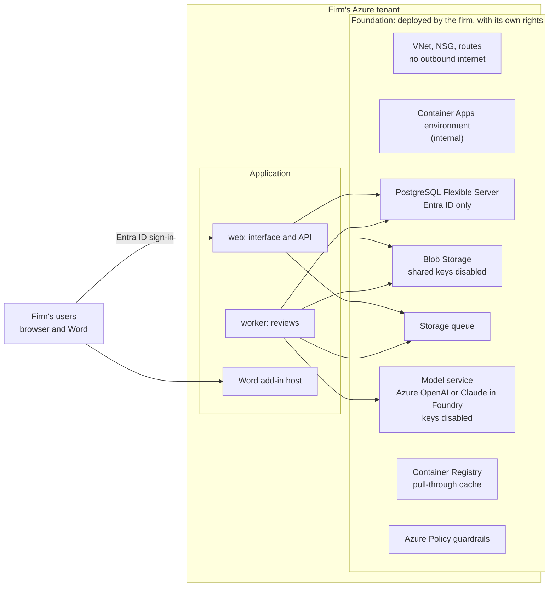

# Clausewise inside a firm's own Azure tenant

Status: design, 8 November 2026. Nothing in this document is built yet. The web app, the
Word add-in and the Azure templates it describes do not exist, as the README says. The
command line is the only part of Clausewise that runs today.

This is the plan for running Clausewise as a web app and a Word add-in inside a firm's own
Azure subscription, so that contracts never leave the firm's tenant except to the model
service the firm chooses, deployed in that same tenant. A firm can deploy and run it itself.
It can also delegate the running of it to a provider (section 7). Either way, everything here
is Apache-2.0 like the rest of Clausewise.

---

## 1. Principles

Clausewise's principles (see the README) carry over unchanged:

- **Self-hosted.** It runs in the firm's subscription. There is no telemetry and no hosted
  service.
- **The model proposes; the code decides.** An edit becomes a tracked change only if the words
  it quotes occur exactly once, as whole words, in the clause it names. Statuses and clause ids
  are checked against the document and the playbook.
- **Contract text is data,** fenced off in the prompt.
- **Not legal advice.**

Running inside Azure adds three more:

- **No stored secrets.** Every component signs in with Entra ID and a managed identity. Key
  access is turned off by Azure Policy.
- **No outbound internet.** The network refuses it. The only service that sees contract text is
  the model service the firm deployed (section 5).
- **The firm owns every permission.** The firm creates the network, the data stores and every
  role assignment with its own rights. A provider, if there is one, cannot change them.

---

## 2. What version 1 does

- **Review an uploaded contract.** Upload a `.docx`, choose a playbook, and get the same three
  results as the command line: the contract with suggestions as Word tracked changes and
  comments, the JSON report, and the readable summary. The findings are also shown in the
  browser.
- **Review in Word.** An add-in reviews the open document against a playbook and writes its
  edits into that document as tracked changes and comments.
- **A playbook library for the firm.** Playbooks are the same YAML files as today, stored in
  the app, checked by the same validation as `clausewise playbook check`, versioned, and editable
  only by the people the firm names.
- **Sign-in and access.** Entra ID sign-in, access by Entra groups, and an audit log of every
  review, download and playbook change, which stays in the tenant.

**Not in version 1:** questions over a set of documents, tabular review, PDF and scanned
contracts, and connectors to document stores.

---

## 3. Architecture

The design splits the firm's Azure tenant into two halves with different owners.

### 3.1 The foundation

The firm deploys the foundation once, from a template in this repository, using its own Owner
rights. It changes only when the firm deploys a newer version of the template.

- **Network.** A VNet with subnets for the Container Apps environment and for private endpoints.
  An NSG and user-defined routes deny outbound internet traffic. Microsoft documents
  user-defined routes and firewall egress for Container Apps environments on workload profiles,
  so the environment uses workload profiles.
- **Container Apps environment,** internal, so it is reachable only from the firm's network.
  Section 3.4 covers how users reach it.
- **Azure Database for PostgreSQL Flexible Server,** with Entra ID authentication only, private
  access and point-in-time restore. It holds playbooks, review records, reports and the audit
  log.
- **Blob Storage** for uploaded contracts and redlined results, with shared-key access disabled,
  a private endpoint, versioning and soft delete.
- **A storage queue** for review jobs, in its own storage account with shared keys disabled.
- **The model service** the firm chooses (section 5), with key access disabled and a private
  endpoint.
- **Azure Container Registry** (Premium, for its private endpoint) with a pull-through cache
  rule for Clausewise's images. The images are public, because Clausewise is open source, so
  the rule needs no credential.
- **Managed identities,** one per application component, each holding only the data roles it
  needs. They sit in the application resource group so that new releases can be attached to
  them. Their role assignments are on foundation resources, and only the firm can change them.
- **The Entra ID app registration** for sign-in, created in the firm's own directory by the same
  template, with Microsoft Graph Bicep (generally available since 29 July 2025).
- **Log Analytics and Application Insights,** inside the tenant.
- **Azure Policy guardrails** (section 7.2).

### 3.2 The application

| Component       | Does                                                                                                                                                |
| --------------- | --------------------------------------------------------------------------------------------------------------------------------------------------- |
| `web`           | The interface and the API. Validates Entra ID tokens, checks access, issues upload URLs, queues reviews, serves results.                            |
| `worker`        | Runs reviews: reads the `.docx`, segments it, checks each rule, anchors edits and writes the redlined result, using the same packages the CLI uses. |
| `addin`         | Static files for the Word add-in. One build serves every firm: its URLs come from configuration at run time, not from the build.                    |
| `migrate` (job) | Database migrations, run before each release.                                                                                                       |

**The review engine is the one the command line already uses.** The worker calls
`@clausewise/docx`, `@clausewise/playbook` and `@clausewise/review` unchanged. What is new in
`@clausewise/llm` is a provider that signs in with a managed identity instead of an API key
(section 5).

**There are no stored secrets.** The web interface is a single-page app that signs in with MSAL
and PKCE, a public-client flow that needs no client secret. The API validates Entra ID tokens.
Every component reaches PostgreSQL, Blob Storage, the queue and the model service with its
managed identity. Uploads go straight to Blob Storage with user delegation SAS tokens, which are
signed with Entra credentials and keep working with shared keys disabled.

### 3.3 Releases

Each release is a set of container images, built from this repository, signed, published with
an SBOM and provenance, and referenced by digest. A firm can verify every image against the
source, or build its own. The firm's registry fetches images through its cache rule as an Azure
service, not through the firm's network.

### 3.4 How users reach it

The Container Apps environment is internal. There are two ways in, chosen when the foundation is
deployed:

- **Firm network only:** VPN, ExpressRoute or the office network. The strictest option. Word on
  the web and the add-in work only while the user is on that network.
- **Public, through Application Gateway with WAF,** deployed in the foundation, with Entra ID
  sign-in in front. Works from anywhere, and costs more.

---

## 4. How a review runs

1. The interface asks the API for an upload URL. The API checks the user's access and returns a
   short-lived user delegation SAS for one blob.
2. The browser uploads the `.docx` straight to Blob Storage, and the API queues a review job.
3. The worker reads the file with the same size and structure limits as the command line,
   splits it into clauses and checks each playbook rule with the model.
4. Each proposed edit is anchored as it is today: it becomes a tracked change only if the quoted
   words occur exactly once, as whole words, in the clause it names. Anything else becomes a
   comment.
5. The worker writes the redlined `.docx` to Blob Storage, and the report and summary to
   PostgreSQL, and records the review in the audit log.
6. The interface shows the findings, worst first, with downloads of all three results.

**In Word,** the add-in sends the open document to the same API and receives the findings and
anchored edits. It writes them into the document as tracked changes and comments, attributed to
the name the firm configures. Whether the add-in applies edits through Word's own tracked-change
API or replaces the document with the reviewed `.docx` is decided in phase 2, by testing
fidelity on real documents (section 9).

**Add-in sign-in.** Microsoft lists nested app authentication for Word as preview on every
platform, and says not to use it in production on a preview platform. Version 1 therefore signs
in through an Office dialog with MSAL, and moves to nested app authentication once Word is
generally available.

---

## 5. Models

Clausewise already supports any model. Inside Azure, the firm chooses between two services, and
the interface names the one in use before every review, as the command line does today.

|                            | Azure OpenAI                                    | Claude in Microsoft Foundry, "Hosted on Azure"                                                                          |
| -------------------------- | ----------------------------------------------- | ----------------------------------------------------------------------------------------------------------------------- |
| Who processes the text     | Microsoft                                       | Anthropic, as seller, operator and independent data processor, under Anthropic's terms                                  |
| Where it is processed      | The Azure region or data zone of the deployment | On Azure infrastructure: Microsoft says prompts and outputs never leave Azure. Global or US Data Zone deployments only. |
| Keyless sign-in            | Yes, with Entra ID                              | **Not yet confirmed.** Required, because the guardrails deny key access (section 7.2).                                  |
| Private endpoint           | Yes                                             | **Not yet confirmed**                                                                                                   |
| Subscriptions not eligible | None known                                      | Free trial, student, credit-based, Cloud Solution Provider (CSP), and enterprise accounts in South Korea                |

Foundry also offers Claude "Hosted on Anthropic infrastructure", where Microsoft says data might
be processed outside Azure. Clausewise inside a firm's tenant does not use that option.

Firms should read their chosen provider's data, retention and abuse-monitoring terms with their
own counsel.

**What changes in `@clausewise/llm`:** a provider that obtains Entra ID tokens from the
component's managed identity, for Azure OpenAI first, and for Claude in Foundry once keyless
sign-in is confirmed. The command line keeps its existing providers.

---

## 6. What leaves the tenant

| Leaves the firm's tenant                                                                         | Never leaves it                                   |
| ------------------------------------------------------------------------------------------------ | ------------------------------------------------- |
| Contract text, to the model service the firm deployed, under that service's terms (section 5)    | Contracts and results at rest, reports, audit log |
| With delegated management only: resource metadata and health status, to the provider (section 7) | Playbooks                                         |
|                                                                                                  | Application logs and traces                       |

Application logs and traces stay in the firm's Application Insights, with contract text
redacted at the source.

---

## 7. Optional: delegated management

A firm that wants someone else to run upgrades, monitor health and handle releases can delegate
the **application** resource group, and only that group, to a provider through Azure Lighthouse.
Without a delegation, the firm runs everything itself from the same templates.

### 7.1 The provider's roles

Lighthouse allows built-in roles only. It rules out Owner, any role with data actions, and any
`Microsoft.Authorization` write. The delegation holds only these, each checked against
Microsoft's built-in role reference and none with data actions:

| Role                                                 | Why                                                                                                    |
| ---------------------------------------------------- | ------------------------------------------------------------------------------------------------------ |
| Container Apps Contributor                           | Deploy new revisions into the existing environment. It can join the environment but cannot change it.  |
| Container Apps Jobs Contributor                      | Define and start the `migrate` job.                                                                    |
| Managed Identity Operator                            | Attach the application's existing identities to new revisions. It can read and assign identities only. |
| Reader                                               | Revision health, metrics and deployment status.                                                        |
| Managed Services Registration Assignment Delete Role | Lets the provider withdraw its own delegation.                                                         |

**Deliberately not held:**

- **Container Apps Operator and Container Apps Jobs Operator.** Both carry the `exec` and
  `logstream` data actions, so Lighthouse cannot delegate them. A provider cannot open a shell
  in a container or stream its logs.
- **Managed Identity Contributor.** It can add federated credentials to an identity, which
  would let an outside party obtain the application's tokens.

The network, the data stores, the model service, the registry and every role assignment are in
the foundation, and the provider holds no role on them.

### 7.2 Guardrails the provider cannot undo

The firm assigns these in the foundation. Lighthouse prevents a delegated identity from changing
policy assignments.

| Guardrail                                                     | Policy                                                                               |
| ------------------------------------------------------------- | ------------------------------------------------------------------------------------ |
| No key access to the model service                            | Built-in "Azure AI Services resources should have key access disabled", set to Deny  |
| No shared-key access to storage                               | Built-in, set to Deny                                                                |
| PostgreSQL accepts only Entra ID sign-in                      | The built-in is preview and audit-only, so the foundation ships a custom Deny policy |
| Only Clausewise's signed images, from the firm's own registry | A custom policy that admits images only from that registry, referenced by digest     |

So no identity of the provider's can read a contract, a database row or a model exchange through
Azure. Lighthouse gives it no data actions, keys cannot be used, and the database accepts only
Entra identities that the provider does not hold.

### 7.3 What remains

The application's own identity can read everything the application stores, and a release is
code that runs as that identity. Four things keep that risk small and visible:

- **No outbound path.** The network denies internet egress, and the provider holds no role on
  the network.
- **Open source releases.** Every image is built from this public repository, signed and pinned
  by digest, so the firm can see exactly what it runs.
- **Release approval.** A firm can require its own approval of each release digest.
- **Audit.** Every action of the provider's identity appears in the firm's Azure Activity Log,
  and the firm can remove the delegation at any time from the Azure portal. Clausewise keeps
  running when it does.

---

## 8. Operating it

- **Upgrades** are new Container Apps revisions with new image digests. Migrations follow
  expand-then-contract, so the old and new revisions both work during a rollout. Traffic moves
  only after health checks pass, and rolling back moves it back.
- **Model changes** are gated by the evaluation harness in `evals/`: no environment changes its
  model or model version until the harness has run against that model on the fixtures and the
  results have been reviewed.
- **Backups:** PostgreSQL point-in-time restore, and Blob versioning and soft delete. A restore
  drill each quarter into a scratch resource group in the firm's subscription.
- **Monitoring** happens inside the tenant. With delegated management, the provider reads
  revision health and metrics through Azure Resource Manager, which is metadata only.
- **Leaving:** export the playbooks, reviews and results, then delete the resource groups.

---

## 9. Phases

| Phase                 | Work                                                                                                                             | Done when                                                                                                                                                                                                                                                                                                                       |
| --------------------- | -------------------------------------------------------------------------------------------------------------------------------- | ------------------------------------------------------------------------------------------------------------------------------------------------------------------------------------------------------------------------------------------------------------------------------------------------------------------------------- |
| 1. Thin slice         | The foundation template, `web` and `worker`, and the managed-identity provider for Azure OpenAI.                                 | With the scripted test model, every fixture contract reviewed through the web app gives the same report as the command line. With a live model, the evaluation harness scores the web app as it scores the command line. A scan finds no secret anywhere in the deployment. A test proves the worker cannot reach the internet. |
| 2. Word and playbooks | The Word add-in, the playbook library, the audit log, and the choice between Word's tracked-change API and a `.docx` round trip. | With the scripted test model, the add-in's tracked changes match the command line's redlines on every fixture, checked in Word itself.                                                                                                                                                                                          |
| 3. Delegation         | The Lighthouse delegation template and the custom policies, as an option on the foundation.                                      | A test deployment in a second tenant shows every delegated action in that tenant's Activity Log, and removing the delegation leaves Clausewise running.                                                                                                                                                                         |
| 4. Claude in Foundry  | The keyless provider for Claude, once Microsoft confirms keyless sign-in and private endpoints.                                  | The same tests as phase 1 pass with Claude.                                                                                                                                                                                                                                                                                     |

---

## 10. Open questions

1. **Claude in Foundry:** keyless sign-in with Entra ID, and private endpoints.
2. **Digest pulls through the registry cache rule,** and whether the registry's network rules
   must let trusted Azure services through for the cache to store anything. One Microsoft Q&A
   report says they must.
3. **Managed Identity Operator:** whether updating a revision that references user-assigned
   identities needs anything more. Test it in phase 1.
4. **Tracked changes in the add-in:** Word's API or a `.docx` round trip (section 4).

---

## Sources

- Microsoft Learn, "Compare hosting options for Claude models in Microsoft Foundry" (updated 21
  September 2026):
  <https://learn.microsoft.com/en-us/azure/foundry/foundry-models/concepts/claude-models-hosting-comparison>
- Microsoft Learn, "Tenants, users, and roles in Azure Lighthouse scenarios" (updated 6 April
  2026): <https://learn.microsoft.com/en-us/azure/lighthouse/concepts/tenants-users-roles>
- Microsoft Learn, Azure built-in roles for Containers
  (<https://learn.microsoft.com/en-us/azure/role-based-access-control/built-in-roles/containers>)
  and for Identity
  (<https://learn.microsoft.com/en-us/azure/role-based-access-control/built-in-roles/identity>),
  both updated 1 July 2026
- Microsoft Learn, Azure Container Registry artifact cache:
  <https://learn.microsoft.com/en-us/azure/container-registry/artifact-cache-overview>
- Microsoft Learn, "Firewall integration" for Container Apps:
  <https://learn.microsoft.com/en-us/azure/container-apps/firewall-integration>
- Microsoft Learn, "Enable nested app authentication in your add-in":
  <https://learn.microsoft.com/office/dev/add-ins/develop/enable-nested-app-authentication-in-your-add-in>
- Microsoft Entra developer blog, "Bicep templates for Microsoft Entra ID resources is GA":
  <https://devblogs.microsoft.com/identity/bicep-templates-for-microsoft-entra-id-resources-is-ga/>
- Azure Policy built-ins: AI Services key access
  (<https://github.com/Azure/azure-policy/blob/master/built-in-policies/policyDefinitions/Azure%20Ai%20Services/DisableLocalAuth_Audit.json>)
  and PostgreSQL flexible server Entra-only authentication
  (<https://github.com/Azure/azure-policy/blob/master/built-in-policies/policyDefinitions/SQL/PostgreSQL_FlexibleServers_EnableEntraOnlyAuthentication_Audit.json>)
