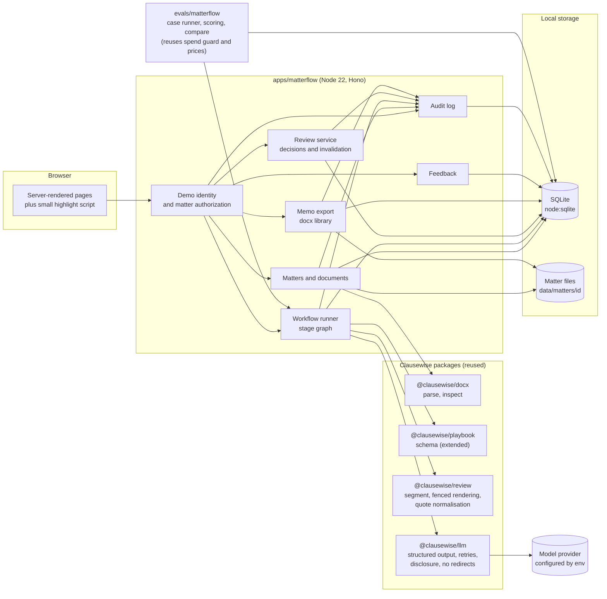
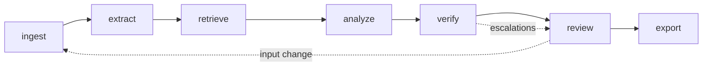
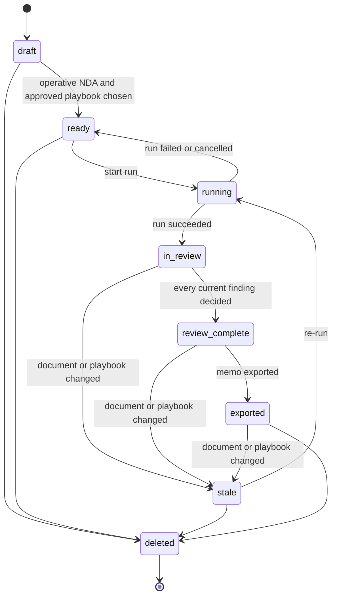
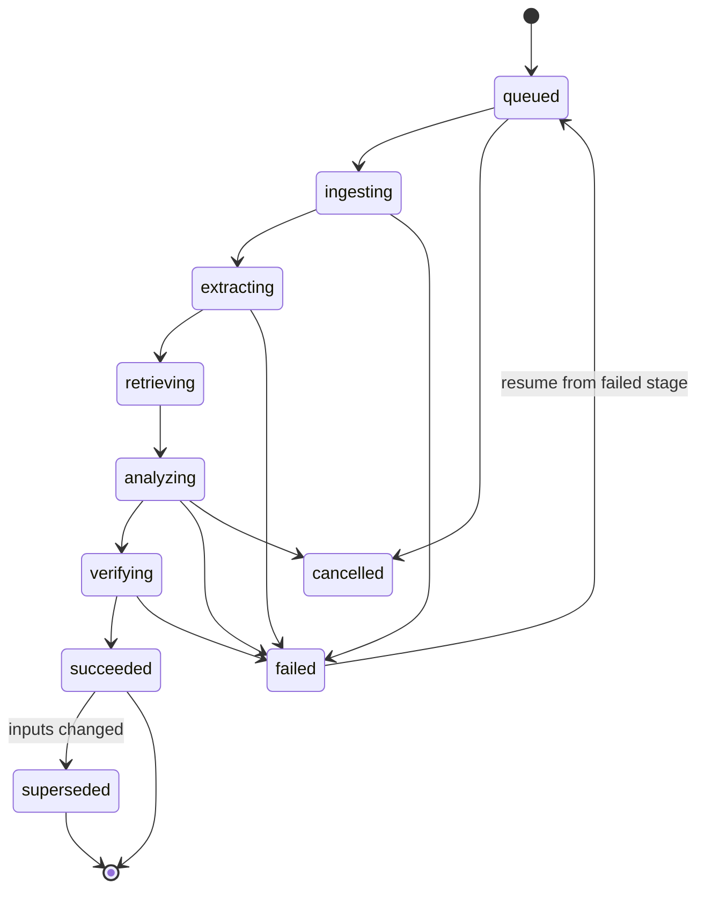
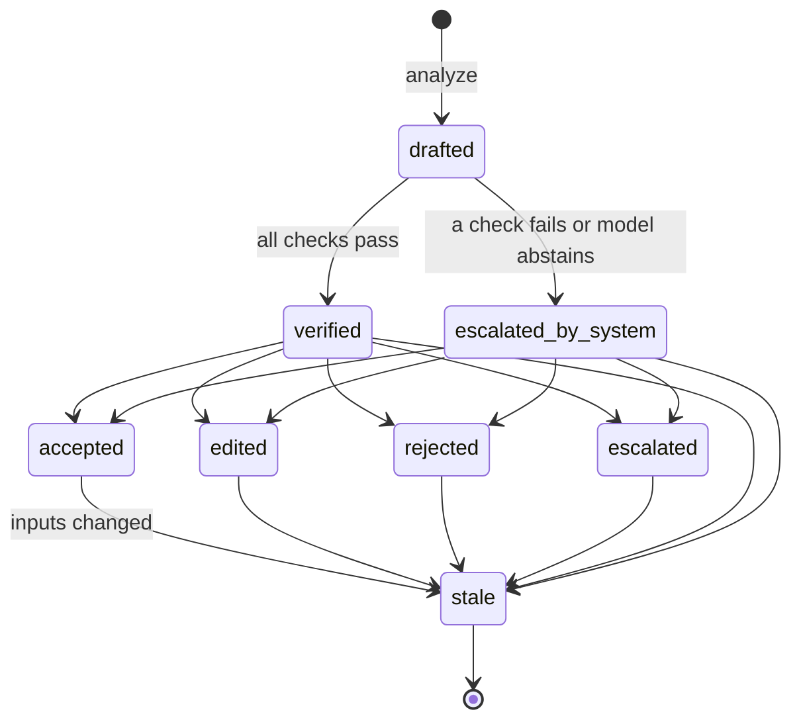

# 2. Experience and architecture

## User journey

One matter, from intake to memo. "System" lines are what MatterFlow does; everything else is a
person.

| #   | Who                | Action                                                                                | System                                                                                                  | Matter state |
| --- | ------------------ | ------------------------------------------------------------------------------------- | ------------------------------------------------------------------------------------------------------- | ------------ |
| 1   | Associate          | Creates matter "Lanternfish / Corvane NDA", names the client entity, adds a reviewer  | Creates the matter, grants membership, writes an audit event                                            | `draft`      |
| 2   | Associate          | Uploads the NDA (DOCX) and Amendment No. 1 (TXT), marks the NDA operative             | Hashes each file, parses paragraphs into source spans, warns about duplicates and instruction-like text | `draft`      |
| 3   | Associate          | Selects playbook "MF NDA (Recipient)" version 1.0.0                                   | Checks the version is approved; the matter is ready                                                     | `ready`      |
| 4   | Associate          | Starts a run                                                                          | Pins documents, playbook, workflow and model; runs ingest, extract, retrieve, analyze, verify           | `running`    |
| 5   | Associate          | Opens the issue table; triages; adds notes for the reviewer                           | Shows eight findings with statuses, escalations and evidence links                                      | `in_review`  |
| 6   | Reviewing attorney | Opens each finding's evidence; accepts, edits, rejects or escalates                   | Records each decision against the exact finding content it saw                                          | `in_review`  |
| 7   | Associate          | Uploads a corrected amendment (new version)                                           | Marks the run's findings and reviews stale, blocks export, offers a re-run                              | `stale`      |
| 8   | Associate          | Re-runs; reviewer re-decides the changed findings                                     | New run pinned to the new manifest                                                                      | `in_review`  |
| 9   | Reviewing attorney | Exports the memo                                                                      | Checks every current finding has a current decision, builds the DOCX with a provenance appendix         | `exported`   |
| 10  | Both               | Leave feedback on findings and a one-question rating                                  | Stores feedback with the run and workflow version                                                       | `exported`   |
| 11  | Legal engineer     | Reviews corrections across matters; runs the evaluation suite on a candidate revision | Compares versions on dev and held-out sets with pinned inputs; drafts a promotion record                | n/a          |

## Screen sketches

Server-rendered pages with a little JavaScript for highlighting. A permanent banner reads
"DEMO: synthetic documents, demo identity, not for client work".

### S1. Matter intake

```text
+-----------------------------------------------------------------------------------------+
| DEMO: synthetic documents, demo identity, not for client work       Signed in as: A. Ruiz|
+-----------------------------------------------------------------------------------------+
| New matter                                                                              |
|   Matter name     [ Lanternfish / Corvane NDA                ]                          |
|   Our client      [ Lanternfish Software, Inc.               ]  (exact legal name)      |
|   Reviewer        [ D. Whitfield (reviewing attorney)     v ]                           |
|                                                                                         |
| Documents                                                     Operative   Kind          |
|   1  Mutual NDA.docx      14 KB  sha 3f2a91..  38 paragraphs     (o)       NDA          |
|   2  Amendment 1.txt       2 KB  sha 9c04e1..   7 paragraphs     ( )       Amendment    |
|      ! Paragraph 22 of Mutual NDA reads like an instruction to software. It will be     |
|        treated as document text only.                                   [view]          |
|   [ + Add DOCX or TXT ]                                                                 |
|                                                                                         |
| Playbook   [ MF NDA (Recipient)  v1.0.0  approved 2026-10-28  v ]   [ view rules ]      |
|                                                                                         |
| Text will be sent to: Anthropic API (api.anthropic.com)                                 |
|                                                      [ Save draft ]  [ Start review ]   |
+-----------------------------------------------------------------------------------------+
```

### S2. Issue table with evidence inspector

The table is the primary view. Selecting a row opens the document pane at the cited passage.

```text
+------------------------------------------------+----------------------------------------+
| Issues  run r_0142  workflow v2  playbook 1.0.0 | Evidence: DUR-1                        |
| [All 8] [Open 5] [Escalated 2] [Stale 0]       |                                        |
+----+----------------+-----------+---------+----+ Amendment No. 1 (v1)  para 3  Sec. 2   |
| Sev| Category       | Status    | Review  | Esc| > "[Section 6.1 of the Agreement is    |
+----+----------------+-----------+---------+----+   deleted in its entirety]."           |
| H  | Duration       | Deviation | --      |    |                            GOVERNING   |
|    | DUR-1          |           |         |    | Mutual NDA (v1)  para 19  Sec. 6.1     |
| H  | Exclusions     | Compliant | Accepted|    | > "The obligations of each Receiving   |
| M  | Governing law  | Undeterm. | --      | CS |   Party under Section 4 [shall continue|
| M  | Parties        | Compliant | --      |    |   for two (2) years from the date of   |
| M  | Definition     | Deviation | Edited  |    |   each disclosure] ..."     SUPERSEDED |
| M  | Permitted (rep)| Compliant | --      |    | Mutual NDA (v1)  para 29  Sec. 9.3     |
| M  | Permitted (law)| Missing   | --      |    | > "[Sections 4, 5 and 8 survive any    |
| L  | Return/destroy | N/A       | --      |    |   termination or expiration of this    |
+----+----------------+-----------+---------+----+   Agreement]."             SUPPORTING  |
| CS = conflicting sources                       |                                        |
| Warnings: 1 instruction-like paragraph (NDA 22)| Checks                                 |
|                                                |  [ok] quotes found verbatim (2 of 2)   |
|                                                |  [ok] support check: supported         |
|                                                |  [ok] numbers match cited text         |
|                                                |  [i] amendment span retrieved by its   |
|                                                |      cross-reference to Section 6.1    |
+------------------------------------------------+----------------------------------------+
```

The statuses in the left pane are illustrative and mix situations from several evaluation cases;
the evidence pane is the worked example in [document 4](04-worked-example.md).

### S3. Review decision

```text
+-----------------------------------------------------------------------------------------+
| DUR-1  Confidentiality duration                     Severity: high   Status: Deviation  |
+-----------------------------------------------------------------------------------------+
| Playbook rule (v1.0.0)                                                                  |
|   Standard:     Obligations end 3 years or less after disclosure. Trade secret carve-out|
|                 acceptable.                                                             |
|   Fallback:     5 years or less after the agreement ends.                               |
|   Unacceptable: No stated end for information that is not a trade secret.              |
|                                                                                         |
| Discrepancy  [ Amendment No. 1 deletes Section 6.1, the only time limit on the Section ]|
|              [ 4 obligations, and Section 9.3 keeps Section 4 in force after           ]|
|              [ termination. No stated end for information that is not a trade secret.  ]|
| Fallback     [ 6.1 The obligations of each Receiving Party under Section 4 shall       ]|
| language     [ continue for two (2) years from the date of each disclosure ...         ]|
|              Approved text from playbook: [show]   Changes from approved text: [diff]   |
|                                                                                         |
| Decision   ( ) Accept  (o) Edit  ( ) Reject  ( ) Escalate                               |
| Reason     [ The parties agreed two years in February. Propose reinstating it.        ]|
|                                                                                         |
| You are deciding finding f_0917 as shown (content hash 51be..). If the documents or     |
| playbook change, this decision becomes stale.                    [ Save decision ]      |
+-----------------------------------------------------------------------------------------+
```

### S4. Evaluation comparison

```text
+-----------------------------------------------------------------------------------------+
| Compare workflow versions                    Dataset mf-cases v1 (sha 0be1..)  k = 3    |
|   Baseline  v1  (prompts P1, retrieval R1)   Candidate v2 (prompts P1, retrieval R2)    |
|   Pinned: playbook 1.0.0, model <id>, prices sha 77c2..                                 |
+-----------------------------------------------------------------------------------------+
| Split: [dev] [held-out]                                                                 |
|                                   Baseline        Candidate       Gate      Pass?       |
|   Strict issue recall             __ / __          __ / __         >= 0.90   __         |
|   Issue precision                 __ / __          __ / __         >= 0.80   __         |
|   High-severity silent misses     __               __              0         __         |
|   Substantive support             __ / __          __ / __         >= 0.95   __         |
|   Required escalations raised     __ / __          __ / __         all       __         |
|   Unnecessary escalations         __ / __          __ / __         <= 0.15   __         |
|   Severity-weighted failure       __               __              <= 0.05   __         |
|   p95 run latency                 __ s             __ s            budget    __         |
|   Mean cost per run               $__              $__             budget    __         |
|   Unauthorized exposure           __               __              0         __         |
+-----------------------------------------------------------------------------------------+
| Slots that changed (paired, modal status)                                               |
|   MF-D05 dur-1   expected deviation   baseline: compliant x3   candidate: __            |
|   ...                                                            [ open evidence ]      |
| [ Draft promotion record ]                                                              |
+-----------------------------------------------------------------------------------------+
```

The blanks are deliberate: no run has happened.

## Architecture



Every request passes the authorization layer before it can reach a service that reads matter data,
calls a model or writes a file. The evaluation runner calls the same workflow runner with
synthetic matters, so what is measured is what the application does.

## Stage graph



| Stage    | Kind                              | Input                                     | Output                                                                   | Model? |
| -------- | --------------------------------- | ----------------------------------------- | ------------------------------------------------------------------------ | ------ |
| ingest   | deterministic                     | Document versions in the run manifest     | Source spans with stable ids; warnings; defined terms; cross-references  | No     |
| extract  | model plus rules                  | Source spans of all operative documents   | For each category, located spans with verified quotes, or "not found"    | Yes    |
| retrieve | deterministic                     | Located spans, playbook version, category | One context bundle per rule: rule text, approved fallback, bounded spans | No     |
| analyze  | model                             | One context bundle                        | Draft finding: status, evidence quotes with roles, discrepancy, fallback | Yes    |
| verify   | deterministic, then a model check | Draft finding and the spans it cites      | Verified finding, or a finding with escalation reasons                   | Partly |
| review   | human                             | Verified findings                         | Decisions bound to finding content hashes                                | No     |
| export   | deterministic                     | Current findings with current decisions   | DOCX memo with provenance appendix                                       | No     |

Contracts for each stage are in [document 3](03-data-model-and-contracts.md#stage-contracts).

## State machines

### Matter



`review_complete` returns to `in_review` if a reviewer reopens a decision. An exported memo stays
on record after a matter goes stale, marked as superseded.

### Run



A rule whose model call fails after bounded retries does not fail the run: it produces an
`undetermined` finding with the escalation `output_invalid`. A run fails only when a stage cannot
produce any output (for example a provider that rejects the key, or a corrupt file).

### Finding and review



`escalated` is a reviewer decision (send to a partner, leave open in the memo). `escalated_by_system`
is the verify stage saying it cannot stand behind the finding; a reviewer still decides it.

## Stack decision

**Recommendation: TypeScript on Node 22, inside the Clausewise monorepo, with SQLite through
`node:sqlite`, Hono for routing and server-rendered JSX, and the `docx` library for the memo.**

Why not a new Python application, which the request allows: the repository already contains the
hard, tested parts in TypeScript (Word parsing with size and structure limits, clause segmentation
with typed numbering, fenced rendering of untrusted text, quote normalisation, a model layer that
refuses redirects, ignores ambient headers and retries schema failures a bounded number of times,
and an evaluation harness with a spend guard). Rewriting them in Python would cost most of the two
weeks and lose their tests. A second language would also split the evaluation harness from the
code it measures.

| Dependency               | New?                                       | Why it earns its place                                                                                                                                                                      | Alternative considered                                                               |
| ------------------------ | ------------------------------------------ | ------------------------------------------------------------------------------------------------------------------------------------------------------------------------------------------- | ------------------------------------------------------------------------------------ |
| `@clausewise/*` packages | No                                         | Parsing, segmentation, playbook schema, model access, quote normalisation                                                                                                                   | Reimplementing: weeks of work, untested                                              |
| `zod`                    | No                                         | Already the schema library for model output and playbooks                                                                                                                                   | n/a                                                                                  |
| `node:sqlite`            | No (built in)                              | One file, no native build, transactions, enough for one machine. Available in Node 22 without a flag; it prints an experimental warning, so the store sits behind a small repository module | `better-sqlite3`: mature but a native module; swap in if `node:sqlite` changes shape |
| `hono`                   | Yes                                        | Small router with no runtime dependencies; its JSX escapes text by default, which matters when every page shows untrusted document text                                                     | Node's `http` plus hand-written escaping: easy to get one page wrong                 |
| `docx`                   | No (already a dev dependency for fixtures) | Generates the memo as a real Word document with tables and headings                                                                                                                         | Writing OOXML by hand with `@clausewise/docx` internals: possible, more code         |
| Front-end framework      | None                                       | Pages are forms and tables. About 200 lines of plain JavaScript scroll to and highlight a span                                                                                              | React or htmx: a build step or another dependency for little gain                    |
| ORM                      | None                                       | Plain SQL migrations in numbered files; a dozen tables                                                                                                                                      | Drizzle or Prisma: more surface than the schema needs                                |

Complexity budget: one process, one database file, one folder of matter files, no queue (runs
execute in the server process with a concurrency limit; a run's stage outputs are persisted, so a
restart resumes rather than repeats), no background services.

### Repository layout

```text
apps/matterflow/
  src/
    server/        routes, demo identity, authorization middleware, pages (Hono JSX)
    stages/        ingest, extract, retrieve, analyze, verify (pure functions plus a runner)
    store/         SQLite repository, migrations runner, file store
    export/        memo builder
    prompts/       prompt templates, each with an id; hashes computed at load
  migrations/      001_init.sql, ...
  public/          highlight.js, styles.css
  test/            vitest, scripted generators only, never a real model
playbooks/
  mf-nda-recipient.yaml        the fictional demo playbook, version 1.0.0
fixtures/matterflow/
  cases.ts                     synthetic documents and answer keys, one entry per case
  (generated .docx and .txt files and answer-keys.json)
evals/matterflow/
  run.ts, score.ts, compare.ts reuses evals/src prices, budget guard, usage
docs/matterflow/               these documents
```

Small, tested changes to existing packages that MatterFlow needs:

1. `@clausewise/playbook`: optional `version`, `category`, `fallbackLanguage` and `escalateWhen`
   fields. Optional, so `nda-mutual.yaml` and `saas-customer.yaml` still validate unchanged.
2. `@clausewise/review`: export the pure helpers MatterFlow reuses (status settlement for required
   and absence rules, clause reference resolution) instead of copying them.
3. A TXT reader that produces the same paragraph shape as `parseDocx`, so `segment` works on both.
