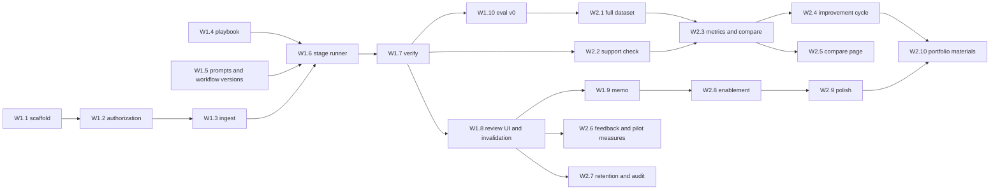

# 7. Delivery plan

Two weeks for one engineer. Estimates are focused hours: about 35 planned hours in each 40-hour
week, leaving 5 to 6 hours of buffer. Every item ends with the repository's own checks passing (`pnpm lint && pnpm typecheck &&
pnpm test`), with tests that use scripted models only, as `CONTRIBUTING.md` requires. Live model
calls happen only in the evaluation runner, behind the existing spend guard.

**Week one** delivers the MVP: one matter end to end (intake, run, evidence, decisions,
invalidation, memo) and a first baseline on part of the dev set. **Week two** delivers the
distinctive part: the full dataset, the full metrics, the controlled improvement cycle with a
held-out comparison, and the pilot and portfolio materials.

## Dependencies

## Week one: MVP

| Item  | Work                                                                                                                                                                                                              | Depends on       |  Hours | Acceptance criteria                                                                                                                                                                                                                              |
| ----- | ----------------------------------------------------------------------------------------------------------------------------------------------------------------------------------------------------------------- | ---------------- | -----: | ------------------------------------------------------------------------------------------------------------------------------------------------------------------------------------------------------------------------------------------------ |
| W1.1  | Scaffold `apps/matterflow`: Hono server, `node:sqlite` repository, numbered SQL migrations, demo identity, CSRF tokens, strict CSP, the demo banner                                                               | none             |      3 | `pnpm matterflow` serves on 127.0.0.1; refuses another address with demo identity on; migrations create the schema from empty; root checks pass                                                                                                  |
| W1.2  | Authorization middleware, `AuthorizedMatter` branded type, the route-coverage test, the first probe matrix                                                                                                        | W1.1             |      3 | Every probe returns its expected status; removing the middleware from any one route makes the coverage test fail (checked by doing it once)                                                                                                      |
| W1.3  | Matters, documents and versions; upload of DOCX (`parseDocx`) and TXT (new reader producing the same paragraph shape); file and text hashes; duplicate warnings; spans; annotations                               | W1.2             |      5 | Spans of a DOCX and an equivalent TXT segment identically; identical re-upload gives `duplicate_document` and stores nothing; "Section 6.1 of the Agreement is deleted" yields a `cross_reference` (6.1, deletes); a corrupt file stores nothing |
| W1.4  | Optional `version`, `category`, `fallbackLanguage`, `escalateWhen` in `@clausewise/playbook`; `playbooks/mf-nda-recipient.yaml`; import and approve; immutability trigger                                         | none             |    2.5 | The shipped playbooks still pass `shipped.test`; the demo playbook validates; updating an approved version's YAML fails at the database                                                                                                          |
| W1.5  | Prompt registry with hashes; workflow version v1 manifest (prompts P1, retrieval R1, checks C1); export the pure helpers MatterFlow reuses from `@clausewise/review`                                              | none             |      2 | Changing one character of a prompt changes the workflow version hash; the review package's tests still pass                                                                                                                                      |
| W1.6  | Stage runner; ingest, extract, retrieve (R1) and analyze stages; per-unit persistence by input hash; resume; bounded semantic repair                                                                              | W1.3, W1.4, W1.5 |      5 | A scripted run produces eight findings; a run interrupted after three rules resumes and makes calls only for the other five; an unknown span label triggers one repair, then `output_invalid`                                                    |
| W1.7  | Verify, deterministic checks: `quote_exists`, `span_in_bundle`, `citation_shape`, numeric and jurisdiction consistency, client name, missing confirmation, precedence labels, `escalateWhen` ids, fallback basis  | W1.6             |    3.5 | One unit test per check, passing and failing; a test reproduces the `MF-D05` v1 trail and shows every check passing, recording the known gap; an unfound quote is struck through and raises `quote_not_verified`                                 |
| W1.8  | Issue table, evidence inspector, decision form; invalidation on any input change; export gate                                                                                                                     | W1.6, W1.7       |    4.5 | All eight findings can be decided; a new amendment version marks every finding and decision stale and blocks export; a decision with an old content hash gets 409                                                                                |
| W1.9  | Memo export with the `docx` library: summary table, sections, open items, rejected appendix, provenance; quotes re-verified at export                                                                             | W1.8             |      3 | The memo contains every decided finding with locations; export with one undecided finding is refused; the file opens in LibreOffice where available (as the Clausewise tests do)                                                                 |
| W1.10 | Evaluation v0: case format and builder with anchor checks; six dev cases (D01, D03, D05, D06, D08, D12); status, flag and citation metrics; a scripted oracle selftest; first live baseline if a key is available | W1.7             |    3.5 | `pnpm eval:matterflow --selftest` shows a perfect score and fails if one answer key is altered; the live plan prints a cost bound before any call                                                                                                |
|       | **Week one total**                                                                                                                                                                                                |                  | **35** |                                                                                                                                                                                                                                                  |

**End of week one:** a reviewer can take the worked-example matter from upload to memo, and the
first baseline numbers on six cases exist (or, without a key, the selftest proves the plumbing and
the write-up says no live run happened).

## Week two: the evaluation cycle and polish

| Item  | Work                                                                                                                                                                                                                 | Depends on |  Hours | Acceptance criteria                                                                                                                                                |
| ----- | -------------------------------------------------------------------------------------------------------------------------------------------------------------------------------------------------------------------- | ---------- | -----: | ------------------------------------------------------------------------------------------------------------------------------------------------------------------ |
| W2.1  | Remaining 8 dev and 12 held-out cases; canary matters; injection twins; builder prints totals and split hashes; held-out hash committed                                                                              | W1.10      |      6 | The builder's totals match [document 5](05-evaluation.md#totals); every anchor resolves once; the held-out hash is in a commit dated before the first baseline     |
| W2.2  | Support check call with its own prompt and isolated context; the 40-pair calibration set; checker metrics                                                                                                            | W1.7       |    3.5 | The checker sees only the cited spans (asserted on the prompt in a test); calibration metrics are computed and reported, whatever they are                         |
| W2.3  | Full metrics and report: extraction, strict and lenient, SWF, abstention, injection effect, stability, latency, cost (existing usage and price modules), Wilson intervals; pin-checking `compare`; record and replay | W2.1, W2.2 |      5 | Metrics match hand-computed values on a three-case fixture; `compare` refuses runs that differ in an undeclared pin; a replay re-scores without network access     |
| W2.4  | The improvement cycle: dev baseline (k = 3), failure analysis, R2 (or the observed top failure's fix), dev re-run, held-out runs, promotion record                                                                   | W2.3       |      5 | `EXP-001.md` holds the pre-registration, measured tables, the failure record and a recommendation that follows the decision rule, including if H1 is not confirmed |
| W2.5  | Evaluation comparison page (S4)                                                                                                                                                                                      | W2.3       |    2.5 | Shows both versions, every gate, the paired changed slots, and links each to its evidence trail                                                                    |
| W2.6  | Feedback on findings (reason codes, missed issue), post-matter rating, pilot measures page and CSV export                                                                                                            | W1.8       |      3 | Every measure in [document 8](08-pilot-and-enablement.md#measures) is computed from stored events, with its denominator shown                                      |
| W2.7  | Retention job, matter deletion, audit hash-chain verification command                                                                                                                                                | W1.8       |      2 | After deletion no row or file of the matter remains (test scans tables and the folder); altering one audit row makes verification fail                             |
| W2.8  | Seeded training matter, quickstart page, in-app help                                                                                                                                                                 | W1.9       |      2 | A new user can complete the training exercise from the quickstart alone (checked by walking through it)                                                            |
| W2.9  | Polish: keyboard navigation in the table and inspector, contrast, error and empty states, README section, demo seed script                                                                                           | W2.8       |      3 | Every action is reachable by keyboard; every error state has a message that says what to do; `pnpm matterflow:seed` builds the demo matters                        |
| W2.10 | Portfolio materials: two-minute recording, one-pager, postmortem draft with the measured numbers                                                                                                                     | W2.4, W2.9 |      2 | Every number in the one-pager traces to a results file; claims say whether they rest on the answer keys or on qualified review                                     |
|       | **Week two total**                                                                                                                                                                                                   |            | **34** |                                                                                                                                                                    |

## Spend

Live evaluation runs use the Clausewise spend guard: the plan is printed first, nothing is sent
without `--yes`, and a per-request cap holds the run to `--max-cost`. For scale, the Clausewise
README's bound for one of its NDA fixtures is about 46,000 to 49,000 input tokens for 10 calls.
MatterFlow makes roughly 15 calls per case (one extract, eight analyze, up to eight support checks,
fewer when a rule needs none), so expect the same order of magnitude per case, multiplied by about
one and a half. That is an estimate from someone else's bound, not a measurement: run one case first
and read its usage table before running a split.

## Scope cuts, in order

If the plan slips, cut from the top. Each cut says what is lost so the write-up can say it too.

| #   | Cut                                                                   | What is lost                                                            |
| --- | --------------------------------------------------------------------- | ----------------------------------------------------------------------- |
| 1   | Comparison page (W2.5); keep the Markdown report                      | A visual; the numbers remain                                            |
| 2   | Rule-level carry-forward of findings on playbook change               | Convenience only; full invalidation stays                               |
| 3   | Pilot measures page (W2.6); keep feedback capture and a CSV script    | A dashboard; the measures remain computable                             |
| 4   | Model support check (W2.2); keep the deterministic consistency checks | The independent substantive check; G5 and G11 reported as not evaluated |
| 5   | Held-out set from 12 to 8 cases                                       | Statistical power; the report states the smaller denominators           |
| 6   | Held-out repeats from 3 to 2                                          | Stability evidence; never below 2                                       |

**Never cut:** authorization and its probe tests, quote verification, the export gate,
invalidation, the separation of dev and held-out sets, pinning, and honest reporting of whatever the
runs show.

## Risks

| Risk                                                            | Effect                                    | Response                                                                                                     |
| --------------------------------------------------------------- | ----------------------------------------- | ------------------------------------------------------------------------------------------------------------ |
| No API key or budget                                            | The improvement cycle has no real numbers | Ship the selftest and the protocol; say plainly that no live run happened                                    |
| H1 does not reproduce                                           | The planned story changes                 | The protocol picks the top observed failure; report H1 as not confirmed                                      |
| Writing 26 good synthetic cases takes longer                    | W2.1 overruns                             | Case templates per phenomenon; cut 5 if needed                                                               |
| `node:sqlite` changes behaviour (it is experimental)            | Store breaks on a Node update             | The repository module isolates it; `better-sqlite3` is the fallback; pin the Node minor in CI                |
| A model returns valid quotes that the anchor normaliser rejects | Many false `quote_not_verified`           | The metric separates model citation validity from displayed validity; inspect before changing the normaliser |
| Word unavailable to check the memo                              | Formatting surprises                      | LibreOffice check, as Clausewise does; state the limit                                                       |

## Definition of done

- The worked example runs end to end in the app, and the memo exports.
- `EXP-001.md` contains pre-registered hypotheses, measured tables for both versions on dev and
  held-out, the failure record, and a recommendation that follows the decision rule.
- All gates are reported with counts, intervals and pass or fail, including failures.
- The README says what was measured, on what, and what was not.
