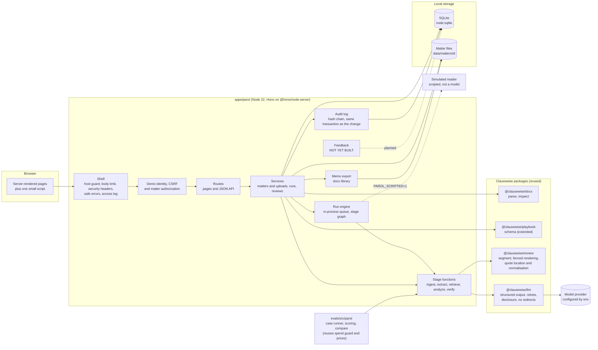
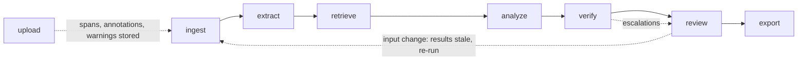
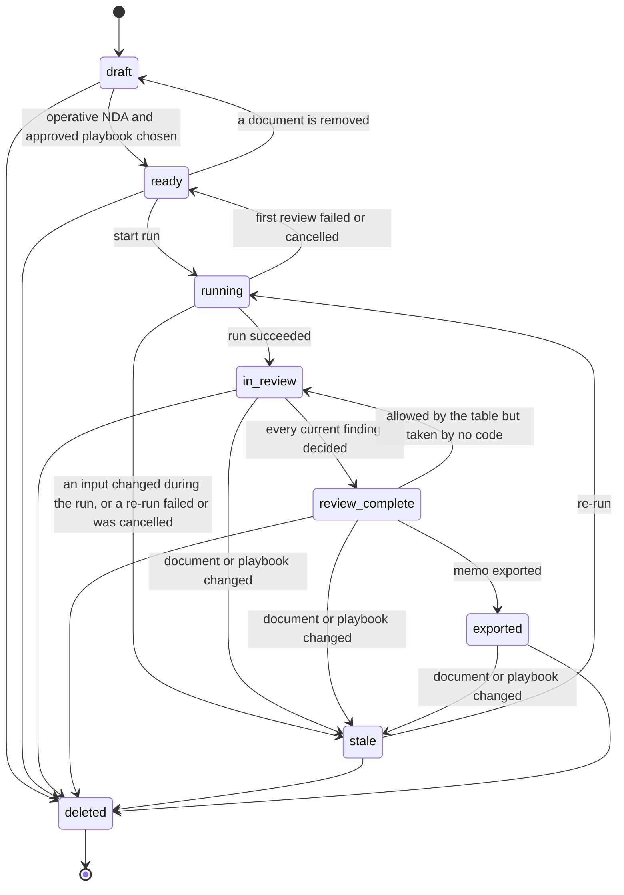
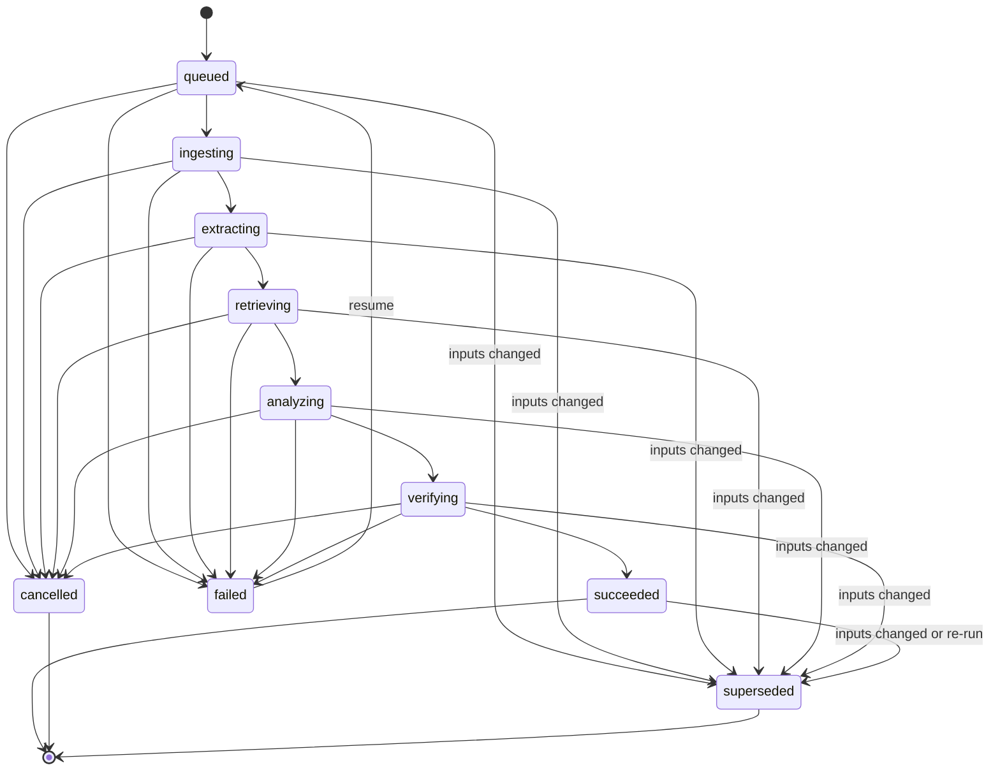
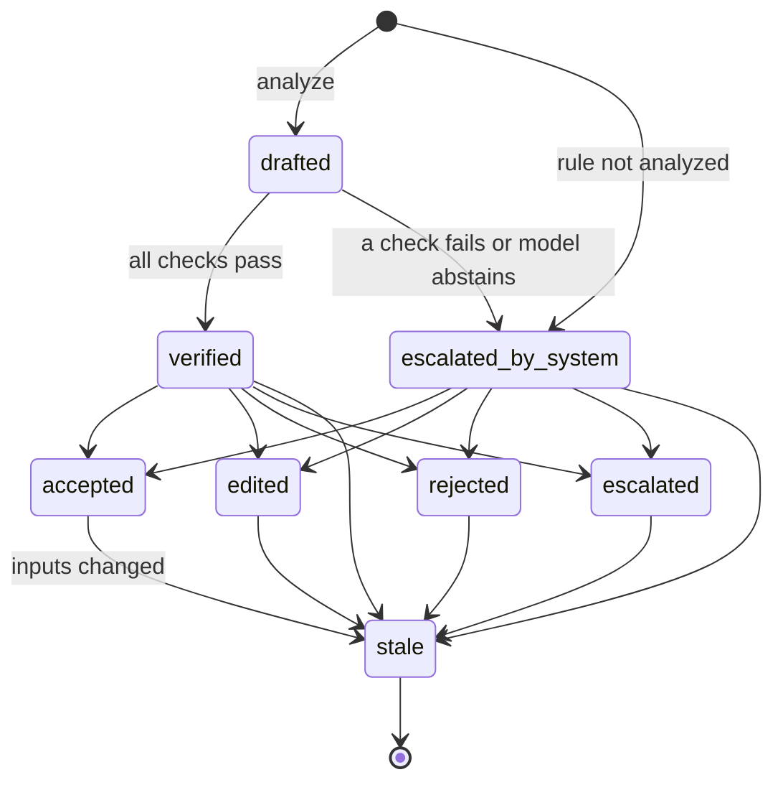

# 2. Experience and architecture

**Implementation status.** Built and tested in `apps/parol` (run with `pnpm parol`): the journey from
intake to memo up to step 9, the screens S1 to S3, the stage graph, the three state machines and the
stack. Deferred and marked Not yet built below: notes for the reviewer and one-click re-confirmation
after a re-run (steps 5 and 8), feedback (step 10), the evaluation comparison page S4 and the
correction review (step 11), and the model support check in a registered workflow (wired, off in v1
and v2). Never run live: no real model has been called, so no accuracy, latency or cost figure
exists. The demonstration runs a scripted simulated reader, which answers one worked example from a
table and is not a measurement. A **Deviation** note marks where the code departs from the design.

## User journey

One matter, from intake to memo. "System" lines are what Parol does; everything else is a
person.

| #   | Who                | Action                                                                                               | System                                                                                                                                                                          | Matter state                        |
| --- | ------------------ | ---------------------------------------------------------------------------------------------------- | ------------------------------------------------------------------------------------------------------------------------------------------------------------------------------- | ----------------------------------- |
| 1   | Associate          | Creates matter "Lanternfish / Corvane NDA", names the client entity, adds a reviewer                 | Creates the matter, grants membership (associate for the creator, reviewer for the person chosen), writes an audit event                                                        | `draft`                             |
| 2   | Associate          | Uploads the NDA (DOCX) and Amendment No. 1 (TXT), enters each stated date                            | Hashes each file, stores it, parses paragraphs into source spans and annotations, warns about duplicates, unreviewed content and instruction-like text; the upload is operative | `draft`                             |
| 3   | Associate          | Selects playbook "Parol NDA (Recipient)" version 1.0.1                                               | Checks the version is approved; the matter is ready                                                                                                                             | `ready`                             |
| 4   | Associate          | Picks a workflow version if more than one is offered (v1 or v2) and starts a review                  | Pins documents, playbook, workflow and model in a run manifest; reads the stored spans, then runs extract, retrieve, analyze and verify                                         | `running`                           |
| 5   | Associate          | Opens the issue table and triages. Not yet built: adding notes for the reviewer                      | Shows eight findings with statuses, flags (escalations) and an evidence inspector beside the table                                                                              | `in_review`                         |
| 6   | Reviewing attorney | Opens each finding's evidence; accepts, edits, rejects or escalates                                  | Records each decision against the exact finding content it saw; refuses the person who started the review unless `PAROL_RELAXED_SEGREGATION` is set                             | `in_review`, then `review_complete` |
| 7   | Associate          | Uploads a corrected amendment (new version), or changes a stated date, the client or the playbook    | Marks the review's findings and decisions stale, supersedes the review and the current memo, blocks export, offers a re-run                                                     | `stale`                             |
| 8   | Associate          | Re-runs; reviewer decides the new findings again                                                     | New run pinned to the new manifest. Not yet built: showing the earlier decision for reference and re-confirming an unchanged finding in one click                               | `in_review`                         |
| 9   | Reviewing attorney | Exports the memo                                                                                     | Rechecks that every finding of the current run has a current decision made on its exact content, builds the DOCX with a provenance appendix                                     | `exported`                          |
| 10  | Both               | Leave feedback on findings and a one-question rating. Not yet built                                  | The `feedback` table and a store method exist; there is no route, service or page                                                                                               | `exported`                          |
| 11  | Legal engineer     | Reviews corrections across matters; runs the evaluation suite on a candidate revision. Not yet built | Not in the application. `pnpm eval:parol` runs the suite from the command line over synthetic cases and writes a results file; there is no comparison page and no promotion     | n/a                                 |

**Deviation (step 2).** Each upload is operative at once, and the associate can choose another
version of a document later. The design had the associate mark the NDA operative. A re-saved file
whose text is identical to an earlier version is stored but does not replace the operative one, so
nothing goes stale; the associate chooses.

**Deviation (step 2).** Ingest runs when a file is uploaded, not at the start of a run, so the
warnings appear straight away and a resumed run needs no second parse. The run's ingest stage reads
the stored spans back.

**Deviation (step 6).** A reviewer can change their own decision on a finding until the memo is
exported, but cannot overwrite another reviewer's: the second one is refused (409 `decision_conflict`)
and the finding page says why. The design is silent on two reviewers on one matter.

**Deviation (step 8).** The Re-run form says that the findings are replaced and that decisions
already made on them stop counting. A re-run that fails, is cancelled or is interrupted leaves the
matter out of date and not ready, because its earlier decisions have already stopped counting.

**Deviation (step 9).** Once a memo is exported, decisions are refused until a re-run, so that the
memo always matches the decisions it was built from. The design is silent on this. Exporting the same
decisions of the same run again returns the memo on record and does not supersede it with a copy.

## Screen sketches

Server-rendered pages with one small script, `public/parol.js`. The script only adds keyboard
shortcuts in the issue table, scrolls a quote into view, stops a double submit and polls a running
review's progress; every page works with it blocked. A permanent banner reads "DEMO: synthetic
documents, demo identity, not for client work". The sketches below were redrawn from the built pages
(screenshots of the seeded demonstration); ids, hashes and dates in them are illustrative, and every
finding text shown is the output of the scripted simulated reader, not of a language model.

### S1. Matter intake

Deviation: intake is two pages and not one. The new-matter form is on the matters page; documents,
settings and the start of a review are on the matter page. "View rules" for the playbook is not built.

```text
S1a. Matters page
+-----------------------------------------------------------------------------------------+
| DEMO: synthetic documents, demo identity, not for client work                           |
| Parol   Matters                                      Signed in as Alex Ruiz (associate) |
+-----------------------------------------------------------------------------------------+
| Matters                                                                                 |
|   Your matters (only matters you are a member of)                                       |
|  Matter                Client          Status  Your role  Playbook  Created  Kept until |
|  Lanternfish / Corvane Lanternfish ... Ready   Associate  parol-..  ...      ...        |
|                                                                                         |
|   New matter                                                                            |
|     Matter name         [                                  ]                            |
|     Our client          [                                  ] exact legal name           |
|     Reviewing attorney  [ Choose later                    v ]                           |
|     Playbook            [ Choose later                    v ]                           |
|                                                           [ Create matter ]             |
+-----------------------------------------------------------------------------------------+

S1b. Matter page
+-----------------------------------------------------------------------------------------+
| Matters / Lanternfish / Corvane NDA                                                     |
| Lanternfish / Corvane NDA                                                               |
| [Ready to review]  Our client: Lanternfish Software, Inc.   Your role: Associate        |
|                                                                                         |
| Documents  Choose which version of each document is operative.                          |
|   D1 Mutual NDA [NDA]                                                                   |
|     (o) Version 1  DOCX, 12 KB, sha 328e8474   Stated date [2026-02-02] [Save date]     |
|     [Save operative version of D1]   > Upload a new version of D1                       |
|   D2 Amendment No. 1 [Amendment]                                                        |
|     (o) Version 1  TXT, 647 bytes, sha 28b25c4e  Stated date [2026-09-15] [Save date]   |
|     > Upload a new version of D2     > Remove D2 from this matter                       |
|   Add a document: title, kind, stated date, file (.docx or .txt)    [ Add document ]    |
|                                                                                         |
| Warnings (shown only when there are any; they do not stop a review)                     |
|   ! Reads like an instruction to software: D1-p1 in the NDA (matched                    |
|     addresses_ai_assistant, addresses_automated_reviewer, mark_all_compliant).          |
|     The review gives it to the model as document text, and Parol cannot show that a    |
|     model ignored it. Read it yourself; p counts paragraphs from zero.                  |
|                                                                                         |
| Client and playbook  Our client [ ... ]  Playbook [ Parol NDA (Recipient) 1.0.1 ... v ] |
|                                                                                         |
| Start the review                                                                        |
|   Where document text is sent: <one sentence from the model layer's disclosure>         |
|   Workflow version [ v1 (candidate, default) v ]                      [ Start review ]  |
|                                                                                         |
| Reviews | Memos | People | Delete this matter                                           |
+-----------------------------------------------------------------------------------------+
```

The warning shown is what the upload of `fixtures/parol/files/parol-d08-nda.docx` produces; the
seeded matters raise none. A page that sends text to a hosted provider says so in the sentence
under "Start the review"; with the simulated reader it says that nothing is sent anywhere.

### S2. Issue table with evidence inspector

The table is the primary view. Selecting a row opens the inspector beside it with the cited
passages, each with its quote highlighted inside its own paragraph.

Deviation: the inspector shows the cited paragraph and not the whole document at the cited place; a
paragraph that holds a quote that was not found is struck through, and its paragraph is behind a
disclosure. Filters are All, Open, Escalated and Out of date.

```text
+-----------------------------------------------------------------------------------------+
| DEMO: synthetic documents, demo identity, not for client work                           |
| Matters / Lanternfish / Corvane NDA / Review                                            |
| Issues   [Finished]  Run run_5ad2adbb8da33e40  Workflow v2                              |
|          Read by simulated, parol-simulated-reader   Playbook parol-nda-recipient 1.0.1 |
| [ Read by a scripted stand-in, not a language model ]  (shown for scripted providers)   |
| [All 8] [Open 8] [Escalated 0] [Out of date 0]                                          |
+------------------------------------------------+----------------------------------------+
| Sev Category, rule    Status    Review   Flags | Duration, rule dur-1                   |
| H   Duration dur-1    Deviation Not dec. None  | [High] [Deviation] [Not decided]       |
| H   Exclusions exc-1  Compliant Not dec. None  |                                        |
| M   Definition def-1  Compliant Not dec. None  | EVIDENCE                               |
| M   Gov. law gov-1    Compliant Not dec. None  | Amendment No. 1 (v1), Section 2, para 3|
| M   Reps pds-1        Compliant Not dec. None  | [Governing] [Quote found]              |
| M   By law pds-2      Compliant Not dec. None  | 2. Section 6.1 of the Agreement is     |
| M   Parties pty-1     Compliant Not dec. None  |    deleted in its entirety.            |
| L   Return ret-1      Compliant Not dec. None  | Mutual NDA (v1), Section 9.3, para 29  |
|                                                | [Supporting] [Quote found]             |
| Warnings (when there are any)                  | Sections 4, 5 and 8 survive any        |
|                                                |    termination or expiration ...       |
| Flags say what the review could not confirm.   | Mutual NDA (v1), Section 6.1, para 19  |
| > Keyboard shortcuts                           | [Superseded] [Quote found]             |
|                                                | (struck through: a later passage       |
|                                                |    replaces it)                        |
|                                                |                                        |
|                                                | WHAT THE REVIEW FOUND                  |
|                                                |   Discrepancy, Explanation             |
|                                                | CHECKS  10 passed, 0 failed, 3 n/a     |
|                                                |   Passed  Quotes appear word for word  |
|                                                |   ...                                  |
|                                                | PLAYBOOK RULE, SUGGESTED LANGUAGE,     |
|                                                | YOUR DECISION, HISTORY (see S3)        |
+------------------------------------------------+----------------------------------------+
```

The table is ordered by severity, then status, then rule key. The rows are the seeded
demonstration under workflow v2 (simulated reader); under v1 the same table shows Duration as
Compliant and Return as Deviation, which is the retrieval gap the worked example is about. The
evidence pane is the worked example in [document 4](04-worked-example.md). The checks panel lists
every check the finding went through, with Passed, Failed or Not applicable (thirteen for this finding:
ten passed and three not applicable, counted from the database of a seeded run), so a flag is always
explained by the check that raised it.

### S3. Review decision

The decision form is the lower part of the inspector (and of the finding's own page), under the
evidence, the finding, the checks and the playbook rule.

Deviation: the design's "Changes from approved text: [diff]" is not built. The page labels where the
suggested wording comes from (approved text unchanged, approved text adapted, or wording written by
the workflow) and offers the approved wording behind a disclosure. The label of each cited passage
can be changed in the same form (the `evidenceRoles` edit of the API).

```text
+-----------------------------------------------------------------------------------------+
| Duration, rule dur-1        Duration of confidentiality obligations                     |
| [High] [Deviation] [Not decided]                                  Go to the decision    |
+-----------------------------------------------------------------------------------------+
| Playbook rule (parol-nda-recipient 1.0.1)                                               |
|   Standard:     Obligations end three years or less after each disclosure. Continued    |
|                 protection of trade secrets for as long as they remain trade secrets    |
|                 is acceptable.                                                          |
|   Fallback:     Obligations end five years or less after each disclosure, or five years |
|                 or less after the agreement ends.                                       |
|   Unacceptable: Obligations that are perpetual or have no stated end, for information   |
|                 that is not a trade secret.                                             |
|                                                                                         |
| What the review found                                                                   |
|   Discrepancy  Amendment No. 1 deletes Section 6.1, the only time limit on the          |
|                obligations in Section 4, and Section 9.3 keeps Section 4 in force after |
|                termination. As amended, the obligations have no stated end ...          |
|                                                                                         |
| Suggested language                                                                      |
|   6.1 The obligations of each Receiving Party under Section 4 shall continue for three  |
|   (3) years from the date of each disclosure ...                                        |
|   Basis: Approved playbook text, adapted to these documents.                            |
|   > Approved wording from the playbook                                                  |
|                                                                                         |
| Your decision   ( ) Accept  (o) Edit  ( ) Reject  ( ) Escalate                          |
| Reason     [ The parties agreed two years in February. Propose reinstating it.        ] |
| Edits, used only when you choose Edit: Status [Deviation v]  Discrepancy [...]          |
|            Fallback language [...]   How each passage is labelled [...]                 |
|                                                                                         |
| You are deciding dur-1 as shown (content hash 6be99ad6a4c3). The decision is bound to   |
| this exact finding. If the documents or the playbook change, it becomes stale: it no    |
| longer counts and has to be made again.                           [ Save decision ]     |
+-----------------------------------------------------------------------------------------+
```

### S4. Evaluation comparison

**Not yet built.** There is no comparison page, and the held-out split has no cases yet. On the
command line, `pnpm eval:parol --simulate --workflow v1 --out a.json` and then the same with
`--workflow v2 --compare a.json --out b.json` compare two workflow versions over the development
cases against the scripted simulated reader, as a Markdown report on standard output; every report
and results file says in capitals that it is not a measurement of any model. A run against a real
model needs a key and `--yes`, and has never been made. The sketch below is the design, with
the values left blank.

```text
+-----------------------------------------------------------------------------------------+
| Compare workflow versions                 Dataset parol-cases v1 (sha __)      k = 3    |
|   Baseline  v1  (prompts P1, retrieval R1)   Candidate v2 (prompts P1, retrieval R2)    |
|   Pinned: playbook 1.0.1, model <id>, prices sha __                                     |
+-----------------------------------------------------------------------------------------+
| Split: [dev] [held-out]                                                                 |
|                                   Baseline        Candidate       Gate      Pass?       |
|   Strict issue recall             __ / __          __ / __         >= 0.90   __         |
|   Issue precision                 __ / __          __ / __         >= 0.80   __         |
|   High-severity silent misses     __               __              0         __         |
|   Substantive support             __ / __          __ / __         >= 0.95   __         |
|   Required escalations raised     __ / __          __ / __         all       __         |
|   Unnecessary escalations         __ / __          __ / __         <= 0.15   __         |
|   Severity-weighted failure       __               __              <= 0.05   __         |
|   p95 run latency                 __ s             __ s            budget    __         |
|   Mean cost per run               $__              $__             budget    __         |
|   Unauthorized exposure           __               __              0         __         |
+-----------------------------------------------------------------------------------------+
| Slots that changed (paired, modal status)                                               |
|   PAROL-D05 dur-1   expected deviation   baseline: compliant x3   candidate: __         |
|   ...                                                            [ open evidence ]      |
| [ Draft promotion record ]                                                              |
+-----------------------------------------------------------------------------------------+
```

The blanks are deliberate: no run against a real model has happened.

## Architecture



Every request passes the shell and then, for a matter, the authorization layer before it can reach a
service that reads matter data, calls a model or writes a file. As built:

- The shell runs in a fixed order: request context (an id for the request and the security headers on
  every response, errors included), the host guard, a refusal of a request address that has a user
  or password part (400, before the body limit reads anything), the body limit (the upload limit plus
  64 KiB for multipart framing), then the route. With the demo identity on, the host guard refuses
  any request whose address or `Host` header is not this machine, which is the defence against DNS
  rebinding. Below the shell, the server's own wrapper answers a request that Node's parser rejects,
  that has no `Host`, or whose `Transfer-Encoding` does not end in `chunked`, with a short page that
  carries the same headers and one access line (see
  [document 6](06-access-and-governance.md#demo-identity)).
- The demo identity is a list of seeded people, not authentication. The session cookie `parol_session`
  is signed with HMAC-SHA256 under a server secret, is `HttpOnly` and `SameSite=Strict` (and `Secure`
  when `PAROL_SECURE_COOKIES=1`), and expires after eight hours. Only the user id is in it; names and
  roles are read from the database on every request. Signing out also records the value in memory, so
  a copy of the cookie stops working until the process restarts.
- Every write (POST, PUT, PATCH, DELETE) must carry a CSRF token, in the `_csrf` form field or the
  `x-csrf-token` header. The token is an HMAC bound to the session cookie, or before sign-in to a
  short-lived anonymous cookie.
- A matter route is declared only through `defineMatterRoute`, which names the action. It resolves
  the person, checks the token on a write, then asks `authorizeMatter` for membership and role from
  the database. A non-member, a missing matter and a deleted matter all give the same 404; a member
  whose role may not do the thing gets 403. The service behind the route checks the role again. The
  `AuthorizedMatter` type can be made only in `src/auth/authorize.ts`, and a test scans the source for
  any other place that makes one.
- Responses carry a content security policy that allows script, style and connections from the same
  origin only (`default-src 'none'`), no framing, `nosniff`, `no-referrer`, a permissions policy that
  denies browser features Parol does not use, and `Cache-Control: no-store` except for static files.
  Errors are a fixed kind and message and never repeat what the request carried; the access log line
  holds ids, the route template, the status and the latency.

**Deviation.** The design said the evaluation runner "calls the same workflow runner with synthetic
matters". It calls the same stage functions (extract, retrieve, analyze, verify, the prompts and the
workflow manifests), with its own composition of them in `evals/src/parol/runner.ts`, written
without the store, the queue or the run engine, which are what a measurement does not need. A test
pins the rule concurrency of the two, and a layers test compares the application's runner with the
reference pipeline on the development cases. Nothing makes a later change to
`src/services/runner.ts` reach the evaluation automatically.

## Stage graph



| Stage    | Kind                              | Input                                                                 | Output                                                                                 | Model?                                      |
| -------- | --------------------------------- | --------------------------------------------------------------------- | -------------------------------------------------------------------------------------- | ------------------------------------------- |
| ingest   | deterministic                     | Document versions in the run manifest (stored when each was uploaded) | Source spans with stable ids; warnings; defined terms; cross-references; keyword hints | No                                          |
| extract  | model plus rules                  | Source spans of all operative documents                               | For each category, located spans with verified quotes, or "not found"                  | Yes                                         |
| retrieve | deterministic                     | Located spans, playbook version, category                             | One context bundle per rule: rule text, approved fallback, bounded spans               | No                                          |
| analyze  | model                             | One context bundle                                                    | Draft finding: status, evidence quotes with roles, discrepancy, fallback               | Yes                                         |
| verify   | deterministic, then a model check | Draft finding and the spans it cites                                  | Verified finding, or a finding with escalation reasons                                 | Partly: the model check is off in v1 and v2 |
| review   | human                             | Verified findings                                                     | Decisions bound to finding content hashes                                              | No                                          |
| export   | deterministic                     | Current findings with current decisions                               | DOCX memo with provenance appendix                                                     | No                                          |

Each stage's output is stored in `run_stages` with the hash of its input (extract once per run,
analyze and verify once per rule), which is what lets a resumed run skip what is done. Retrieve
stores only a summary of its bundles (for each rule, the span count, estimated tokens, whether it
is over budget and whether it is the whole document) and is rebuilt from the stored extract output.
Ingest runs when a file is uploaded (see the deviation under step 2 of the journey).

Contracts for each stage are in [document 3](03-data-model-and-contracts.md#stage-contracts).

## State machines

### Matter



An input that moves the matter to `stale` is a new or removed document, another operative version,
a stated date, the client's legal name, the playbook version or a re-run request. A review that
ends without results (failed, cancelled, or interrupted by a restart) returns the matter to `ready`
only when no review ever saved findings on it. When it holds findings of an earlier review, which a
re-run made stale, `ready` would read as if the matter had never been reviewed and would hide the
decisions that no longer count, so it stays `stale` (reason `rerun_requested`, "A new review was
requested."). A matter that went stale while its first review was running holds no findings to read
the reason from, so the reason is read from the last `inputs.changed` audit event and worded "while
the review was running". The Re-run form says that the findings are replaced and the decisions stop
counting, and that an exported memo stays on record. A reviewer who
changes a decision while the matter is `review_complete` records a new decision that replaces the
old (the old stays in the history, marked stale), and the matter stays `review_complete`; once the
memo is exported, decisions are refused until a re-run. An exported memo stays on record after a matter goes stale,
marked as superseded when the inputs changed.

**Deviation.** The design drew four edges into `deleted`; the code allows six (every state but
`running`), and a matter with a run in flight has the run cancelled first. `deleted` is a state of the
machine and a value the database accepts, but it is never stored: deleting a matter removes its rows,
its files and its memos, and only the audit events remain (ids, hashes and counts).
`review_complete` to `in_review` is in the transition table because the design named it; reopening
is a new decision and not a state change, so no application code takes the edge.

### Run



**Deviation.** The design drew cancelling from two states and failing from four; the code allows
both from every in-flight state (the runner checks for a stop between units and before each write),
and supersession from every in-flight state as well as from `succeeded`. A run is superseded only by
a change of inputs or a re-run, never by `updateRunStatus`. Resume is accepted only for a failed
run, only on the inputs it started on, only on the provider and model it started on, and only with
nothing else in flight; one run per matter can be in flight, enforced by a unique index. The
server runs at most two runs at once, and three rules of one run at a time.

A rule whose model call fails after bounded retries does not fail the run: it produces an
`undetermined` finding with the escalation `output_invalid`, and a rule whose context is over the
budget gets `context_over_budget` without a call. A failed extract call does not fail the run
either: retrieval then reads the whole document for every rule. A run fails only when it cannot
produce output: a provider that rejects the key, the account, the model or the address
(`provider_auth`, `provider_permission`, `provider_model`, `provider_billing`, `provider_redirect`),
a restart that interrupted it (`interrupted`, set at start-up and offered as Resume), or an
unexpected internal error (`internal`). A corrupt file cannot fail a run, because files are parsed
at upload and refused there.

### Finding and review



`escalated` is a reviewer decision (send to a partner, leave open in the memo). `escalated_by_system`
is the verify stage saying it cannot stand behind the finding, or a rule the workflow could not
analyze; a reviewer still decides it.

**Deviation.** The diagram is a lifecycle, and the store keeps its parts apart. `drafted` exists only
in memory: a finding is saved after verify, as `verified` or `escalated_by_system`
(`findings.verification_state`). A decision is a row in `reviews`, and a finding can be decided again
until the memo is exported: the new decision replaces the current one and the old one stays in the
history, marked stale. `stale` is a flag on the finding and on each decision (`validity`), set when
the inputs change, and for a decision also when a newer decision replaces it; it never goes back.

## Stack decision

**Recommendation: TypeScript on Node 22, inside the Clausewise monorepo, with SQLite through
`node:sqlite`, Hono for routing and server-rendered JSX, and the `docx` library for the memo.**

Why not a new Python application, which the request allows: the repository already contains the
hard, tested parts in TypeScript (Word parsing with size and structure limits, clause segmentation
with typed numbering, fenced rendering of untrusted text, quote normalisation, a model layer that
refuses redirects, ignores ambient headers and retries schema failures a bounded number of times,
and an evaluation harness with a spend guard). Rewriting them in Python would cost most of the two
weeks (a plan estimate; actual effort was not tracked) and lose their tests. A second language would
also split the evaluation harness from the code it measures.

| Dependency               | New?                                                                          | Why it earns its place                                                                                                                                                                                                       | Alternative considered                                                               |
| ------------------------ | ----------------------------------------------------------------------------- | ---------------------------------------------------------------------------------------------------------------------------------------------------------------------------------------------------------------------------- | ------------------------------------------------------------------------------------ |
| `@clausewise/*` packages | No                                                                            | Parsing, segmentation, playbook schema, model access, quote normalisation                                                                                                                                                    | Reimplementing: weeks of work, untested                                              |
| `zod`                    | No                                                                            | Already the schema library for model output and playbooks                                                                                                                                                                    | n/a                                                                                  |
| `node:sqlite`            | No (built in)                                                                 | One file, no native build, transactions, enough for one machine. Available in Node 22 without a flag; it prints an experimental warning, so the store sits behind a small repository module                                  | `better-sqlite3`: mature but a native module; swap in if `node:sqlite` changes shape |
| `hono`                   | Yes                                                                           | Small router with no runtime dependencies; its JSX escapes text by default, which matters when every page shows untrusted document text                                                                                      | Node's `http` plus hand-written escaping: easy to get one page wrong                 |
| `@hono/node-server`      | Yes, a second dependency beside `hono`                                        | Serves the Hono application on Node's `http`. `main.ts` uses its request listener on its own server, so that a request the adapter cannot read still gets the security headers; its `serve` helper takes no error handler    | Writing the request and response conversion by hand: more code to get wrong          |
| `docx`                   | Yes, for this app (a dev dependency of the repository root for the fixtures)  | Generates the memo as a real Word document with tables and headings; it is a runtime dependency of `apps/parol`, so it moved from dev dependencies to dependencies                                                           | Writing OOXML by hand with `@clausewise/docx` internals: possible, more code         |
| `jszip`                  | Yes, a direct dependency of this app (already used inside `@clausewise/docx`) | Rewrites the memo's zip so that its timestamps are the export date and nothing else, which makes the memo file a pure function of its content and its stored hash meaningful                                                 | Leaving the library's clock stamps: two exports of one memo would hash differently   |
| `tsx`                    | A dependency of this app (a dev dependency of the repository root)            | Runs the TypeScript sources directly for `pnpm parol` and `pnpm parol:seed`; the scripts pass the app's `tsconfig.json` so that JSX compiles for Hono                                                                        | A build step: not needed for a local demonstration                                   |
| Front-end framework      | None                                                                          | Pages are forms and tables. One script of about 250 lines adds keyboard shortcuts, scrolls a quote into view, stops a double submit and polls progress; the quote highlighting is rendered on the server from stored offsets | React or htmx: a build step or another dependency for little gain                    |
| ORM                      | None                                                                          | Plain SQL migrations in numbered files; 25 tables                                                                                                                                                                            | Drizzle or Prisma: more surface than the schema needs                                |

Complexity budget: one process, one database file, one folder of matter files, no queue service (runs
execute in the server process through a bounded in-process queue, two at a time; a run's stage
outputs are persisted, so after a restart a person resumes the run and it skips what is done), no
background services.

**Deviation.** The sentence above said a restart resumes a run; document 3 always said that
unfinished runs become `failed` with `interrupted` at start-up and are resumed. The code follows
document 3: the associate presses Resume, and the run skips what is finished. Why a person presses
it: a resumed run must use the provider and model it started on, or its provenance and the
disclosure of where its text went would name a model that did not read all of it, so resume is
refused if the configuration has changed.

### Repository layout

```text
apps/parol/
  src/
    auth/          demo identity, session cookie, CSRF, matter authorization
    boot/          registers prompts, workflow versions and the demo playbook at start-up
    demo/          the simulated reader and the data of the seeded matters (not a model)
    export/        memo builder (docx)
    ingest/        DOCX and TXT readers, spans, annotations, warnings
    playbooks/     playbook loader (validates version, categories, hint topics)
    prompts/       prompt sources, each with an id; hashes computed at load; workflow versions
    server/        shell (app.ts, middleware), routes, pages (Hono JSX), views
    services/      matters, uploads, runs and the run engine, reviews, memo input
    stages/        extract, retrieve, analyze, verify and its checks (pure functions)
    store/         SQLite repository, migration runner, file store, audit log
    contracts.ts, module-contracts.ts, canonical.ts   shared shapes and hashing
    main.ts, seed.ts   the server (pnpm parol) and the demonstration data (pnpm parol:seed)
  migrations/      001_init.sql, 002_integrity.sql, 003_ingest_warnings.sql
  playbooks/
    parol-nda-recipient.yaml      the fictional demo playbook, version 1.0.1
  public/          parol.js, parol.css
  test/            vitest, scripted generators only, never a real model
fixtures/parol/
  cases.ts, build.ts            synthetic documents and answer keys, one entry per case
  (generated .docx and .txt files in files/, answer-keys.json, splits.json)
evals/src/parol/
  cli.ts, runner.ts, score.ts, compare.ts, gates.ts, ...   run by pnpm eval:parol; reuses the
                                prices, budget guard and usage of evals/src
docs/parol/               these documents
```

Small, tested changes to existing packages that Parol needs:

1. `@clausewise/playbook`: optional `version`, `category`, `fallbackLanguage` and `escalateWhen`
   fields, and a fifth, `hintTopics` (which kinds of keyword hint matter to a rule, added because two
   rules share a category). Optional, so `nda-mutual.yaml` and `saas-customer.yaml` still validate
   unchanged.
2. `@clausewise/review`: exports `settledStatus` (status settlement for required and absence rules),
   `normalizeForAnchor` and a new `locateQuote`, which finds a quote in a paragraph under the same
   normalisation as `anchorEdit`. Deviation: clause reference resolution was not exported; Parol has
   its own in `src/ingest/references.ts` and `src/stages/clause-refs.ts`. `settledStatus` is exported
   and is not called by Parol (see the status settlement note in
   [document 3](03-data-model-and-contracts.md#deterministic-checks-and-model-judgment)).
3. **Deviation.** The TXT reader is not a package change. It lives in `apps/parol/src/ingest/txt.ts`
   and produces the same paragraph shape as `parseDocx`, so `segment` works on both. It copies the
   typed-number rules of `segment` because the package keeps them private, and a test cuts the same
   text as TXT and as DOCX to catch the two drifting apart.
