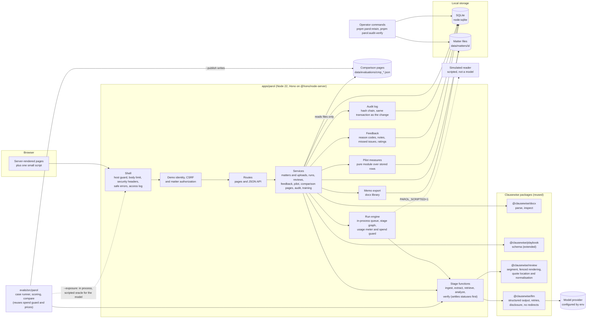
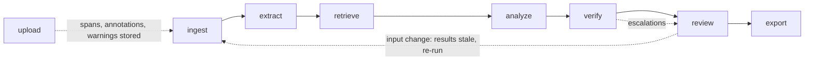
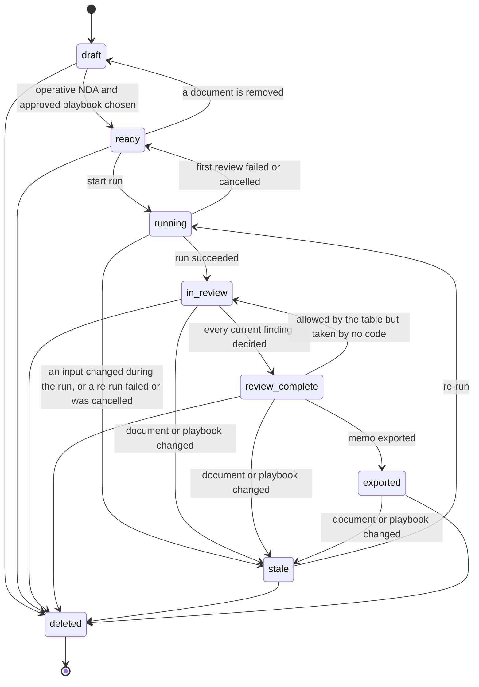
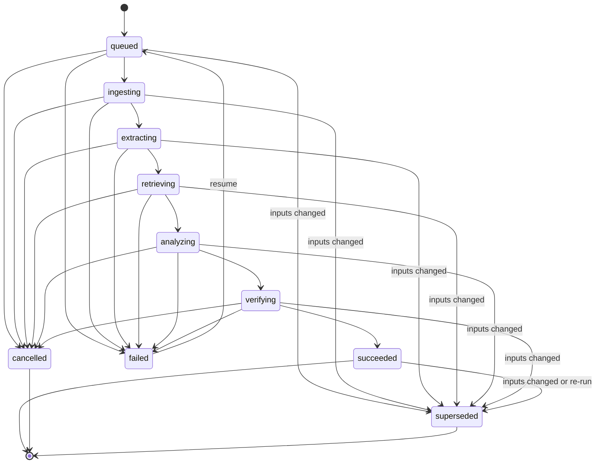
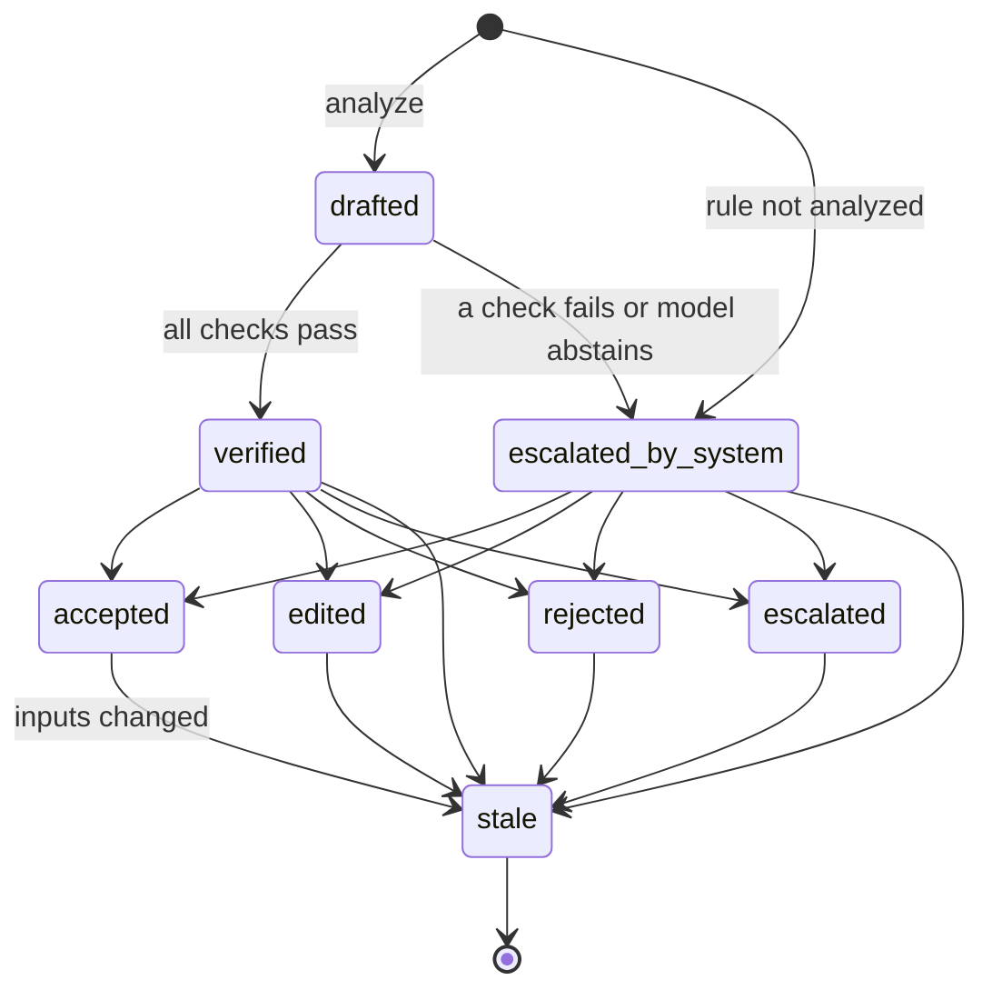

# 2. Experience and architecture

**Implementation status.** Built and tested in `apps/parol` (run with `pnpm parol`): the journey from
intake to memo up to step 9, feedback (step 10, in part), the screens S1 to S5 and the pages outside
the journey (the audit log check, the quickstart and the help), the stage graph, the three state
machines and the stack. Deferred and marked Not yet built below: one-click re-confirmation after a
re-run (step 8), the correction review across matters (step 11), and the model support check in a
workflow version the application ships (built; v1 and v2, which the application registers, leave it
off, and the evaluation-only v3 turns it on). The evaluation comparison page S4 is built and shows
only files that the evaluation command wrote from scripted runs. Never run live: no real model has
been called, so no accuracy, latency or cost figure exists. The demonstration runs a scripted
simulated reader, which reads two document sets (the worked example and the training matter) and is
not a measurement. Everything here is tested against scripted wires and synthetic data; no person has
used the pages with a keyboard alone or a screen reader (known gap 21 of
[document 7](07-delivery-plan.md#known-gaps)). A **Deviation** note marks where the code departs
from the design.

## User journey

One matter, from intake to memo. "System" lines are what Parol does; everything else is a
person.

| #   | Who                | Action                                                                                            | System                                                                                                                                                                                                                                                         | Matter state                        |
| --- | ------------------ | ------------------------------------------------------------------------------------------------- | -------------------------------------------------------------------------------------------------------------------------------------------------------------------------------------------------------------------------------------------------------------- | ----------------------------------- |
| 1   | Associate          | Creates matter "Lanternfish / Corvane NDA", names the client entity, adds a reviewer              | Creates the matter, grants membership (associate for the creator, reviewer for the person chosen), writes an audit event                                                                                                                                       | `draft`                             |
| 2   | Associate          | Uploads the NDA (DOCX) and Amendment No. 1 (TXT), enters each stated date                         | Hashes each file, stores it, parses paragraphs into source spans and annotations, warns about duplicates, unreviewed content and instruction-like text; the upload is operative                                                                                | `draft`                             |
| 3   | Associate          | Selects playbook "Parol NDA (Recipient)" version 1.0.1                                            | Checks the version is approved; the matter is ready                                                                                                                                                                                                            | `ready`                             |
| 4   | Associate          | Picks a workflow version if more than one is offered (v1 or v2) and starts a review               | Pins documents, playbook, workflow and model in a run manifest; with a hosted model, first plans the most the review could cost and refuses to start if that would pass a spend limit; reads the stored spans, then runs extract, retrieve, analyze and verify | `running`                           |
| 5   | Associate          | Opens the issue table and triages; leaves a note on a finding for the reviewer                    | Shows eight findings with statuses, flags (escalations) and an evidence inspector beside the table; stores a note with the finding and does not print it in the memo                                                                                           | `in_review`                         |
| 6   | Reviewing attorney | Opens each finding's evidence; accepts, edits, rejects or escalates                               | Records each decision against the exact finding content it saw, with a reason code for an edit or a reject and a minor-edit mark for an edit; refuses the person who started the review unless `PAROL_RELAXED_SEGREGATION` is set                              | `in_review`, then `review_complete` |
| 7   | Associate          | Uploads a corrected amendment (new version), or changes a stated date, the client or the playbook | Marks the review's findings and decisions stale, supersedes the review and the current memo, blocks export, offers a re-run                                                                                                                                    | `stale`                             |
| 8   | Associate          | Re-runs; reviewer decides the new findings again                                                  | New run pinned to the new manifest. Not yet built: showing the earlier decision for reference and re-confirming an unchanged finding in one click                                                                                                              | `in_review`                         |
| 9   | Reviewing attorney | Exports the memo                                                                                  | Rechecks that every finding of the current run has a current decision made on its exact content, builds the DOCX with a provenance appendix                                                                                                                    | `exported`                          |
| 10  | Both               | Report an issue the review missed, rate the matter once a memo is exported; time the work         | Stores a report (a rule or "not covered by any rule", a place, a note), one rating from 1 to 5 for each person and matter, and the timers of the associate and the reviewer                                                                                    | `exported`                          |
| 11  | Legal engineer     | Reads the measures; compares a candidate revision. Corrections across matters: Not yet built      | The pilot measures page counts the stored rows (S5). `pnpm eval:parol` runs the suite from the command line over synthetic cases, and the comparison page (S4) shows a file it published; nothing promotes a version                                           | n/a                                 |

**Deviation (step 2).** Each upload is operative at once, and the associate can choose another
version of a document later. The design had the associate mark the NDA operative. A re-saved file
whose text is identical to an earlier version is stored but does not replace the operative one, so
nothing goes stale; the associate chooses.

**Deviation (step 2).** Ingest runs when a file is uploaded, not at the start of a run, so the
warnings appear straight away and a resumed run needs no second parse. The run's ingest stage reads
the stored spans back.

**Deviation (step 6).** A reviewer can change their own decision on a finding until the memo is
exported, but cannot overwrite another reviewer's: the second one is refused (409 `decision_conflict`)
and the finding page says why. The design is silent on two reviewers on one matter.

**Deviation (step 8).** The Re-run form says that the findings are replaced and that decisions
already made on them stop counting. A re-run that fails, is cancelled or is interrupted leaves the
matter out of date and not ready, because its earlier decisions have already stopped counting.

**Deviation (step 9).** Once a memo is exported, decisions are refused until a re-run, so that the
memo always matches the decisions it was built from. The design is silent on this. Exporting the same
decisions of the same run again returns the memo on record and does not supersede it with a copy.

## Screen sketches

Server-rendered pages with one small script, `public/parol.js`. The script only adds keyboard
shortcuts in the issue table, scrolls a quote into view (except on a page that opens on a refusal),
stops a double submit and polls a running review's progress; every page works with it blocked. Every
control is a native link, button or field, the first Tab stop of every page is a skip link, and the
pages follow the light or dark setting of the system (there is no theme switch). Fifteen rules over the
HTML are checked on 213 page fixtures, and an opt-in run in Chromium (`pnpm test:browser`, run once on
one machine) audits 109 pages; no person has used a screen reader on the pages (known gap 21 of
[document 7](07-delivery-plan.md#known-gaps)). A permanent banner reads "DEMO: synthetic documents, demo identity, not for client work"; it sticks to
the top of the window from 40rem up, and on a narrower screen it is at the top of the page and
scrolls away. The sketches below were drawn from the built pages (the seeded demonstration, read by
a script and not photographed); ids, hashes and dates in them are illustrative, every finding text
shown is the output of the scripted simulated reader, not of a language model, and the sketches of the
comparison and the pilot pages carry no figures because every figure those pages can show today is
scripted or synthetic. Two pages sit outside the journey and are open to everyone, signed in or not:
the quickstart (ten steps and a training exercise on a matter made for the purpose, T01) and the help
page (the words the pages use). The review page and the finding pane carry short help text of their
own ("What the words mean").

### S1. Matter intake

Deviation: intake is two pages and not one. The new-matter form is on the matters page; documents,
settings and the start of a review are on the matter page. "View rules" for the playbook is not built.

```text
S1a. Matters page
+-----------------------------------------------------------------------------------------+
| DEMO: synthetic documents, demo identity, not for client work                           |
| Parol   Matters                                      Signed in as Alex Ruiz (associate) |
+-----------------------------------------------------------------------------------------+
| Matters                                                                                 |
|   Your matters (only matters you are a member of)                                       |
|  Matter                Client          Status  Your role  Playbook  Created  Kept until |
|  Lanternfish / Corvane Lanternfish ... Ready   Associate  parol-..  ...      ...        |
|                                                                                         |
|   New matter                                                                            |
|     Matter name         [                                  ]                            |
|     Our client          [                                  ] exact legal name           |
|     Reviewing attorney  [ Choose later                    v ]                           |
|     Playbook            [ Choose later                    v ]                           |
|     Keep for (days)     [ 30 ]  1 to 90; can be changed later                           |
|                                                           [ Create matter ]             |
+-----------------------------------------------------------------------------------------+

S1b. Matter page
+-----------------------------------------------------------------------------------------+
| Matters / Lanternfish / Corvane NDA                                                     |
| Lanternfish / Corvane NDA                                                               |
| [Ready to review]  Our client: Lanternfish Software, Inc.   Your role: Associate        |
|                                                                                         |
| Documents  Choose which version of each document is operative.                          |
|   D1 Mutual NDA [NDA]                                                                   |
|     (o) Version 1  DOCX, 12 KB, sha 328e8474   Stated date [2026-02-02] [Save date]     |
|     [Save operative version of D1]   > Upload a new version of D1                       |
|   D2 Amendment No. 1 [Amendment]                                                        |
|     (o) Version 1  TXT, 647 bytes, sha 28b25c4e  Stated date [2026-09-15] [Save date]   |
|     > Upload a new version of D2     > Remove D2 from this matter                       |
|   Add a document: title, kind, stated date, file (.docx or .txt)    [ Add document ]    |
|                                                                                         |
| Warnings (shown only when there are any; they do not stop a review)                     |
|   ! Reads like an instruction to software: D1-p1 in the NDA (matched                    |
|     addresses_ai_assistant, addresses_automated_reviewer, mark_all_compliant).          |
|     The review gives it to the model as document text, and Parol cannot show that a    |
|     model ignored it. Read it yourself; p counts paragraphs from zero.                  |
|                                                                                         |
| Client and playbook  Our client [ ... ]  Playbook [ Parol NDA (Recipient) 1.0.1 ... v ] |
|                                                                                         |
| Start the review                                                                        |
|   Where document text is sent: <one sentence from the model layer's disclosure>         |
|   Workflow version [ v1 (candidate, default) v ]                      [ Start review ]  |
|                                                                                         |
| Reviews | Memos | Time on this matter | Reference list (reviewer) | People |            |
| How long this matter is kept | Delete this matter                                       |
+-----------------------------------------------------------------------------------------+
```

The warning shown is what the upload of `fixtures/parol/files/parol-d08-nda.docx` produces; the
seeded matters raise none, and the training matter T01 carries it. A page that sends text to a hosted
provider says so in the sentence under "Start the review"; with the simulated reader it says that
nothing is sent anywhere. Once a review exists, "Start the review" reads "Run the review again" and
says that the findings are replaced.

The "Results are out of date" banner that follows a change to a document, the client or the playbook
has its own "Re-run review" button, which sends no workflow, so the new review uses the default
version (the latest promoted to pilot, else v1) even when the earlier review ran on v2; the picker is
in the "Run the review again" section (known gap 36 of [document 7](07-delivery-plan.md#known-gaps)).

Three sections are new since the first build, each in the place shown above. "Time on this matter" is
shown to the associate and the reviewing attorney: Start timer and Stop timer, when the timer
began, and the person's own closed total (sessions and time); it shows no elapsed time, because the
page reads no clock. "Reference list for shadow mode" is shown to the reviewing attorney: one select
per playbook rule (Not an issue, High, Medium, Low) and three counts (0 to 9, one for each severity) of issues no
rule covers; it closes read-only at the first review of the matter, and with no playbook chosen it offers
only the counts. "How long this matter is kept" shows the date and, to an associate, a field for the
number of days from today (1 to 90) that replaces it, earlier or later; everyone else reads "Only an
associate on the matter can change this date." Neither timer nor reference list is offered on a
training matter. A training matter also opens with a "Training matter T01" notice and a "Training
progress" table (steps 3 to 7 read from what Parol stored, step 1 set up, step 2 the trainer's), both
above Documents and neither drawn in the sketch. The matters list marks a
past retention date with a "Past" chip (a triangle and the word) and a training matter with
"Training".

### S2. Issue table with evidence inspector

The table is the primary view. Selecting a row opens the inspector beside it with the cited
passages, each with its quote highlighted inside its own paragraph.

Deviation: the inspector shows the cited paragraph and not the whole document at the cited place; a
paragraph that holds a quote that was not found is struck through, and its paragraph is behind a
disclosure. Filters are All, Open, Escalated and Out of date.

```text
+-----------------------------------------------------------------------------------------+
| DEMO: synthetic documents, demo identity, not for client work                           |
| Matters / Lanternfish / Corvane NDA / Review                                            |
| Issues   [Finished]  Run run_5ad2adbb8da33e40  Workflow v2                              |
|          Read by a scripted stand-in (simulated, parol-simulated-reader)                |
|          Playbook parol-nda-recipient 1.0.1                                             |
| [ Read by a scripted stand-in, not a language model ]  (shown for scripted providers)   |
| [All 8] [Open 8] [Escalated 0] [Out of date 0]                                          |
| Go to the evidence inspector     Report a missed issue                                  |
+------------------------------------------------+----------------------------------------+
| Sev Category, rule    Status    Review   Flags | Duration, rule dur-1                   |
| H   Duration dur-1    Deviation Not dec. None  | [High] [Deviation] [Not decided]       |
| H   Exclusions exc-1  Compliant Not dec. None  |                                        |
| M   Definition def-1  Compliant Not dec. None  | EVIDENCE                               |
| M   Gov. law gov-1    Compliant Not dec. None  | Amendment No. 1 (v1), Section 2, para 3|
| M   Reps pds-1        Compliant Not dec. None  | [Governing] [Quote found]              |
| M   By law pds-2      Compliant Not dec. None  | 2. Section 6.1 of the Agreement is     |
| M   Parties pty-1     Compliant Not dec. None  |    deleted in its entirety.            |
| L   Return ret-1      Compliant Not dec. None  | Mutual NDA (v1), Section 9.3, para 29  |
|                                                | [Supporting] [Quote found]             |
| Warnings (when there are any)                  | Sections 4, 5 and 8 survive any        |
|                                                |    termination or expiration ...       |
| Flags say what the review could not confirm.   | Mutual NDA (v1), Section 6.1, para 19  |
| > Keyboard shortcuts                           | [Superseded] [Quote found]             |
|                                                | (struck through: a later passage       |
|                                                |    replaces it)                        |
|                                                |                                        |
|                                                | WHAT THE REVIEW FOUND                  |
|                                                |   Discrepancy, Explanation             |
|                                                | CHECKS  10 passed, 0 failed, 3 n/a     |
|                                                |   Passed  Quotes appear word for word  |
|                                                |   ...                                  |
|                                                | PLAYBOOK RULE, SUGGESTED LANGUAGE,     |
|                                                | YOUR DECISION, HISTORY (see S3)        |
+------------------------------------------------+----------------------------------------+
```

The table is ordered by severity, then status, then rule key. The rows are the seeded
demonstration under workflow v2 (simulated reader); under v1 the same table shows Duration as
Compliant and Return as Deviation, which is the retrieval gap the worked example is about. The
evidence pane is the worked example in [document 4](04-worked-example.md). The checks panel lists
every check the finding went through, with Passed, Failed or Not applicable (thirteen for this finding:
ten passed and three not applicable, counted from the database of a seeded run), so a flag that a
check raised is explained by that check. A rule that was not analyzed (`output_invalid` or
`context_over_budget`) has no checks, and its finding states the reason in words.

Below the table and the inspector the review page has, in this order, "What the words mean" (the
statuses, severities and passage roles, in the page's own words), the form "Report a missed issue"
(S3), the reports already made on this review, and a "Usage" section. The Usage section reads "No
model was called, so there is no usage to record." for a scripted reader. For a review by a hosted
provider it gives the number of calls recorded and how many of them reported usage, the token counts,
an estimated cost (only where a price was applied, with the number of calls priced) and the model the
provider named; the header and the matter page then read "Answered by X", "Answered by X (requested
Y)" or "Requested Y; the provider did not say which model answered". The application records usage
and the reported model for the `anthropic` provider only, and only against scripted wires so far: no
provider has been called. When the playbook's flags settled a finding's status to another one than
the workflow stated, the issue table says so under the status ("Settled by the playbook; the workflow
stated ...") and the finding page opens its "What the review found" with a note that names both
statuses and the reason. A review that the spend guard refuses to start is answered with the matter's
own page, the status 409 and an alert that gives the planned bound and the limit and says what to do
(its words name no matter, run, person or document); nothing is created, and the matter is as it was.

### S3. Review decision

The decision form is the lower part of the inspector (and of the finding's own page), under the
evidence, the finding, the checks and the playbook rule. Below it are the notes on the finding and
the history of its decisions.

Deviation: the design's "Changes from approved text: [diff]" is not built. The page labels where the
suggested wording comes from (approved text unchanged, approved text adapted, or wording written by
the workflow) and offers the approved wording behind a disclosure. The label of each cited passage
can be changed in the same form (the `evidenceRoles` edit of the API).

```text
+-----------------------------------------------------------------------------------------+
| Duration, rule dur-1        Duration of confidentiality obligations                     |
| [High] [Deviation] [Not decided]                                  Go to the decision    |
+-----------------------------------------------------------------------------------------+
| Playbook rule (parol-nda-recipient 1.0.1)                                               |
|   Standard:     Obligations end three years or less after each disclosure. Continued    |
|                 protection of trade secrets for as long as they remain trade secrets    |
|                 is acceptable.                                                          |
|   Fallback:     Obligations end five years or less after each disclosure, or five years |
|                 or less after the agreement ends.                                       |
|   Unacceptable: Obligations that are perpetual or have no stated end, for information   |
|                 that is not a trade secret.                                             |
|                                                                                         |
| What the review found                                                                   |
|   Discrepancy  Amendment No. 1 deletes Section 6.1, the only time limit on the          |
|                obligations in Section 4, and Section 9.3 keeps Section 4 in force after |
|                termination. As amended, the obligations have no stated end ...          |
|                                                                                         |
| Suggested language                                                                      |
|   6.1 The obligations of each Receiving Party under Section 4 shall continue for three  |
|   (3) years from the date of each disclosure ...                                        |
|   Basis: Approved playbook text, adapted to these documents.                            |
|   > Approved wording from the playbook                                                  |
|                                                                                         |
| Your decision   ( ) Accept  (o) Edit  ( ) Reject  ( ) Escalate                          |
| Reason     [ The parties agreed two years in February. Propose reinstating it.        ] |
| Reason code [ Bad fallback language v ]   required for edit and reject, not otherwise   |
| Edits, used only when you choose Edit: Status [Deviation v]  Discrepancy [...]          |
|            Fallback language [...]   How each passage is labelled [...]                 |
|            [ ] This is a minor edit   (a change of status is never minor)               |
|                                                                                         |
| You are deciding dur-1 as shown (content hash 6be99ad6a4c3). The decision is bound to   |
| this exact finding. If the documents or the playbook change, it becomes stale: it no    |
| longer counts and has to be made again.                           [ Save decision ]     |
+-----------------------------------------------------------------------------------------+
| Notes on this finding   (any member; not part of the decision; not printed in the memo) |
|   Your note [                                                        ]   [ Add note ]   |
+-----------------------------------------------------------------------------------------+
| Review history   (each decision with its reason code and minor-edit mark)               |
+-----------------------------------------------------------------------------------------+
```

The reason code is one of six, listed in the order the form shows them: wrong status, wrong
evidence, missed context, bad fallback language, unclear, other; the page explains each in the words
under the select. An edit and a reject need one, an accept and an escalate must not carry one, and
an escalate still needs a reason in words. The wording of the six codes and of "minor edit" was
written by the project and has not been agreed with attorneys (known gap 37 of
[document 7](07-delivery-plan.md#known-gaps)). A note is allowed on any current finding of a review
that has not been replaced, in any state of the matter including exported; a note on a finding that
is out of date is refused, though the notes it already had stay with it. When a finding has notes, the
Review cell of the issue table reads "n notes". The missed-issue form (rule or "Not covered by any
rule", a place, a note) is on the review page, and the rating, once a memo is exported, on the memos
page ("I would use this for my next NDA", 1 to 5, with an optional comment); a rating is final.

### S4. Evaluation comparison

**Built (package W2.5), and showing only scripted comparisons.** `GET /evaluations` lists the
comparisons that the evaluation command has published, newest first, and `GET
/evaluations?comparison=<id>` opens one. It is for the legal engineer and the administrator (the
global action `evaluation.read`; a member gets 403 and no link, a visitor is sent to sign in). It
changes nothing, has no form and no JSON twin, and reads only files: the command `pnpm eval:parol
--simulate --workflow v2 --compare a.json --out b.json --publish <data folder>` (or `--baseline` and
`--candidate` with two files that exist) writes `<data folder>/evaluations/cmp_<16 hex digits>.json`,
the application lists that folder on each request, and the code that reads it imports nothing from
the store, so the page cannot reach matter data. The page shows what the file says: it does not
prove who made the file or that a model was called, and its footer says so. No live run has ever been made, so every
comparison the command can publish today comes from a selftest oracle or the simulated reader; a page
for such a file carries the capital-letter banner of its mode (SELFTEST, SIMULATED or REPLAY), and no
figure of a model can be shown. A split that the comparison did not include reads "The held-out split
is not in this comparison". The sketch below is the built layout in page order, drawn without
figures for that reason; `n` and `N` stand for counts the page prints.

```text
+-----------------------------------------------------------------------------------------+
| Evaluations / v1 against v2                                                             |
| SIMULATED RUN. THE ANSWERS BELOW COME FROM THE SCRIPTED SIMULATED READER OF THE DEMO,   |
| NOT FROM A LANGUAGE MODEL. THESE SCORES ARE NOT A MEASUREMENT OF ANY MODEL.             |
+-----------------------------------------------------------------------------------------+
| The two versions        Baseline v1 (workflow hash, retrieval R1, checks C1, prompts,   |
|                         model requested and reported, endpoint, started, finished,      |
|                         repeats, code, evidence trails recorded or not, results file)   |
|                         Candidate v2 (the same facts)                                   |
| What they were run on   dataset and answer-key hashes, playbook, evaluation version     |
| Differences between the runs   pin, field, baseline, candidate, status                  |
+-----------------------------------------------------------------------------------------+
| Split: [Dev] [Held-out]   Baseline: n of N cases of the split, k repeats scored.        |
|                           Candidate: n of N cases of the split, k repeats scored.       |
+-----------------------------------------------------------------------------------------+
| Gates   G1 .. G14       Threshold     Baseline          Candidate                       |
|   Pass, Fail or Not evaluated, with the reason, and the counts behind each              |
| Decision rule   applied, or "not applied" with the reason (a scripted run: never)       |
+-----------------------------------------------------------------------------------------+
| Metrics   recall, precision, silent misses, unsupported findings, escalations, SWF,     |
|           stability, latency, cost, exposure, support checker:  baseline  candidate     |
|           change  gate  pass; a cell without data reads n/a                             |
+-----------------------------------------------------------------------------------------+
| Slots that changed   "n of N paired slots changed", regressions first                   |
|   Case  Rule  Severity  Expected  Baseline  Candidate  Change  [ Open the trail ]       |
+-----------------------------------------------------------------------------------------+
| Evidence trail of one slot (opened from the list)                                       |
|   The answer key: expected status, basis, the passages the key cites                    |
|   Per version and repeat: the status and whether it was right; the paragraphs the       |
|   reader was shown and why; the paragraphs the finding cited with their role and        |
|   whether the quote was found; the checks passed and not applicable; escalations        |
|   "This page shows where each version looked and what it cited. It does not show        |
|   what it wrote."  (a version recorded without a trail says why: not recorded, or       |
|   the case changed between the runs)                                                    |
+-----------------------------------------------------------------------------------------+
| Draft promotion record   text to copy; Decision / Conditions / Signed off by: left blank |
| This page shows a file written by the evaluation command. It does not prove who made    |
| the file or that a model was called.                                                    |
+-----------------------------------------------------------------------------------------+
```

A gate that was not evaluated is shown as that, with its reason, and is never a pass. The draft
promotion record is text only: it records nothing and promotes nothing, it never uses the word
recommend except in one fixed sentence, and the person fills in the decision and signs it in a
document. The evidence trail holds ids, offsets and codes recorded by the run, and the page sets beside them the
text of the synthetic case passages from `fixtures/parol`; no document holds a model answer, a
quotation a model wrote, a prompt or text from a matter, because the results file records none. The
trails of the held-out split's changed slots are sealed by default ("Sealed", and a sentence saying
the trail is not in the file); `--open-heldout-trails` puts them in, records that in the file, and
makes the page say in capitals that the held-out set was opened for it, so a workflow changed in response to those trails can no longer be judged on that set. That results files record these trails at
all is a decision of the build that the owner can overturn (number 1 of the [decisions of part 3](07-delivery-plan.md#decisions-of-part-3-that-the-project-owner-can-overturn)); without them the
trail shows the answer key and the scores only. The command's options are in
[document 5](05-evaluation.md). The list of comparisons shows, for each, the candidate's gates as
counts (passed, failed, not evaluated, of 14).

### S5. Pilot measures

**Built (package W2.6b), and empty of any pilot result.** `GET /pilot` shows the measures of
[document 8](08-pilot-and-enablement.md#measures) in one of two scopes; `GET /pilot/measures.csv`
downloads the same rows for the scope asked for. It is for the legal engineer and the administrator
(`pilot.read`; the two forms that save the start date and the list of trained people need
`pilot.manage`, held by the same two roles); a member gets 403. The scope is asked for by query
(`?scope=synthetic`; anything else reads as the pilot scope, which is the default), and the pilot scope is
empty on every database this build can make, because every person is a demonstration identity (known gap 30). The
synthetic scope counts what demonstration identities did to synthetic matters, and its page opens
with a banner that says its figures are not pilot data, not adoption, not accuracy and not time
saved. The optional seed `pnpm parol:seed --pilot-demo` fills the synthetic scope with a scripted
scenario so that the page has something to show.

```text
+-----------------------------------------------------------------------------------------+
| Pilot measures                                                                          |
| Which scope: [Pilot scope] [Synthetic scope, a demonstration]                           |
| (pilot scope, empty:) No pilot data. This database holds N matters and every one is     |
| synthetic or was made by a demonstration identity, so the pilot scope is empty and      |
| every measure below reads no data.                                                      |
+-----------------------------------------------------------------------------------------+
| Pilot calendar   The pilot starts on <date> and week 5 ends on <date>, counted in UTC.  |
|                  First day of the pilot [ date ] [ Save the start date ]                |
| People who were trained (recorded by the trainer, not worked out)  [x] name ...         |
|                                                                [ Save who was trained ] |
+-----------------------------------------------------------------------------------------+
| Measures   Measure | Result | Numerator | Denominator | What the denominator counts |    |
|            Note   (a row with nothing to count reads "No data" and says why)            |
| Breakdowns   by pilot phase; correction rate by reason code; missed issues by rule;     |
|              rating distribution; shadow-mode agreement by severity; active time by     |
|              phase and by associate, attorney and both (n, median, minimum, maximum)    |
+-----------------------------------------------------------------------------------------+
| What the measures count   the population table, one line for every exclusion, with a    |
|                           count; matters that will expire before week 5 ends            |
| How to read this page     ten fixed method lines                                        |
| Download   [ Download the CSV of this scope ]                                           |
+-----------------------------------------------------------------------------------------+
```

Every figure on the page states its numerator and its denominator, and a ratio over nothing reads
"No data" with one of three fixed reasons (no calendar can be counted from, every matter belongs to
the other scope, nothing meets the definition), never 0 percent of nothing. The page computes
medians only, with the number of NDAs, the minimum and the maximum: no mean, no difference between
phases and no saving. It does not judge the acceptance criteria and does not recommend go or no-go.
The CSV holds codes and numbers only, one scope per file, with the scope on every row. Training
matters (T01) are in neither scope.

### S6. Audit log check

**Built (package W2.7).** `GET /audit`, for the administrator only (`audit.read`; the legal engineer
and a member get 403, and the navigation shows the link to the administrator alone). It has no form
and one link, "Check again". When it is opened it walks the hash chain of the audit log and shows the
number of events checked of those in the log, the newest event and its hash (to be kept somewhere that
nobody who can write the database can edit, and given to `pnpm parol:audit-verify --expect-head`),
whether every matter that was created has a creation event and every deleted one a deletion event, how
many matters are past their retention date and the last retention run, and a section "What this check
does not show". It stores no result. Its limits are the ones the page states: the log is in the same
file as the data, the hashes are not keyed, the number of the newest event is in that file too, a head
kept elsewhere closes both only up to the event it names, and the log records changes and not reads or
refusals (a refusal is a line in the access log, which goes to standard output and is not stored).

### Navigation

The primary navigation is the same list on every page, and shows a link only to the people who will
be let through: Matters, Quickstart and Help to everyone (the last two without signing in); Evaluations
and Pilot measures to the legal engineer and the administrator; Audit log to the administrator. The
trainer's key (`GET /training/key`, global action `training.key`, legal engineer and administrator) has
no navigation link: the quickstart page links it to the people who may open it. Which roles may open each page is
a decision of the build that the project owner can overturn (number 2 of the [decisions of part 3](07-delivery-plan.md#decisions-of-part-3-that-the-project-owner-can-overturn); one line per action in the action
table). The gate is a global
role that the sign-in picker assigns and the database stores; it is tested against its table, and the
demo identity is not authentication, so it is not access control (known gap 26).

## Architecture



Every request passes the shell and then, for a matter, the authorization layer before it can reach a
service that reads matter data, calls a model or writes a file. As built:

- The shell runs in a fixed order: request context (an id for the request and the security headers on
  every response, errors included), the host guard, a refusal of a request address that has a user
  or password part (400, before the body limit reads anything), the body limit (the upload limit plus
  64 KiB for multipart framing), then the route. With the demo identity on, the host guard refuses
  any request whose address or `Host` header is not this machine, which is the defence against DNS
  rebinding. Below the shell, the server's own wrapper answers a request that Node's parser rejects,
  that has no `Host`, or whose `Transfer-Encoding` does not end in `chunked`, with a short page that
  carries the same headers and one access line (see
  [document 6](06-access-and-governance.md#demo-identity)).
- The demo identity is a list of seeded people, not authentication. The session cookie `parol_session`
  is signed with HMAC-SHA256 under a server secret, is `HttpOnly` and `SameSite=Strict` (and `Secure`
  when `PAROL_SECURE_COOKIES=1`), and expires after eight hours. Only the user id is in it; names and
  roles are read from the database on every request. Signing out also records the value in memory, so
  a copy of the cookie stops working until the process restarts.
- Every write (POST, PUT, PATCH, DELETE) must carry a CSRF token, in the `_csrf` form field or the
  `x-csrf-token` header. The token is an HMAC bound to the session cookie, or before sign-in to a
  short-lived anonymous cookie.
- A route that names no matter and is not open to everyone is declared through `defineRoute`, which
  names a global action (`evaluation.read`, `pilot.read`, `pilot.manage`, `audit.read` or
  `training.key`). The order is the person (a visitor is sent to sign in, or gets 401 under `/api`),
  the CSRF token on a write, the global role read from the database on every request (a member gets
  403), then the handler. The action table (`GLOBAL_ACTIONS`) also decides which navigation links a
  person sees, so a link is shown to the people who will be let through and to no one else.
- A matter route is declared only through `defineMatterRoute`, which names the action. It resolves
  the person, checks the token on a write, then asks `authorizeMatter` for membership and role from
  the database. A non-member, a missing matter and a deleted matter all give the same 404; a member
  whose role may not do the thing gets 403. The service behind the route checks the role again. The
  `AuthorizedMatter` type can be made only in `src/auth/authorize.ts`, and a test scans the source for
  any other place that makes one. The shell's own four middleware are registered through
  `defineMiddleware`, so that the list of routes tells them from a handler that answers: a test fails
  if the shell as `createApp` builds it holds a route registered another way, of any method, and a
  scan of the source fails for a direct `app.get`, `app.all` or the like. A wildcard handler added
  by `app.use` or `app.mount` among the page and API routes under a path that names a matter fails
  the test of the matter routes as well; one under a path that names no matter (`/legacy/*`) is found only by the
  evaluation's exposure suite, which stops for any wildcard route for every method that the source
  registers and that is not one of the four, whether it answers or only hands on, until it is
  declared with `defineMiddleware`, replaced by routes that a probe table names, or removed. A
  function declared with `defineMiddleware` is taken to hand on and is given no URL of its own; an
  answer of it at a URL that another probe sends is counted all the same. The authorization
  probes also send each such wildcard all five methods and count an answer other than the 404 of a
  URL that nothing owns as an exposure (see
  [document 5](05-evaluation.md#supplementary-suites)).
- Responses carry a content security policy that allows script, style and connections from the same
  origin only (`default-src 'none'`), no framing, `nosniff`, `no-referrer`, a permissions policy that
  denies browser features Parol does not use, and `Cache-Control: no-store` except for static files.
  Errors are a fixed kind and message and do not repeat what the request carried, except an upload
  error and the reasons a review cannot start (see
  [document 6](06-access-and-governance.md#minimal-sensitive-logging)); the access log line
  holds ids, the route template, the status and the latency. An error page chooses its sentence from
  a closed list by the kind of failure, and says what to do; the 404 is one sentence for every cause,
  so a matter that is not yours reads byte for byte as one that does not exist. A form that is refused
  is answered with its own page and the status of the refusal, and an error notice carries a marked
  sentence that says what to do and, for a field, a link to it. A server that cannot start prints one
  sentence that says what to do, and quotes no secret, path or line of a file.

**Deviation.** The design said the evaluation runner "calls the same workflow runner with synthetic
matters". It calls the same stage functions (extract, retrieve, analyze, verify, the prompts and the
workflow manifests), with its own composition of them in `evals/src/parol/runner.ts`, written
without the store, the queue or the run engine, which are what a measurement does not need. A test
pins the rule concurrency of the two, and a layers test compares the application's runner with the
reference pipeline on the development cases. Nothing makes a later change to
`src/services/runner.ts` reach the evaluation automatically. With `--publish` the evaluation also
writes a page document into the application's data folder (`<data folder>/evaluations`), which the
application only reads. The application's usage meter and spend guard are a separate copy of the
evaluation's reported-model reader, prices loader and planner arithmetic, tied to the originals by
parity tests (`evals/test/parol-app-*.test.ts`) and not by shared code.

The exposure suite is the exception to that composition. `pnpm eval:parol --exposure`
(`evals/src/parol/exposure/`) builds the real application in process (the real shell, routes and
services over an in-memory store, with no socket) and sends the authorization probes (which include
requests to URLs that no route owns, sent with each of GET, POST, PUT, PATCH and DELETE, including
one URL under each wildcard route that is not one of the shell's four middleware, and which must all
get the 404 of a URL that nothing owns), the canary scan and the replay of upload steps through it.
The model in that application is a scripted key-oracle that is not a language model, so the suite
tests the application and not a model. The reviews it starts follow the workflow of the run
(`--workflow`, v1 unless given; a call from code that names none gets the newest version the
application ships), because the prompts a review sends depend on the version. A version that the
application does not ship (v3) is registered in the suite's own copy of the application and nowhere
else. The record carries the label and the hash of that workflow, and gate G1 is read from it only
for a run of the same workflow. The suite feeds gate G1, and
[document 5](05-evaluation.md#supplementary-suites) has the detail.

## Stage graph



| Stage    | Kind                              | Input                                                                 | Output                                                                                 | Model?                                                                  |
| -------- | --------------------------------- | --------------------------------------------------------------------- | -------------------------------------------------------------------------------------- | ----------------------------------------------------------------------- |
| ingest   | deterministic                     | Document versions in the run manifest (stored when each was uploaded) | Source spans with stable ids; warnings; defined terms; cross-references; keyword hints | No                                                                      |
| extract  | model plus rules                  | Source spans of all operative documents                               | For each category, located spans with verified quotes, or "not found"                  | Yes                                                                     |
| retrieve | deterministic                     | Located spans, playbook version, category                             | One context bundle per rule: rule text, approved fallback, bounded spans               | No                                                                      |
| analyze  | model                             | One context bundle                                                    | Draft finding: status, evidence quotes with roles, discrepancy, fallback               | Yes                                                                     |
| verify   | deterministic, then a model check | Draft finding and the spans it cites                                  | Verified finding, or a finding with escalation reasons; the status settled first       | Partly: the model check is off in v1 and v2 (on in v3, evaluation only) |
| review   | human                             | Verified findings                                                     | Decisions bound to finding content hashes                                              | No                                                                      |
| export   | deterministic                     | Current findings with current decisions                               | DOCX memo with provenance appendix                                                     | No                                                                      |

The first step of verify is status settlement, in every workflow version: the playbook's flags, not
the model, say what an absent clause means, so a `missing` on a rule that is not required becomes
`not_applicable`, a `not_applicable` on a required rule becomes `missing`, and either on a rule that
forbids something becomes `compliant`. The status the model stated is kept (`findings.model_status`),
a `status_settled` row in the checks says what changed, and the finding's content hash covers it.
Applying settlement to every workflow version, v1 and v2 included, is a decision of the build that
the project owner can overturn (number 3 of the [decisions of part 3](07-delivery-plan.md#decisions-of-part-3-that-the-project-owner-can-overturn)); a results file made before it carries another `code`
pin. A
`not_applicable` that the model states directly on an optional rule is not checked against the
keyword hints (known gap 6 of [document 7](07-delivery-plan.md#known-gaps)).

Each stage's output is stored in `run_stages` with the hash of its input (extract once per run,
analyze and verify once per rule), which is what lets a resumed run skip what is done. Retrieve
stores only a summary of its bundles (for each rule, the span count, estimated tokens, whether it
is over budget and whether it is the whole document) and is rebuilt from the stored extract output.
Ingest runs when a file is uploaded (see the deviation under step 2 of the journey).

Contracts for each stage are in [document 3](03-data-model-and-contracts.md#stage-contracts).

## State machines

### Matter



An input that moves the matter to `stale` is a new or removed document, another operative version,
a stated date, the client's legal name, the playbook version or a re-run request. A review that
ends without results (failed, cancelled, or interrupted by a restart) returns the matter to `ready`
only when no review ever saved findings on it. When it holds findings of an earlier review, which a
re-run made stale, `ready` would read as if the matter had never been reviewed and would hide the
decisions that no longer count, so it stays `stale` (reason `rerun_requested`, "A new review was
requested."). A matter that went stale while its first review was running holds no findings to read
the reason from, so the reason is read from the last `inputs.changed` audit event and worded "while
the review was running". The Re-run form says that the findings are replaced and the decisions stop
counting, and that an exported memo stays on record. A reviewer who
changes a decision while the matter is `review_complete` records a new decision that replaces the
old (the old stays in the history, marked stale), and the matter stays `review_complete`; once the
memo is exported, decisions are refused until a re-run. An exported memo stays on record after a matter goes stale,
marked as superseded when the inputs changed.

**Deviation.** The design drew four edges into `deleted`; the code allows six (every state but
`running`), and a matter with a run in flight has the run cancelled first. `deleted` is a state of the
machine and a value the database accepts, but it is never stored: deleting a matter, by a person or by
`pnpm parol:retain --apply` for a matter past its retention date, removes its rows, its files and
its memos, and only the audit events remain (ids, hashes and counts). Nothing deletes a matter by
itself: no scheduler ships, and a matter past its date stays open and usable until an operator runs
the command (known gap 17 of [document 7](07-delivery-plan.md#known-gaps)). `--apply` refuses to run
while the server holds the data folder, which is also a decision the owner can overturn (number 6 of
the [decisions of part 3](07-delivery-plan.md#decisions-of-part-3-that-the-project-owner-can-overturn)).
`review_complete` to `in_review` is in the transition table because the design named it; reopening
is a new decision and not a state change, so no application code takes the edge.

### Run



**Deviation.** The design drew cancelling from two states and failing from four; the code allows
both from every in-flight state (the runner checks for a stop between units and before each write),
and supersession from every in-flight state as well as from `succeeded`. A run is superseded only by
a change of inputs or a re-run, never by `updateRunStatus`. Resume is accepted only for a failed
run, only on the inputs it started on, only on the provider and model it started on, and only with
nothing else in flight; one run per matter can be in flight, enforced by a unique index. The
server runs at most two runs at once, and three rules of one run at a time.

A rule whose model call fails after bounded retries does not fail the run: it produces an
`undetermined` finding with the escalation `output_invalid`, and a rule whose context is over the
budget gets `context_over_budget` without a call. A failed extract call does not fail the run
either: retrieval then reads the whole document for every rule. A run fails only when it cannot
produce output: a provider that rejects the key, the account, the model or the address
(`provider_auth`, `provider_permission`, `provider_model`, `provider_billing`, `provider_redirect`),
the spend guard stopping a review that reached its limit for one review or for the UTC day
(`spend_review_limit`, `spend_daily_limit`; the run can be resumed after the limit is raised), a
restart that interrupted it (`interrupted`, set at start-up and offered as Resume), or an
unexpected internal error (`internal`). These are the nine kinds a run can end with. A corrupt file cannot fail a run, because files are parsed
at upload and refused there.

### Finding and review



`escalated` is a reviewer decision (send to a partner, leave open in the memo). `escalated_by_system`
is the verify stage saying it cannot stand behind the finding, or a rule the workflow could not
analyze; a reviewer still decides it.

**Deviation.** The diagram is a lifecycle, and the store keeps its parts apart. `drafted` exists only
in memory: a finding is saved after verify, as `verified` or `escalated_by_system`
(`findings.verification_state`). A decision is a row in `reviews`, and a finding can be decided again
until the memo is exported: the new decision replaces the current one and the old one stays in the
history, marked stale. `stale` is a flag on the finding and on each decision (`validity`), set when
the inputs change, and for a decision also when a newer decision replaces it; it never goes back.

## Stack decision

**Decision (built): TypeScript on Node 22, inside the Clausewise monorepo, with SQLite through
`node:sqlite`, Hono for routing and server-rendered JSX, and the `docx` library for the memo.**

Why not a new Python application, which the request allows: the repository already contains the
hard, tested parts in TypeScript (Word parsing with size and structure limits, clause segmentation
with typed numbering, fenced rendering of untrusted text, quote normalisation, a model layer that
refuses redirects, ignores ambient headers and retries schema failures a bounded number of times,
and an evaluation harness with a spend guard). Rewriting them in Python would cost most of the two
weeks (a plan estimate; actual effort was not tracked) and lose their tests. A second language would
also split the evaluation harness from the code it measures.

| Dependency               | New?                                                                          | Why it earns its place                                                                                                                                                                                                       | Alternative considered                                                               |
| ------------------------ | ----------------------------------------------------------------------------- | ---------------------------------------------------------------------------------------------------------------------------------------------------------------------------------------------------------------------------- | ------------------------------------------------------------------------------------ |
| `@clausewise/*` packages | No                                                                            | Parsing, segmentation, playbook schema, model access, quote normalisation                                                                                                                                                    | Reimplementing: weeks of work (the author's estimate), untested                      |
| `zod`                    | No                                                                            | Already the schema library for model output and playbooks                                                                                                                                                                    | n/a                                                                                  |
| `node:sqlite`            | No (built in)                                                                 | One file, no native build, transactions, enough for one machine. Available in Node 22 without a flag; it prints an experimental warning, so the store sits behind a small repository module                                  | `better-sqlite3`: mature but a native module; swap in if `node:sqlite` changes shape |
| `hono`                   | Yes                                                                           | Small router with no runtime dependencies; its JSX escapes text by default, which matters when every page shows untrusted document text                                                                                      | Node's `http` plus hand-written escaping: easy to get one page wrong                 |
| `@hono/node-server`      | Yes, a second dependency beside `hono`                                        | Serves the Hono application on Node's `http`. `main.ts` uses its request listener on its own server, so that a request the adapter cannot read still gets the security headers; its `serve` helper takes no error handler    | Writing the request and response conversion by hand: more code to get wrong          |
| `docx`                   | Yes, for this app (a dev dependency of the repository root for the fixtures)  | Generates the memo as a real Word document with tables and headings; it is a runtime dependency of `apps/parol`, so it moved from dev dependencies to dependencies                                                           | Writing OOXML by hand with `@clausewise/docx` internals: possible, more code         |
| `jszip`                  | Yes, a direct dependency of this app (already used inside `@clausewise/docx`) | Rewrites the memo's zip so that its timestamps are the export date and nothing else, which makes the memo file a pure function of its content and its stored hash meaningful                                                 | Leaving the library's clock stamps: two exports of one memo would hash differently   |
| `tsx`                    | A dependency of this app (a dev dependency of the repository root)            | Runs the TypeScript sources directly for `pnpm parol`, `pnpm parol:seed`, `pnpm parol:retain` and `pnpm parol:audit-verify`; the scripts pass the app's `tsconfig.json` so that JSX compiles for Hono                        | A build step: not needed for a local demonstration                                   |
| Front-end framework      | None                                                                          | Pages are forms and tables. One script of about 250 lines adds keyboard shortcuts, scrolls a quote into view, stops a double submit and polls progress; the quote highlighting is rendered on the server from stored offsets | React or htmx: a build step or another dependency for little gain                    |
| ORM                      | None                                                                          | Plain SQL migrations in numbered files (eight); 31 tables in a fresh database, counting the migration runner's own `schema_migrations`                                                                                       | Drizzle or Prisma: more surface than the schema needs                                |

Complexity budget: one process, one database file, one folder of matter files, no queue service (runs
execute in the server process through a bounded in-process queue, two at a time; a run's stage
outputs are persisted, so after a restart a person resumes the run and it skips what is done), no
background services.

**Deviation.** The sentence above said a restart resumes a run; document 3 always said that
unfinished runs become `failed` with `interrupted` at start-up and are resumed. The code follows
document 3: the associate presses Resume, and the run skips what is finished. Why a person presses
it: a resumed run must use the provider and model it started on, or its provenance and the
disclosure of where its text went would name a model that did not read all of it, so resume is
refused if the configuration has changed.

### Repository layout

```text
apps/parol/
  src/
    auth/          demo identity, session cookie, CSRF, matter and global authorization
    boot/          registers prompts, workflow versions and the demo playbook at start-up
    demo/          the simulated reader and the data of the seeded matters (not a model)
    evaluations/   reads the comparison page documents the evaluation command publishes
    export/        memo builder (docx)
    ingest/        DOCX and TXT readers, spans, annotations, warnings
    pilot/         the pure module that computes the pilot measures, their CSV and their fixed words
    playbooks/     playbook loader (validates version, categories, hint topics)
    prompts/       prompt sources, each with an id; hashes computed at load; workflow versions
    retention/     the retention job and the start-up notices
    server/        shell (app.ts, middleware), routes, pages (Hono JSX), views
    services/      matters, uploads, runs and the run engine, reviews, feedback, pilot, memo input
    stages/        extract, retrieve, analyze, verify and its checks (pure functions)
    store/         SQLite repository, migration runner, file store, audit log
    training/      the training matter T01, the quickstart steps, the trainer's key, progress
    usage/         the usage meter, prices, the spend guard and the reported-model reader
    contracts.ts, module-contracts.ts, canonical.ts, settlement.ts   shared shapes, hashing, status settlement
    main.ts, seed.ts   the server (pnpm parol) and the demonstration data (pnpm parol:seed)
    retain.ts, audit-verify.ts, cli-common.ts   the commands pnpm parol:retain and pnpm parol:audit-verify
  migrations/      001_init.sql to 008_pilot_measures.sql (eight files)
  training/         t01-nda.docx, t01-amendment-1.txt (built by pnpm fixtures:parol:training)
  playbooks/
    parol-nda-recipient.yaml      the fictional demo playbook, version 1.0.1
  public/          parol.js, parol.css
  test/            vitest, scripted generators only, never a real model
fixtures/parol/
  cases.ts, cases/, build.ts    synthetic documents and answer keys, one file per case
  canary.ts, calibration/       the two canary matters; the 40 calibration pairs
  (generated .docx and .txt files in files/, answer-keys.json, calibration.json, splits.json)
evals/src/parol/
  cli.ts, runner.ts, score.ts, compare.ts, gates.ts, ...   run by pnpm eval:parol; reuses the
                                prices, budget guard and usage of evals/src
  replay.ts, calibration-run.ts, exposure/                 record and replay of a live run's answers;
                                the support checker's calibration step; the exposure suites
docs/parol/               these documents
```

Small, tested changes to existing packages that Parol needs:

1. `@clausewise/playbook`: optional `version`, `category`, `fallbackLanguage` and `escalateWhen`
   fields, and a fifth, `hintTopics` (which kinds of keyword hint matter to a rule, added because two
   rules share a category). Optional, so `nda-mutual.yaml` and `saas-customer.yaml` still validate
   unchanged.
2. `@clausewise/review`: exports `settledStatus` (status settlement for required and absence rules),
   `normalizeForAnchor` and a new `locateQuote`, which finds a quote in a paragraph under the same
   normalisation as `anchorEdit`. Deviation: clause reference resolution was not exported; Parol has
   its own in `src/ingest/references.ts` and `src/stages/clause-refs.ts`. `settledStatus` is exported
   and, since week-two part 3, is called by Parol: `src/settlement.ts` wraps it and the verify stage
   calls it first, for every workflow version (see the status settlement note in
   [document 3](03-data-model-and-contracts.md#deterministic-checks-and-model-judgment)).
3. **Deviation.** The TXT reader is not a package change. It lives in `apps/parol/src/ingest/txt.ts`
   and produces the same paragraph shape as `parseDocx`, so `segment` works on both. It copies the
   typed-number rules of `segment` because the package keeps them private, and a test cuts the same
   text as TXT and as DOCX to catch the two drifting apart.
