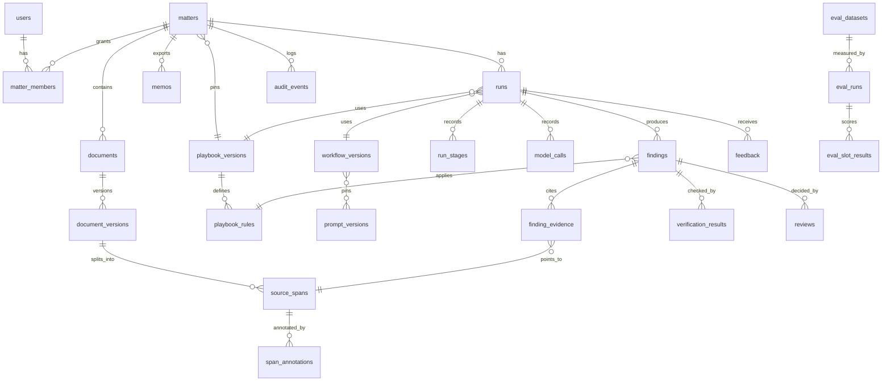

# 3. Data model and contracts

## Vocabulary

These terms are used identically in every Parol document.

**Categories** (the seven playbook categories): `parties`, `ci-definition`, `exclusions`,
`permitted-disclosures`, `duration`, `return-destruction`, `governing-law`.

**Rules** in the demo playbook `parol-nda-recipient` version 1.0.0 (full text in
[document 4](04-worked-example.md#the-demo-playbook)):

| Rule    | Category              | Title                                   | Severity | Required |
| ------- | --------------------- | --------------------------------------- | -------- | -------- |
| `pty-1` | parties               | Parties correctly identified            | medium   | yes      |
| `def-1` | ci-definition         | Scope of Confidential Information       | medium   | yes      |
| `exc-1` | exclusions            | Four standard exclusions                | high     | yes      |
| `pds-1` | permitted-disclosures | Disclosure to representatives           | medium   | yes      |
| `pds-2` | permitted-disclosures | Disclosure required by law              | medium   | yes      |
| `dur-1` | duration              | Duration of confidentiality obligations | high     | yes      |
| `ret-1` | return-destruction    | Return or destruction of information    | low      | no       |
| `gov-1` | governing-law         | Governing law and forum                 | medium   | yes      |

A category can hold more than one rule (`permitted-disclosures` holds two), so a matter always
produces eight findings, one per rule.

**Finding status**: `compliant`, `deviation`, `missing` (a required presence rule with no clause),
`not_applicable` (a rule that is not required, with no clause), and `undetermined` (the workflow
will not state a status; always carries at least one escalation). The first four are the
Clausewise statuses; `undetermined` is new.

**Escalation reasons** (the only way Parol expresses doubt; there are no confidence scores):

| Code                      | Raised by                  | Meaning for the reviewer                                                                                 | Forces `undetermined`? |
| ------------------------- | -------------------------- | -------------------------------------------------------------------------------------------------------- | ---------------------- |
| `quote_not_verified`      | verify, deterministic      | A cited passage does not occur in the span it names. It is shown struck through and never exported.      | No                     |
| `support_not_confirmed`   | verify, model or numeric   | The cited passages exist but do not establish the conclusion, or a number in the finding is not in them. | No                     |
| `superseded_evidence`     | verify, deterministic (v3) | The finding relies on a clause that an amendment expressly replaces, without citing the amendment.       | No                     |
| `conflicting_sources`     | analyze or verify          | Two operative passages disagree and the precedence rules do not settle which governs.                    | Yes                    |
| `missing_not_confirmed`   | verify, deterministic      | "Missing" was claimed, but keyword hints found candidate passages the analysis did not explain.          | No                     |
| `defined_term_unresolved` | verify, deterministic      | A defined term the evidence relies on is undefined, or defined twice in different ways.                  | No                     |
| `parties_mismatch`        | verify, deterministic      | The client's legal name from intake does not appear in the parties passage.                              | No                     |
| `playbook_escalation`     | analyze, validated         | The playbook says this situation goes to an attorney (for example a forum outside the approved list).    | No                     |
| `model_abstained`         | analyze                    | The model declined to state a status and said why.                                                       | Yes                    |
| `output_invalid`          | analyze                    | No valid structured answer after bounded retries, a refusal, or a cut-off reply.                         | Yes                    |
| `context_over_budget`     | retrieve                   | The context for this rule exceeds the budget; nothing was truncated, the rule was not analyzed.          | Yes                    |

**Warnings** attach to a document or run, not to a finding: `instruction_like_text`,
`duplicate_document`, `near_duplicate_version`, `unreviewed_content` (footnotes, headers, hidden
runs and comments counted by `inspectDocx` but not reviewed).

**Review decisions**: `accept`, `edit`, `reject`, `escalate`.

## Identifiers and stable references

- A **document version** is immutable once uploaded. A changed file is a new version.
- A **source span** is one paragraph of one document version. Its id is
  `<documentVersionId>:p<paragraphIndex>`, so it never changes while the version exists, and it
  stores the paragraph text and its SHA-256.
- Users see a location like **"Amendment No. 1 (v1), Section 2, paragraph 3"**: document title,
  version number, clause number as written (from `segment`), paragraph index.
- The model sees span labels such as `[D2-p3] 2 (section: Amendments)`: document ordinal and
  paragraph index, never an internal id. Code maps labels back to span ids, exactly as Clausewise
  maps `c12` to a clause.
- Quotes are located inside a span by character offsets after verification, so the inspector can
  highlight the exact words.

## Entities



### Schema (SQLite)

Timestamps are ISO 8601 UTC text. JSON columns are validated by zod on write. Foreign keys are on.

```sql
-- Identity and permissions --------------------------------------------------------------
CREATE TABLE users (
  id            TEXT PRIMARY KEY,
  display_name  TEXT NOT NULL,
  global_role   TEXT NOT NULL CHECK (global_role IN ('member','legal_engineer','admin')),
  demo          INTEGER NOT NULL DEFAULT 1 CHECK (demo = 1)  -- this build has demo identities only
);

CREATE TABLE matters (
  id                       TEXT PRIMARY KEY,
  name                     TEXT NOT NULL,
  client_legal_name        TEXT NOT NULL,
  playbook_version_id      TEXT REFERENCES playbook_versions(id),
  status                   TEXT NOT NULL CHECK (status IN
                             ('draft','ready','running','in_review','review_complete',
                              'exported','stale','deleted')),
  current_manifest_sha256  TEXT,          -- recomputed in the same transaction as any input change
  synthetic                INTEGER NOT NULL DEFAULT 1,
  created_by               TEXT NOT NULL REFERENCES users(id),
  created_at               TEXT NOT NULL,
  retain_until             TEXT NOT NULL,
  deleted_at               TEXT
);

CREATE TABLE matter_members (
  matter_id   TEXT NOT NULL REFERENCES matters(id) ON DELETE CASCADE,
  user_id     TEXT NOT NULL REFERENCES users(id),
  role        TEXT NOT NULL CHECK (role IN ('associate','reviewer','viewer')),
  granted_by  TEXT NOT NULL REFERENCES users(id),
  granted_at  TEXT NOT NULL,
  PRIMARY KEY (matter_id, user_id)
);

-- Documents and spans --------------------------------------------------------------------
CREATE TABLE documents (
  id         TEXT PRIMARY KEY,
  matter_id  TEXT NOT NULL REFERENCES matters(id) ON DELETE CASCADE,
  kind       TEXT NOT NULL CHECK (kind IN ('nda','amendment')),
  title      TEXT NOT NULL,
  ordinal    INTEGER NOT NULL,              -- D1, D2, D3 within the matter
  UNIQUE (matter_id, ordinal)
);

CREATE TABLE document_versions (
  id            TEXT PRIMARY KEY,
  document_id   TEXT NOT NULL REFERENCES documents(id) ON DELETE CASCADE,
  matter_id     TEXT NOT NULL REFERENCES matters(id) ON DELETE CASCADE,
  version_no    INTEGER NOT NULL,
  media_type    TEXT NOT NULL CHECK (media_type IN ('docx','txt')),
  file_sha256   TEXT NOT NULL,
  text_sha256   TEXT NOT NULL,              -- of the extracted paragraph texts; catches re-saves
  byte_size     INTEGER NOT NULL,
  stated_date   TEXT,                       -- entered at intake, never parsed from document text
  operative     INTEGER NOT NULL DEFAULT 0, -- at most one operative NDA version per matter
  storage_path  TEXT NOT NULL,
  uploaded_by   TEXT NOT NULL REFERENCES users(id),
  uploaded_at   TEXT NOT NULL,
  UNIQUE (document_id, version_no)
);

CREATE TABLE source_spans (
  id                   TEXT PRIMARY KEY,    -- <document_version_id>:p<paragraph_index>
  document_version_id  TEXT NOT NULL REFERENCES document_versions(id) ON DELETE CASCADE,
  matter_id            TEXT NOT NULL REFERENCES matters(id) ON DELETE CASCADE,
  paragraph_index      INTEGER NOT NULL,
  clause_id            TEXT NOT NULL,       -- c<n> from segment()
  clause_number        TEXT,                -- as written, such as 6.1
  heading              TEXT,
  text                 TEXT NOT NULL,
  text_sha256          TEXT NOT NULL
);

CREATE TABLE span_annotations (            -- deterministic, derived at ingest
  span_id  TEXT NOT NULL REFERENCES source_spans(id) ON DELETE CASCADE,
  kind     TEXT NOT NULL CHECK (kind IN
             ('defines_term','uses_term','cross_reference','instruction_like','keyword_hint')),
  value    TEXT NOT NULL                    -- JSON: {term}, {target:"6.1",verb:"replaces"}, ...
);

-- Playbooks, prompts, workflow versions ---------------------------------------------------
CREATE TABLE playbook_versions (
  id             TEXT PRIMARY KEY,
  playbook_slug  TEXT NOT NULL,             -- parol-nda-recipient
  version        TEXT NOT NULL,             -- 1.0.0
  yaml           TEXT NOT NULL,
  sha256         TEXT NOT NULL,
  status         TEXT NOT NULL CHECK (status IN ('draft','approved','retired')),
  approved_by    TEXT REFERENCES users(id),
  approved_at    TEXT,
  UNIQUE (playbook_slug, version)
);
-- A trigger refuses UPDATE of yaml or sha256 once status is 'approved'.

CREATE TABLE playbook_rules (
  id                   TEXT PRIMARY KEY,
  playbook_version_id  TEXT NOT NULL REFERENCES playbook_versions(id),
  rule_key             TEXT NOT NULL,       -- dur-1
  category             TEXT NOT NULL,
  severity             TEXT NOT NULL CHECK (severity IN ('high','medium','low')),
  required             INTEGER NOT NULL,
  kind                 TEXT NOT NULL CHECK (kind IN ('presence','absence')),
  rule_json            TEXT NOT NULL,       -- standard, fallback, unacceptable, fallbackLanguage, escalateWhen
  rule_sha256          TEXT NOT NULL,       -- lets a later version tell which rules changed
  UNIQUE (playbook_version_id, rule_key)
);

CREATE TABLE prompt_versions (
  id           TEXT PRIMARY KEY,            -- analyze.p2
  stage        TEXT NOT NULL CHECK (stage IN ('extract','analyze','support')),
  template     TEXT NOT NULL,
  schema_json  TEXT NOT NULL,
  sha256       TEXT NOT NULL UNIQUE,
  created_at   TEXT NOT NULL
);

CREATE TABLE workflow_versions (
  id                TEXT PRIMARY KEY,
  label             TEXT NOT NULL UNIQUE,   -- v1, v2
  manifest_json     TEXT NOT NULL,          -- prompt ids, retrieval policy, enabled checks, model settings
  sha256            TEXT NOT NULL,
  status            TEXT NOT NULL CHECK (status IN ('candidate','pilot','retired')),
  promoted_by       TEXT REFERENCES users(id),
  promoted_at       TEXT,
  promotion_record  TEXT                    -- path to the signed-off comparison, required for 'pilot'
);

-- Runs ------------------------------------------------------------------------------------
CREATE TABLE runs (
  id                     TEXT PRIMARY KEY,
  matter_id              TEXT NOT NULL REFERENCES matters(id) ON DELETE CASCADE,
  workflow_version_id    TEXT NOT NULL REFERENCES workflow_versions(id),
  playbook_version_id    TEXT NOT NULL REFERENCES playbook_versions(id),
  model_provider         TEXT NOT NULL,
  model_requested        TEXT NOT NULL,
  model_reported         TEXT,              -- what the provider said served the request
  input_manifest_json    TEXT NOT NULL,
  input_manifest_sha256  TEXT NOT NULL,
  purpose                TEXT NOT NULL CHECK (purpose IN ('matter','eval')),
  status                 TEXT NOT NULL CHECK (status IN
                           ('queued','ingesting','extracting','retrieving','analyzing',
                            'verifying','succeeded','failed','cancelled','superseded')),
  error_kind             TEXT,              -- interrupted, provider_auth, corrupt_file, ...
  started_by             TEXT NOT NULL REFERENCES users(id),
  started_at             TEXT NOT NULL,
  finished_at            TEXT
);

CREATE TABLE run_stages (
  run_id         TEXT NOT NULL REFERENCES runs(id) ON DELETE CASCADE,
  stage          TEXT NOT NULL,
  unit           TEXT NOT NULL DEFAULT '*', -- rule key for analyze and verify, '*' otherwise
  attempt        INTEGER NOT NULL,
  status         TEXT NOT NULL CHECK (status IN ('running','succeeded','failed')),
  input_sha256   TEXT NOT NULL,
  output_json    TEXT,
  output_sha256  TEXT,
  error_kind     TEXT,
  started_at     TEXT NOT NULL,
  finished_at    TEXT,
  PRIMARY KEY (run_id, stage, unit, attempt)
);

CREATE TABLE model_calls (                  -- no prompt or response text, by design
  id                  TEXT PRIMARY KEY,
  run_id              TEXT NOT NULL REFERENCES runs(id) ON DELETE CASCADE,
  stage               TEXT NOT NULL,
  rule_key            TEXT,
  prompt_version_id   TEXT NOT NULL REFERENCES prompt_versions(id),
  request_sha256      TEXT NOT NULL,
  attempt             INTEGER NOT NULL,
  outcome             TEXT NOT NULL CHECK (outcome IN
                        ('ok','schema_error','semantic_error','refusal','cut_off','transport','fatal')),
  input_tokens        INTEGER, output_tokens INTEGER,
  cache_read_tokens   INTEGER, cache_write_tokens INTEGER,
  latency_ms          INTEGER NOT NULL,
  cost_usd_estimate   REAL,
  price_table_sha256  TEXT
);

-- Findings, evidence, verification ---------------------------------------------------------
CREATE TABLE findings (
  id                  TEXT PRIMARY KEY,
  run_id              TEXT NOT NULL REFERENCES runs(id) ON DELETE CASCADE,
  matter_id           TEXT NOT NULL REFERENCES matters(id) ON DELETE CASCADE,
  playbook_rule_id    TEXT NOT NULL REFERENCES playbook_rules(id),
  rule_key            TEXT NOT NULL,
  category            TEXT NOT NULL,
  severity            TEXT NOT NULL,
  status              TEXT NOT NULL CHECK (status IN
                        ('compliant','deviation','missing','not_applicable','undetermined')),
  discrepancy         TEXT NOT NULL,       -- empty when compliant or not_applicable
  explanation         TEXT NOT NULL,
  fallback_language   TEXT,
  fallback_basis      TEXT NOT NULL CHECK (fallback_basis IN
                        ('approved_adapted','approved_verbatim','generated','none')),
  escalations_json    TEXT NOT NULL DEFAULT '[]',
  verification_state  TEXT NOT NULL CHECK (verification_state IN ('verified','escalated_by_system')),
  content_sha256      TEXT NOT NULL,       -- over status, texts, evidence and escalations
  validity            TEXT NOT NULL DEFAULT 'current' CHECK (validity IN ('current','stale')),
  stale_reason        TEXT
);

CREATE TABLE finding_evidence (
  id             TEXT PRIMARY KEY,
  finding_id     TEXT NOT NULL REFERENCES findings(id) ON DELETE CASCADE,
  span_id        TEXT NOT NULL REFERENCES source_spans(id) ON DELETE CASCADE,
  role           TEXT NOT NULL CHECK (role IN
                   ('governing','supporting','superseded','conflicting','definition')),
  quote          TEXT NOT NULL,
  start_offset   INTEGER,                  -- set only when the quote was verified
  end_offset     INTEGER,
  quote_check    TEXT NOT NULL CHECK (quote_check IN ('verified','not_found','ambiguous')),
  support_check  TEXT NOT NULL CHECK (support_check IN
                   ('supported','not_supported','insufficient','not_run'))
);

CREATE TABLE verification_results (
  finding_id  TEXT NOT NULL REFERENCES findings(id) ON DELETE CASCADE,
  check_id    TEXT NOT NULL,               -- quote_exists, numeric_consistency, support, ...
  kind        TEXT NOT NULL CHECK (kind IN ('deterministic','model')),
  outcome     TEXT NOT NULL CHECK (outcome IN ('pass','fail','not_applicable')),
  detail      TEXT NOT NULL,               -- ids and short reasons; no document text
  PRIMARY KEY (finding_id, check_id)
);

-- Review, export, feedback ---------------------------------------------------------------
CREATE TABLE reviews (
  id                      TEXT PRIMARY KEY,
  finding_id              TEXT NOT NULL REFERENCES findings(id) ON DELETE CASCADE,
  matter_id               TEXT NOT NULL REFERENCES matters(id) ON DELETE CASCADE,
  reviewer_id             TEXT NOT NULL REFERENCES users(id),
  decision                TEXT NOT NULL CHECK (decision IN ('accept','edit','reject','escalate')),
  edited_json             TEXT,            -- changed fields only
  reason                  TEXT,            -- required for edit, reject and escalate
  finding_content_sha256  TEXT NOT NULL,   -- the exact finding content the reviewer saw
  supersedes_review_id    TEXT REFERENCES reviews(id),
  validity                TEXT NOT NULL DEFAULT 'current' CHECK (validity IN ('current','stale')),
  created_at              TEXT NOT NULL
);

CREATE TABLE memos (
  id               TEXT PRIMARY KEY,
  matter_id        TEXT NOT NULL REFERENCES matters(id) ON DELETE CASCADE,
  run_id           TEXT NOT NULL REFERENCES runs(id),
  review_ids_json  TEXT NOT NULL,
  file_sha256      TEXT NOT NULL,
  storage_path     TEXT NOT NULL,
  status           TEXT NOT NULL CHECK (status IN ('current','superseded')),
  exported_by      TEXT NOT NULL REFERENCES users(id),
  exported_at      TEXT NOT NULL
);

CREATE TABLE feedback (
  id           TEXT PRIMARY KEY,
  matter_id    TEXT NOT NULL REFERENCES matters(id) ON DELETE CASCADE,
  run_id       TEXT REFERENCES runs(id),
  finding_id   TEXT REFERENCES findings(id),
  user_id      TEXT NOT NULL REFERENCES users(id),
  kind         TEXT NOT NULL CHECK (kind IN ('finding_reason','missed_issue','rating','comment')),
  reason_code  TEXT,                       -- wrong_status, wrong_evidence, bad_fallback, unclear, ...
  rating       INTEGER CHECK (rating BETWEEN 1 AND 5),
  text         TEXT,
  created_at   TEXT NOT NULL
);

-- Evaluation ------------------------------------------------------------------------------
CREATE TABLE eval_datasets (
  id              TEXT PRIMARY KEY,
  label           TEXT NOT NULL,           -- parol-cases v1
  dev_sha256      TEXT NOT NULL,
  heldout_sha256  TEXT NOT NULL,           -- committed before the first baseline run
  created_at      TEXT NOT NULL
);

CREATE TABLE eval_runs (
  id                   TEXT PRIMARY KEY,
  dataset_id           TEXT NOT NULL REFERENCES eval_datasets(id),
  split                TEXT NOT NULL CHECK (split IN ('dev','heldout','calibration')),
  workflow_version_id  TEXT NOT NULL REFERENCES workflow_versions(id),
  playbook_version_id  TEXT NOT NULL REFERENCES playbook_versions(id),
  model                TEXT NOT NULL,
  repeats              INTEGER NOT NULL,
  price_table_sha256   TEXT NOT NULL,
  results_path         TEXT NOT NULL,
  started_at           TEXT NOT NULL,
  finished_at          TEXT
);

CREATE TABLE eval_slot_results (
  eval_run_id      TEXT NOT NULL REFERENCES eval_runs(id),
  case_key         TEXT NOT NULL,          -- PAROL-D05
  rule_key         TEXT NOT NULL,
  repeat           INTEGER NOT NULL,
  run_id           TEXT NOT NULL REFERENCES runs(id),
  expected_status  TEXT NOT NULL,
  got_status       TEXT NOT NULL,
  scores_json      TEXT NOT NULL,          -- per-metric outcome for this slot
  PRIMARY KEY (eval_run_id, case_key, rule_key, repeat)
);

-- Audit -----------------------------------------------------------------------------------
CREATE TABLE audit_events (
  seq          INTEGER PRIMARY KEY AUTOINCREMENT,
  at           TEXT NOT NULL,
  actor_id     TEXT,
  matter_id    TEXT,                       -- kept after matter deletion, as an id only
  action       TEXT NOT NULL,              -- matter.create, document.upload, run.start, review.decide, ...
  target_type  TEXT NOT NULL,
  target_id    TEXT NOT NULL,
  detail_json  TEXT NOT NULL,              -- ids, hashes, counts; never document text
  prev_hash    TEXT NOT NULL,
  hash         TEXT NOT NULL               -- sha256(prev_hash || canonical row), tamper evident
);
```

## Invalidation

**Mechanism.** A run's input manifest is canonical JSON of: the operative NDA version and every
included amendment version (ids and text hashes, stated dates), the client legal name, the
playbook version hash and the workflow version hash. The matter stores the hash of the manifest
its current inputs would produce, recomputed in the same transaction as any change. A finding is
current only while its run's manifest hash equals the matter's. A review is current only while its
finding is current and its `finding_content_sha256` equals the finding's hash. Export recomputes
both checks at the moment of export rather than trusting stored flags.

| Change                                                 | Findings                                       | Reviews          | Exported memo | What the user sees                                                                                             |
| ------------------------------------------------------ | ---------------------------------------------- | ---------------- | ------------- | -------------------------------------------------------------------------------------------------------------- |
| New version of an operative document                   | All stale (`document_changed`)                 | Stale            | Superseded    | Banner, export blocked, "Re-run" button                                                                        |
| Amendment added, removed, or its stated date changed   | All stale (any amendment can touch any rule)   | Stale            | Superseded    | Same                                                                                                           |
| Identical file re-uploaded (same `file_sha256`)        | No change                                      | No change        | No change     | `duplicate_document` warning; upload not stored again                                                          |
| Re-saved file with identical text (same `text_sha256`) | No change                                      | No change        | No change     | `near_duplicate_version` warning; operator chooses                                                             |
| Client legal name edited                               | All stale (the name is in every prompt)        | Stale            | Superseded    | Same as a document change                                                                                      |
| Matter switched to another playbook version            | All stale (MVP)                                | Stale            | Superseded    | Same                                                                                                           |
| New playbook version approved but not selected         | None (matters pin versions)                    | None             | None          | "Version 1.1.0 is available" notice                                                                            |
| Workflow version promoted to pilot                     | None for existing runs                         | None             | None          | New runs use it; old runs keep their label                                                                     |
| Re-run with unchanged inputs                           | New findings; old ones superseded with the run | Not carried over | Unchanged     | Prior decision shown for reference; if the new finding's content hash equals the old one, one-click re-confirm |

Week two option (cut first if time runs short): when only the playbook version changes, findings
for rules whose `rule_sha256` is unchanged are carried into the new run, labelled "carried from
run r_0142", and their decisions need explicit re-confirmation rather than silently persisting.

## Stage contracts

TypeScript shapes, validated with zod at every stage boundary. A stage's output is persisted with
the hash of its input, which is what makes resume safe.

```ts
type SpanId = string; // `${documentVersionId}:p${paragraphIndex}`
type CategoryId =
  | "parties"
  | "ci-definition"
  | "exclusions"
  | "permitted-disclosures"
  | "duration"
  | "return-destruction"
  | "governing-law";
type Status = "compliant" | "deviation" | "missing" | "not_applicable" | "undetermined";
type EvidenceRole = "governing" | "supporting" | "superseded" | "conflicting" | "definition";

interface RunManifest {
  matterId: string;
  clientLegalName: string;
  documents: {
    documentVersionId: string;
    label: "D1" | "D2" | "D3";
    kind: "nda" | "amendment";
    statedDate: string | null;
    textSha256: string;
  }[];
  playbook: { versionId: string; sha256: string };
  workflow: { versionId: string; sha256: string };
  model: { provider: string; model: string };
}

// ingest: deterministic
interface IngestOutput {
  spans: {
    id: SpanId;
    label: string;
    documentVersionId: string;
    paragraphIndex: number;
    clauseId: string;
    clauseNumber: string | null;
    heading: string | null;
    text: string;
    textSha256: string;
  }[];
  annotations: (
    | { kind: "defines_term"; spanId: SpanId; term: string }
    | { kind: "uses_term"; spanId: SpanId; term: string }
    | {
        kind: "cross_reference";
        spanId: SpanId;
        target: string;
        verb: "replaces" | "amends" | "deletes" | "refers";
      }
    | { kind: "instruction_like"; spanId: SpanId; pattern: string }
    | { kind: "keyword_hint"; spanId: SpanId; category: CategoryId }
  )[];
  warnings: { code: string; documentVersionId: string; spanId?: SpanId; detail: string }[];
}

// extract: one model call over all operative spans, then deterministic quote checks
interface ExtractOutput {
  categories: Record<
    CategoryId,
    {
      located: { spanId: SpanId; quote: string; quoteCheck: "verified" | "not_found" }[];
      notFound: boolean; // the model found no passage for the category
      hintSpans: SpanId[]; // keyword hints the model did not locate
    }
  >;
}

// retrieve: deterministic, one bundle per rule
interface ContextBundle {
  ruleKey: string;
  category: CategoryId;
  rule: {
    title: string;
    severity: "high" | "medium" | "low";
    required: boolean;
    kind: "presence" | "absence";
    standard: string;
    fallback: string | null;
    unacceptable: string | null;
    fallbackLanguage: string | null;
    escalateWhen: { id: string; text: string }[];
  };
  spans: {
    spanId: SpanId;
    label: string;
    why: "located" | "definition" | "cross_reference" | "hint" | "full_document";
  }[];
  fullDocument: boolean; // true when "missing" is possible and must be judged on everything
  estimatedTokens: number;
  budgetTokens: number;
}

// analyze: model output after mapping labels to span ids
interface DraftFinding {
  ruleKey: string;
  status: Status;
  evidence: { spanId: SpanId; quote: string; role: EvidenceRole }[];
  discrepancy: string;
  explanation: string;
  fallbackLanguage: string | null;
  escalateWhenMatched: string[]; // ids from the rule's escalateWhen list
  conflict: string | null;
  abstainReason: string | null;
}

// verify
interface VerifiedFinding extends DraftFinding {
  evidence: (DraftFinding["evidence"][number] & {
    quoteCheck: "verified" | "not_found" | "ambiguous";
    offsets: { start: number; end: number } | null;
    supportCheck: "supported" | "not_supported" | "insufficient" | "not_run";
  })[];
  checks: {
    id: string;
    kind: "deterministic" | "model";
    outcome: "pass" | "fail" | "not_applicable";
    detail: string;
  }[];
  escalations: { code: string; detail: string }[];
  verificationState: "verified" | "escalated_by_system";
  fallbackBasis: "approved_adapted" | "approved_verbatim" | "generated" | "none";
  contentSha256: string;
}
```

### Model-facing schemas

Kept plain, as Clausewise's `RuleCheckSchema` is: no optional keys (nullable instead), no min or
max constraints, enums with their definitions in the description. Every semantic check is done in
code after parsing.

```ts
const LocateSchema = z.object({
  categories: z.array(
    z.object({
      category: z.enum(CATEGORY_IDS),
      passages: z.array(
        z.object({
          span: z
            .string()
            .describe("A span label such as D1-p19, exactly as shown in the header line."),
          quote: z
            .string()
            .describe(
              "Words copied exactly from that span that show why it belongs to the category.",
            ),
        }),
      ),
      notFoundReason: z
        .string()
        .nullable()
        .describe("Why no passage covers the category, or null."),
    }),
  ),
});

const AnalysisSchema = z.object({
  status: z.enum(["compliant", "deviation", "missing", "not_applicable", "undetermined"]),
  evidence: z.array(
    z.object({
      span: z.string(),
      quote: z.string().describe("Copied character for character from the span."),
      role: z.enum(["governing", "supporting", "superseded", "conflicting", "definition"]),
    }),
  ),
  discrepancy: z
    .string()
    .describe("How the governing text differs from the standard. Empty when compliant."),
  explanation: z.string(),
  fallbackLanguage: z
    .string()
    .nullable()
    .describe(
      "Adapt the rule's approved fallback language. Null when compliant or not applicable.",
    ),
  escalateWhenMatched: z.array(z.string()),
  conflict: z.string().nullable().describe("Describe passages that disagree, or null."),
  abstainReason: z.string().nullable().describe("Required when status is undetermined."),
});

const SupportSchema = z.object({
  verdict: z.enum(["supported", "not_supported", "insufficient"]),
  missingPremise: z
    .string()
    .nullable()
    .describe("What the passages would need to say for the conclusion to follow."),
});
```

## HTTP API

JSON under `/api`; the HTML pages call the same handlers. Every route below `/api/matters/:id`
resolves membership first; a user who is not a member gets **404**, so the existence of a matter
is not revealed. Roles: associate (A), reviewer (R), viewer (V), legal engineer (LE), admin (AD).

| Method | Path                                           | Purpose                                        | Allowed     |
| ------ | ---------------------------------------------- | ---------------------------------------------- | ----------- |
| POST   | `/api/demo/session`                            | Choose a demo identity (demo build only)       | anyone      |
| GET    | `/api/matters`                                 | Matters the user is a member of                | any user    |
| POST   | `/api/matters`                                 | Create a matter; creator becomes associate     | any user    |
| GET    | `/api/matters/:id`                             | Matter, documents, status, warnings            | A, R, V     |
| PATCH  | `/api/matters/:id`                             | Client name, playbook version, operative doc   | A           |
| POST   | `/api/matters/:id/members`                     | Add a member                                   | A           |
| POST   | `/api/matters/:id/documents`                   | Upload DOCX or TXT (multipart)                 | A           |
| POST   | `/api/matters/:id/documents/:docId/versions`   | Upload a new version                           | A           |
| GET    | `/api/matters/:id/spans/:spanId`               | One span's text (for the inspector)            | A, R, V     |
| POST   | `/api/matters/:id/runs`                        | Start a run (409 with a link if one is active) | A           |
| GET    | `/api/matters/:id/runs/:runId`                 | Run status, stage, per-rule progress           | A, R, V     |
| POST   | `/api/matters/:id/runs/:runId/resume`          | Resume from the failed stage                   | A           |
| GET    | `/api/matters/:id/runs/:runId/findings`        | Issue table                                    | A, R, V     |
| GET    | `/api/matters/:id/findings/:findingId`         | Finding, evidence, checks, decisions           | A, R, V     |
| POST   | `/api/matters/:id/findings/:findingId/reviews` | Record a decision                              | R           |
| POST   | `/api/matters/:id/memos`                       | Export the memo                                | R           |
| GET    | `/api/matters/:id/memos/:memoId/file`          | Download the memo                              | A, R, V     |
| POST   | `/api/matters/:id/feedback`                    | Rating, reason code, missed issue, comment     | A, R, V     |
| DELETE | `/api/matters/:id`                             | Delete the matter and its files                | creator, AD |
| GET    | `/api/playbooks`                               | Playbook versions                              | any user    |
| POST   | `/api/playbooks/:slug/versions`                | Import a draft version                         | LE          |
| POST   | `/api/playbooks/:slug/versions/:v/approve`     | Approve (immutable afterwards)                 | AD          |
| POST   | `/api/workflows/:id/promote`                   | Promote to pilot, with a promotion record      | AD          |
| GET    | `/api/evals/runs`, `/api/evals/compare`        | Evaluation results, synthetic matters only     | LE          |

Two representative payloads:

```ts
// POST /api/matters/:id/findings/:findingId/reviews
interface ReviewRequest {
  decision: "accept" | "edit" | "reject" | "escalate";
  findingContentSha256: string; // 409 if it no longer matches, or the finding is stale
  edits: {
    status?: Status;
    discrepancy?: string;
    fallbackLanguage?: string;
    evidenceRoles?: { evidenceId: string; role: EvidenceRole }[];
  } | null; // required for "edit", null otherwise
  reason: string | null; // required for edit, reject and escalate
}

// GET /api/matters/:id/runs/:runId/findings
interface IssueRow {
  findingId: string;
  ruleKey: string;
  ruleTitle: string;
  category: CategoryId;
  severity: "high" | "medium" | "low";
  status: Status;
  validity: "current" | "stale";
  evidence: {
    evidenceId: string;
    location: string; // "Amendment No. 1 (v1), Section 2, paragraph 3"
    spanId: string;
    quote: string;
    role: EvidenceRole;
    quoteCheck: "verified" | "not_found" | "ambiguous";
    supportCheck: "supported" | "not_supported" | "insufficient" | "not_run";
  }[];
  rule: { key: string; playbookVersion: string; standard: string };
  discrepancy: string;
  explanation: string;
  fallbackLanguage: string | null;
  fallbackBasis: "approved_adapted" | "approved_verbatim" | "generated" | "none";
  escalations: { code: string; detail: string }[];
  review: { decision: string; reviewer: string; at: string; validity: "current" | "stale" } | null;
}
```

## Retrieval boundaries and provenance

**The corpus is the run manifest, nothing more.** Retrieval functions take a `RunManifest` that the
server builds after authorization, never a matter id from the request. Every span query filters on
the manifest's document version ids. There is no cross-matter index, no precedent bank, no web
access and no tool the model can call. A sentence in a document that asks for another matter's
terms is just text in a span.

**Rules are looked up, not searched.** A rule is fetched by key from the pinned playbook version.
Similarity search has no role in choosing which rule applies; the category-to-rule mapping is in
the playbook.

**Context per rule** (retrieval policy R1, the baseline):

1. Spans the extract stage located for the rule's category, with verified quotes.
2. Definition spans for every defined term that those spans use (from `defines_term` and
   `uses_term` annotations).
3. Keyword-hint spans for the category that extract did not locate, labelled as hints.
4. If extract found nothing for a presence rule, every operative span (`fullDocument: true`), so
   that "missing" is a whole-document judgment, not an artefact of retrieval.

Policy R2 (the planned revision in the improvement cycle) adds: 5. every amendment span with a
`cross_reference` annotation whose target is the clause number of a span in 1, labelled
"cross_reference". The reasoning is in [document 5](05-evaluation.md#the-improvement-cycle).

**Context limits.** A synthetic NDA is roughly 3,000 to 8,000 tokens, well inside a modern model's
window, so the budget exists to keep prompts focused and costs predictable, not to fit. Each
bundle has a budget (default 12,000 estimated tokens, using Clausewise's `estimateTokens`, which
overestimates English). A bundle over budget is never truncated: the rule gets `undetermined` with
`context_over_budget`, and the run reports it. Contract text is rendered with Clausewise's
`renderClauses`, so it stays fenced inside `<contract>` tags with forged closing tags and headers
neutralised.

**Provenance.** Each finding links to its spans (document version, paragraph, offsets, text hash);
each run records the manifest, workflow version (and through it the prompt versions and retrieval
policy), playbook version, requested and reported model, and each call's request hash and token
usage. The memo's appendix repeats this in readable form.

**Conflicting sources.** Precedence is decided by rules in code, from intake data and annotations,
not by the model's preference:

1. An amendment span that expressly replaces, amends or deletes clause N governs clause N, when
   the amendment's stated date is not earlier than the NDA's.
2. Two amendments that touch the same clause: the later stated date governs; equal or missing
   dates are a conflict.
3. An amendment that addresses a category without an express reference, and disagrees with the
   NDA, is a conflict unless one of the documents states which controls.
4. Two inconsistent passages in one document (for example two definitions of the same term) are a
   conflict.

The model labels evidence roles (`governing`, `superseded`, `conflicting`); verify compares those
labels with what the rules above say. A conflict the rules cannot settle produces `undetermined`
with `conflicting_sources`, and both passages are shown side by side. Parol never picks one
silently.

## Deterministic checks and model judgment

| Concern                                | Deterministic (code)                                                                  | Model judgment                                         |
| -------------------------------------- | ------------------------------------------------------------------------------------- | ------------------------------------------------------ |
| File acceptance                        | Type, size, structure limits (`@clausewise/docx`), hashing, duplicate detection       |                                                        |
| Paragraphs, clause numbers, span ids   | `parseDocx` or the TXT reader, then `segment`                                         |                                                        |
| Defined terms, cross-references        | Pattern annotations at ingest                                                         |                                                        |
| Instruction-like text                  | Pattern warning (a signal for the reviewer, not a security control)                   |                                                        |
| Which clauses belong to a category     | Keyword hints as a recall backstop                                                    | Locating paraphrased clauses                           |
| Which rule applies                     | Keyed lookup in the pinned playbook                                                   |                                                        |
| Whether the text meets the standard    |                                                                                       | Status, discrepancy, explanation                       |
| Required and absence semantics         | Status settlement (Clausewise's rule: a missing optional clause is not applicable)    |                                                        |
| Quote validity                         | Normalised match in the cited span (`normalizeForAnchor`); span must be in the bundle |                                                        |
| Substantive support                    | Numbers and jurisdictions in the finding must appear in cited quotes                  | Isolated support check over the cited passages only    |
| Missing clause                         | Requires extract "not found", full-document analysis and no unexplained hints         | The analysis itself                                    |
| Precedence between documents           | The four rules above                                                                  | Proposing evidence roles                               |
| Parties                                | Client legal name from intake must appear in the parties passage                      | Whether roles and entities are adequately stated       |
| Playbook escalation conditions         | The ids returned must exist in the rule                                               | Whether a condition is met                             |
| Fallback language                      | Diff against the approved text; basis label                                           | Adapting approved text to the document's defined terms |
| Permissions, export gate, invalidation | Entirely in code                                                                      | Never                                                  |

## Quotation validity versus substantive support

A quote that exists in the document does not make the conclusion true. The baseline failure the
improvement cycle is built around is exactly this: a correct quote from Section 6.1 of an NDA,
"two (2) years from the date of each disclosure", supporting "compliant", when an amendment has
replaced Section 6.1. So the two properties are checked separately and reported separately.

**Quotation validity** (deterministic, `quote_exists`): each quote, after normalising quotation
marks, dashes and spacing with Clausewise's `normalizeForAnchor`, must occur in the text of the span
it names, and that span must be one the model was given. A unique occurrence gets offsets for
highlighting; more than one occurrence is `ambiguous` (still valid, highlighted at each place). A
quote that is not found is shown struck through, never exported, and raises `quote_not_verified`.

**Substantive support** has three layers:

1. _Citation shape_ (deterministic): `compliant` and `deviation` need at least one verified quote
   in a `governing` or `supporting` role; `missing` and `not_applicable` cite none in those roles.
2. _Consistency_ (deterministic): durations, day counts and jurisdictions named in the discrepancy
   or explanation must appear, in word or digit form, in a verified quote.
3. _Support check_ (model, separate call and separate prompt): the checker sees the rule, the
   claimed status and discrepancy, and the full text of the cited spans, and nothing else. It does
   not see the rest of the document, so it cannot fill a gap from text the finding did not cite. It
   answers `supported`, `not_supported` or `insufficient`, with the missing premise. Anything but
   `supported` raises `support_not_confirmed`.

The support check is local by design, which is why it cannot catch a superseded clause on its own:
the cited clause does support "two years". That gap is closed by retrieval (R2) and by a
deterministic supersession check (v3), each measured separately. The checker is itself evaluated on
a calibration set of supported and deliberately unsupported pairs
([document 5](05-evaluation.md#support-calibration-set)).

## Structured output, retries and recovery

| Failure                                                                                     | Handling                                                                                                  | Bound                   |
| ------------------------------------------------------------------------------------------- | --------------------------------------------------------------------------------------------------------- | ----------------------- |
| Transport error, stream error, schema mismatch                                              | Retried by `@clausewise/llm`                                                                              | `maxRetries`, default 2 |
| Reply cut off at the output limit                                                           | Not retried (Clausewise behaviour); `output_invalid`                                                      | 0                       |
| Refusal                                                                                     | Not retried; `output_invalid` with the provider's category                                                | 0                       |
| Semantic error (unknown span label, `undetermined` without a reason, unknown escalation id) | One repair attempt that appends the validation message; then `output_invalid`                             | 1                       |
| Fatal provider error (401, 402, 403, 404, redirect)                                         | Stops the run with `error_kind`; completed rules are kept but not shown as a complete run                 | 0                       |
| Server restart during a run                                                                 | On boot, unfinished runs become `failed` with `interrupted`; resume skips completed units by input hash   | n/a                     |
| Upload parse failure                                                                        | Rejected with the reader's reason; nothing stored                                                         | n/a                     |
| Memo write failure                                                                          | Written to a temporary file and renamed (the Clausewise pattern); the database row is inserted only after | n/a                     |
| Spend                                                                                       | Evaluation runs use the Clausewise spend guard (plan first, `--yes`, per-request cap)                     | `--max-cost`            |

Worst case per rule: (1 + 2) attempts for the first answer, times two if a repair is needed, so six
calls; the evaluation plan uses that figure for its retry bound.

A failed rule never becomes a guessed finding. It becomes `undetermined` with a named reason, the
issue table counts it, and export lists it under open items.

## Escalation instead of confidence

Parol shows no confidence percentages. A model's own estimate of its confidence is not
calibrated against this playbook, and a number such as "87%" invites a reviewer to skip reading.
Instead, each finding is either verified (every check passed) or carries escalation reasons, and
each reason tells the reviewer what to look at: which passage, which check failed, what was
expected. Abstaining is an allowed answer: the analysis prompt asks for `undetermined` with a
reason whenever the text does not let the rule be applied, and the evaluation rewards an
escalation where the answer key requires one and penalises unnecessary ones
([document 5](05-evaluation.md#metrics)).
