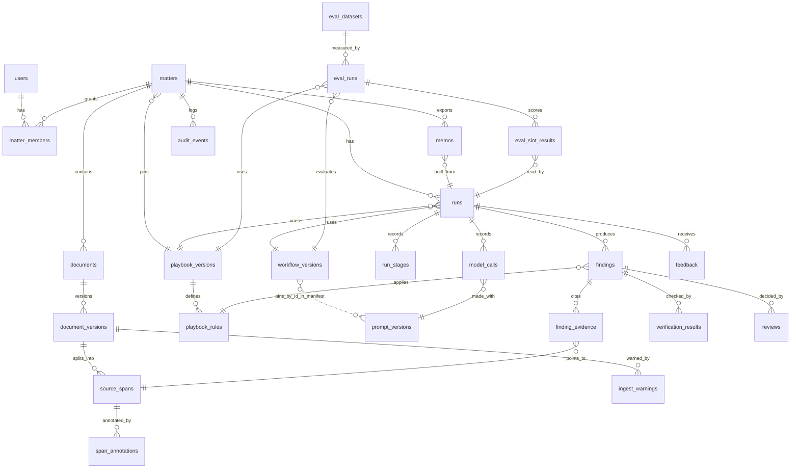

# 3. Data model and contracts

**Implementation status.** Built and tested: the schema as migrations 001 to 003 (25 tables, 29 named
indexes and 68 triggers, counted from a fresh database; the migration runner adds its own bookkeeping
table, `schema_migrations`, which is not counted or shown), the shared shapes in `src/contracts.ts`,
`src/module-contracts.ts` and `src/services`, 21 JSON routes under `/api` beside the page routes,
invalidation by an inputs digest, and 16 verification check ids in two check sets. Not yet built:
feedback, the span endpoint, playbook import and approval and workflow promotion over HTTP, the
evaluation endpoints, carrying findings across a playbook change. The model support check is wired
and no registered workflow pins it; check set C2 is enabled by none. Never run live: token counts,
cost and the provider-reported model are never recorded (NULL), and nothing here is measured.

## Vocabulary

These terms are used identically in every Parol document.

**Categories** (the seven playbook categories): `parties`, `ci-definition`, `exclusions`,
`permitted-disclosures`, `duration`, `return-destruction`, `governing-law`.

**Rules** in the demo playbook `parol-nda-recipient` version 1.0.1 (the file is
`apps/parol/playbooks/parol-nda-recipient.yaml`; the text is in
[document 4](04-worked-example.md#the-demo-playbook)):

| Rule    | Category              | Title                                   | Severity | Required | Hint topics        |
| ------- | --------------------- | --------------------------------------- | -------- | -------- | ------------------ |
| `pty-1` | parties               | Parties correctly identified            | medium   | yes      |                    |
| `def-1` | ci-definition         | Scope of Confidential Information       | medium   | yes      |                    |
| `exc-1` | exclusions            | Four standard exclusions                | high     | yes      |                    |
| `pds-1` | permitted-disclosures | Disclosure to representatives           | medium   | yes      | `representatives`  |
| `pds-2` | permitted-disclosures | Disclosure required by law              | medium   | yes      | `legal-compulsion` |
| `dur-1` | duration              | Duration of confidentiality obligations | high     | yes      |                    |
| `ret-1` | return-destruction    | Return or destruction of information    | low      | no       |                    |
| `gov-1` | governing-law         | Governing law and forum                 | medium   | yes      |                    |

A category can hold more than one rule (`permitted-disclosures` holds two), so a matter always
produces eight findings, one per rule. A hint topic says which kind of keyword hint matters to a
rule: a category that several rules share has one keyword list per topic (the topics are fixed in
`src/ingest/signals.ts`: `representatives` and `legal-compulsion` for `permitted-disclosures`, none
for the other six categories), and a rule that lists topics is checked against the hints of those
topics only. Without the field every topic of the category counts. The playbook loader refuses a
topic the category does not have.

**Finding status**: `compliant`, `deviation`, `missing` (a required presence rule with no clause),
`not_applicable` (a rule that is not required, with no clause), and `undetermined` (the workflow
will not state a status; always carries at least one escalation). The first four are the
Clausewise statuses; `undetermined` is new.

**Escalation reasons** (the only way Parol expresses doubt; there are no confidence scores). These
are the eleven codes in `ESCALATION_CODES`; the check names are those of the verification checks
listed under [Stage contracts](#stage-contracts).

| Code                      | Raised by                                                                                                                                | Meaning for the reviewer                                                                                                                                                                                                                                                                                                                                                                                                              | Forces `undetermined`? |
| ------------------------- | ---------------------------------------------------------------------------------------------------------------------------------------- | ------------------------------------------------------------------------------------------------------------------------------------------------------------------------------------------------------------------------------------------------------------------------------------------------------------------------------------------------------------------------------------------------------------------------------------- | ---------------------- |
| `quote_not_verified`      | verify, deterministic (`quote_exists`, `span_in_bundle`)                                                                                 | A cited passage does not occur in the span it names, is too short (under 12 characters) or too long (over 2,000) to count, or names a span that was not in the bundle. It is shown struck through and never exported.                                                                                                                                                                                                                 | No                     |
| `support_not_confirmed`   | verify: `citation_shape`, `evidence_set`, `numeric_consistency`, `instruction_like_text` (deterministic); `support` (model, when pinned) | The cited passages exist but the finding is not cited as its status requires (including `not_applicable` on a rule the playbook requires, or from a selection), repeats or malforms its evidence, or states a figure or place that is in no verified quote or in the rule; or a cited passage sits in a paragraph that reads like an instruction to software; or the support check says the passages do not establish the conclusion. | No                     |
| `superseded_evidence`     | verify, deterministic: `precedence_labels` (check set C1) and `superseded_evidence` (check set C2)                                       | C1: a passage labelled superseded is not backed by a cited amendment that changes its clause, or a passage labelled governing is changed by a cited amendment. C2: the finding relies on a clause that a later amendment replaces, deletes or amends, without citing the amendment.                                                                                                                                                   | No                     |
| `conflicting_sources`     | verify (`precedence_labels`), from the roles and the conflict text the analysis gave                                                     | Two operative passages disagree and the precedence rules do not settle which governs: a passage labelled conflicting, a conflict the model described, or amendments whose stated dates do not say which governs.                                                                                                                                                                                                                      | Yes                    |
| `missing_not_confirmed`   | verify, deterministic (`missing_confirmation`)                                                                                           | "Missing" (or a compliant absence rule that cites nothing) was claimed, but a keyword hint for the rule's topics sits on a span in the bundle that the finding neither cites nor explains.                                                                                                                                                                                                                                            | No                     |
| `defined_term_unresolved` | verify, deterministic (`defined_term`)                                                                                                   | A term the cited quotes use as defined has no definition in any span of the run. Two different definitions of one term are not detected in code; the analysis is told to report them as a conflict.                                                                                                                                                                                                                                   | No                     |
| `parties_mismatch`        | verify, deterministic (`parties`)                                                                                                        | The client's legal name from intake appears in no cited governing or supporting quote and in no span of the bundle. See the known gap under [Deterministic checks](#deterministic-checks-and-model-judgment).                                                                                                                                                                                                                         | No                     |
| `playbook_escalation`     | verify, deterministic (`playbook_escalation`), from the ids the analysis returned                                                        | The analysis says a condition in the rule's `escalateWhen` list is met (for example a forum outside the approved list). An id the rule does not have is refused at the repair step and dropped in verify.                                                                                                                                                                                                                             | No                     |
| `model_abstained`         | verify (`model_abstained`), from an `undetermined` answer                                                                                | The model declined to state a status and said why.                                                                                                                                                                                                                                                                                                                                                                                    | Yes                    |
| `output_invalid`          | analyze (the runner records it); verify when the status is not one of the five                                                           | No valid structured answer after bounded retries, a refusal, a cut-off reply, or an unusable answer after the one repair attempt.                                                                                                                                                                                                                                                                                                     | Yes                    |
| `context_over_budget`     | retrieve flags the bundle; the runner records the finding                                                                                | The context for this rule exceeds the budget; nothing was truncated, the rule was not analyzed.                                                                                                                                                                                                                                                                                                                                       | Yes                    |

**Warnings** attach to a document or run, not to a finding. Five codes: `instruction_like_text`,
`duplicate_document`, `near_duplicate_version`, `unreviewed_content` and `no_reviewable_text` (a
document that has no paragraph with text to review). `unreviewed_content` has two parts in its detail,
both counts only. `not reviewed: ...` lists footnotes, endnotes, headers and footers, comments,
hidden runs, images, and table-of-contents entries that read like clauses. A hidden run is text
marked hidden in Word, and also text a reader could not see: a colour equal to what is behind it
(white on the page, or the colour of its shading or highlight), a size under 2 points, a character
scale under 10 percent, or condensing of 5 points or more. Only formatting set directly on the run
counts, and not formatting that comes from a style; such text is left out of the review.
`read as accepted: tracked_insertions=N, tracked_deletions=M` lists tracked changes that are not
resolved, which the review reads as if every change had been accepted. A warning's detail holds ids,
counts and pattern names, never document text.

**Review decisions**: `accept`, `edit`, `reject`, `escalate`.

## Identifiers and stable references

- A **document version** is immutable once uploaded. A changed file is a new version.
- A **source span** is one paragraph of one document version. Its id is
  `<documentVersionId>:p<paragraphIndex>`, so it never changes while the version exists, and it
  stores the paragraph text and its SHA-256. A trigger refuses a span whose id has another shape.
  Table-of-contents entries and paragraphs with no visible text get no span, so paragraph indexes
  can have gaps.
- Users see a location like **"Amendment No. 1 (v1), Section 2, paragraph 3"**: document title,
  version number, clause number as written (from `segment`), paragraph index. In lists a span is
  `D2-p3`: the document label and the paragraph index.
- **Deviation.** The model sees clause labels `c1`, `c2`, and so on, counted across all the documents
  of the run in the order D1, D2, D3, in a header line such as `[c12] 6.1 (section: D1 | 6. Term)`:
  the label, the clause number as written, and a section that starts with the document label. It
  never sees an internal id or a `D1-p19` label. Why: the clause renderer in `@clausewise/review`
  already defuses a document line that imitates a `[c12]` header, and it would not defuse any other
  label. Code maps labels back to span ids, as Clausewise maps `c12` to a clause. The label is not
  stored: `toSourceSpans` in `src/store/model-labels.ts` recomputes it from the stored spans, so a
  resumed run reads the labels the first run did. `source_spans.clause_id` is a different thing: the
  `c<n>` that `segment` gave the clause within its own document (`c0` when a paragraph belongs to no
  clause).
- Quotes are located inside a span by character offsets after verification, so the inspector can
  highlight the exact words. A quote that occurs more than once in its span has no offsets (below).

## Entities



The link from a workflow version to its prompts is the prompt ids in its manifest and not a foreign
key (registering a workflow checks that its prompts exist). `audit_events` has no foreign key: it
keeps the matter id after the matter is deleted, and nothing else.

### Schema (SQLite)

Timestamps are ISO 8601 UTC text. JSON columns are validated by zod on write. Foreign keys are on,
and so are `recursive_triggers` and `secure_delete`; the database file is in WAL mode and its file
mode is 0600.

The listing is the schema after migrations `001_init.sql`, `002_integrity.sql` and
`003_ingest_warnings.sql`, in `apps/parol/migrations`. Migration 001 is the design's SQL as it was and
is unchanged, because the migration runner records a checksum of every applied file and refuses to
start if one changed; migration 002 added the columns marked 002, the indexes and the triggers below,
and 003 added `ingest_warnings`. The runner keeps one more table, `schema_migrations`, which is not
shown.

```sql
-- Identity and permissions --------------------------------------------------------------
CREATE TABLE users (
  id            TEXT PRIMARY KEY,
  display_name  TEXT NOT NULL,
  global_role   TEXT NOT NULL CHECK (global_role IN ('member','legal_engineer','admin')),
  demo          INTEGER NOT NULL DEFAULT 1 CHECK (demo = 1)  -- this build has demo identities only
);

CREATE TABLE matters (
  id                       TEXT PRIMARY KEY,
  name                     TEXT NOT NULL,
  client_legal_name        TEXT NOT NULL,
  playbook_version_id      TEXT REFERENCES playbook_versions(id),  -- only an approved version (002)
  status                   TEXT NOT NULL CHECK (status IN
                             ('draft','ready','running','in_review','review_complete',
                              'exported','stale','deleted')),   -- 'deleted' is never stored
  current_manifest_sha256  TEXT,          -- never written: replaced by current_inputs_sha256 (below)
  synthetic                INTEGER NOT NULL DEFAULT 1,
  created_by               TEXT NOT NULL REFERENCES users(id),
  created_at               TEXT NOT NULL,
  retain_until             TEXT NOT NULL, -- 30 days after creation; nothing deletes an expired matter yet
  deleted_at               TEXT,          -- never set: deleting a matter removes its rows
  current_inputs_sha256    TEXT           -- 002. The digest of the inputs a run would use, recomputed
                                          -- in the same transaction as any input change; NULL while
                                          -- the inputs are incomplete
);

CREATE TABLE matter_members (
  matter_id   TEXT NOT NULL REFERENCES matters(id) ON DELETE CASCADE,
  user_id     TEXT NOT NULL REFERENCES users(id),
  role        TEXT NOT NULL CHECK (role IN ('associate','reviewer','viewer')),
  granted_by  TEXT NOT NULL REFERENCES users(id),
  granted_at  TEXT NOT NULL,
  PRIMARY KEY (matter_id, user_id)
);

-- Documents and spans --------------------------------------------------------------------
CREATE TABLE documents (
  id         TEXT PRIMARY KEY,
  matter_id  TEXT NOT NULL REFERENCES matters(id) ON DELETE CASCADE,
  kind       TEXT NOT NULL CHECK (kind IN ('nda','amendment')),
  title      TEXT NOT NULL,
  ordinal    INTEGER NOT NULL,              -- D1, D2, D3 within the matter (1 to 3); the NDA is the
                                            -- one document of kind nda, amendments at most two (002)
  UNIQUE (matter_id, ordinal)
);

CREATE TABLE document_versions (
  id            TEXT PRIMARY KEY,
  document_id   TEXT NOT NULL REFERENCES documents(id) ON DELETE CASCADE,
  matter_id     TEXT NOT NULL REFERENCES matters(id) ON DELETE CASCADE,
  version_no    INTEGER NOT NULL,
  media_type    TEXT NOT NULL CHECK (media_type IN ('docx','txt')),
  file_sha256   TEXT NOT NULL,
  text_sha256   TEXT NOT NULL,              -- of the extracted paragraph texts (documentTextSha256:
                                            -- SHA-256 of the JSON array of them); catches re-saves
  byte_size     INTEGER NOT NULL,
  stated_date   TEXT,                       -- entered at intake, never parsed from document text
  operative     INTEGER NOT NULL DEFAULT 0, -- at most one operative version per document (002)
  storage_path  TEXT NOT NULL,              -- <matter id>/<generated name>; one row per file (002)
  uploaded_by   TEXT NOT NULL REFERENCES users(id),
  uploaded_at   TEXT NOT NULL,
  UNIQUE (document_id, version_no)
);

CREATE TABLE source_spans (
  id                   TEXT PRIMARY KEY,    -- <document_version_id>:p<paragraph_index>
  document_version_id  TEXT NOT NULL REFERENCES document_versions(id) ON DELETE CASCADE,
  matter_id            TEXT NOT NULL REFERENCES matters(id) ON DELETE CASCADE,
  paragraph_index      INTEGER NOT NULL,
  clause_id            TEXT NOT NULL,       -- c<n> from segment(), within its own document; c0 for none.
                                            -- Not the model's label, which is not stored
  clause_number        TEXT,                -- as written, such as 6.1
  heading              TEXT,
  text                 TEXT NOT NULL,
  text_sha256          TEXT NOT NULL
);

CREATE TABLE span_annotations (            -- deterministic, derived at ingest
  span_id  TEXT NOT NULL REFERENCES source_spans(id) ON DELETE CASCADE,
  kind     TEXT NOT NULL CHECK (kind IN
             ('defines_term','uses_term','cross_reference','instruction_like','keyword_hint')),
  value    TEXT NOT NULL                    -- JSON: {term}, {target:"6.1",verb:"deletes"}, {pattern},
                                            -- {category,topic?} (topic only for a category that has them)
);

CREATE TABLE ingest_warnings (             -- 003
  seq                  INTEGER PRIMARY KEY AUTOINCREMENT,
  matter_id            TEXT NOT NULL REFERENCES matters(id) ON DELETE CASCADE,
  document_version_id  TEXT NOT NULL REFERENCES document_versions(id) ON DELETE CASCADE,
  span_id              TEXT REFERENCES source_spans(id) ON DELETE CASCADE,
  code                 TEXT NOT NULL CHECK (code IN
                         ('instruction_like_text','duplicate_document','near_duplicate_version',
                          'unreviewed_content','no_reviewable_text')),
  detail               TEXT NOT NULL CHECK (length(detail) <= 300),  -- ids, counts, pattern names
  created_at           TEXT NOT NULL
);

-- Playbooks, prompts, workflow versions ---------------------------------------------------
CREATE TABLE playbook_versions (
  id             TEXT PRIMARY KEY,
  playbook_slug  TEXT NOT NULL,             -- parol-nda-recipient
  version        TEXT NOT NULL,             -- 1.0.1
  yaml           TEXT NOT NULL,
  sha256         TEXT NOT NULL,             -- of the YAML text exactly as given
  status         TEXT NOT NULL CHECK (status IN ('draft','approved','retired')),
  approved_by    TEXT REFERENCES users(id),
  approved_at    TEXT,
  UNIQUE (playbook_slug, version)
);
-- Triggers (002) create a version as a draft, refuse any change to yaml, sha256, version or approver
-- once it is approved, freeze its rules, and refuse to delete an approved or retired version.

CREATE TABLE playbook_rules (
  id                   TEXT PRIMARY KEY,
  playbook_version_id  TEXT NOT NULL REFERENCES playbook_versions(id),
  rule_key             TEXT NOT NULL,       -- dur-1
  category             TEXT NOT NULL,
  severity             TEXT NOT NULL CHECK (severity IN ('high','medium','low')),
  required             INTEGER NOT NULL,
  kind                 TEXT NOT NULL CHECK (kind IN ('presence','absence')),
  rule_json            TEXT NOT NULL,       -- title, standard, fallback, unacceptable, guidance,
                                            -- fallbackLanguage, escalateWhen, hintTopics
  rule_sha256          TEXT NOT NULL,       -- lets a later version tell which rules changed
  ordinal              INTEGER NOT NULL DEFAULT 0,  -- 002: playbook order, for findings and the memo
  UNIQUE (playbook_version_id, rule_key)
);

CREATE TABLE prompt_versions (
  id           TEXT PRIMARY KEY,            -- analyze.p1
  stage        TEXT NOT NULL CHECK (stage IN ('extract','analyze','support')),
  template     TEXT NOT NULL,               -- canonical JSON of the system text, user template,
                                            -- schema name and the fixed prose the stage adds
  schema_json  TEXT NOT NULL,               -- JSON Schema of the answer
  sha256       TEXT NOT NULL UNIQUE,        -- the registry's hash, which also covers the wording of
                                            -- the shared rendering helpers
  created_at   TEXT NOT NULL
);

CREATE TABLE workflow_versions (
  id                TEXT PRIMARY KEY,
  label             TEXT NOT NULL UNIQUE,   -- v1, v2
  manifest_json     TEXT NOT NULL,          -- label, prompt ids, retrieval policy, enabled check sets,
                                            -- context budget, repair attempts (no model settings)
  sha256            TEXT NOT NULL,
  status            TEXT NOT NULL CHECK (status IN ('candidate','pilot','retired')),
  promoted_by       TEXT REFERENCES users(id),
  promoted_at       TEXT,
  promotion_record  TEXT                    -- path to the signed-off comparison, required for 'pilot'
);

-- Runs ------------------------------------------------------------------------------------
CREATE TABLE runs (
  id                     TEXT PRIMARY KEY,
  matter_id              TEXT NOT NULL REFERENCES matters(id) ON DELETE CASCADE,
  workflow_version_id    TEXT NOT NULL REFERENCES workflow_versions(id),
  playbook_version_id    TEXT NOT NULL REFERENCES playbook_versions(id),
  model_provider         TEXT NOT NULL,     -- 'simulated' for the demonstration reader
  model_requested        TEXT NOT NULL,
  model_reported         TEXT,              -- never written: the model layer does not report it
  input_manifest_json    TEXT NOT NULL,     -- the RunManifest
  input_manifest_sha256  TEXT NOT NULL,     -- its canonical hash; keys the reuse of finished stages
  purpose                TEXT NOT NULL CHECK (purpose IN ('matter','eval')),
  status                 TEXT NOT NULL CHECK (status IN
                           ('queued','ingesting','extracting','retrieving','analyzing',
                            'verifying','succeeded','failed','cancelled','superseded')),
  error_kind             TEXT,              -- provider_auth, provider_permission, provider_model,
                                            -- provider_billing, provider_redirect, interrupted, internal
  started_by             TEXT NOT NULL REFERENCES users(id),
  started_at             TEXT NOT NULL,
  finished_at            TEXT,
  inputs_sha256          TEXT               -- 002. The inputs digest the run was started on; required
                                            -- (a trigger refuses a run without it)
);

CREATE TABLE run_stages (
  run_id         TEXT NOT NULL REFERENCES runs(id) ON DELETE CASCADE,
  stage          TEXT NOT NULL,             -- ingest, extract, retrieve, analyze, verify
  unit           TEXT NOT NULL DEFAULT '*', -- rule key for analyze and verify, '*' otherwise
  attempt        INTEGER NOT NULL,
  status         TEXT NOT NULL CHECK (status IN ('running','succeeded','failed')),
  input_sha256   TEXT NOT NULL,
  output_json    TEXT,
  output_sha256  TEXT,
  error_kind     TEXT,
  started_at     TEXT NOT NULL,
  finished_at    TEXT,
  PRIMARY KEY (run_id, stage, unit, attempt)
);

CREATE TABLE model_calls (                  -- no prompt or response text, by design
  id                  TEXT PRIMARY KEY,
  run_id              TEXT NOT NULL REFERENCES runs(id) ON DELETE CASCADE,
  stage               TEXT NOT NULL,
  rule_key            TEXT,
  prompt_version_id   TEXT NOT NULL REFERENCES prompt_versions(id),
  request_sha256      TEXT NOT NULL,        -- of the system text and the prompt
  attempt             INTEGER NOT NULL,
  outcome             TEXT NOT NULL CHECK (outcome IN
                        ('ok','schema_error','semantic_error','refusal','cut_off','transport','fatal')),
  input_tokens        INTEGER, output_tokens INTEGER,        -- always NULL: the model layer does not
  cache_read_tokens   INTEGER, cache_write_tokens INTEGER,   -- report usage to the stages
  latency_ms          INTEGER NOT NULL,
  cost_usd_estimate   REAL,                 -- always NULL
  price_table_sha256  TEXT                  -- always NULL
);

-- Findings, evidence, verification ---------------------------------------------------------
CREATE TABLE findings (
  id                  TEXT PRIMARY KEY,
  run_id              TEXT NOT NULL REFERENCES runs(id) ON DELETE CASCADE,
  matter_id           TEXT NOT NULL REFERENCES matters(id) ON DELETE CASCADE,
  playbook_rule_id    TEXT NOT NULL REFERENCES playbook_rules(id),
  rule_key            TEXT NOT NULL,
  category            TEXT NOT NULL,
  severity            TEXT NOT NULL,
  status              TEXT NOT NULL CHECK (status IN
                        ('compliant','deviation','missing','not_applicable','undetermined')),
  discrepancy         TEXT NOT NULL,       -- empty when compliant or not_applicable
  explanation         TEXT NOT NULL,
  fallback_language   TEXT,
  fallback_basis      TEXT NOT NULL CHECK (fallback_basis IN
                        ('approved_adapted','approved_verbatim','generated','none')),
  escalations_json    TEXT NOT NULL DEFAULT '[]',
  verification_state  TEXT NOT NULL CHECK (verification_state IN ('verified','escalated_by_system')),
  content_sha256      TEXT NOT NULL,       -- over rule key, status, texts, fallback basis, conflict,
                                           -- evidence (span, quote, role, quote and support checks)
                                           -- and escalations;
                                           -- not abstain reason, offsets or check details
  validity            TEXT NOT NULL DEFAULT 'current' CHECK (validity IN ('current','stale')),
  stale_reason        TEXT,                -- a closed code, such as document_changed
  conflict            TEXT,                -- 002: the model's description of passages that disagree
  abstain_reason      TEXT                 -- 002: why the model gave no status
);

CREATE TABLE finding_evidence (
  id             TEXT PRIMARY KEY,
  finding_id     TEXT NOT NULL REFERENCES findings(id) ON DELETE CASCADE,
  span_id        TEXT NOT NULL REFERENCES source_spans(id) ON DELETE CASCADE,
  role           TEXT NOT NULL CHECK (role IN
                   ('governing','supporting','superseded','conflicting','definition')),
  quote          TEXT NOT NULL,
  start_offset   INTEGER,                  -- set only for a unique, verified quote
  end_offset     INTEGER,
  quote_check    TEXT NOT NULL CHECK (quote_check IN ('verified','not_found','ambiguous')),
  support_check  TEXT NOT NULL CHECK (support_check IN
                   ('supported','not_supported','insufficient','not_run')),
  ordinal        INTEGER NOT NULL DEFAULT 0  -- 002: the content hash covers evidence in order
);

CREATE TABLE verification_results (
  finding_id  TEXT NOT NULL REFERENCES findings(id) ON DELETE CASCADE,
  check_id    TEXT NOT NULL,               -- quote_exists, span_in_bundle, numeric_consistency, ...
  kind        TEXT NOT NULL CHECK (kind IN ('deterministic','model')),
  outcome     TEXT NOT NULL CHECK (outcome IN ('pass','fail','not_applicable')),
  detail      TEXT NOT NULL,               -- ids and short reasons; no document text
  ordinal     INTEGER NOT NULL DEFAULT 0,  -- 002
  PRIMARY KEY (finding_id, check_id)
);

-- Review, export, feedback ---------------------------------------------------------------
CREATE TABLE reviews (
  id                      TEXT PRIMARY KEY,
  finding_id              TEXT NOT NULL REFERENCES findings(id) ON DELETE CASCADE,
  matter_id               TEXT NOT NULL REFERENCES matters(id) ON DELETE CASCADE,
  reviewer_id             TEXT NOT NULL REFERENCES users(id),
  decision                TEXT NOT NULL CHECK (decision IN ('accept','edit','reject','escalate')),
  edited_json             TEXT,            -- changed fields only: status, discrepancy, fallbackLanguage,
                                           -- evidenceRoles
  reason                  TEXT,            -- required for edit, reject and escalate
  finding_content_sha256  TEXT NOT NULL,   -- the exact finding content the reviewer saw
  supersedes_review_id    TEXT REFERENCES reviews(id),
  validity                TEXT NOT NULL DEFAULT 'current' CHECK (validity IN ('current','stale')),
  created_at              TEXT NOT NULL
);

CREATE TABLE memos (
  id               TEXT PRIMARY KEY,
  matter_id        TEXT NOT NULL REFERENCES matters(id) ON DELETE CASCADE,
  run_id           TEXT NOT NULL REFERENCES runs(id),
  review_ids_json  TEXT NOT NULL,
  file_sha256      TEXT NOT NULL,
  storage_path     TEXT NOT NULL,
  status           TEXT NOT NULL CHECK (status IN ('current','superseded')),
  exported_by      TEXT NOT NULL REFERENCES users(id),
  exported_at      TEXT NOT NULL
);

CREATE TABLE feedback (                    -- the table and a store method exist; no route or page
  id           TEXT PRIMARY KEY,
  matter_id    TEXT NOT NULL REFERENCES matters(id) ON DELETE CASCADE,
  run_id       TEXT REFERENCES runs(id),
  finding_id   TEXT REFERENCES findings(id),
  user_id      TEXT NOT NULL REFERENCES users(id),
  kind         TEXT NOT NULL CHECK (kind IN ('finding_reason','missed_issue','rating','comment')),
  reason_code  TEXT,                       -- wrong_status, wrong_evidence, bad_fallback, unclear, ...
  rating       INTEGER CHECK (rating BETWEEN 1 AND 5),
  text         TEXT,
  created_at   TEXT NOT NULL
);

-- Evaluation ------------------------------------------------------------------------------
-- The three tables and their store methods exist and are tested. The evaluation runner
-- (evals/src/parol) does not write to them: it writes a results file.
CREATE TABLE eval_datasets (
  id              TEXT PRIMARY KEY,
  label           TEXT NOT NULL,           -- parol-cases v1
  dev_sha256      TEXT NOT NULL,
  heldout_sha256  TEXT NOT NULL,           -- committed before the first baseline run
  created_at      TEXT NOT NULL
);

CREATE TABLE eval_runs (
  id                   TEXT PRIMARY KEY,
  dataset_id           TEXT NOT NULL REFERENCES eval_datasets(id),
  split                TEXT NOT NULL CHECK (split IN ('dev','heldout','calibration')),
  workflow_version_id  TEXT NOT NULL REFERENCES workflow_versions(id),
  playbook_version_id  TEXT NOT NULL REFERENCES playbook_versions(id),
  model                TEXT NOT NULL,
  repeats              INTEGER NOT NULL,
  price_table_sha256   TEXT NOT NULL,
  results_path         TEXT NOT NULL,
  started_at           TEXT NOT NULL,
  finished_at          TEXT
);

CREATE TABLE eval_slot_results (
  eval_run_id      TEXT NOT NULL REFERENCES eval_runs(id),
  case_key         TEXT NOT NULL,          -- PAROL-D05
  rule_key         TEXT NOT NULL,
  repeat           INTEGER NOT NULL,
  run_id           TEXT NOT NULL REFERENCES runs(id),
  expected_status  TEXT NOT NULL,
  got_status       TEXT NOT NULL,
  scores_json      TEXT NOT NULL,          -- per-metric outcome for this slot
  PRIMARY KEY (eval_run_id, case_key, rule_key, repeat)
);

-- Audit -----------------------------------------------------------------------------------
CREATE TABLE audit_events (
  seq          INTEGER PRIMARY KEY AUTOINCREMENT,
  at           TEXT NOT NULL,
  actor_id     TEXT,
  matter_id    TEXT,                       -- kept after matter deletion, as an id only
  action       TEXT NOT NULL,              -- matter.create, document.add, run.create, review.decide, ...
  target_type  TEXT NOT NULL,
  target_id    TEXT NOT NULL,
  detail_json  TEXT NOT NULL,              -- ids, hashes, counts; never document text
  prev_hash    TEXT NOT NULL,
  hash         TEXT NOT NULL               -- sha256(prev_hash || canonical row); tamper evident only
                                           -- when verifyAuditChain is run, which no application code does;
                                           -- one chain for the whole database
);
```

**Indexes added by migration 002 and 003.** Eight are unique, and each states a rule that must hold
whatever code writes the rows: one run in flight per matter, one operative version per document, one
NDA per matter, one current decision per finding, one current memo per matter, one finding per rule
in a run, and one row per stored file (for versions and for memos). The other 21 are on the child
side of foreign keys and on the orderings the pages use, because SQLite does not index them itself
and a matter's deletion would otherwise scan every child table once per cascaded row.

**Triggers added by migration 002 and 003.** The store refuses changes a bug could make, whatever
code runs against the file. Each message starts with `parol:` so that the store can tell a trigger
from another constraint error, and every immutability trigger has an insert guard too, because an
`INSERT OR REPLACE` removes the old row without an update ever being seen.

| Area                  | What the triggers enforce                                                                                                                                                                                                                            |
| --------------------- | ---------------------------------------------------------------------------------------------------------------------------------------------------------------------------------------------------------------------------------------------------- |
| Audit                 | `audit_events` is append only (no update, delete or replace), and each new row's `prev_hash` is the hash of the row before it. The hash itself is checked by `verifyAuditChain`, as SQLite cannot compute SHA-256                                    |
| Matters               | Identity (id, creator, creation time, synthetic flag) never changes; a matter is never replaced; a matter can pin only an approved playbook version                                                                                                  |
| Documents             | One NDA and at most two amendments, labelled D1 to D3; identity never changes; never replaced                                                                                                                                                        |
| Document versions     | Content never changes (only the stated date and the operative flag); at most one operative version per document; a version belongs to its document's matter; the stored file is in the matter's own folder and belongs to one row, never also a memo |
| Spans and annotations | Written once, in the matter of their version, with the id shape above; never updated                                                                                                                                                                 |
| Playbooks             | A version is created as a draft; once approved or retired it is frozen with its rules; approval records who and when; an approved version cannot be deleted                                                                                          |
| Prompts and workflows | A prompt version is immutable and never deleted; a workflow version is created as a candidate, its manifest never changes, its status moves only candidate to pilot to retired, and a pilot needs a promotion record, a promoter and a time          |
| Runs                  | A run records its inputs digest; its provenance columns never change; a matter has one run in flight                                                                                                                                                 |
| Findings and evidence | A finding is created current and its content never changes; validity moves from current to stale and never back, with a reason; evidence must cite a span of a document version in the run's manifest; verification results are never replaced       |
| Reviews               | Immutable except that a current review becomes stale, and never back; a review belongs to the matter of its finding                                                                                                                                  |
| Memos                 | Immutable except for being superseded; a memo belongs to the matter of its run and its file sits in that matter's folder                                                                                                                             |
| Feedback, evaluation  | Feedback refers only to its own matter; evaluation results come only from synthetic matters                                                                                                                                                          |
| Ingest warnings (003) | A warning belongs to a version of its own matter; warnings are replaced, never edited                                                                                                                                                                |

## Invalidation

**Mechanism.** Two hashes do two jobs.

- The **inputs digest** decides whether results are current. It is the SHA-256 of the canonical JSON
  (sorted keys, no white space) of the client's legal name, the playbook version's hash and, for each
  document in ordinal order, its operative version id, text hash, stated date and kind
  (`inputsDigestOf` in `src/store/repo-matters.ts`). It leaves out the workflow and the model on
  purpose, so that a matter can say whether its results are current before anyone has chosen a
  workflow, and a new workflow version does not make old findings stale. The matter stores it as
  `current_inputs_sha256`, recomputed in the same transaction as any input change; a run stores the
  digest it started on as `inputs_sha256`. It is NULL while the inputs are incomplete (no approved
  playbook, no NDA, or a document without an operative version).
- The **run manifest hash** says what a run read. `runs.input_manifest_json` is the `RunManifest`
  (below), which the server builds from the database after authorization and never from request data,
  and `input_manifest_sha256` is its canonical hash, computed in `createRun`
  (`src/store/repo-runs.ts`). It includes the workflow and the model. It is the base of every stage's
  input hash, so a resumed run reuses a finished unit only when the manifest, the prompt and the
  bundle are the same. It does not decide currency.

**Deviation.** The design had one manifest hash, stored on the matter as `current_manifest_sha256`,
and said a finding is current while its run's manifest hash equals the matter's. That would have made
every choice of workflow or model look like a change of inputs. The 001 column still exists and is
never written.

A finding is current only while its `validity` is `current` and its run's `inputs_sha256` equals the
digest recomputed from the database. A review is current only while its finding is current and its
`finding_content_sha256` equals the finding's hash. Export recomputes both checks at the moment of
export rather than trusting stored flags: `getExportReadiness` recomputes the digest, each finding's
content hash from its stored content and compares each decision's hash, and the store runs it again
inside the transaction that records the memo, which must also name exactly the current decisions.
Exporting the same decisions of the same run a second time is idempotent: the store returns the memo
on record, writes nothing and adds no audit event, so the first memo is not marked superseded by an
identical copy (the check is inside the transaction, so parallel exports give one memo). A later
review with new decisions supersedes it. The download file name is
`parol-memo-<matter id without its prefix>-<yyyymmdd>.docx`, and a superseded memo downloads as
`...-<yyyymmdd>-superseded-<first eight characters of the memo id>.docx`, so a replaced memo and its
replacement do not share a name even on the same day. The stored file carries no marker of its own,
because it is kept as built under its recorded hash.

Where hashes are made: `src/canonical.ts` (canonical JSON, SHA-256, the finding content hash),
`src/ingest/text-hash.ts` (a version's text hash), `src/store/repo-matters.ts` (inputs digest),
`src/store/repo-runs.ts` (manifest hash), `src/store/repo-playbooks.ts` (rule hashes),
`src/prompts/registry.ts` and `workflows.ts` (prompt and workflow hashes), `src/playbooks/load.ts`
(the playbook's YAML hash), `src/store/audit.ts` (the chain) and the services (file and memo hashes).

| Change                                                 | Findings                                                                                                                                                                  | Reviews          | Exported memo                                                                                                                                                                                                                                                  | What the user sees                                                                                                                                                                                                                                                                            |
| ------------------------------------------------------ | ------------------------------------------------------------------------------------------------------------------------------------------------------------------------- | ---------------- | -------------------------------------------------------------------------------------------------------------------------------------------------------------------------------------------------------------------------------------------------------------- | --------------------------------------------------------------------------------------------------------------------------------------------------------------------------------------------------------------------------------------------------------------------------------------------- |
| New version of a document with different text          | All stale (`document_changed`)                                                                                                                                            | Stale            | Superseded                                                                                                                                                                                                                                                     | Banner "Results are out of date" with the reason in words, export blocked, "Re-run review" button                                                                                                                                                                                             |
| Document added or removed                              | All stale (`document_added`, `document_removed`; any document can touch any rule)                                                                                         | Stale            | Superseded                                                                                                                                                                                                                                                     | Same. A removed document's spans are deleted with it, and so is the evidence that earlier, stale findings cited from it                                                                                                                                                                       |
| Another version of a document made operative           | All stale (`operative_changed`)                                                                                                                                           | Stale            | Superseded                                                                                                                                                                                                                                                     | Same                                                                                                                                                                                                                                                                                          |
| A document's stated date changed                       | All stale (`stated_date_changed`)                                                                                                                                         | Stale            | Superseded                                                                                                                                                                                                                                                     | Same                                                                                                                                                                                                                                                                                          |
| Identical file re-uploaded (same `file_sha256`)        | No change                                                                                                                                                                 | No change        | No change                                                                                                                                                                                                                                                      | `duplicate_document` warning; upload not stored again; the API answers 200 and not 201. If the upload carries a stated date that differs from the stored one, it is refused with 409 `duplicate_stated_date` (change the date on the existing version); the same date, or none, gives the 200 |
| Re-saved file with identical text (same `text_sha256`) | No change                                                                                                                                                                 | No change        | No change                                                                                                                                                                                                                                                      | `near_duplicate_version` warning; the copy is stored and the earlier version stays operative; the associate may choose the copy, which changes the operative version and so makes results stale                                                                                               |
| Client legal name edited                               | All stale (`client_name_changed`; the name is in every prompt)                                                                                                            | Stale            | Superseded                                                                                                                                                                                                                                                     | Same                                                                                                                                                                                                                                                                                          |
| Matter switched to another playbook version            | All stale (`playbook_changed`; MVP)                                                                                                                                       | Stale            | Superseded                                                                                                                                                                                                                                                     | Same                                                                                                                                                                                                                                                                                          |
| New playbook version approved but not selected         | None (matters pin versions)                                                                                                                                               | None             | None                                                                                                                                                                                                                                                           | Not yet built: the "Version 1.1.0 is available" notice. The playbook picker lists every approved version                                                                                                                                                                                      |
| Workflow version promoted to pilot                     | None for existing runs (the digest leaves the workflow out)                                                                                                               | None             | None                                                                                                                                                                                                                                                           | New runs use it; old runs keep their label. Not yet built over HTTP: the store method exists, no route calls it                                                                                                                                                                               |
| Re-run with unchanged inputs                           | New findings; the old ones stale (`rerun_requested`) and their run superseded. A re-run that fails or is cancelled leaves the matter `stale`, with the old findings stale | Not carried over | Unchanged: it stays on record until the new run's memo supersedes it. The memos page and the matter page label it "Earlier review" and say a newer review was started; its JSON status stays `current`, so a client compares `memo.runId` with the current run | The Re-run form says the findings are replaced and the decisions stop counting. Not yet built: the prior decision shown for reference and one-click re-confirmation when the new finding's content hash equals the old one                                                                    |

The reason shown for a stale matter is read from its stale findings. A matter whose first review was
stopped by the change holds no finding, so its reason is read from the last `inputs.changed` audit
event and worded "while the review was running" (for example "The stated date of a document changed
while the review was running."), and its banner does not talk about decisions that were never made.

**Not built.** Scope cut 2 in [document 7](07-delivery-plan.md#scope-cuts-in-order) drops it: when
only the playbook version changes, findings for rules whose `rule_sha256` is unchanged are carried into the new run,
labelled "carried from run r_0142", and their decisions need explicit re-confirmation rather than
silently persisting.

## Stage contracts

TypeScript shapes, validated with zod at every stage boundary. A stage's output is persisted with
the hash of its input, which is what makes resume safe. The shapes below are those of
`src/contracts.ts` and the function signatures of `src/module-contracts.ts`, trimmed of comments.

```ts
type SpanId = string; // `${documentVersionId}:p${paragraphIndex}`
type CategoryId =
  | "parties"
  | "ci-definition"
  | "exclusions"
  | "permitted-disclosures"
  | "duration"
  | "return-destruction"
  | "governing-law";
type Status = "compliant" | "deviation" | "missing" | "not_applicable" | "undetermined";
type EvidenceRole = "governing" | "supporting" | "superseded" | "conflicting" | "definition";

interface RunManifest {
  matterId: string;
  clientLegalName: string;
  documents: {
    documentVersionId: string;
    label: "D1" | "D2" | "D3";
    kind: "nda" | "amendment";
    title: string;
    versionNo: number;
    statedDate: string | null;
    textSha256: string;
  }[];
  playbook: { versionId: string; slug: string; version: string; sha256: string };
  workflow: { versionId: string; label: string; sha256: string };
  model: { provider: string; model: string };
}

// What a workflow version pins; its canonical hash is the workflow version's identity.
interface WorkflowManifest {
  label: string; // v1, v2
  prompts: { extract: string; analyze: string; support: string | null }; // prompt ids
  retrieval: "R1" | "R2";
  checks: string[]; // enabled check sets: "C1" baseline, "C2" adds the supersession check
  budgetTokens: number; // estimated tokens allowed in one rule's context (12000)
  repairAttempts: number; // extra attempts after a semantic error (1)
}

interface SourceSpan {
  id: SpanId;
  label: string; // what people read: D1-p19
  modelLabel: string; // what the model reads and cites: c1, c2, ... across D1, D2, D3
  documentVersionId: string;
  docLabel: "D1" | "D2" | "D3";
  paragraphIndex: number;
  clauseId: string; // from segment(), within its own document
  clauseNumber: string | null;
  heading: string | null;
  text: string;
  textSha256: string;
}

// ingest: deterministic. Run when a file is uploaded; the run reads the stored result.
type BuildIngest = (input: { documents: IngestDocumentInput[] }) => IngestOutput;
interface IngestOutput {
  spans: SourceSpan[];
  annotations: (
    | { kind: "defines_term"; spanId: SpanId; term: string }
    | { kind: "uses_term"; spanId: SpanId; term: string }
    | {
        kind: "cross_reference";
        spanId: SpanId;
        target: string;
        verb: "replaces" | "amends" | "deletes" | "refers";
      }
    | { kind: "instruction_like"; spanId: SpanId; pattern: string }
    | { kind: "keyword_hint"; spanId: SpanId; category: CategoryId; topic?: string }
  )[];
  warnings: { code: WarningCode; documentVersionId: string; spanId?: SpanId; detail: string }[];
}

// extract: one model call over all operative spans, then deterministic quote checks
interface ExtractArgs {
  ingest: IngestOutput;
  manifest: RunManifest; // intake data: document kinds, stated dates, the client's name
  prompt: RegisteredPrompt;
  generator: ObjectGenerator;
  signal?: AbortSignal;
}
interface ExtractOutput {
  categories: Record<
    CategoryId,
    {
      located: { spanId: SpanId; quote: string; quoteCheck: "verified" | "not_found" }[];
      notFound: boolean; // the model found no passage for the category
      notFoundReason: string | null;
      hintSpans: SpanId[]; // keyword hints the model did not locate
    }
  >;
  degraded: boolean; // the model call failed: nothing located, retrieval reads whole documents
}

// retrieve: deterministic, one bundle per rule
interface RetrieveArgs {
  ingest: IngestOutput;
  extract: ExtractOutput;
  rules: PlaybookRuleRecord[];
  policy: "R1" | "R2";
  budgetTokens: number;
}
interface PlaybookRuleRecord {
  key: string;
  category: CategoryId;
  title: string;
  severity: "high" | "medium" | "low";
  required: boolean;
  kind: "presence" | "absence";
  standard: string;
  fallback: string | null;
  unacceptable: string | null;
  guidance: string | null;
  fallbackLanguage: string | null;
  escalateWhen: { id: string; text: string }[];
  hintTopics?: string[];
}
interface ContextBundle {
  ruleKey: string;
  category: CategoryId;
  rule: PlaybookRuleRecord;
  spans: {
    spanId: SpanId;
    why: "located" | "definition" | "cross_reference" | "hint" | "full_document";
  }[];
  fullDocument: boolean; // true when "missing" is possible and must be judged on everything
  estimatedTokens: number;
  budgetTokens: number;
  overBudget: boolean; // estimatedTokens > budgetTokens: nothing is truncated, the rule is not analyzed
}

// analyze: model output after mapping labels to span ids
interface AnalyzeArgs {
  bundle: ContextBundle;
  ingest: IngestOutput;
  manifest: RunManifest;
  prompt: RegisteredPrompt;
  repairAttempts: number;
  generator: ObjectGenerator;
  signal?: AbortSignal;
}
type AnalyzeResult =
  | { ok: true; draft: DraftFinding; calls: CallRecord[] }
  | { ok: false; detail: string; calls: CallRecord[] }; // becomes undetermined, output_invalid
interface DraftFinding {
  ruleKey: string;
  status: Status;
  evidence: { spanId: SpanId; quote: string; role: EvidenceRole }[];
  discrepancy: string;
  explanation: string;
  fallbackLanguage: string | null;
  escalateWhenMatched: string[]; // ids from the rule's escalateWhen list
  conflict: string | null;
  abstainReason: string | null;
}

// verify
interface VerifyArgs {
  draft: DraftFinding;
  bundle: ContextBundle;
  rule: PlaybookRuleRecord;
  ingest: IngestOutput;
  manifest: RunManifest;
  enabledChecks: string[]; // the workflow's check sets: "C1", "C2"
  supportChecker?: SupportChecker | null; // null or absent: no model check, supportCheck stays not_run
  generator?: ObjectGenerator;
  signal?: AbortSignal;
}
interface VerifiedFinding {
  ruleKey: string;
  category: CategoryId;
  severity: "high" | "medium" | "low";
  status: Status;
  evidence: {
    spanId: SpanId;
    quote: string;
    role: EvidenceRole;
    quoteCheck: "verified" | "not_found" | "ambiguous";
    offsets: { start: number; end: number } | null;
    supportCheck: "supported" | "not_supported" | "insufficient" | "not_run";
  }[];
  discrepancy: string;
  explanation: string;
  fallbackLanguage: string | null;
  fallbackBasis: "approved_adapted" | "approved_verbatim" | "generated" | "none";
  conflict: string | null;
  abstainReason: string | null;
  checks: {
    id: string;
    kind: "deterministic" | "model";
    outcome: "pass" | "fail" | "not_applicable";
    detail: string;
  }[];
  escalations: { code: EscalationCode; detail: string }[];
  verificationState: "verified" | "escalated_by_system";
  contentSha256: string;
}
type VerifyFinding = (
  args: VerifyArgs,
) => Promise<{ finding: VerifiedFinding; calls: CallRecord[] }>;

// A rule the workflow could not analyze: status undetermined, no evidence, one escalation.
type MakeUndetermined = (args: {
  rule: PlaybookRuleRecord;
  code: EscalationCode;
  detail: string;
}) => VerifiedFinding;

// One model call as recorded in model_calls: hashes, counts and names, never text.
interface CallRecord {
  stage: "extract" | "analyze" | "support";
  ruleKey: string | null;
  promptVersionId: string;
  requestSha256: string;
  attempt: number; // 1 for the first answer, 2 for a semantic repair
  outcome: "ok" | "schema_error" | "semantic_error" | "refusal" | "cut_off" | "transport" | "fatal";
  latencyMs: number;
  inputTokens: number | null; // always null: the generator interface does not report usage
  outputTokens: number | null;
  cacheReadTokens: number | null;
  cacheWriteTokens: number | null;
}
```

**The checks.** Verification records its checks under these 16 ids (the same as
`verification_results.check_id`), in this order: `quote_exists`, `span_in_bundle`, `evidence_set`,
`citation_shape`, `numeric_consistency`, `precedence_labels`, `superseded_evidence`, `parties`,
`missing_confirmation`, `playbook_escalation`, `defined_term`, `instruction_like_text`, `support`,
`model_abstained`, `status_forced` and `fallback_basis`. Check set `C1` is the baseline and runs
thirteen of them: all but `superseded_evidence`, `support` and `status_forced`. Set `C2` adds
`superseded_evidence`. The `support` check (model) runs whenever a support checker is given, which is
when the workflow pins the prompt `support.p1`. `status_forced` is recorded when an escalation turned
a determined status into `undetermined`. `instruction_like_text` escalates (`support_not_confirmed`)
every cited passage, in any role, that sits in a paragraph ingest flagged as reading like an
instruction to software; its detail names evidence positions and span labels, never the paragraph.
With no set enabled a finding still has well-formed evidence, a basis and a hash, and an
`undetermined` status still carries an escalation. A name that is not a check set is a programming
error and throws. Workflow versions v1 and v2 pin `["C1"]` and no support prompt, so C2 and the model
check are built and tested and are not turned on by any registered workflow. Before a finding is
formed, NUL characters and lone surrogates in the model's free text (discrepancy, explanation,
fallback language, conflict, abstain reason) and in its quotes are replaced by U+FFFD, so that the
content hash taken at verify equals the hash recomputed from the stored row.

### Model-facing schemas

Kept plain, as Clausewise's `RuleCheckSchema` is: no optional keys (nullable instead), no min or
max constraints, enums with their definitions in the description. Every semantic check is done in
code after parsing. These are in `src/contracts.ts`.

```ts
const LocateSchema = z.object({
  categories: z.array(
    z.object({
      category: z.enum(CATEGORY_IDS),
      passages: z.array(
        z.object({
          span: z
            .string()
            .describe("A clause label such as c12, exactly as shown in the header line."),
          quote: z
            .string()
            .describe(
              "Words copied exactly from that clause that show why it belongs to the category.",
            ),
        }),
      ),
      notFoundReason: z
        .string()
        .nullable()
        .describe("Why no passage covers the category, or null when passages are given."),
    }),
  ),
});

const AnalysisSchema = z.object({
  // Described by five sentences, one per status; analyze.p1 repeats them word for word,
  // and a test keeps the two equal.
  status: z.enum(["compliant", "deviation", "missing", "not_applicable", "undetermined"]),
  evidence: z.array(
    z.object({
      span: z.string().describe("A clause label such as c12, exactly as shown in the header line."),
      quote: z.string().describe("Copied character for character from that clause."),
      role: z.enum(["governing", "supporting", "superseded", "conflicting", "definition"]),
    }),
  ),
  discrepancy: z
    .string()
    .describe(
      "How the governing text differs from the standard. An empty string when compliant or not applicable.",
    ),
  explanation: z.string(),
  fallbackLanguage: z
    .string()
    .nullable()
    .describe(
      "Adapt the rule's approved fallback language to the documents' defined terms. Null when compliant or not applicable.",
    ),
  escalateWhenMatched: z.array(z.string()),
  conflict: z.string().nullable().describe("Describe passages that disagree, or null."),
  abstainReason: z.string().nullable().describe("Required when status is undetermined."),
});

const SupportSchema = z.object({
  verdict: z.enum(["supported", "not_supported", "insufficient"]),
  missingPremise: z
    .string()
    .nullable()
    .describe("What the passages would need to say for the conclusion to follow."),
});
```

The three prompts are registered as `extract.p1`, `analyze.p1` and `support.p1` in
`src/prompts/registry.ts`, each with a hash that covers its text, its schema, the fixed prose the
stage adds around it and the wording of the shared rendering helpers; the store refuses to register a
changed prompt under an id it already holds.

## HTTP API

JSON under `/api`; the HTML pages call the same operations (`src/server/routes/operations.ts`), so a
page and the API refuse the same input. Every route below `/api/matters/:id` resolves membership
first; a user who is not a member gets **404**, so the existence of a matter is not revealed, and a
member whose role may not do the thing gets 403. Roles: associate (A), reviewer (R), viewer (V),
legal engineer (LE), admin (AD).

Conventions as built:

- A visitor with no session gets 401 JSON under `/api` and a 303 redirect to `/` for a page.
- Every write needs the CSRF token in the `x-csrf-token` header (or the `_csrf` form field).
  `GET /api/session` tells a script its token; a script signs in by posting to `/session`.
- Every body is checked with a strict schema: a key the operation does not offer is a 400, with a
  fixed message that does not repeat the input.
- An error is `{ "error": { "kind", "message", ... } }` with a fixed kind and message and a closed
  `code` where there is one (`invalid_request` 400, `unauthenticated` 401, `forbidden` and `csrf` 403,
  `not_found` 404, `conflict`, `active_run`, `stale_run`, `not_ready` and `export_blocked` 409,
  `too_large` 413, `upload_rejected` 422, `internal` 500 with a `requestId`). A `conflict` carries the
  code of what disagreed: `content_mismatch` and `stale_finding` (a decision made on content that
  moved on), `decision_conflict` (another reviewer's decision is current on the finding; a reviewer
  can change only their own), `duplicate_stated_date` (an identical file arrived with a different
  stated date), `memo_file_changed` and `memo_file_missing` (the stored memo no longer matches its
  record, or is gone), among others.
- The upload limit is `PAROL_MAX_UPLOAD_BYTES` (10 MB by default).

| Method | Path                                           | Purpose                                                                                                                                                                                                                                                                                               | Allowed                           |
| ------ | ---------------------------------------------- | ----------------------------------------------------------------------------------------------------------------------------------------------------------------------------------------------------------------------------------------------------------------------------------------------------- | --------------------------------- |
| GET    | `/api/session`                                 | The signed-in person (or null) and the CSRF token. Built, and not in the design                                                                                                                                                                                                                       | anyone                            |
| POST   | `/session`, `/session/end`                     | Choose a demo identity (`intent` `sign-in` and `userId`) or sign out; a form or JSON. A caller that posts JSON gets JSON errors (kind and code), a form post gets the HTML page, and a JSON post to any other page still gets HTML. Replaces `POST /api/demo/session`; only with the demo identity on | anyone, with a token              |
| GET    | `/api/matters`                                 | Matters the user is a member of                                                                                                                                                                                                                                                                       | any user                          |
| POST   | `/api/matters`                                 | Create a matter; creator becomes associate; optional reviewer and playbook version                                                                                                                                                                                                                    | any user                          |
| GET    | `/api/matters/:id`                             | Matter, members, documents, upload warnings, playbooks, readiness to start, runs, memos                                                                                                                                                                                                               | A, R, V                           |
| PATCH  | `/api/matters/:id`                             | One kind of change per request: client name or playbook version, or the operative version of a document, or a stated date                                                                                                                                                                             | A                                 |
| POST   | `/api/matters/:id/members`                     | Add a member                                                                                                                                                                                                                                                                                          | A                                 |
| POST   | `/api/matters/:id/documents`                   | Upload DOCX or TXT (multipart: `title`, `kind`, `statedDate`, `file`); 201, or 200 for a duplicate, or 409 `duplicate_stated_date` for a duplicate whose stated date differs                                                                                                                          | A                                 |
| POST   | `/api/matters/:id/documents/:docId/versions`   | Upload a new version (multipart: `statedDate`, `file`); the same 200 and 409 as above                                                                                                                                                                                                                 | A                                 |
| DELETE | `/api/matters/:id/documents/:docId`            | Remove the last document of the matter. Built, and not in the design                                                                                                                                                                                                                                  | A                                 |
| POST   | `/api/matters/:id/runs`                        | Start a run, body `{ workflow? }`; 202. 409 `active_run` carries the active run's id, 409 `not_ready` the reasons                                                                                                                                                                                     | A                                 |
| GET    | `/api/matters/:id/runs`                        | The matter's runs. Built, and not in the design                                                                                                                                                                                                                                                       | A, R, V                           |
| GET    | `/api/matters/:id/runs/:runId`                 | Run status, stage, progress                                                                                                                                                                                                                                                                           | A, R, V                           |
| POST   | `/api/matters/:id/runs/:runId/resume`          | Resume from the failed stage                                                                                                                                                                                                                                                                          | A                                 |
| POST   | `/api/matters/:id/runs/:runId/cancel`          | Cancel a run in flight. Built, and not in the design                                                                                                                                                                                                                                                  | A                                 |
| GET    | `/api/matters/:id/runs/:runId/findings`        | Issue table: `{ runId, findings: IssueRow[] }`                                                                                                                                                                                                                                                        | A, R, V                           |
| GET    | `/api/matters/:id/findings/:findingId`         | Finding, evidence, checks, decisions (`FindingView`)                                                                                                                                                                                                                                                  | A, R, V                           |
| POST   | `/api/matters/:id/findings/:findingId/reviews` | Record a decision; 201 and the `FindingView`                                                                                                                                                                                                                                                          | R (A when segregation is relaxed) |
| POST   | `/api/matters/:id/memos`                       | Export the memo; 201. The same decisions of the same run exported again return the memo on record                                                                                                                                                                                                     | R (A when segregation is relaxed) |
| GET    | `/api/matters/:id/memos/:memoId/file`          | Download the memo; 409 `memo_file_changed` or `memo_file_missing` when the stored file no longer matches its record or is gone                                                                                                                                                                        | A, R, V                           |
| DELETE | `/api/matters/:id`                             | Delete the matter and its files; 204                                                                                                                                                                                                                                                                  | creator, AD                       |
| GET    | `/api/playbooks`                               | Approved playbook versions a matter can pin (not every version)                                                                                                                                                                                                                                       | any user                          |
| GET    | `/api/matters/:id/spans/:spanId`               | Not yet built. The inspector gets each cited paragraph inside the finding (`spanText`)                                                                                                                                                                                                                | A, R, V                           |
| POST   | `/api/matters/:id/feedback`                    | Not yet built. Rating, reason code, missed issue, comment                                                                                                                                                                                                                                             | A, R, V                           |
| POST   | `/api/playbooks/:slug/versions`                | Not yet built. The store can import a draft; at start-up the demo playbook is imported as the demo legal engineer                                                                                                                                                                                     | LE                                |
| POST   | `/api/playbooks/:slug/versions/:v/approve`     | Not yet built. The store can approve; at start-up the demo admin approves the demo playbook                                                                                                                                                                                                           | AD                                |
| POST   | `/api/workflows/:id/promote`                   | Not yet built. The store can promote, with a promotion record                                                                                                                                                                                                                                         | AD                                |
| GET    | `/api/evals/runs`, `/api/evals/compare`        | Not yet built. Evaluation runs from the command line (`pnpm eval:parol`)                                                                                                                                                                                                                              | LE                                |

The page routes are the `GET` and form `POST` routes under `/` and `/matters/...` (matter, settings,
members, documents, operative version, stated date, runs, a run's status for the progress script,
findings and decisions, memos), plus `/healthz` and `/assets/:name`. A form post answers with a 303
redirect to the page that shows its result, carrying a fixed notice code and a short-lived signature
that binds it to the person and the page, so that a link cannot make a page claim something was done;
a form that is refused is answered with its own page and the status of the refusal.

Two representative payloads:

```ts
// POST /api/matters/:id/findings/:findingId/reviews
interface ReviewRequest {
  decision: "accept" | "edit" | "reject" | "escalate";
  findingContentSha256: string; // 409 content_mismatch if it no longer matches, 409 stale_finding if stale
  edits: {
    status?: Status;
    discrepancy?: string;
    fallbackLanguage?: string;
    evidenceRoles?: { evidenceId: string; role: EvidenceRole }[];
  } | null; // required for "edit", null otherwise
  reason: string | null; // required for edit, reject and escalate
}

// GET /api/matters/:id/runs/:runId/findings returns { runId, findings: IssueRow[] }
interface IssueRow {
  findingId: string;
  ruleKey: string;
  ruleTitle: string;
  category: CategoryId;
  severity: "high" | "medium" | "low";
  status: Status;
  validity: "current" | "stale";
  verificationState: "verified" | "escalated_by_system";
  escalations: { code: EscalationCode; detail: string }[];
  evidenceCount: number;
  review: {
    decision: ReviewDecision;
    reviewerName: string;
    at: string;
    validity: "current" | "stale";
  } | null;
}

// GET /api/matters/:id/findings/:findingId returns the detail, one finding at a time
interface FindingView {
  issue: IssueRow;
  rule: {
    standard: string;
    fallback: string | null;
    unacceptable: string | null;
    fallbackLanguage: string | null; // the playbook's approved wording
    playbook: { slug: string; version: string };
  };
  discrepancy: string;
  explanation: string;
  fallbackLanguage: string | null;
  fallbackBasis: "approved_adapted" | "approved_verbatim" | "generated" | "none";
  conflict: string | null;
  abstainReason: string | null;
  evidence: {
    evidenceId: string;
    spanId: string;
    location: string; // "Amendment No. 1 (v1), Section 2, paragraph 3"
    quote: string;
    role: EvidenceRole;
    quoteCheck: "verified" | "not_found" | "ambiguous";
    supportCheck: "supported" | "not_supported" | "insufficient" | "not_run";
    offsets: { start: number; end: number } | null;
    spanText: string; // the whole paragraph, so the quote can be shown in place
  }[];
  checks: {
    id: string;
    kind: "deterministic" | "model";
    outcome: "pass" | "fail" | "not_applicable";
    detail: string;
  }[];
  reviews: {
    decision: ReviewDecision;
    reviewerName: string;
    at: string;
    reason: string | null;
    validity: "current" | "stale";
    edits: ReviewRequest["edits"];
  }[];
  contentSha256: string; // what a decision must quote back
  canDecide: { allowed: boolean; reason: string | null };
}
```

**Deviation.** The design's single `IssueRow` carried the evidence, rule and review detail. The built
API splits it: the table row is a summary, and the detail is the finding resource. Why: the table
needs eight small rows, and the inspector needs one finding's evidence with its paragraphs.

A decision is refused when the person who started the run is the one deciding (403), unless
`PAROL_RELAXED_SEGREGATION` is set for a single-person demonstration, after the memo is exported
(409) until a re-run, and when the finding's current decision belongs to another reviewer (409
`decision_conflict`). In that last case the finding page offers no form and says why, and findings
that reviewer has not decided stay open to the second one. `canDecide.reason` is one of a closed set
of fixed phrases. For a finding that went stale only because a re-run replaced its review
(`stale_reason` `rerun_requested`) it reads "A newer review replaced this one. Decide the findings
of the current review.", while a real change of documents or playbook gets the phrase that says so.
A run summary carries an optional `resumable` flag that is true only for a failed run, on unchanged
inputs, on the provider and model now in use; the pages offer Resume only then and otherwise say the
review was started on another model.

## Retrieval boundaries and provenance

**The corpus is the run manifest, nothing more.** The server builds the manifest after authorization,
never from a matter id in the request, and the runner reads the spans of the manifest's document
version ids and nothing else. The stages take that ingest output, not a matter id: `buildBundles`
ignores a span id that is not in it, so a stale or forged extract output cannot reach into another
matter, and a database trigger refuses evidence that cites a span outside the run's manifest. There is
no cross-matter index, no precedent bank, no web access and no tool the model can call (a generator
only answers a request). A sentence in a document that asks for another matter's terms is just text in
a span.

**Rules are looked up, not searched.** A rule is fetched by key from the pinned playbook version.
Similarity search has no role in choosing which rule applies; the category-to-rule mapping is in
the playbook.

**Context per rule** (retrieval policy R1, the baseline):

1. Spans the extract stage located for the rule's category, with verified quotes.
2. Definition spans for every defined term that those spans use (from `defines_term` and
   `uses_term` annotations).
3. Keyword-hint spans for the category that extract did not locate, labelled as hints, and the spans
   extract pointed at whose quote was not found in them (a pointer that was not confirmed is a hint,
   not a location). A rule that lists `hintTopics` takes only the hints of those topics, and those with
   no topic.
4. Every operative span (`fullDocument: true`), so that "missing" is a whole-document judgment and
   not an artefact of retrieval, in any of three cases: extract located nothing it can vouch for
   (a passage whose quote was not found does not count), extract failed, or the rule shares its
   category with another rule.

**Deviation.** The design said step 4 applies "if extract found nothing for a presence rule". The code
applies it to absence rules too (an absence rule found compliant by citing nothing is the same claim as
"missing"), and to every rule whose category holds more than one rule. Why: extract locates passages
for a category and not for a rule, so what it found for `pds-1` was handed to `pds-2` as located, the
bundle was never the whole document, and `pds-2` could never be judged missing.

Policy R2 (the revision in the improvement cycle) adds a fifth source: every amendment span (D2 or D3)
whose annotation says it deletes, replaces or amends a clause (not one that only refers to it) where
the target is the clause number, or the number in the heading, of a D1 span already in the bundle,
labelled `cross_reference`, together with the unnumbered paragraphs that follow it, which carry the
wording an amendment restates. It goes one hop only. The reasoning is in
[document 5](05-evaluation.md#the-improvement-cycle).

**Context limits.** The six development cases measure 1,250 to 2,453 estimated tokens for all their
documents in full (Clausewise's `estimateTokens`, which overestimates English, over the rendered
clauses; counted for this revision), well inside a modern model's window, so the budget exists to keep
prompts focused and costs predictable, not to fit. Each bundle has a budget (12,000 estimated tokens
in v1 and v2). A bundle over budget is never truncated: the rule gets `undetermined` with
`context_over_budget`, no call is made, and the finding says so. Contract text is rendered with
Clausewise's `renderClauses`, so it stays fenced inside `<contract>` tags with forged closing tags and
headers neutralised.

**Provenance.** Each finding links to its spans (document version, paragraph, offsets, text hash);
each run records the manifest, workflow version (and through it the prompt versions and retrieval
policy), playbook version, the requested model, and each call's request hash. The memo's appendix
repeats this in readable form. **Not recorded, so not satisfied: the provider-reported model and each
call's token usage.** The model layer returns only the parsed answer to the stages, so
`runs.model_reported` and the token and cost columns of `model_calls` stay NULL and the memo says "not
reported". Recording them needs the layer to report usage per call.

**Conflicting sources.** Precedence is settled by rules written down in the analysis prompt and
checked in code against intake data and annotations, not left to the model's preference:

1. An amendment span that expressly replaces, amends or deletes clause N governs clause N, when
   the amendment's stated date is not earlier than the NDA's. When either document has no stated
   date, or one that cannot be read as a date, the two cannot be ordered and the passages conflict:
   an express reference to the clause is not taken as later on that ground alone.
2. Two amendments that touch the same clause: the later stated date governs; equal or missing
   dates are a conflict.
3. An amendment that addresses a category without an express reference, and disagrees with the
   NDA, is a conflict unless one of the documents states which controls.
4. Two inconsistent passages in one document (for example two definitions of the same term) are a
   conflict.

The model labels evidence roles (`governing`, `superseded`, `conflicting`); verify compares those
labels with what rules 1 and 2 say (`precedence_labels`: a superseded passage needs a cited amendment
that changes its clause and is not dated earlier; an amendment dated before the NDA does not supersede
it; a missing or unreadable stated date on either side raises `conflicting_sources`, which forces
`undetermined`; the same day governs for an NDA but not between two amendments), and raises
`conflicting_sources` for a passage labelled conflicting or a conflict the model described. A conflict the rules cannot settle produces `undetermined` with `conflicting_sources`, and
both passages are shown. **Known gap.** Rules 3 and 4 are only in the prompt: no code detects a
disagreement between an amendment and the NDA on a topic without an express reference, or two
definitions of one term, so a model that fails to report such a conflict is not corrected. Where
ingest cannot tell which document a bare clause target belongs to, the check errs towards raising an
alarm.

## Deterministic checks and model judgment

| Concern                                | Deterministic (code)                                                                                                                                                                                                                                                                                                                                                                                                                                                                      | Model judgment                                                                |
| -------------------------------------- | ----------------------------------------------------------------------------------------------------------------------------------------------------------------------------------------------------------------------------------------------------------------------------------------------------------------------------------------------------------------------------------------------------------------------------------------------------------------------------------------- | ----------------------------------------------------------------------------- |
| File acceptance                        | Type, size, structure limits (`@clausewise/docx` and the limits in `src/ingest/parse.ts`), hashing, duplicate detection; a Word package with two parts of one name (compared ignoring ASCII case) is refused, naming no part; text a reader cannot see in Word is left out and reported as hidden                                                                                                                                                                                         |                                                                               |
| Paragraphs, clause numbers, span ids   | `parseDocx` or the TXT reader (`src/ingest/txt.ts`), then `segment`                                                                                                                                                                                                                                                                                                                                                                                                                       |                                                                               |
| Defined terms, cross-references        | Pattern annotations at ingest                                                                                                                                                                                                                                                                                                                                                                                                                                                             |                                                                               |
| Instruction-like text                  | Pattern warning at upload, repeated in the memo's "Document warnings"; a finding that cites a flagged paragraph is escalated (`instruction_like_text`). A signal for the reviewer, not a security control: a model that follows such a paragraph yet cites a genuine clause is not flagged on the finding                                                                                                                                                                                 |                                                                               |
| Which clauses belong to a category     | Keyword hints as a recall backstop                                                                                                                                                                                                                                                                                                                                                                                                                                                        | Locating paraphrased clauses                                                  |
| Which rule applies                     | Keyed lookup in the pinned playbook                                                                                                                                                                                                                                                                                                                                                                                                                                                       |                                                                               |
| Whether the text meets the standard    |                                                                                                                                                                                                                                                                                                                                                                                                                                                                                           | Status, discrepancy, explanation                                              |
| Required and absence semantics         | **Not satisfied in full.** The design had status settlement in code (Clausewise's rule: a missing optional clause is not applicable). Code checks the citation shape: `missing` and `not_applicable` must cite nothing as governing or supporting, both need the whole document, and `not_applicable` on a rule the playbook requires is escalated. `settledStatus` is exported by `@clausewise/review` and no stage calls it, so `missing` on the optional rule `ret-1` is not corrected | The model applies it, as the analysis prompt tells it                         |
| Quote validity                         | Normalised match in the cited span (`locateQuote`, the `normalizeForAnchor` normalisation and whole-word rule); span must be in the bundle                                                                                                                                                                                                                                                                                                                                                |                                                                               |
| Substantive support                    | Durations, percentages, amounts and jurisdictions in the discrepancy or explanation must appear in a cited verified quote, or in the rule's own text                                                                                                                                                                                                                                                                                                                                      | Isolated support check over the cited passages only (wired, off in v1 and v2) |
| Missing clause                         | Requires the whole document in the bundle (`citation_shape`) and no uncited keyword hint for the rule's topics (`missing_confirmation`)                                                                                                                                                                                                                                                                                                                                                   | The analysis itself                                                           |
| Precedence between documents           | Rules 1 and 2 above, as label checks (rules 3 and 4 are not in code)                                                                                                                                                                                                                                                                                                                                                                                                                      | Proposing evidence roles                                                      |
| Parties                                | Client legal name from intake must appear in a cited governing or supporting quote, **or in any span of the bundle**: weaker than the design, see below                                                                                                                                                                                                                                                                                                                                   | Whether roles and entities are adequately stated                              |
| Playbook escalation conditions         | The ids returned must exist in the rule                                                                                                                                                                                                                                                                                                                                                                                                                                                   | Whether a condition is met                                                    |
| Fallback language                      | Basis label by word overlap with the approved text (Dice coefficient of at least 0.6, and no figure the approved text does not name); no diff is shown                                                                                                                                                                                                                                                                                                                                    | Adapting approved text to the document's defined terms                        |
| Permissions, export gate, invalidation | Entirely in code                                                                                                                                                                                                                                                                                                                                                                                                                                                                          | Never                                                                         |

**Known gap (parties).** The design said the client's legal name must appear in the parties passage.
`parties` also passes when the name appears in any span of the bundle, and for a rule whose bundle is
the whole document that is any occurrence anywhere (a signature block, say), so it cannot tell an
entity named in the preamble from the same name in a later clause. The check's label on the page says
"appears in the parties passage".

**Known gap (defined terms).** `defined_term` finds a term that no span defines. It does not find a
term defined twice in different ways, and its page label ("Defined terms are defined once") says
more than it checks.

## Quotation validity versus substantive support

A quote that exists in the document does not make the conclusion true. The baseline failure the
improvement cycle is built around is exactly this: a correct quote from Section 6.1 of an NDA,
"two (2) years from the date of each disclosure", supporting "compliant", when an amendment has
replaced Section 6.1. So the two properties are checked separately and reported separately.

**Quotation validity** (deterministic, `quote_exists` and `span_in_bundle`): each quote, after
normalising quotation marks, dashes and spacing with Clausewise's `normalizeForAnchor` and applying its
whole-word rule, must occur in the text of the span it names, and that span must be one the model was
given. A quote of fewer than 12 or more than 2,000 characters after normalisation does not count, and a
finding keeps at most 40 passages. A unique occurrence gets offsets for highlighting. **Deviation.** More
than one occurrence is `ambiguous`: still valid, but it has no offsets, so the inspector does not
highlight it and says why (the design highlighted each place). A quote that is not found is shown
struck through, never exported (the memo counts what it left out), and raises `quote_not_verified`.

**Substantive support** has three layers:

1. _Citation shape_ (deterministic, `citation_shape`): `compliant` and `deviation` need at least one
   verified quote in a `governing` or `supporting` role (except an absence rule found compliant by
   citing nothing, which needs the whole document); `missing` and `not_applicable` cite none in those
   roles and need the whole document in the bundle, and `not_applicable` also needs a rule the
   playbook does not require.
2. _Consistency_ (deterministic, `numeric_consistency`): durations, percentages, amounts and
   jurisdictions named in the discrepancy or explanation must appear, in word or digit form, in a
   verified quote or in the rule's own text. A duration is compared by length (36 months and three
   years are the same), and a place from a fixed list. The forms it does not read are listed in
   `src/stages/checks/facts.ts`.
3. _Support check_ (model, separate call and separate prompt, `support.p1`): the checker sees the
   rule, the claimed status and discrepancy, and the full text of the cited spans, and nothing else.
   It does not see the rest of the document, so it cannot fill a gap from text the finding did not cite.
   It answers `supported`, `not_supported` or `insufficient`, with the missing premise. Anything but
   `supported` raises `support_not_confirmed`. **Not turned on:** it is built and tested, and v1 and v2
   do not pin the prompt, so every finding says "support not checked".

The support check is local by design, which is why it cannot catch a superseded clause on its own:
the cited clause does support "two years". That gap is closed by retrieval (R2) and by a
deterministic supersession check (check set C2), which are to be measured separately. R2 has been
exercised only against the simulated reader, and C2 is built and no registered workflow enables it. The checker is itself evaluated on a calibration set of supported and
deliberately unsupported pairs ([document 5](05-evaluation.md#support-calibration-set)). The scoring
for that set is built; the set of pairs itself is not (`fixtures/parol` holds only the six
development cases), so the gate that needs it cannot be evaluated.

## Structured output, retries and recovery

| Failure                                                                                       | Handling                                                                                                                                                                                                                                                | Bound                   |
| --------------------------------------------------------------------------------------------- | ------------------------------------------------------------------------------------------------------------------------------------------------------------------------------------------------------------------------------------------------------- | ----------------------- |
| Transport error, stream error, schema mismatch                                                | Retried by `@clausewise/llm`                                                                                                                                                                                                                            | `maxRetries`, default 2 |
| Reply cut off at the output limit                                                             | Not retried (Clausewise behaviour); `output_invalid`                                                                                                                                                                                                    | 0                       |
| Refusal                                                                                       | Not retried; `output_invalid` with the provider's category                                                                                                                                                                                              | 0                       |
| Semantic error (unknown clause label, `undetermined` without a reason, unknown escalation id) | One repair attempt that appends the validation message (by label and id, never quoting the answer); then `output_invalid`                                                                                                                               | 1                       |
| Fatal provider error (401, 402, 403, 404, redirect)                                           | Stops the run with a closed `error_kind`; finished units stay in `run_stages` and a resume skips them, and no findings are saved until every rule is verified                                                                                           | 0                       |
| Server restart during a run                                                                   | On boot, unfinished runs become `failed` with `interrupted`; the associate resumes, and resume skips finished units by input hash. The matter returns to `ready`, or to `stale` when it holds findings of an earlier review                             | n/a                     |
| A run's end cannot be written (the database refuses the write)                                | The runner tries again at growing intervals (100 ms to 5 s) until the write works, keeping the run's queue slot, then settles the run `failed` with `internal`; a refusal by the store itself (cancelled, deleted, superseded meanwhile) is not retried | no bound                |
| A second server on the data folder                                                            | Refused before the database is opened: an exclusive lock on `parol.lock`, dropped by the operating system when the holder ends                                                                                                                          | n/a                     |
| Upload parse failure                                                                          | Rejected with the reader's reason (HTTP 422); nothing stored                                                                                                                                                                                            | n/a                     |
| Memo write failure                                                                            | Written to a temporary file and renamed (the Clausewise pattern); the database row is inserted only after, and the file is removed if the row is refused                                                                                                | n/a                     |
| Spend                                                                                         | Evaluation runs use the Clausewise spend guard (plan first, `--yes`, per-request cap), `--max-cost`. The application has no spend guard of its own: a review through the server is not metered                                                          | `--max-cost`            |

Worst case per rule: (1 + 2) attempts for the first answer, times two if a repair is needed, so six
calls; the evaluation plan uses that figure for its retry bound.

A failed rule never becomes a guessed finding. It becomes `undetermined` with a named reason, the
issue table counts it, and export lists it under open items.

## Escalation instead of confidence

Parol shows no confidence percentages. A model's own estimate of its confidence is not
calibrated against this playbook, and a number such as "87%" invites a reviewer to skip reading.
Instead, each finding is either verified (every check passed) or carries escalation reasons, and
each reason tells the reviewer what to look at: which passage, which check failed, what was
expected. Abstaining is an allowed answer: the analysis prompt asks for `undetermined` with a
reason whenever the text does not let the rule be applied, and the evaluation rewards an
escalation where the answer key requires one and penalises unnecessary ones
([document 5](05-evaluation.md#metrics)).
