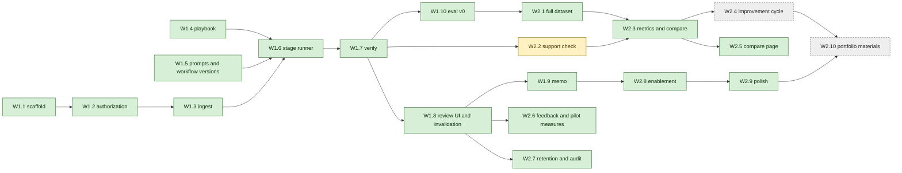

# 7. Delivery plan

**Implementation status.** The plan below was written before any code. Its ten week-one items are
Done; of its ten week-two items 7 are Done (W2.1, W2.3, W2.5, W2.6, W2.7, W2.8, W2.9), 1 is Partly done
(W2.2) and 2 are Not started (W2.4, W2.10). Done means the item's acceptance criterion is met by code
and a test; it does not mean that anything was measured, and each row of the status table says what
its Done rests on and what it does not show. Each item's status, with its evidence, follows the table
it belongs to. The hours are the plan's estimates; actual hours were not tracked, so this document
reports no actual effort. **Never run live:** no model has been called, so there is no baseline and
no improvement cycle, and no score, latency or cost of any model exists. The only numbers from a run
anywhere in this folder come from a selftest oracle or a scripted simulated reader and are labelled
so. Week-two part 3 built the application's side of the evaluation and the pilot (the comparison
page, feedback capture, the pilot measures page and its CSV, retention and audit verification, the
training matter, quickstart and help, error pages and a polish sweep with a real-browser pass) and,
outside the plan's rows, the usage meter, the spend guard and settled statuses. All of it is tested
against scripted wires, a scripted simulated reader and synthetic data; none of it has met a live
model, a real provider, a real participant, or a person using the pages with a keyboard alone or a
screen reader. What cannot be done without a provider key and the owner's approval of the spend is
listed under [What remains for week two](#what-remains-for-week-two) and is still not done.
Departures from the plan are collected under
[Implementation deviations](#implementation-deviations), and the design claims that the code does
not satisfy, with a severity each, under [Known gaps](#known-gaps).

**Last verified.** On 11 November 2026, on the merged code of week-two part 3 (commit `8995e0d`),
the figures below were taken. `pnpm fixtures:parol --check` and `pnpm fixtures:parol:training --check`
each reported up to date. `pnpm eval:parol --selftest`, under workflows v1, v2 and v3, scored the
scripted oracle 112 of 112 slots on the development split and 96 of 96 on the held-out split under
each of the three; the oracle reads the answer key and is not a language model, and no model was
called. Under v2 the development plan is 14 cases and 2 injection twins at 1 repeat, 128 rule slots
(16 runs of 8 rules, of which the 112 scored slots are the 14 cases) and 144 model calls, and the
held-out plan is 12 cases and 2 twins, 112 rule slots (14 runs, 96 scored) and 126 calls. The dataset
has 26 cases (14 development with 112 rule slots, 12 held-out with 96) and a calibration set of 40
pairs, the demonstration playbook has 8 rules, and the gates are 14. `pnpm typecheck` exited 0 (run
for this update, at the same commit). `pnpm test`, the default run, reported 461 test files and
13,360 tests, of which 37 were skipped: 36 are the real-browser tests, which are opt in (below), and 1
was already skipped before part 3. The run that printed these figures had 2 failures, both stale
expectations in one test file (`apps/parol/test/routes/pilot-panels.test.ts`) that commit `8995e0d`
fixed; that folder (39 files, 1,692 tests) passes after the fix. So 13,323 tests pass, 37 are
skipped and none fail, and the run took 353 seconds. `pnpm test:browser` (which sets
`PAROL_BROWSER_TESTS=1`) ran 3 files and 70 tests, all passing, in 433 seconds, with Playwright
1.63.0 and Chromium 153.0.8010.12 (headless) on Node 22.23.4, on one machine. It is opt in: a default
`pnpm test` skips the two files that start a browser (`audit.test.ts` and `flows.test.ts`) and prints
a line that says how to ask, `judge.test.ts` runs always because it starts no browser, and the
repository's CI runs `pnpm lint`, `pnpm typecheck` and `pnpm test` and not `pnpm test:browser`, so CI
does not run them (gap 33). `pnpm eval:parol --selftest
--exposure` ran nine times (workflows v1, v2 and v3, each on the development split, the held-out
split and both); all nine exited 0, gate G1 passed in each, and each sent 2,066 authorization probes.
The artefacts scanned and the denominators of G1 ("found 0 of N") were 478 and 2,544 for v1 and v2 on
either split, 956 and 3,022 for v1 and v2 on both splits, 494 and 2,560 for v3 on the development
split, 492 and 2,558 for v3 on the held-out split, and 986 and 3,052 for v3 on both. The counts move
with every test added, so run the commands instead of trusting this line. In this plan "run", used of
the held-out split or of a model, means a live run, which is what the held-out ledger records;
scripted selftest and exposure runs on the held-out split are counted apart and do not contaminate
it.

Two weeks for one engineer. Estimates are focused hours: about 35 planned hours in each 40-hour
week, leaving 5 to 6 hours of buffer. Every item ends with the repository's own checks passing (`pnpm lint && pnpm typecheck &&
pnpm test`), with tests that use scripted models only, as `CONTRIBUTING.md` requires. Live model
calls happen only in the evaluation runner and in the application's runner, each behind a spend
guard of its own.

**Deviation, closed in week-two part 3.** The plan's sentence was "Live model calls happen only in the
evaluation runner, behind the existing spend guard", and it was not true of the code until part 3; the
sentence above is the form that is true now. The application's own runner called a live model
whenever it was started without `PAROL_SCRIPTED` and with a provider key, and it had no spend guard: a review was bounded only by its own call count (one
extract call and one analyze call for each rule, plus repairs and client retries), not by a cost
limit, and only `pnpm eval:parol` had `--max-cost`. It was a control the plan promised and the code
lacked. The application now has a spend guard of its own (see [Spend](#spend) for what it does and
known gap 5 for what it does not): a server that calls a model does not start without a limit in US
dollars for one review and for one UTC day, a price file that prices the configured model, and
either the `anthropic` provider or the explicit `PAROL_SPEND_BOUND_ONLY=1`. Live model calls
therefore happen in two places, the evaluation runner and the application's runner, each behind a
guard of its own; the two guards are separate code, tied by parity tests. The application's guard
has been tested against scripted wires only and has never met a live provider.

**Week one** delivers the MVP: one matter end to end (intake, run, evidence, decisions,
invalidation, memo) and a first baseline on part of the dev set. **Week two** delivers the
distinctive part: the full dataset, the full metrics, the controlled improvement cycle with a
held-out comparison, and the pilot and portfolio materials.

## Dependencies

Green is Done, yellow is Partly done and dashed grey is Not started, as in the status tables below.
The edges are the plan's; they were not enforced during the build. The modules were built in
parallel against the shared contracts (`apps/parol/src/contracts.ts`, `module-contracts.ts`) and
integrated afterwards, so two edges changed in practice. The evaluation runner and scorer (part of
W2.3) were built before the dataset (W2.1) was complete, which is why the first reports of the gates
were of six development cases only; the dataset is now complete and the selftest runs both splits.
The default support checker (part of W2.2) was written with the services that run a review (W1.6),
because the runner needs a checker as soon as a workflow version pins the support prompt.
In week-two part 3 the order was set by the files the packages share and not by these edges. The
usage meter, the spend guard and settled statuses, the comparison page (W2.5) and retention (W2.7)
came first; feedback capture (W2.6, first half) and the training matter (W2.8) next; then the pilot
measures (W2.6, second half) and the error pages (the error half of W2.9); the polish sweep and the
real-browser pass (W2.9) last. The pilot measures read the reason codes that feedback capture added,
leave out the training matter, and extend the matter deletion that W2.7 made, so they were built
after those three.

## Week one: MVP

| Item  | Work                                                                                                                                                                                                              | Depends on       |  Hours | Acceptance criteria                                                                                                                                                                                                                              |
| ----- | ----------------------------------------------------------------------------------------------------------------------------------------------------------------------------------------------------------------- | ---------------- | -----: | ------------------------------------------------------------------------------------------------------------------------------------------------------------------------------------------------------------------------------------------------ |
| W1.1  | Scaffold `apps/parol`: Hono server, `node:sqlite` repository, numbered SQL migrations, demo identity, CSRF tokens, strict CSP, the demo banner                                                                    | none             |      3 | `pnpm parol` serves on 127.0.0.1; refuses another address with demo identity on; migrations create the schema from empty; root checks pass                                                                                                       |
| W1.2  | Authorization middleware, `AuthorizedMatter` branded type, the route-coverage test, the first probe matrix                                                                                                        | W1.1             |      3 | Every probe returns its expected status; removing the middleware from any one route makes the coverage test fail (checked by doing it once)                                                                                                      |
| W1.3  | Matters, documents and versions; upload of DOCX (`parseDocx`) and TXT (new reader producing the same paragraph shape); file and text hashes; duplicate warnings; spans; annotations                               | W1.2             |      5 | Spans of a DOCX and an equivalent TXT segment identically; identical re-upload gives `duplicate_document` and stores nothing; "Section 6.1 of the Agreement is deleted" yields a `cross_reference` (6.1, deletes); a corrupt file stores nothing |
| W1.4  | Optional `version`, `category`, `fallbackLanguage`, `escalateWhen` in `@clausewise/playbook`; `playbooks/parol-nda-recipient.yaml`; import and approve; immutability trigger                                      | none             |    2.5 | The shipped playbooks still pass `shipped.test`; the demo playbook validates; updating an approved version's YAML fails at the database                                                                                                          |
| W1.5  | Prompt registry with hashes; workflow version v1 manifest (prompts P1, retrieval R1, checks C1); export the pure helpers Parol reuses from `@clausewise/review`                                                   | none             |      2 | Changing one character of a prompt changes the workflow version hash; the review package's tests still pass                                                                                                                                      |
| W1.6  | Stage runner; ingest, extract, retrieve (R1) and analyze stages; per-unit persistence by input hash; resume; bounded semantic repair                                                                              | W1.3, W1.4, W1.5 |      5 | A scripted run produces eight findings; a run interrupted after three rules resumes and makes calls only for the other five; an unknown span label triggers one repair, then `output_invalid`                                                    |
| W1.7  | Verify, deterministic checks: `quote_exists`, `span_in_bundle`, `citation_shape`, numeric and jurisdiction consistency, client name, missing confirmation, precedence labels, `escalateWhen` ids, fallback basis  | W1.6             |    3.5 | One unit test per check, passing and failing; a test reproduces the `PAROL-D05` v1 trail and shows every check passing, recording the known gap; an unfound quote is struck through and raises `quote_not_verified`                              |
| W1.8  | Issue table, evidence inspector, decision form; invalidation on any input change; export gate                                                                                                                     | W1.6, W1.7       |    4.5 | All eight findings can be decided; a new amendment version marks every finding and decision stale and blocks export; a decision with an old content hash gets 409                                                                                |
| W1.9  | Memo export with the `docx` library: summary table, sections, open items, rejected appendix, provenance; quotes re-verified at export                                                                             | W1.8             |      3 | The memo contains every decided finding with locations; export with one undecided finding is refused; the file opens in LibreOffice where available (as the Clausewise tests do)                                                                 |
| W1.10 | Evaluation v0: case format and builder with anchor checks; six dev cases (D01, D03, D05, D06, D08, D12); status, flag and citation metrics; a scripted oracle selftest; first live baseline if a key is available | W1.7             |    3.5 | `pnpm eval:parol --selftest` shows a perfect score and fails if one answer key is altered; the live plan prints a cost bound before any call                                                                                                     |
|       | **Week one total**                                                                                                                                                                                                |                  | **35** |                                                                                                                                                                                                                                                  |

**End of week one:** a reviewer can take the worked-example matter from upload to memo, and the
first baseline numbers on six cases exist (or, without a key, the selftest proves the plumbing and
the write-up says no live run happened).

**What the end of week one is today.** The first half holds with a scripted reader: the worked
example goes from upload to an exported memo against the demo's simulated reader
(`apps/parol/test/e2e/worked-example.test.ts`, `apps/parol/test/demo/walkthrough.test.ts`), which is
a table written in advance and not a language model. The second half is the no-key branch: no live
baseline exists, `pnpm eval:parol --selftest` proves the plumbing, and no live run has happened.

### Status of the week-one items

Done means the acceptance criterion above is met by code and a test. Partly done means part of the
item exists. Not started means nothing but a schema or a name exists. The evidence is a file, a test
or a command; commands marked "run by hand" were run while this status was written.

| Item  | Status | Evidence                                                                                                                                                                                                                                                                                                                                                                                                                                                                                                                                                                                                                                                |
| ----- | ------ | ------------------------------------------------------------------------------------------------------------------------------------------------------------------------------------------------------------------------------------------------------------------------------------------------------------------------------------------------------------------------------------------------------------------------------------------------------------------------------------------------------------------------------------------------------------------------------------------------------------------------------------------------------- |
| W1.1  | Done   | `PAROL_DEMO_IDENTITY=1 PAROL_SCRIPTED=1 pnpm parol` answers `/healthz` on 127.0.0.1 and a request with a foreign `Host` header with 403; `PAROL_HOST=0.0.0.0` with the demo identity exits 1 before opening the database (run by hand). Tests: `apps/parol/test/server/shell-main.test.ts`, `shell-host.test.ts`, `apps/parol/test/store/db.test.ts` (migrations from empty). `pnpm lint` and `pnpm typecheck` pass.                                                                                                                                                                                                                                    |
| W1.2  | Done   | `apps/parol/src/auth/authorize.ts` is the only file that makes an `AuthorizedMatter`; `test/auth/brand.test.ts` and `brand-typed.test.ts` scan for forgeries; `test/server/shell-routes.test.ts` fails for a matter route registered without the guard and, for the shell as `createApp` builds it, for any route registered another way, of any method, with the shell's four middleware recognised by the function they registered through `defineMiddleware` (shown on synthetic routes inside the test, not by editing a real route); `test/routes/authorization.test.ts` is the probe matrix over every route.                                     |
| W1.3  | Done   | `apps/parol/src/ingest/`, `src/services/uploads.ts`. Tests: `test/ingest/parity.test.ts` (DOCX and TXT segment alike), `test/services/uploads.test.ts` (an identical file is stored once), `test/ingest/references.test.ts` ("Section 6.1 of the Agreement is deleted"), `test/ingest/hostile.test.ts` and `test/services/uploads.test.ts` (a file that cannot be read stores nothing).                                                                                                                                                                                                                                                                 |
| W1.4  | Done   | `packages/playbook/test/parol-fields.test.ts`; `apps/parol/test/playbooks/` (shipped and demo playbooks validate); `apps/parol/test/store/playbooks.test.ts` and `triggers.test.ts` (an approved version cannot be updated at the database). The playbook is `apps/parol/playbooks/parol-nda-recipient.yaml`, version 1.0.1.                                                                                                                                                                                                                                                                                                                            |
| W1.5  | Done   | `apps/parol/src/prompts/registry.ts` and `workflows.ts`; `test/prompts/registry.test.ts` (one changed character of a prompt changes its hash) and `workflows.test.ts`. `@clausewise/review` exports `locateQuote`, `normalizeForAnchor` and `settledStatus`; `pnpm exec vitest run packages` passes (72 files, 2741 tests, run by hand).                                                                                                                                                                                                                                                                                                                |
| W1.6  | Done   | `apps/parol/src/services/runner.ts` and `src/stages/{extract,retrieve,analyze}.ts`. Tests: `test/services/runs-failures.test.ts` (a failed run resumes and does not ask again for what it has), `test/stages/analyze-repair.test.ts` (one repair, then `output_invalid`), `test/integration/layers.test.ts` (eight findings for the worked example).                                                                                                                                                                                                                                                                                                    |
| W1.7  | Done   | `apps/parol/src/stages/verify.ts` and `stages/checks/`. Tests: `test/stages/verify*.test.ts`, and `verify-worked-example.test.ts`, whose first case is the `PAROL-D05` v1 trail passing every check while the finding is wrong, labelled "the known gap". Seventeen check ids exist (the seventeenth, `status_settled`, was added in part 3); the list is in [document 3](03-data-model-and-contracts.md).                                                                                                                                                                                                                                              |
| W1.8  | Done   | `apps/parol/src/server/pages/run.tsx`, `finding.tsx`; `src/store/repo-matters.ts` (`applyInputChange`). Tests: `test/routes/decision.test.ts`, `test/routes/forged-ids.test.ts` (409 for an old content hash), `test/integration/layers.test.ts` (a changed document makes findings and decisions stale and blocks export).                                                                                                                                                                                                                                                                                                                             |
| W1.9  | Done   | `apps/parol/src/export/`. Tests: `test/export/gates.test.ts` (export with an undecided finding is refused), `memo.test.ts`, `determinism.test.ts`, `libreoffice.test.ts` (converts the memo where `soffice` is installed, as it is here; Word itself was never available).                                                                                                                                                                                                                                                                                                                                                                              |
| W1.10 | Done   | `pnpm eval:parol --selftest` (run by hand: status accuracy 112 of 112 on the development split and, with `--split heldout --allow-heldout`, 96 of 96 on the held-out split, for a scripted oracle; it was 48 of 48 over the six cases W1.10 planned); `evals/test/parol-run-dataset.test.ts` and `parol-cli-exit.test.ts` alter an answer key, a case file or a hash and expect exit 2; `pnpm eval:parol` without `--yes` prints the plan and a cost upper bound and exits 3 (run by hand with a placeholder key in the environment; with no provider configured it exits 1 and says so). The optional live baseline was not run: no key was available. |

## Week two: the evaluation cycle and polish

| Item  | Work                                                                                                                                                                                                                 | Depends on |  Hours | Acceptance criteria                                                                                                                                                |
| ----- | -------------------------------------------------------------------------------------------------------------------------------------------------------------------------------------------------------------------- | ---------- | -----: | ------------------------------------------------------------------------------------------------------------------------------------------------------------------ |
| W2.1  | Remaining 8 dev and 12 held-out cases; canary matters; injection twins; builder prints totals and split hashes; held-out hash committed                                                                              | W1.10      |      6 | The builder's totals match [document 5](05-evaluation.md#totals); every anchor resolves once; the held-out hash is in a commit dated before the first baseline     |
| W2.2  | Support check call with its own prompt and isolated context; the 40-pair calibration set; checker metrics                                                                                                            | W1.7       |    3.5 | The checker sees only the cited spans (asserted on the prompt in a test); calibration metrics are computed and reported, whatever they are                         |
| W2.3  | Full metrics and report: extraction, strict and lenient, SWF, abstention, injection effect, stability, latency, cost (existing usage and price modules), Wilson intervals; pin-checking `compare`; record and replay | W2.1, W2.2 |      5 | Metrics match hand-computed values on a three-case fixture; `compare` refuses runs that differ in an undeclared pin; a replay re-scores without network access     |
| W2.4  | The improvement cycle: dev baseline (k = 3), failure analysis, R2 (or the observed top failure's fix), dev re-run, held-out runs, promotion record                                                                   | W2.3       |      5 | `EXP-001.md` holds the pre-registration, measured tables, the failure record and a recommendation that follows the decision rule, including if H1 is not confirmed |
| W2.5  | Evaluation comparison page (S4)                                                                                                                                                                                      | W2.3       |    2.5 | Shows both versions, every gate, the paired changed slots, and links each to its evidence trail                                                                    |
| W2.6  | Feedback on findings (reason codes, missed issue), post-matter rating, pilot measures page and CSV export                                                                                                            | W1.8       |      3 | Every measure in [document 8](08-pilot-and-enablement.md#measures) is computed from stored events, with its denominator shown                                      |
| W2.7  | Retention job, matter deletion, audit hash-chain verification command                                                                                                                                                | W1.8       |      2 | After deletion no row or file of the matter remains (test scans tables and the folder); altering one audit row makes verification fail                             |
| W2.8  | Seeded training matter, quickstart page, in-app help                                                                                                                                                                 | W1.9       |      2 | A new user can complete the training exercise from the quickstart alone (checked by walking through it)                                                            |
| W2.9  | Polish: keyboard navigation in the table and inspector, contrast, error and empty states, README section, demo seed script                                                                                           | W2.8       |      3 | Every action is reachable by keyboard; every error state has a message that says what to do; `pnpm parol:seed` builds the demo matters                             |
| W2.10 | Portfolio materials: two-minute recording, one-pager, postmortem draft with the measured numbers                                                                                                                     | W2.4, W2.9 |      2 | Every number in the one-pager traces to a results file; claims say whether they rest on the answer keys or on qualified review                                     |
|       | **Week two total**                                                                                                                                                                                                   |            | **34** |                                                                                                                                                                    |

### Status of the week-two items

| Item  | Status      | Evidence                                                                                                                                                                                                                                                                                                                                                                                                                                                                                                                                                                                                                                                                                                                                                                                                                                                                                                                                                                                                                                                                                                                                                                                                                                                                                                                                                                                                                                                                                                                                                                                                                                                                                                                                                                                                                                                                                                                                                                                                                                                                                                                                                                                                                                                                                                                                                                                                                                                                                                                                                                                                                                                                                                                                                                                                                                                                                                                                                                                                                                                                                                                                                                                                                                                                                                                                                                                                                                                                                                                                                                                                                                                                                                                                                                                                    |
| ----- | ----------- | ----------------------------------------------------------------------------------------------------------------------------------------------------------------------------------------------------------------------------------------------------------------------------------------------------------------------------------------------------------------------------------------------------------------------------------------------------------------------------------------------------------------------------------------------------------------------------------------------------------------------------------------------------------------------------------------------------------------------------------------------------------------------------------------------------------------------------------------------------------------------------------------------------------------------------------------------------------------------------------------------------------------------------------------------------------------------------------------------------------------------------------------------------------------------------------------------------------------------------------------------------------------------------------------------------------------------------------------------------------------------------------------------------------------------------------------------------------------------------------------------------------------------------------------------------------------------------------------------------------------------------------------------------------------------------------------------------------------------------------------------------------------------------------------------------------------------------------------------------------------------------------------------------------------------------------------------------------------------------------------------------------------------------------------------------------------------------------------------------------------------------------------------------------------------------------------------------------------------------------------------------------------------------------------------------------------------------------------------------------------------------------------------------------------------------------------------------------------------------------------------------------------------------------------------------------------------------------------------------------------------------------------------------------------------------------------------------------------------------------------------------------------------------------------------------------------------------------------------------------------------------------------------------------------------------------------------------------------------------------------------------------------------------------------------------------------------------------------------------------------------------------------------------------------------------------------------------------------------------------------------------------------------------------------------------------------------------------------------------------------------------------------------------------------------------------------------------------------------------------------------------------------------------------------------------------------------------------------------------------------------------------------------------------------------------------------------------------------------------------------------------------------------------------------------------------- |
| W2.1  | Done        | `pnpm fixtures:parol --check` (run by hand, exit 0) prints the totals and the split hashes: 14 development cases with 112 rule slots and 12 held-out cases with 96, 20 files in each split, the two cases with upload steps (D09 and H08), the two canary matters (Bramblewick in development, Saltmarsh in held-out) and the calibration set (40 pairs). All 26 cases are written, with the injection twins of D08, D10, H07 and H09. The totals match the built columns of [document 5](05-evaluation.md#totals); three rows differ from the plan's counts, with the reasons given there. The held-out hash is in `fixtures/parol/splits.json` and in commit `66a23f4` of 10 November 2026, which is on the remote branch; no live run has used the held-out split. Two judgement calls are for the user to confirm (document 5 gives the reasons for both): the cross-matter cases D10 and H09 each carry an injected clause, so each split has 2 injection cases where the plan counted 1, and the slots with an allowed alternative are 1 in development and 0 in held-out. D09 departs from the design (see [document 5](05-evaluation.md#supplementary-suites)). Builder tests: `evals/test/parol-builder.test.ts`, `parol-anchors.test.ts`, `parol-builder-uploads.test.ts`, `parol-builder-canary.test.ts`.                                                                                                                                                                                                                                                                                                                                                                                                                                                                                                                                                                                                                                                                                                                                                                                                                                                                                                                                                                                                                                                                                                                                                                                                                                                                                                                                                                                                                                                                                                                                                                                                                                                                                                                                                                                                                                                                                                                                                                                                                                                                                                                                                                                                                                                                                                                                                                                                                                                                                        |
| W2.2  | Partly done | Built and tested; not yet run on a model. `apps/parol/src/prompts/support-p1.ts` and `src/services/support-checker.ts`; `test/stages/verify-support.test.ts` asserts the checker is shown only the cited spans. The 40-pair calibration set is written (`fixtures/parol/calibration/pairs.ts`, built into `calibration.json`, hash and counts in `splits.json`): 20 supported and 20 unsupported pairs, four of each of five kinds of unsupported. `scoreCalibration` in `evals/src/parol/suites.ts` computes the checker metrics, and the runner step (`evals/src/parol/calibration-run.ts`, `--calibration`) sends the 40 pairs once per run through the support checker a review uses (`createSupportChecker`, given the rule, the claimed status, the discrepancy and the cited paragraph), for gate G11; a test compares those requests with the ones that function builds for the same rule, draft and passage, and what the verify stage hands it is pinned by `test/stages/verify-support.test.ts`. Workflow v3 pins `support.p1` and check set C2; it is defined for the evaluation only, because the application registers v1 and v2 at start-up, which pin no support prompt, so a review in the application still says "Support not checked". What is missing is the figure the acceptance criterion asks for: the checker's catch rate and false alarms on the set. They need a live run (or a replay of one), and nothing has been sent to a checker.                                                                                                                                                                                                                                                                                                                                                                                                                                                                                                                                                                                                                                                                                                                                                                                                                                                                                                                                                                                                                                                                                                                                                                                                                                                                                                                                                                                                                                                                                                                                                                                                                                                                                                                                                                                                                                                                                                                                                                                                                                                                                                                                                                                                                                                                                                                                         |
| W2.3  | Done        | `evals/src/parol/{score,stats,gates,timing,report,compare,replay}.ts`: the metrics of document 5, Wilson intervals, gates G1 to G14, latency and cost summaries, a pin-checking comparison, and record and replay. Tests: `evals/test/parol-score.test.ts` (a three-case key), `parol-run-compare.test.ts` (a difference in an undeclared pin is refused), `parol-replay.test.ts` (a replay re-scores a recording with no model and stops at a request the recording does not hold). A live run writes `<results>.responses.jsonl` beside its results file (off with `--no-record`), and `--replay <file>` re-scores it; a replay is labelled REPLAY, is never a repeat, records no latency or cost, and the decision rule is not applied to it. The comparison reads the exposure and calibration records of each file (the G1 and G11 rows), so every gate is reachable by a run; an exposure record is read for G1 only if its reviews were of the file's own workflow, and otherwise G1 is not evaluated and the comparison row says so; the decision rule is skipped for scripted runs and replays. A recording that lost a call is marked `failed` in the results file and reported as one that cannot be replayed. The criteria are met by tests, and these limits remain: latency, cost and the model the provider reports have only met scripted generators and a loopback server, never a provider, and no recording of a live run exists.                                                                                                                                                                                                                                                                                                                                                                                                                                                                                                                                                                                                                                                                                                                                                                                                                                                                                                                                                                                                                                                                                                                                                                                                                                                                                                                                                                                                                                                                                                                                                                                                                                                                                                                                                                                                                                                                                                                                                                                                                                                                                                                                                                                                                                                                                                                                                        |
| W2.4  | Not started | No live run was made, so there is no baseline, failure record or promotion record. `experiments/EXP-001.md` is a pre-registration draft without a measured table. Two runs of `pnpm eval:parol --simulate` (v1, then v2 with `--compare` on the v1 file) compare v1 with v2 on the simulated reader (see [document 5](05-evaluation.md#a-dry-run-with-the-simulated-reader)); that demonstrates the machinery and is not the cycle. It cannot start without the first live run, which needs a provider key and the owner's approval of the spend (see [What remains for week two](#what-remains-for-week-two)).                                                                                                                                                                                                                                                                                                                                                                                                                                                                                                                                                                                                                                                                                                                                                                                                                                                                                                                                                                                                                                                                                                                                                                                                                                                                                                                                                                                                                                                                                                                                                                                                                                                                                                                                                                                                                                                                                                                                                                                                                                                                                                                                                                                                                                                                                                                                                                                                                                                                                                                                                                                                                                                                                                                                                                                                                                                                                                                                                                                                                                                                                                                                                                                             |
| W2.5  | Done        | The page: `GET /evaluations` (`apps/parol/src/server/pages/evaluations.tsx`, `src/evaluations/`) for the legal engineer and the administrator (global action `evaluation.read`; a member gets 403 and a visitor is sent to sign in), with the comparison chosen by query. It reads page documents (`cmp_<16 hex>.json`, at most 4 MiB, each with a fingerprint the reader checks) from `<data folder>/evaluations` and never reads matter data. Publishing: `pnpm eval:parol --publish <data-folder>` after a comparison (`--compare <previous>` with a run, or `--baseline <a> --candidate <b>`, which runs nothing and sends nothing); `--open-heldout-trails` opens the held-out answer keys, passages and trails and makes the page raise the contamination warning in capitals. The page shows both versions and what they were run on, a split switch with the denominators, all 14 gates with the reason for any not evaluated, the decision rule, the metric rows with counts, the paired slots that changed, and for each changed slot the key's passages and, where the results file recorded trails, where each version looked and what it cited (the results file gained an optional `trails` field of ids, offsets and codes, never text: `evals/src/parol/trails.ts`). It drafts a promotion record as text with the decision, the conditions and the sign-off left blank. Tests: `apps/parol/test/evaluations/` (document, source, service, draft, words, pins), `test/pages/evaluations-page.test.ts`, `test/routes/evaluations.test.ts`, `evals/test/parol-page-build.test.ts`, `parol-page-e2e.test.ts`, `parol-trails.test.ts`, `parol-cli-publish.test.ts`. The criteria are met by tests, and these limits remain: every comparison that exists is scripted (a selftest, the simulated reader or a replay) and the page labels the mode of each run (SELFTEST, SIMULATED, REPLAY); the page cannot tell that a file's mode label is true (the fingerprint finds an accidental edit and is not authentication); a trail shows where a version looked and what it cited and not what it wrote, because no model answer is kept; held-out changed slots are listed, but their key, passages and trails are sealed unless the file was published with `--open-heldout-trails`; and the draft record is text that records and promotes nothing. Scope cut 1 was not needed.                                                                                                                                                                                                                                                                                                                                                                                                                                                                                                                                                                                                                                                                                                                                                                                                                                                                                                                                                                                                                                                                                                                                                                                                                                                                                                                                                                                                                 |
| W2.6  | Done        | Capture (W2.6a). Migration 006 adds `reviews.reason_code` (six codes: `wrong_status`, `wrong_evidence`, `missed_context`, `bad_fallback`, `unclear`, `other`; an edit or a reject carries one) and `reviews.minor_edit` (an edit carries the mark, and an edit that changes the status is never minor), and in `feedback` the report of a missed issue (`rule_key`, `location`) and the post-matter rating (1 to 5, one per person and matter, final). A note on a finding, for the reviewer, is a feedback row of the existing `comment` kind. `FeedbackService` (`src/services/feedback.ts`) and `src/store/repo-findings.ts` write them; there are seven routes: a missed issue, a note and a rating, each as a page form and as JSON, and `GET /api/matters/:matterId/feedback`. Measures (W2.6b). Migration 008 adds `pilot_calendar`, `pilot_participants`, `time_entries` and `reference_issues`. `src/pilot/` is a pure computation from records to measures, tested against a hand-written fixture (F1) whose expected values are written by hand, with the words of the page and the CSV. `loadPilotRecords` in `src/store/repo-pilot.ts` reads ids, flags, codes and times across matters and names no text column (a source-scan test enforces it). `GET /pilot` and `GET /pilot/measures.csv` are for the legal engineer and the administrator (`pilot.read`); `POST /pilot/calendar` and `POST /pilot/participants` (`pilot.manage`) set the start date and the roster of trained participants; the timer (`POST /matters/:matterId/timer`, `time.record`: an associate or a reviewing attorney) and the reference list (`POST /matters/:matterId/reference-list`, `reference.write`: the reviewing attorney, closed at the first review) are sections of the matter page. The eight measures of the plan's table in document 8 are computed with numerator, denominator and a sentence for the denominator, or shown as 'no data' with one of three fixed reasons, never as a ratio of nothing; the page adds a ninth row, `accepted_or_minor` (the number acceptance criterion A3 reads; document 8's table also lists it, with a note that the plan's table did not), and a population table of what was included and left out, and the CSV has the same rows with a scope column. Training matters are in neither scope. The optional `pnpm parol:seed --pilot-demo` makes a backdated scenario through the services (run for this update on a fresh folder: 6 matters, 16 timed sittings, 2 reference lists, 6 reviews, 32 decisions, 3 memos exported, 3 missed-issue reports and 5 ratings, all by demonstration identities and the scripted reader). Tests: `apps/parol/test/pilot/`, `test/store/pilot*.test.ts`, `test/services/pilot.test.ts`, `test/routes/pilot*.test.ts`, `test/pages/pilot.test.ts`, `timer-panel.test.ts`, `reference-panel.test.ts`, `test/demo/pilot-demo.test.ts`, and for capture `test/routes/feedback*.test.ts`, `decision-reason-code.test.ts`, `test/store/feedback*.test.ts`. What Done rests on and what it does not show: the pilot scope is empty on every database this build can make (gap 30), so the page can show figures only in the synthetic scope, where they come from demonstration identities and a scripted reader and are not a pilot result; the page computes medians (with n, minimum and maximum) and no mean, no difference between phases and no saving, so the comparison with the phase 0 median that acceptance criterion A6 names is deliberately not computed; repeat usage takes the roster the trainer records and not the training matter's progress; and no person has used the pilot page, the timer or the reference list. Retention against the pilot is gap 31 and the free text and wording of feedback gap 37. |
| W2.7  | Done        | Retention: `pnpm parol:retain` (`src/retain.ts`, `src/retention/job.ts`) is a dry run by default that lists the matters past their date with a count and its denominator and changes nothing; `--apply` deletes (one transaction for a matter's rows, then its folder, then folders no row names, then one compaction per run), refuses while the server holds the data folder (exit 2), and refuses with exit 3 when more matters than `--max-matters` (default 25, a number chosen here) are due; exit 1 means a failure or a broken audit chain. The retention date is set at creation (1 to 90 days, default 30) and changed by an associate on the matter page (`POST /matters/:matterId/retention`, audited as `matter.retention`). `deleteMatter` has a residue guard (`matter_residue`: it refuses while any table with a `matter_id` column, `audit_events` excepted, still holds a row of the matter), also deletes the ingest warnings, the timers and the reference list, and records the reason and the date; the spend ledger is kept on purpose (a date and numbers), and so is the audit log: it keeps the matter's events (ids, codes and counts, no text) and gains the deletion event, so the criterion that no row of the matter remains holds for every table except the audit log. Audit: `pnpm parol:audit-verify` (read only, so it runs beside the server; `--expect-head SEQ:HASH`), `GET /audit` for the administrator only (`audit.read`; it writes no event) and, at start-up, a notice for matters past their date and a warning when the log does not verify. The server deletes nothing. Tests: `apps/parol/test/retention/{job,cli,audit-verify}.test.ts`, `test/services/deletion-leaves-nothing.test.ts` (a trace scan of every table and the folder), `test/store/retention.test.ts` and `audit.test.ts`, `test/server/shell-main-retention.test.ts`, `test/pages/audit-page.test.ts`, `test/routes/matter-residue.test.ts`. Limits (gaps 17 and 31): no scheduler ships and nothing blocks a matter past its date; there is no legal hold; a rewritten log with every later hash recomputed is found only against a head kept outside the file; the log records changes only, and not reads or refusals (a refusal is a 403 or 404 line in the access log on standard output, which is not stored).                                                                                                                                                                                                                                                                                                                                                                                                                                                                                                                                                                                                                                                                                                                                                                                                                                                                                                                                                                                                                                                                                                                                                                                                                                                                                                                                                                                                                                                                    |
| W2.8  | Done        | The training matter T01 is two files in `apps/parol/training/` (`t01-nda.docx` and `t01-amendment-1.txt`), built by `pnpm fixtures:parol:training` from evaluation cases PAROL-D05 and PAROL-D08 (the worked example with one instruction paragraph added to the NDA; `--check` reports up to date). `pnpm parol:seed --training`, or the button on the quickstart (`POST /training`: any signed-in person, who becomes the associate, with a reviewing attorney chosen and, if there is one, a trainer), makes the matter. Migration 007 adds `matters.training_key` (set at creation, never changed, one per creator, synthetic only) and triggers that stop an evaluation run or result on a training matter. `GET /quickstart` and `GET /help` are open to everyone; `GET /training/key` (the trainer's key) is for the legal engineer and the administrator (`training.key`; a member gets 403). The ten quickstart steps and the seven training steps of document 8 agree with the code word for word (`apps/parol/test/training/doc-agree.test.ts`). The page shows progress for steps 3 to 7 from stored events (five steps; steps 1 and 2 are set up or the trainer's) and times nothing. Tests: `test/training/` (files, isolation, progress, reader, start, steps, doc-agree, walkthrough), `test/routes/training-*.test.ts`, `quickstart-routes.test.ts`, `trainer-key-routes.test.ts`, `test/pages/quickstart-page.test.ts`, `help-page*.test.ts`, `training-*.test.ts`. The acceptance criterion is met by a script: `walkthrough.test.ts` starts the server on a socket with the simulated reader and plays the associate, the reviewing attorney and the trainer through the seven steps by following only the links and forms the pages offer. Limits (gap 35): no person has done the exercise and nobody has timed it (the 20 minutes is the plan's figure); the planted finding is the simulated reader's script, and that reader now reads two document sets, the worked example and T01, and declines everything else, including one changed word of either; a training matter is in neither scope of the pilot measures and is never used in evaluation (its files are outside the dataset, two database triggers, the reader's condition and the measures' filter each hold that, and each is tested).                                                                                                                                                                                                                                                                                                                                                                                                                                                                                                                                                                                                                                                                                                                                                                                                                                                                                                                                                                                                                                                                                                                                                                                                                                                                                                                                                                                                                                                                              |
| W2.9  | Done        | Without a browser: 15 rules (`apps/parol/test/a11y/rules.ts`, run by `checkInvariants`) hold 217 page fixtures (188 before the sweep) with 0 violations after the sweep fixed what it found (the first sweep counted 58 violations in 28 fixtures when it ran; a recount for this update, on the pages as they were before the fix and the 213 fixtures of that commit, gave 59 in 28, so treat 58 as approximate), and hold the pages the route table serves in every role that can reach them (`test/a11y/routes.test.ts`, `inventory.test.ts`, `pages.test.ts`: a new GET route fails until someone says whether it is a page); the page script and the stylesheet are pinned (`test/a11y/script.test.ts`, `test/pages/script.test.ts`, `styles.test.ts`, which checks contrast numerically). Error half: error pages and refusal notices choose a fixed sentence by the kind of failure (a closed list of guidance keys in `src/server/guidance.ts`) and carry a marked 'what to do' sentence, with a link to the field where the control is on the page; a server that cannot start prints one sentence that says what to do (`describeStartFailure`); `pnpm parol:seed`, `parol:retain` and `parol:audit-verify` print `Parol <command> cannot run: <what is wrong and what to do>` (`test/a11y/errors.test.ts`, `core-refusals.test.ts`, `refusal-completeness.test.ts`, `start-failure.test.ts`, `command-failure.test.ts`). In a real browser, opt in (gap 33): `pnpm test:browser` ran 3 files and 70 tests, all passing, in headless Chromium 153.0.8010.12 driven by Playwright 1.63.0 on one machine on 11 November 2026. `audit.test.ts` audits 109 pages in every role that can reach them (skip link, Tab order against reading order, focus rings of at least 3:1 in light and dark, names in the browser's accessibility tree, text contrast, no sideways scroll at 640 and 320 pixel widths, reduced motion, forced colours, scripts off, Escape and Enter), and `flows.test.ts` drives the main tasks by keyboard alone (15 flows, key presses and no mouse). What the pass changed in the product: the page script no longer scrolls to the quote on a page that opens on a refusal, the demo banner sticks to the top only from 40rem up, and the memo links no longer carry a `download` attribute, so a refused download shows the memos page. `pnpm parol:seed` builds the two demonstration matters (run by hand for this update) and `apps/parol/README.md` is the README section. Not shown (gap 21): any use by a person with a keyboard alone or a screen reader, any browser but Chromium, real zoom, touch, voice, text spacing, target size, the native file dialog, the cancel and resume of a running review in a browser, and the page states the seed does not reach. The older refusal wording is checked for the presence of a 'what to do' sentence and not for the quality of the advice.                                                                                                                                                                                                                                                                                                                                                                                                                                                                                                                                                                                                                                                                                                                                                                                                                                                                          |
| W2.10 | Not started | No recording, one-pager or postmortem exists, and there are no measured numbers for them to carry. [Document 9](09-portfolio-materials.md) holds the script and the templates only. It cannot carry measured numbers before W2.4, which needs the first live run (a provider key and the owner's approval of the spend).                                                                                                                                                                                                                                                                                                                                                                                                                                                                                                                                                                                                                                                                                                                                                                                                                                                                                                                                                                                                                                                                                                                                                                                                                                                                                                                                                                                                                                                                                                                                                                                                                                                                                                                                                                                                                                                                                                                                                                                                                                                                                                                                                                                                                                                                                                                                                                                                                                                                                                                                                                                                                                                                                                                                                                                                                                                                                                                                                                                                                                                                                                                                                                                                                                                                                                                                                                                                                                                                                    |

**Part 3 work that no row of the plan names (the usage meter, the spend guard and settled statuses).**
The plan's acceptance lines asked for a spend guard the application did not have, so part 3 added three
things to the application. _Settled statuses:_ `src/settlement.ts`, called first in the verify stage for
every workflow version, with the model's own status kept in `findings.model_status` and a seventeenth
check id, `status_settled`; tests `test/settlement.test.ts`, `test/stages/verify-settle.test.ts`,
`test/store/findings-settled.test.ts` and `evals/test/parol-settlement-keys.test.ts`, which pins that no
answer key changes, and the selftest still scores 112 of 112 and 96 of 96 under v1, v2 and v3. _Usage:_
`src/usage/` records for each call the four token counts the provider reported, an estimated cost and the
hash of the price table, and for each run the model the provider named, for the `anthropic` provider only
(tests `test/services/runs-usage.test.ts`, `test/usage/metering-wire.test.ts`, `test/store/usage.test.ts`).
_The spend guard:_ see [Spend](#spend) (tests `test/usage/guard-preflight.test.ts`, `guard-cap.test.ts`,
`guard-fetch.test.ts`, `test/services/runs-spend.test.ts`, `test/routes/spend-refusal.test.ts`,
`spend-shell.test.ts`, `test/server/start-spend.test.ts`, `test/store/spend-ledger.test.ts`, and the
parity tests `evals/test/parol-app-plan-parity.test.ts`, `parol-app-prices-parity.test.ts` and
`parol-app-budget-parity.test.ts`). None of it has met a live provider: the readers and the cap are tested
against scripted wires whose shape is the tests' own reading of the Messages API (gaps 5 and 11).

## What remains for week two

Everything in this list needs the project owner: a provider key and the owner's explicit approval of
the spend (the application's guard is a limit the operator sets, and `pnpm eval:parol` stops at its
plan without `--yes`), and for the qualified review the attorneys who can give it. **None of it has
been done**, and nothing in it is an estimate of effort. What earlier versions of this list had and is
now built and tested, with no model involved: the rest of the dataset (W2.1), workflow v3 with the
support check, the supersession check and the 40-pair calibration set (W2.2), record and replay of the
model's answers (W2.3), the exposure suites that feed gate G1, and, in week-two part 3, the comparison
page, feedback capture, the pilot measures, retention and audit verification, the training matter,
quickstart and help, the error pages and the polish sweep (W2.5 to W2.9), and the usage meter, the
spend guard and settled statuses.

1. **The first live run.** It needs a provider key and `--yes`. Run one case first and read its usage
   table; only then run the development split. Until it happens there is no baseline, no cost and
   latency figure, no recording to replay, and nothing for the improvement cycle (W2.4) to compare.
   The support checker's own figures need a live run of workflow v3 with `--calibration` (40 more
   calls, sent once for the run; a replay answers them from the recording). The spend needs the
   user's explicit approval. The same is true of the application: its spend guard, its usage and
   reported-model readers and its cap have only been tested against scripted wires, and a server that
   calls a model needs its limits and a price file before it starts (see [Spend](#spend)).
2. **The baseline.** The development split under workflow v1 at three repeats, the first step of W2.4.
   It gives the first measured status accuracy, citation validity, latency and cost; none exists.
3. **The improvement cycle (W2.4).** Failure analysis of the baseline, R2 or the fix of the observed
   top failure, the development re-run, the held-out runs and the promotion record. It cannot start
   before items 1 and 2.
4. **Freezing `EXP-001.md`.** It needs a pinned model, its generation settings and a checked price
   table, and the owner's decision to spend; until then it is a pre-registration draft with no
   measured table.
5. **A qualified review of the dataset and of what the runs show.** The answer keys were written by
   the project, so every claim rests on them until attorneys qualified to judge NDA review have
   reviewed them. It cannot start before item 1.
6. **The portfolio materials with measured numbers (W2.10).** They need items 1 to 5. The script and the
   templates of document 9 are all that exists.

Not blocked by the key, and still open: a person using the pages with the keyboard alone and with a
screen reader (gap 21), a run of the browser tests anywhere but one machine and in CI (gap 33), the
pilot itself, which needs real identities and participants (gap 30), usage and a cap for providers
other than `anthropic` (gaps 5 and 11), and the unbuilt items named in gap 20.

## Spend

Live evaluation runs use the Clausewise spend guard: the plan is printed first, nothing is sent
without `--yes`, and a per-request cap holds the run to `--max-cost`. For scale, the bound in
`evals/README.md` for each of Clausewise's two NDA fixtures is 46,181 and 48,581 input tokens for 10
calls. That is an upper bound for a different tool and playbook, not a Parol figure. The
plan assumed roughly 15 Parol calls per case (one extract, eight analyze, up to eight support
checks, fewer when a rule needs none). With the support check off in v1 and v2, the runner's own
plan counts 9 calls per run (one extract and eight analyze), 144 calls for the 14 development cases
and their 2 injection twins at one repeat, and 272 if every rule needed its repair call. Under
workflow v3 the support check adds a call for every rule, so a run is 17 calls, the same split is 272
calls (400 with every repair), and `--calibration` adds the 40 pairs once, 312 (440). Three repeats
of the development split under v3 with `--calibration` come to 856 calls (1,240 with every repair).
These are the plans that `pnpm eval:parol`
prints and stops at without `--yes` (run by hand with a placeholder key in the environment, because
a live-mode plan needs a configured provider; nothing was sent). They are counts of calls and not a
cost. The plan also prints a cost upper bound from the prices in `evals/prices.json`, which have not
been checked against a live price list, and for the whole development split that bound is above the
default `--max-cost` under v1 and under v3, so the plan exits 3 and asks for a higher limit. Nothing
about cost has been measured: run one case first and read its usage table before running a split.

The application has a guard of its own since week-two part 3, in separate code that parity tests tie
to the evaluation's arithmetic (gap 5 says what it does not do). A server that calls a model starts
only with a limit in US dollars for one review (`PAROL_MAX_REVIEW_COST_USD`) and one for a UTC day
(`PAROL_MAX_DAILY_COST_USD`), neither with a default; a price file that prices the configured model
(`PAROL_PRICES_FILE`, the format of `evals/prices.json`; the guard has no built-in price and
refuses an input and output rate of 0 for a hosted provider); no fallback model; and either the `anthropic` provider, the only one whose
adapter reports usage, or `PAROL_SPEND_BOUND_ONLY=1`, which accepts that only the bound planned before
each review is checked. `PAROL_ASSUMED_OUTPUT_TOKENS` sets the output length the plan assumes for each
call. Before a review starts the guard plans a bound from the stored documents and refuses the start
(409 `spend_refused`, nothing created, the matter as it was) when the bound would pass either limit; the
day's figure is the ledger plus what reviews in progress may still spend. While a review runs, a cap
holds back a request that could take the recorded spend past a limit, and a response that does pass one
ends the review as failed with `spend_review_limit` or `spend_daily_limit`, which can be resumed once
the limit is raised and the server started again. The ledger (`spend_ledger`, one row for each UTC day,
counts and a total and no id) is never lowered, by deleting a matter or otherwise. A stand-in reader
needs none of it, and a notice at start names the spend variables it ignores. None of this has met a
live provider.

## Scope cuts, in order

If the plan slips, cut from the top. Each cut says what is lost so the write-up can say it too.

| #   | Cut                                                                   | What is lost                                                            |
| --- | --------------------------------------------------------------------- | ----------------------------------------------------------------------- |
| 1   | Comparison page (W2.5); keep the Markdown report                      | A visual; the numbers remain                                            |
| 2   | Rule-level carry-forward of findings on playbook change               | Convenience only; full invalidation stays                               |
| 3   | Pilot measures page (W2.6); keep feedback capture and a CSV script    | A dashboard; the measures remain computable                             |
| 4   | Model support check (W2.2); keep the deterministic consistency checks | The independent substantive check; G5 and G11 reported as not evaluated |
| 5   | Held-out set from 12 to 8 cases                                       | Statistical power; the report states the smaller denominators           |
| 6   | Held-out repeats from 3 to 2                                          | Stability evidence; never below 2                                       |

**Never cut:** authorization and its probe tests, quote verification, the export gate,
invalidation, the separation of dev and held-out sets, pinning, and honest reporting of whatever the
runs show.

**Where the plan stands against the cuts.** Cut 1 was not taken: the comparison page exists (W2.5),
with its limits in the W2.5 row. Cut 3 was not taken: feedback capture and the pilot measures page with
its CSV are built (W2.6), so the measures are computed from stored events, but over synthetic data only
(gap 30). Cut 4 is half taken: the support check, its calibration set and the runner step that
measures it are built, and workflow v3 turns the check on for the evaluation, but the application's
two workflow versions leave it off (a review there says "Support not checked") and nothing has
measured the checker, so G11 is not evaluated in any report today. **Deviation.** The cut says G5
would then be reported as not evaluated. G5 is scored from the answer keys and not from the support
checker, so it is evaluated with the check off; only G11 depends on the checker. Cut 2 has been taken:
findings are not carried across a playbook change, and a changed playbook version makes every finding
out of date. Cut 5 was not needed: the held-out set has its 12 cases. Cut 6 does not apply yet,
because no held-out run has been made. None of the "never cut" items was cut: authorization with its
probe tests, quote verification, the export gate, invalidation, pinning and the held-out seal are
built and tested, and the held-out set is written and its hash committed.

## Risks

| Risk                                                            | Effect                                    | Response                                                                                                     |
| --------------------------------------------------------------- | ----------------------------------------- | ------------------------------------------------------------------------------------------------------------ |
| No API key or budget                                            | The improvement cycle has no real numbers | Ship the selftest and the protocol; say plainly that no live run happened                                    |
| H1 does not reproduce                                           | The planned story changes                 | The protocol picks the top observed failure; report H1 as not confirmed                                      |
| Writing 26 good synthetic cases takes longer                    | W2.1 overruns                             | Case templates per phenomenon; cut 5 if needed                                                               |
| `node:sqlite` changes behaviour (it is experimental)            | Store breaks on a Node update             | The repository module isolates it; `better-sqlite3` is the fallback; pin the Node minor in CI                |
| A model returns valid quotes that the anchor normaliser rejects | Many false `quote_not_verified`           | The metric separates model citation validity from displayed validity; inspect before changing the normaliser |
| Word unavailable to check the memo                              | Formatting surprises                      | LibreOffice check, as Clausewise does; state the limit                                                       |

**What happened to the risks.** No API key: this happened, and the plan's response was followed, so
the selftest exists and the write-up says no live run happened. H1 (that the baseline fails on the
amendment) has not been tested on a model; the simulated reader shows the retrieval gap by
construction and says nothing about whether a real model fails the same way. Writing 26 cases: all 26
were written (14 development, 12 held-out), so cut 5 was not needed; the hours were not tracked, so
whether W2.1 overran is not known. `node:sqlite` is in use and prints its experimental warning at every start; the
store sits behind `apps/parol/src/store/`, as planned. The repository's CI
(`.github/workflows/ci.yml`) runs lint, typecheck and the default test run, Parol's included (that run
skips the 36 opt-in browser tests), on Node 22, but pins only the major version, so the plan's "pin
the Node minor" response was not carried out. The anchor normaliser and a live model have never met.
Word was never available; the memo is converted by LibreOffice in `test/export/libreoffice.test.ts`
where `soffice` is installed.
The application's spend guard and its usage readers have the same history as the anchor
normaliser: built and tested against scripted wires, never met a live provider.

## Definition of done

Status against each line, today:

- The worked example runs end to end in the app, and the memo exports. **Met with a scripted
  reader.** The simulated reader (a table, not a language model) reads the worked example, and the
  whole path from upload to the memo runs in `apps/parol/test/e2e/worked-example.test.ts` and on a
  real socket in `apps/parol/test/demo/walkthrough.test.ts`. Nothing a language model wrote has been
  through it.
- `EXP-001.md` contains pre-registered hypotheses, measured tables for both versions on dev and
  held-out, the failure record, and a recommendation that follows the decision rule. **Not met.**
  There are no measured tables, because there is no live run (the held-out cases are written).
- All gates are reported with counts, intervals and pass or fail, including failures. **Built, not
  met.** The runner reports every gate with its counts and Wilson interval, and marks the gates it
  cannot evaluate as such. The only reports so far are of a selftest oracle and of the simulated
  reader, and of the exposure suite, which tests the application and not a model.
- The README says what was measured, on what, and what was not. **Met** by `apps/parol/README.md`,
  which says that no score was measured, and by this folder's status paragraphs.

## Known gaps

The design claims that the built system does not satisfy, in one place, each with a severity. They
were found by the documentation writers and verified here against the code, or by the three attack
reviews of the build; gaps 30 to 37 and the changes to gaps 1, 5, 6, 11, 12, 17, 20, 21 and 26 come from the build and
review of week-two part 3. The severity is this document's own judgement and not a measurement. **High**:
a control the design relied on is absent or can be bypassed, or a claim the project exists to make
cannot be made. **Medium**: a control or a measure is weaker than the design said, and a reader of a
result must know. **Low**: an edge, a demonstration limit or a cosmetic mismatch. None of these gaps
is hidden elsewhere: each is also stated where it matters, in the document named in the last column.
Nothing below was small and safe enough to fix without changing what a number means, which is why
they are listed and not fixed; the ones that were small have been fixed (see the end of this section).

| #   | Gap                                                                                                                                                                                                                                                                                                                                                                                                                                                                                                                                                                                                                                                                                                                                                                                                                                                                                                                                                                                                                                                                                   | Severity | Described in                                                                                                    |
| --- | ------------------------------------------------------------------------------------------------------------------------------------------------------------------------------------------------------------------------------------------------------------------------------------------------------------------------------------------------------------------------------------------------------------------------------------------------------------------------------------------------------------------------------------------------------------------------------------------------------------------------------------------------------------------------------------------------------------------------------------------------------------------------------------------------------------------------------------------------------------------------------------------------------------------------------------------------------------------------------------------------------------------------------------------------------------------------------------- | -------- | --------------------------------------------------------------------------------------------------------------- |
| 1   | No live model has ever been called, so there is no baseline, no improvement cycle and no score, latency or cost for any model. Every result in this folder comes from a selftest oracle, a scripted simulated reader or, for the exposure suite, the application run against a scripted key-oracle that is not a language model. The comparison page and the pilot measures page built in week-two part 3 can show only such results today, because no other exists, and they label them as such                                                                                                                                                                                                                                                                                                                                                                                                                                                                                                                                                                                      | High     | [5](05-evaluation.md#the-runner), [EXP-001](experiments/EXP-001.md)                                             |
| 2   | The dataset is complete (26 cases and the 40-pair calibration set) and the held-out hash is committed, but no live run has used it: `EXP-001` cannot be frozen until a model, its generation settings and a checked price table are chosen, and freezing needs a provider key and the user's explicit decision to spend                                                                                                                                                                                                                                                                                                                                                                                                                                                                                                                                                                                                                                                                                                                                                               | High     | [5](05-evaluation.md#dataset), [EXP-001](experiments/EXP-001.md)                                                |
| 3   | The model support check is pinned only by workflow v3, which is defined for the evaluation and is not registered by the application, so every finding in the application reads "Support not checked". The 40-pair calibration set and the runner step that measures the checker are built, but the checker has never been run on a model, so its catch rate and false alarm rate are unknown and G11 is not evaluated in any report                                                                                                                                                                                                                                                                                                                                                                                                                                                                                                                                                                                                                                                   | High     | [3](03-data-model-and-contracts.md#quotation-validity-versus-substantive-support)                               |
| 4   | Gate G1 (unauthorized-data exposure) rests on a suite that tests the application and not a model: `--exposure` runs authorization probes, a canary scan and the replay of upload steps against the real application in process, with a scripted key-oracle model that is not a language model. A pass of G1 says nothing about what a real model does with another matter's text, and without `--exposure` G1 is not evaluated, nor is it when the record's reviews were of another workflow than the run's                                                                                                                                                                                                                                                                                                                                                                                                                                                                                                                                                                           | Medium   | [5](05-evaluation.md#supplementary-suites)                                                                      |
| 5   | The application's spend guard, built in part 3 (it had none before), has never met a live provider, and it is weaker than the evaluation's guard in four ways. It records usage and caps requests only for the `anthropic` provider; for `openai` and `openai-compatible` the server starts only with `PAROL_SPEND_BOUND_ONLY=1` and then checks nothing but the bound planned before each review, and the day's limit counts nothing for them. The bound is an estimate (it assumes an output length and the operator's prices), not a ceiling, so a wrong price or a prompt larger than estimated can take a review past a limit before a response stops it. A call cut short by that stop is in the day's total and has no row in the run's usage. The prices are the operator's file and are not checked against any price list                                                                                                                                                                                                                                                   | Medium   | [7](#spend), [6](06-access-and-governance.md#run-provenance)                                                    |
| 6   | **Closed in part 3 for the statuses it named.** `settledStatus` is now called first in the verify stage, for every workflow version (v1, v2 and v3): a `missing` on a rule that is not required becomes `not_applicable`, a `not_applicable` on a required rule becomes `missing`, either on a rule that forbids something becomes `compliant`, and the model's own status is kept (`findings.model_status`, a `status_settled` check, the content hash). What remains: a `not_applicable` that the model states directly on an optional rule is not checked against keyword hints (a `missing` that settlement turns into `not_applicable` is). The change took effect under unchanged workflow labels, so only the `code` pin (the commit) tells a result made before it from one made after                                                                                                                                                                                                                                                                                        | Low      | [3](03-data-model-and-contracts.md#deterministic-checks-and-model-judgment)                                     |
| 7   | The `parties` check passes when the client's name is in any span of the bundle, and for a whole-document bundle that is any occurrence (a signature block, say); its page label says "in the parties passage"                                                                                                                                                                                                                                                                                                                                                                                                                                                                                                                                                                                                                                                                                                                                                                                                                                                                         | Medium   | [3](03-data-model-and-contracts.md#deterministic-checks-and-model-judgment)                                     |
| 8   | `defined_term` finds a term no span defines, and not a term defined twice in different ways; its label "Defined terms are defined once" says more than it checks                                                                                                                                                                                                                                                                                                                                                                                                                                                                                                                                                                                                                                                                                                                                                                                                                                                                                                                      | Low      | [3](03-data-model-and-contracts.md#deterministic-checks-and-model-judgment)                                     |
| 9   | Precedence rules 3 (an amendment that disagrees without an express reference) and 4 (inconsistent passages in one document) are only in the analysis prompt. A model that fails to report such a conflict is not corrected                                                                                                                                                                                                                                                                                                                                                                                                                                                                                                                                                                                                                                                                                                                                                                                                                                                            | Medium   | [3](03-data-model-and-contracts.md#retrieval-boundaries-and-provenance)                                         |
| 10  | The supersession check (check set C2) is enabled only by workflow v3, which the application does not register, so in the application the worked example's v1 gap passes verification. Whether v3 catches it on a model has not been measured                                                                                                                                                                                                                                                                                                                                                                                                                                                                                                                                                                                                                                                                                                                                                                                                                                          | Medium   | [4](04-worked-example.md)                                                                                       |
| 11  | **Closed in part 3 for the `anthropic` provider.** The application records, for each call, the four token counts the provider reported, an estimated cost and the hash of the price table, and for each run the model or models the provider named (`runs.model_reported`); the review page has a Usage section and the memo's provenance appendix a `Usage:` line of counts with no cost. Still open: `openai` and `openai-compatible` report nothing, so for them the columns stay empty and the page says the provider did not report usage; nothing has been read from a live provider (the readers have met only scripted wires whose shape is the tests' own reading of the Messages API); and the cost is an estimate from the operator's price file                                                                                                                                                                                                                                                                                                                           | Medium   | [6](06-access-and-governance.md#run-provenance)                                                                 |
| 12  | The evaluation runner composes the stage functions itself and does not call the application's run engine; a later change to `services/runner.ts` does not reach the evaluation unless two tests (rule concurrency, a layers test) notice. It writes a results file and never the `eval_*` tables; with `--publish` it also writes a page document into the application's data folder (`<data folder>/evaluations`), which the application only reads                                                                                                                                                                                                                                                                                                                                                                                                                                                                                                                                                                                                                                  | Medium   | [2](02-experience-and-architecture.md#architecture)                                                             |
| 13  | A quote that occurs more than once in its paragraph is valid for the application and shown with a note, but the scorer counts it as displayed and not verified, so it can fail G2 and G5 and lower strict recall for a valid quote                                                                                                                                                                                                                                                                                                                                                                                                                                                                                                                                                                                                                                                                                                                                                                                                                                                    | Medium   | [5](05-evaluation.md#metrics)                                                                                   |
| 14  | The held-out seal is a warning and a contamination note, not a lock, and the ledger records only live runs. Record and replay of the model's answers is built (a live run writes its answers beside its results file and `--replay` re-scores them), but no recording of a live run exists, and a replay is not a new measurement                                                                                                                                                                                                                                                                                                                                                                                                                                                                                                                                                                                                                                                                                                                                                     | Medium   | [5](05-evaluation.md#the-runner)                                                                                |
| 15  | The `AuthorizedMatter` brand guards the service layer and not the store, the run engine or the memo builder, so a module that imported them directly would compile without authorization. Matter-id-first store methods and database triggers contain it                                                                                                                                                                                                                                                                                                                                                                                                                                                                                                                                                                                                                                                                                                                                                                                                                              | Medium   | [6](06-access-and-governance.md#authorization)                                                                  |
| 16  | Approval of a playbook and promotion of a workflow have no route or page, and the store accepts any existing user as the actor; the demo admin approves the playbook at start-up                                                                                                                                                                                                                                                                                                                                                                                                                                                                                                                                                                                                                                                                                                                                                                                                                                                                                                      | Medium   | [6](06-access-and-governance.md#authorization)                                                                  |
| 17  | **Closed in part 3: the job and the verification.** `pnpm parol:retain` (a dry run by default; `--apply` deletes, refuses while the server holds the data folder, and refuses with exit 3 when more matters than `--max-matters`, default 25, are past their date), `pnpm parol:audit-verify`, the page `GET /audit` for the administrator and two start-up notices now exist. What remains: no scheduler ships, so nothing runs the command by itself, and until an operator does, a matter past its date stays open and usable (the pages mark it and the server prints a notice at start, nothing blocks it); there is no legal hold, and an associate can extend the date again and again (each change is audited); the audit hash is not keyed, so someone who can write the file and recompute every later hash makes a log that verifies, which is detected only against a head kept outside the file (`--expect-head`); and the 90-day ceiling on the date is a placeholder for the unanswered question 17 of document 1. Retention against the length of the pilot is gap 31 | Low      | [6](06-access-and-governance.md#retention-and-deletion)                                                         |
| 18  | How a real model treats hostile document text is unobserved. The `instruction_like_text` check flags a finding that cites a flagged paragraph; a model that follows such a paragraph and cites a genuine clause is flagged only in the warnings                                                                                                                                                                                                                                                                                                                                                                                                                                                                                                                                                                                                                                                                                                                                                                                                                                       | Medium   | [6](06-access-and-governance.md#documents-are-data)                                                             |
| 19  | Removing a document deletes the evidence rows that earlier, stale findings cited from it (19 evidence rows became 17 on a copy of the seeded database), so a superseded finding no longer shows every passage it cited                                                                                                                                                                                                                                                                                                                                                                                                                                                                                                                                                                                                                                                                                                                                                                                                                                                                | Medium   | [3](03-data-model-and-contracts.md#invalidation)                                                                |
| 20  | **Mostly closed in part 3.** Built and tested against scripted wires and synthetic data: the comparison page S4 (W2.5), feedback capture (W2.6a), the pilot measures page and CSV, the timer and the reference list (W2.6b), the training matter T01, the quickstart and the help page (W2.8). Still not built: the go/no-go memo, the rollback switch of document 8, real participants and identities (this build has demonstration identities only), and any pilot data (gaps 30 and 35)                                                                                                                                                                                                                                                                                                                                                                                                                                                                                                                                                                                            | Medium   | [8](08-pilot-and-enablement.md), [2](02-experience-and-architecture.md)                                         |
| 21  | No person has used the pages with the keyboard alone or with a screen reader, and nothing here is a conformance claim. Tested: 15 rules over the HTML of 217 page fixtures (0 violations after the sweep fixed what it found; its first run counted 58 violations in 28 fixtures, see W2.9) and over the pages the route table serves in every role that can reach them; and, opt in (gap 33), a Chromium audit of 109 pages in six roles and 15 keyboard-only flows that the test drives, with key presses and no mouse. Not tested: a screen reader, any browser but Chromium, real browser zoom (200 percent is taken as a window half as wide), touch, voice, text spacing, target size, the native file dialog, the cancel and resume of a running review in a browser, the page states the seed does not reach (a review's progress, failed and cancelled runs, the 400, 409, 413 and 500 pages) in a browser, and the Word memo, which was converted by LibreOffice and never opened in Word                                                                                   | Low      | [7](#status-of-the-week-two-items)                                                                              |
| 22  | An ambiguous quote has no offsets, so the inspector cannot highlight it; the design highlighted each place                                                                                                                                                                                                                                                                                                                                                                                                                                                                                                                                                                                                                                                                                                                                                                                                                                                                                                                                                                            | Low      | [3](03-data-model-and-contracts.md#quotation-validity-versus-substantive-support)                               |
| 23  | Evaluation latency is timed from the start of extract to the end of verify and not from queued to succeeded; cost per run exists only for the Anthropic provider; G13's absolute budget has no command-line option                                                                                                                                                                                                                                                                                                                                                                                                                                                                                                                                                                                                                                                                                                                                                                                                                                                                    | Low      | [5](05-evaluation.md#metrics)                                                                                   |
| 24  | The homoglyph table covers only the letters of `contract` and the `c` of a header, and the hidden-text rule reads direct run formatting only (a colour set by a style, near-white greys and sizes between 2 and 5 points are not caught)                                                                                                                                                                                                                                                                                                                                                                                                                                                                                                                                                                                                                                                                                                                                                                                                                                              | Low      | [6](06-access-and-governance.md#documents-are-data)                                                             |
| 25  | A Word file of about 97 KB with 15,000 one-line paragraphs held the single-threaded server for a few seconds in an attack review (not re-measured here); there is no rate limit and no paragraph cap beyond the parser's limits                                                                                                                                                                                                                                                                                                                                                                                                                                                                                                                                                                                                                                                                                                                                                                                                                                                       | Low      | [6](06-access-and-governance.md#deferred-until-production)                                                      |
| 26  | Sign-out revocation is kept in memory, so a copied cookie works again after a restart with a fixed `PAROL_COOKIE_SECRET`; the demo identity is not authentication, so anyone who opens the sign-in page can choose the administrator, and the global roles that gate the evaluation page, the pilot page, the audit page and the trainer's key are tested to follow their table but are not access control                                                                                                                                                                                                                                                                                                                                                                                                                                                                                                                                                                                                                                                                            | Low      | [6](06-access-and-governance.md#demo-identity)                                                                  |
| 27  | A refusal that the parser reports after the application has sent response headers is not logged, and the memo marked "Earlier review" on the pages keeps its JSON status `current`                                                                                                                                                                                                                                                                                                                                                                                                                                                                                                                                                                                                                                                                                                                                                                                                                                                                                                    | Low      | [6](06-access-and-governance.md#demo-identity), [3](03-data-model-and-contracts.md#invalidation)                |
| 28  | The retry that settles a run whose end cannot be written has no upper bound, and a second reviewer cannot override the first reviewer's decision (they must wait for a change or a re-run)                                                                                                                                                                                                                                                                                                                                                                                                                                                                                                                                                                                                                                                                                                                                                                                                                                                                                            | Low      | [6](06-access-and-governance.md#recovery-from-partial-failures)                                                 |
| 29  | CI pins Node 22 and not a minor version, and the "removing the guard from a real route fails the coverage test" criterion of W1.2 was shown on synthetic routes only                                                                                                                                                                                                                                                                                                                                                                                                                                                                                                                                                                                                                                                                                                                                                                                                                                                                                                                  | Low      | [7](#risks)                                                                                                     |
| 30  | The pilot scope of the measures page is empty on every database this build can make. `users.demo` is checked to 1 in the schema, so every person is a demonstration identity, and the pilot scope needs people who are not. The synthetic scope (`/pilot?scope=synthetic`) is the only one with rows, and its figures come from demonstration identities, a scripted reader and, if it was run, the `pnpm parol:seed --pilot-demo` scenario; they are not a pilot result. The pilot scope's computation rests on a hand-written fixture (`apps/parol/test/pilot/f1.ts`) that holds people the database cannot                                                                                                                                                                                                                                                                                                                                                                                                                                                                         | Medium   | [8](08-pilot-and-enablement.md#measures), [6](06-access-and-governance.md#demo-identity)                        |
| 31  | The default retention of 30 days is shorter than the five-week pilot, so a matter made in week 1 can be deleted before week 5 and leaves every measure computed from stored events. The decision taken (kept at 30, open to the owner; see [the decisions of part 3](#decisions-of-part-3-that-the-project-owner-can-overturn)) is that the new-matter form and the matter page take 1 to 90 days, the pilot page counts the in-scope matters whose date falls before the end of week 5 (`matters_expiring_before_pilot_end`), and the CSV is downloaded every week as the record. Feedback, timers, reference lists and decisions go with the matter. No pilot has run, so no measure has yet lost a matter                                                                                                                                                                                                                                                                                                                                                                          | Medium   | [6](06-access-and-governance.md#retention-and-deletion), [8](08-pilot-and-enablement.md#measures)               |
| 32  | The authorization half of the exposure suite does not put a timer or a reference list on the matters it probes before it probes them (the matrix matter, matter B and the scratch matters; its code writes to neither `time_entries` nor `reference_issues`), so a leak of another matter's timers or reference list to an unauthorized caller is looked for by the canary half only. The canary half fills both tables for the case's matter and for each canary matter (`evals/src/parol/exposure/pilot-rows.ts`). Neither table holds text, so such a leak would be of ids and counts                                                                                                                                                                                                                                                                                                                                                                                                                                                                                              | Low      | [5](05-evaluation.md#supplementary-suites)                                                                      |
| 33  | The real-browser tests (Playwright and Chromium, `apps/parol/test/a11y/browser/`) are opt in: `pnpm test:browser`, or `PAROL_BROWSER_TESTS=1`. A default `pnpm test` skips the two files that start a browser and prints how to ask, Playwright is not a dependency of the repository, and the repository's CI runs `pnpm lint`, `pnpm typecheck` and `pnpm test` and not `pnpm test:browser`, so no automatic run covers keyboard reachability, focus rings or reflow in a browser. They have run on one machine, in Chromium only, on 11 November 2026 (70 tests in 433 seconds). A change that breaks them is not found by CI                                                                                                                                                                                                                                                                                                                                                                                                                                                      | Low      | [7](#status-of-the-week-two-items)                                                                              |
| 34  | Migrations 004 to 008 were placeholder files whose bodies were written in place as the work packages landed, and 006 and 008 were edited again after review, so their checksums changed during development. A data folder made by an intermediate commit of part 3 refuses to open on the final build (`migration_changed`) and has no upgrade path. None was released; a folder made by the final build opens on it                                                                                                                                                                                                                                                                                                                                                                                                                                                                                                                                                                                                                                                                  | Low      | [7](#store)                                                                                                     |
| 35  | The reader of the training matter is a script. The planted finding of T01 comes from the simulated reader's script for the one document set that carries the marker in its title: not from a seeded row (the store accepts a finding only from the stages) and not from a language model. With a provider key it does not appear, and nothing stops a trainee starting a review of T01 on a live provider (the quickstart and the seed say so in words). Step 6 changes a stated date instead of uploading a corrected amendment, because the reader declines any changed file. The trainer's key page is open to anyone who signs in as the legal engineer or the administrator, which here is anyone (gap 26). The only evidence that the exercise can be done from the quickstart is a scripted walk (`apps/parol/test/training/walkthrough.test.ts`); no person has done it and nobody has timed it (the 20 minutes is the plan's figure)                                                                                                                                         | Low      | [8](08-pilot-and-enablement.md#training-exercise-20-minutes)                                                    |
| 36  | The "Re-run review" button of the "Results are out of date" banner posts no workflow, so the new review uses the default version (the latest promoted to pilot, else v1; nothing in the application promotes a version, gap 16), even when the earlier review was run on v2. The start form has the picker                                                                                                                                                                                                                                                                                                                                                                                                                                                                                                                                                                                                                                                                                                                                                                            | Low      | [2](02-experience-and-architecture.md)                                                                          |
| 37  | The free text of feedback is not checked against the documents: a note on a finding, a missed-issue report, its place and the comment of a rating are typed by a person and can hold pasted document text. They are stored with the matter, never put in the audit log (its events keep kinds, codes, rule keys and flags) and deleted with the matter. A rating is final; a note or a report stays with its finding or run and is not carried to a new run; one person may write at most 20 notes on a finding and 50 reports on a run, a limit the application holds and the database does not; and the wording of the six reason codes and of "minor edit" is project-authored and has not been agreed with any attorney                                                                                                                                                                                                                                                                                                                                                           | Low      | [8](08-pilot-and-enablement.md#feedback-collection), [6](06-access-and-governance.md#minimal-sensitive-logging) |

**Attack reviews.** Three attack reviews of the running application (web and authorization, hostile
documents, and lifecycle and stale results) reported 30 defects: 1 high, 7 medium and 22 low (8, 12
and 10 per review). All three ran with scripted stand-ins in place of a model. Commit `620fb23`
changes the code for 29 of them, each with a test; some of those fixes close only part of the
problem, and what is left is in gaps 18, 24, 27 and 28. The thirtieth, a slow upload of a Word file
with 15,000 one-line paragraphs, was not changed (gap 25).

**Week-two part 3 reviews.** Independent adversarial reviews were run after phases 0, 1, 2 and 3 of
part 3, each with several reviewers who each took one lens and two skeptics for every finding. They
confirmed 4, 10, 10 and 15 findings (several are the same defect found twice). Every confirmed finding
was reproduced with a failing test first and then fixed. This is an account of how the code was
checked and not a proof that it has no defect; the rows above for gaps 5, 6, 11, 17, 20 and 21 say
what part 3 closed or lowered, and gaps 30 to 37 are what it left open.

**Fixed in this round, because they were small, safe and covered by a test:** the demonstration
playbook test now compares the hint-topics column of the rules table in document 3 as well as the
other five columns (it compared five and failed when the sixth was added); the stale comment in
`evals/src/parol/timing.ts` that said no run produces latency records; and the comment in
`apps/parol/src/store/repo-runs.ts` that said an interrupted run returns its matter to `ready`.

## Implementation deviations

Where the build departs from the plan on purpose, with the reason in one sentence. The departures
are discussed in context in documents [2](02-experience-and-architecture.md),
[3](03-data-model-and-contracts.md), [5](05-evaluation.md) and [6](06-access-and-governance.md);
this is the consolidated list, grouped by area. A departure that makes a control weaker than the
design said is called out as such, and is also reported in document 6. The last subsection lists the nine decisions that
week-two part 3 took on the plan's recommendation and that the project owner can overturn.

### Names, paths and commands

- **Paths.** The playbook is `apps/parol/playbooks/parol-nda-recipient.yaml`, not
  `playbooks/parol-nda-recipient.yaml`: it is Parol's own, and the server finds it from the app's
  folder whatever the working directory. The dataset is in `fixtures/parol/`, the evaluation code in
  `evals/src/parol/`, and the builder is `tools/make-parol-fixtures.ts` (`pnpm fixtures:parol`).
- **Commands.** `pnpm parol`, `pnpm parol:seed`, `pnpm parol:retain`, `pnpm parol:audit-verify`,
  `pnpm eval:parol`, `pnpm fixtures:parol`, `pnpm fixtures:parol:training`,
  `pnpm fixtures:parol:case` and `pnpm test:browser` are root scripts. The first four and
  `eval:parol` pass `--tsconfig apps/parol/tsconfig.json`, because `tsx` run from the root has no JSX
  settings and the first page render fails without them. `pnpm parol:seed` takes `--run <version>`,
  `--training` and `--pilot-demo` (see the seed below).
- **Labels.** The labels the model sees are `c1`, `c2` and so on, numbered across D1, D2 and D3 in
  order. They are not stored (`source_spans` has no such column) and are rebuilt from the stored
  spans whenever a run starts or resumes (`apps/parol/src/store/model-labels.ts`). Check details
  name a passage by a label such as `D1-p19` and a position in the finding, never by span id or by
  text. Case keys are `PAROL-D05`, and the injection twin of a case is `PAROL-D08-twin`.
- **Versions.** The prompts are `extract.p1`, `analyze.p1` and `support.p1`. The workflow versions
  are `v1` (retrieval R1) and `v2` (R2), which use check set C1 and pin no support prompt, and `v3`,
  which is `v2` with the support prompt `support.p1` and check set C2 switched on. The application
  registers v1 and v2 at start-up (`WORKFLOW_LABELS` in `apps/parol/src/boot/register.ts`); v3 is
  defined in `src/prompts/workflows.ts` for the evaluation runner, so a matter cannot be reviewed
  with it until a promotion decision says so. The exposure suite registers the version of the run,
  v3 included, in its own in-memory copy of the application and nowhere else. The hashes of v1 and
  v2 did not change when v3 was added, and a test pins them, because results files and recordings
  name them.
- **Demo users.** The names are the store's: `Alex Ruiz (associate)`, `Dana Whitfield (reviewing
attorney)`, `Lee Okafor (legal engineer)` and `Sam Patel (admin)`. There is one demo associate, so
  the second seeded matter belongs to the legal engineer.

### Dependencies and packages

- **Dependencies of `apps/parol`:** `hono`, `@hono/node-server`, `docx`, `jszip`, `tsx` and `zod`
  (reasons in the stack table of document 2). `jszip` began as a dev dependency and is now a
  dependency, because the memo module imports it at run time to make the file reproducible. The
  forgery scan in `test/auth/brand-scan.ts` imports `typescript`, a root dev dependency that the app
  does not declare. No dependency was added to the other packages.
- **`@clausewise/playbook`** gained the four optional fields the plan names and a fifth,
  `hintTopics`, because two rules share a category (see the playbook entry below).
- **`@clausewise/review`** exports `locateQuote`, `normalizeForAnchor` and `settledStatus`. Clause
  reference resolution was not exported, so Parol has its own (`src/ingest/references.ts`,
  `src/stages/clause-refs.ts`). `settledStatus` is exported, and since part 3 the verify stage calls
  it first, through `src/settlement.ts`, for every workflow version, so a status is settled in code
  against `required` and absence rules; before part 3 no stage called it, which was a weaker control
  than the plan said (gap 6; see
  [document 3](03-data-model-and-contracts.md#deterministic-checks-and-model-judgment)).
- **TXT reading** is in `apps/parol/src/ingest/txt.ts`, not in a package. It copies the typed-number
  rules of `segment`, which the package keeps private, and `test/ingest/parity.test.ts` cuts the same
  text both ways to catch drift.

### Store

- **Eight migrations, not one.** `001_init.sql` is the schema of document 3. `002_integrity.sql`
  adds what the design left out: the inputs digest (`matters.current_inputs_sha256`,
  `runs.inputs_sha256`), `findings.conflict` and `abstain_reason`, the orderings a finding's content
  hash depends on, unique indexes, and triggers that make evidence, findings, decisions, memos,
  prompts, workflow manifests and approved playbooks immutable and keep every row inside its own
  matter. `003_ingest_warnings.sql` adds the 25th table, `ingest_warnings`, because upload warnings
  had no table. `002` was edited in place after review, which changed its checksum, so a database
  made by the first build would refuse to open; none was ever released. `matters.current_manifest_sha256`
  from 001 is never written. Week-two part 3 added the five migrations below, one for each package that
  needed a change of schema (W2.5 and W2.9 needed none). The loader refuses a gap in the
  numbering, so each was first a placeholder file with a comment-only body, made at the start of its
  phase, and its owner replaced the body; that is why a data folder made by an intermediate commit
  refuses to open (gap 34).

| No. | File                       | Owner (package, phase) | Adds                                                                                                                                                                                                                                                                                                                                                                       | Replaces                                                                     |
| --- | -------------------------- | ---------------------- | -------------------------------------------------------------------------------------------------------------------------------------------------------------------------------------------------------------------------------------------------------------------------------------------------------------------------------------------------------------------------- | ---------------------------------------------------------------------------- |
| 004 | `004_usage_settled.sql`    | W2.x, phase 1          | `findings.model_status` and a trigger that keeps it only when code changed the status; the table `spend_ledger` with two triggers (it only grows and is never emptied); three triggers on `model_calls` and `runs` (usage is all reported or all absent and a cost needs a price table, a recorded call is never edited, a reported model is plain text)                   | `findings_content_immutable` (dropped and created again with `model_status`) |
| 005 | `005_retention.sql`        | W2.7, phase 1          | the index `matters_by_retain_until`; the triggers `matters_retention_date_insert` and `matters_retention_date_update` (a retention date is an ISO time after the matter was created)                                                                                                                                                                                       | none                                                                         |
| 006 | `006_feedback_capture.sql` | W2.6a, phase 2         | `reviews.reason_code` and `reviews.minor_edit`; `feedback.rule_key` and `feedback.location`; the indexes `feedback_one_rating_per_user`, `feedback_by_run` and `feedback_by_finding`; triggers for the shape of a decision, for a minor edit that is not a status change, for the shape of each kind of feedback, and for feedback that is never edited and never replaced | `reviews_content_immutable` (dropped and created again with the two columns) |
| 007 | `007_training_matter.sql`  | W2.8, phase 2          | `matters.training_key`; the index `matters_one_training_key_per_creator`; four triggers (the key never changes, a training matter is synthetic, no evaluation run on one, no evaluation result for one)                                                                                                                                                                    | none                                                                         |
| 008 | `008_pilot_measures.sql`   | W2.6b, phase 3         | the tables `pilot_calendar`, `pilot_participants`, `time_entries` and `reference_issues`; four indexes; thirteen triggers (append-only and replace guards, the rules of a timer, a reference list recorded by a reviewer and closed at the first review)                                                                                                                   | none                                                                         |

After migration 008 a fresh database made by the application's own migrations has 30 tables and `schema_migrations` (31 in all), 38 named indexes (not counting SQLite's automatic ones) and 98
triggers; before part 3 it had 25 tables, 29 indexes and 68 triggers. Applying the eight files one at
a time to an empty database (run for this update) adds 6 triggers with 004 (7 created, 1 replaced), 2
with 005, 5 with 006 (6 created, 1 replaced), 4 with 007 and 13 with 008. The plan's derived figure for
008 was twelve triggers; the file has thirteen.

- **Deletion order.** A matter's rows go in one transaction, then its files, then the database is
  compacted (`secure_delete` is on, then `VACUUM`). Document 6 had the files first. The reason is
  that a stop between the two steps then leaves a folder that no row names, which the sweep at start
  removes (`FileStore.sweepOrphans`), and not rows that name a missing file. The retention command
  (`pnpm parol:retain --apply`) deletes each matter in that order, then removes the folders no row
  names, and compacts once for the whole run.
- **State machines** have edges the diagrams did not draw: matter `running` to `stale`, `ready` to
  `draft`, `review_complete` back to `in_review`, and `in_review` or `review_complete` to `deleted`;
  run `failed` to `queued` (resume) and cancel from any active state (`src/store/states.ts`). A
  review that ends without results returns the matter to `ready` only when it has no findings from
  an earlier review; otherwise it stays `stale`, so that the decisions that no longer count are not
  hidden behind a `ready` matter.
- **Audit** has actions beyond the plan's list: `matter.update`, `matter.status`, `document.remove`,
  `version.stated_date`, `prompt.register` and `workflow.register`, and, since part 3,
  `matter.retention` and `retention.run` (W2.7), `time.start`, `time.stop`, `reference.save`,
  `pilot.calendar` and `pilot.participants` (W2.6b). Their details carry ids, codes, counts and rule
  keys and no text; a decision's event also carries its reason code and minor-edit mark, and never the
  reviewer's reason.
- **Errors carry no ids or caller text** (`NotFoundError` takes an entity kind only; the active run's
  id is a field, not part of the message), so a log line or an error page cannot repeat them.
- **Evaluation tables** (`eval_datasets`, `eval_runs`, `eval_slot_results`) exist and have a store
  API, but the runner writes JSON results files and uses none of them. The comparison page uses none
  either: it reads page documents that `--publish` writes as files (see Evaluation below).
- **Near-duplicate re-saves** use an added `keepOperative` option, so a file with the same text and
  a different hash is stored unused and does not make the review stale, as document 3 says. The
  store used to clear the old operative flag whatever the caller said.

### Playbook and hint topics

- **Version 1.0.1, not 1.0.0.** The seeded playbook text changed after the design: the wording of
  several rules (`def-1`, `pds-1`, `dur-1` and `ret-1`) and `hintTopics` on `pds-1` and `pds-2`.
  An approved version is immutable, so changed text is a new version. The answer keys pin the
  playbook hash, and the runner refuses a playbook with another hash. The copy of the playbook in
  [document 4](04-worked-example.md) is the one that follows the code, not the 1.0.0 text.
- **Hint topics.** `pds-1` and `pds-2` share the category `permitted-disclosures`, which the design
  assumed one rule to a category would avoid. Keyword hints therefore carry a `topic`, and a rule
  names the topics that count for it (`hintTopics`, optional, so existing playbooks still load). A
  rule whose category holds more than one rule reads the whole document in retrieval, so that
  `missing` can be confirmed. `hintTopics` is optional in the type, so the compiler cannot catch a
  mapper that drops it; `test/integration/hint-topics-runner.test.ts` is the guard.

### Ingest, retrieval and the stages

- **Ingest runs at upload, not in the run.** Spans, annotations and warnings are stored when a file
  is uploaded, for every version including an unused one, and the run's ingest stage reads them
  back. A resumed run therefore never parses a file.
- **Amendment targets** are matched by the clause number or the number in its heading
  (`src/stages/clause-refs.ts`), shared by retrieval and verification, because an NDA that writes
  "2. TERM" over an unnumbered body paragraph otherwise hides the deleting amendment.
- **A coverage line** in the analysis prompt says whether the model sees the whole document or a
  selection, so that "not shown" is not read as "not present".
- **Repairs and budget.** One repair call at most, then `output_invalid`; a bundle over budget makes
  no call and becomes `undetermined` with `context_over_budget`.
- **Support check.** A default implementation is in `src/services/support-checker.ts`, written with
  the services because none existed; it runs only when a workflow pins `support.p1`, which only v3
  does, and the application does not register v3.

### Verification

- **Seventeen check ids**, not the shorter list of the plan: `evidence_set`, `defined_term`,
  `instruction_like_text`, `model_abstained`, `status_settled`, `status_forced` and
  `superseded_evidence` are additions (document 3 lists them). `status_settled` (part 3) is a record
  and not a test: it passes, raises no escalation, and is present only when settlement changed the
  status. `instruction_like_text` was added after an attack review: a quote from a
  paragraph that reads like an instruction to software verifies like any other quote, so a cited
  passage in such a paragraph now escalates the finding. A `not_applicable` answer on a required
  rule, or from a selection, is also escalated by `citation_shape`, and a missing or unreadable stated
  date on either side of a superseded label is now a conflict and no longer accepted as later.
- **Known gaps** that the plan did not have: the `parties` check passes when the client's name
  appears anywhere in the bundle, not only in the parties passage; `defined_term` does not find a
  term defined twice; precedence rules 3 and 4 of document 3 are only in the prompt; a figure that
  only the rule's own text states is accepted. Document 3 records each of them. These are weaker
  than the plan said.
- **Evidence handling.** Evidence that cites a span the run does not have is removed from the
  finding and raises `quote_not_verified`; a quote that occurs more than once is valid but has no
  offsets, so the inspector does not highlight it.

### Services and runs

- **Order of authorization.** A person who is not a member, a missing matter and a deleted matter
  all get the same 404; only a member whose role may not act gets 403.
- **Removal and order.** Documents are removed last first, and an amendment is not accepted before
  the NDA, because the store labels documents D1 to D3 by position.
- **Resume** is refused (409) when the configured provider or model is not the one the run began
  with, because the run's provenance and the disclosure of where its text went would otherwise be
  untrue. Cancel uses the `run.start` permission, since the action table has no cancel action.
- **Workflow choice.** A run takes an optional `workflow` label; without one it uses the latest
  version promoted to pilot, else `v1`. The matter page shows a picker when more than one version is
  registered.
- **Segregation** is decided from the run's own row: whoever started a review may not decide it
  unless `PAROL_RELAXED_SEGREGATION` is on, and the memo says so only when it happened.
- **Boot.** Registration of prompts, workflows and the demo playbook is idempotent at every start;
  a run left in flight becomes `failed` with `interrupted`; the demo users are seeded whether or not
  the demo identity is on, because they import and approve the demo playbook.
- **The spend guard in the run service.** A start or a resume that the guard refuses throws
  `SpendRefusedError` before anything is created (409 `spend_refused` with the limit and the figures on
  the API, an alert with its own words on the page), and a review that reaches a limit ends failed
  with the run error kind `spend_review_limit` or `spend_daily_limit`; there are nine run error kinds
  in all. A refusal of the guard has no way to the shell's generic 409 page: a source scan of the
  places that start or resume a review and a sweep of the requests fail if a fifth place appears
  (`test/routes/spend-shell.test.ts`). For a live server the line "Document text is sent to: ..." is
  printed after the database is opened, because the guard reads the ledger.

### Routes and pages

- **The issue table row** is a summary (`IssueRow`) and the evidence, discrepancy, explanation and
  fallback are on the finding resource, so a table of eight rows does not carry every passage.
- **Extra routes:** `GET /api/session` (a script has no other way to learn its CSRF token), the list
  of a matter's runs, `POST .../runs/:runId/cancel`, `DELETE .../documents/:documentId`, and a run
  status route the page polls. `POST /api/demo/session` became `POST /session` and
  `POST /session/end`. Week-two part 3 added more, so the application now has 67 routes in all (25
  under `/api` and 42 not under it; 27 GET, 37 POST, 1 PATCH and 2 DELETE, counted once per method and
  path). Pages: `GET /evaluations`, `GET /audit`, `GET /quickstart`, `GET /help`, `GET /training/key`,
  `GET /pilot` and `GET /pilot/measures.csv`. Forms: `POST /training`, `POST /pilot/calendar`,
  `POST /pilot/participants`, and, on a matter, `POST /matters/:matterId/retention`, `/timer`,
  `/reference-list`, `/rating`, `/findings/:findingId/notes` and `/runs/:runId/missed-issues`. Under
  `/api`: `GET /api/matters/:matterId/feedback` and the JSON twins of the rating, the note and the
  missed-issue report. The pilot pages, the timer, the reference list, the quickstart, the help page,
  the audit page, the evaluation page and the training start have no JSON twin, by design.
  `POST /api/matters` takes an optional `retainDays`, and `PATCH /api/matters/:id` has a fourth kind of
  change, `{ retention: { days } }`.
- **Not built:** routes for spans, playbook import and approval, workflow promotion, and the evaluation
  endpoints of the design (`GET /api/evals/...`; the comparison page is a page route that reads
  files). `PATCH /api/matters/:id` takes one kind of change per request.
- **Upload status.** An identical file answers 200, not 201, with the `duplicate_document` warning,
  and stores nothing. If it arrives with a stated date different from the stored one, it is refused
  with 409 `duplicate_stated_date` and the date is not applied, because the version may not be the
  governing one.
- **Notices** that a page shows after a redirect carry a signed `nt` parameter, so a link cannot
  forge one. A refused form is answered with its own page, the status and an error notice: since part
  3 that holds for every form of a matter (settings, members, delete, documents, versions, operative,
  stated date, remove, run start, resume and cancel), for the new-matter form on the list of matters,
  and for the memo export and the memo download on the memos page, which no longer end on the shell's
  409 page (five of those refusals did). A refused decision keeps what the reviewer typed unless the
  finding has changed under them. An error notice carries a marked "what to do" sentence and, where the
  control is on the page that is shown, a link to it (a link to a control that page does not have is
  dropped by one mechanism for all of them, `routes/refusal-jumps.ts`).
- **Error pages choose their sentence by the kind of failure.** The renderer takes a key of a closed
  list (`src/server/guidance.ts`): the three causes of a 403 (a missing token, the host guard, a role
  that may not act) and the 403 of a page that only some global roles may open read differently, the
  last naming the roles that hold the action, and the 404 stays one key for every cause, so a matter
  that is not yours reads byte for byte as one that does not exist. A server that cannot start prints
  one sentence that says what to do (`describeStartFailure`), told from the class of the error and a
  code of fixed shape and never from the message of an error nobody wrote a sentence for, and quotes no
  secret, path or file line.
- **Pages** are server-rendered JSX with one script of under 250 lines (`apps/parol/public/parol.js`,
  248 lines); no front-end framework. Control characters and direction marks in document text are
  shown as visible markers. The real-browser pass changed three things: the script no longer scrolls
  to the quote on a page that opens on a refusal, the demo banner sticks to the top of the window only
  from 40rem up, and the memo links carry no `download` attribute, so a refused download shows the
  memos page.

### Controls added that the plan did not list

- **A host guard.** With the demo identity on, a request whose address or `Host` header is not
  `localhost`, `127.0.0.1` or `[::1]` gets 403, which closes DNS rebinding that would otherwise hand
  the passwordless demo to any web page. `PAROL_HOST` is also checked at start.
- **Sign-out revocation** is kept in memory, so a copied session cookie stops working at sign-out
  but works again after a restart with a fixed `PAROL_COOKIE_SECRET`.
- **A CSP that grants only what is used** (no images, no fonts), `Permissions-Policy`,
  `X-Frame-Options`, `Cache-Control: no-store`, and a body cap of 64 KiB on public writes and 128 KiB
  on JSON.
- **Mass assignment** is refused: an extra key in a JSON body is a 400, and a decision is always the
  signed-in reviewer's whatever reviewer a request names.
- **Stand-in banners.** Pages and the memo's provenance appendix say when the reader was a scripted
  stand-in (`apps/parol/src/stand-in.ts`).
- **Refusals below the application.** A request Node's parser rejects, one with no `Host`, one with
  a `Transfer-Encoding` that does not end in `chunked`, and one whose address has a user part get a
  short page with the security headers and one access line (`src/server/middleware/rejected.ts`).
- **One server per data folder.** An exclusive lock on `parol.lock` (`src/boot/instance-lock.ts`)
  stops a second `pnpm parol` from marking the first one's runs interrupted.
- **Settling a run.** When the database cannot be written at the end of a run, the runner tries again
  until it can, so the run is not left `analyzing` with nothing executing.
- **Decisions.** A second reviewer cannot overwrite the first reviewer's decision (409
  `decision_conflict`); exporting the same decisions again returns the memo on record and does not
  supersede it with an identical copy.
- **Stale and earlier memos.** A memo whose review a newer run replaced is labelled "Earlier review"
  on the pages, and downloads under a name that marks it superseded once it is.
- **Global roles.** A second authorization table, `GLOBAL_ACTIONS` (5 actions, beside the 15 of
  `MATTER_ACTIONS`), gates the pages and routes that name no matter: the evaluation page
  (`evaluation.read`), the pilot page and CSV (`pilot.read`), the calendar and roster forms
  (`pilot.manage`) and the trainer's key (`training.key`) are for the legal engineer and the
  administrator, and the audit page (`audit.read`) for the administrator only; a member gets 403 and
  sees no link. The guard order for such a route is the person (a visitor is sent to sign in, or
  gets 401 under `/api`), the CSRF token on a write, the global role, the handler, and the role is
  read from the database on every request. These pages read counts, ids and fixed words across matters (the audit page can list the ids
  of matters its viewer is not on, and the pilot page the names on its roster form) and never a matter's
  name, client or text. The roles belong to demonstration identities, so they are not access control
  (gap 26).
- **Retention and audit commands.** The dry-run default and `--max-matters` of `pnpm parol:retain`,
  the retention date control (1 to 90 days, default 30, changed by an associate, audited, no legal
  hold), the residue guard of `deleteMatter`, `pnpm parol:audit-verify` with its head anchor
  (`--expect-head`) and its reconciliation of matters against their events, the page `GET /audit`, and
  two start-up notices (a count of matters past their date out of all matters, and a warning with the
  number of the first broken event, each printed to standard error and neither deleting anything).
- **Feedback guards in the database.** A decision carries a reason code and, for an edit, a
  minor-edit mark; a missed-issue report names a rule of its run's playbook or none; a rating is one
  per person and matter and final; feedback is never edited or replaced; a reference list is closed at
  the first review and a timer is final once stopped; the pilot calendar is append-only. Each is a
  trigger of 006 or 008, so the application and the database hold it separately.
- **The trainer's key** is a page for the legal engineer and the administrator that holds the planted
  finding of T01 and what to look for. It keeps the answer off the trainee's screens; it is not
  authentication (gap 35).

### Memo

- **Open items** also lists an accepted or edited finding whose conclusion is `undetermined`, which
  the plan did not say, because the memo would otherwise state no conclusion for that rule and not
  say so. A reviewer's change of an evidence role reaches the memo.
- **Document warnings.** When an upload raised warnings (unread content, tracked changes read as
  accepted, a paragraph that reads like an instruction to software, no text), the memo prints a
  section for them before the open items, with counts and locations and no document text, and the
  open items point to it.
- **Rejected findings** show a decision line and a pointer to the appendix, which gives the
  reviewer's reason and the status the workflow proposed, and nothing of the finding's text.
- **Reproducible file.** The memo's timestamps are rewritten to the export date, so two exports of
  one memo have the same hash. Quotations are cut at 1,500 characters.

### Evaluation

- **The runner composes the stage functions itself** and does not use the store or the queue; a
  layers test compares it with the application's runner on the development cases, but nothing makes
  a later change to `services/runner.ts` reach the evaluation.
- **Every run checks integrity first** (not only the selftest) and exits 2 on a mismatch; a playbook
  with a different hash is refused, because a playbook change is a new dataset version.
- **Gates have three outcomes**, pass, fail and not evaluated; a gate with no input is not a pass,
  and "promote" needs all 14 to pass. G1 has an input when the run is made with `--exposure` (and the
  reviews of the suite were of the run's workflow) and G11 when it is made with `--calibration`
  (workflow v3, live or replay), and the comparison reads both from each file, so "promote" is
  reachable; no run has produced it. The decision rule is applied
  only to two live runs of the whole held-out split, and never to a scripted run or a replay.
- **Record and replay** was a line of the plan's W2.3. A live run writes its answers to
  `<results>.responses.jsonl` (off with `--no-record`, git-ignored everywhere) and `--replay <file>`
  re-scores them with no model, labelled REPLAY, never as a repeat and with no latency or cost. A
  recording of a run that did not finish, or that lost a call it could not record, says so, and a
  replay stops at the first request the recording does not hold.
- **Workflow v3** is not in the plan, which names no version for the support check or for check
  set C2. v3 switches both on at once, on purpose (the comment in `src/prompts/workflows.ts` says
  why), so a result under v3 cannot be split between them; a later version can separate them.
- **The exposure suite** tests the application and not a model: it runs the authorization probes, a
  canary scan and the replay of upload steps against the real application in process, with a
  scripted key-oracle model that is not a language model, and feeds G1. The design had the probe
  table run against the API in every evaluation; it now runs there as an option, `--exposure` (a
  selftest included), and without the option G1 is not evaluated. The probes also send requests to
  URLs that no route owns, and the reviews of the suite follow the workflow of the run, with the
  label and hash of that workflow in the record, so that G1 is read only for a run of the same
  workflow. Document 5 has the detail.
- **D09.** The design said a run must refuse to start until one version of a document is
  operative. The application never does that: a version with new text becomes operative at once.
  The key of `PAROL-D09` therefore records version 2 as operative and the three upload steps (see
  [document 5](05-evaluation.md#supplementary-suites)).
- **The spend check** counts a repair call for every rule, so the whole development split no longer
  starts under the default `--max-cost`.
- **The model as reported** is read by the runner from the provider's responses and pinned, and,
  since part 3, by the application's own copy of the same reader (`src/usage/reported-model.ts`); both
  have only met scripted generators and a loopback server, never a real provider.
- **Held-out seal.** `--allow-heldout` and a ledger of held-out runs exist; the seal is a note, not a
  lock. The split has its 12 cases and its hash is committed, and no live run has used it.
- **The comparison page reads files.** The data path of the page is a file and not the `eval_*`
  tables: `--publish` writes a page document (`cmp_<16 hex>.json`, strict, bounded, with a fingerprint)
  into `<data folder>/evaluations`, and the application only reads that folder. The page is one route,
  `GET /evaluations`, driven by query (the comparison, the split, the changed slot), for the global
  role `evaluation.read`. The document holds counts, ids, hashes, codes and the synthetic case text of
  `fixtures/parol`, never a model answer, a quotation a model wrote, a prompt or text from a matter, and
  the page's banners and labels are the application's words, not the file's (`test/evaluations/pins.test.ts`
  fails when the application's copies of the evaluation's constants and sentences drift).
- **Trails in results files.** A results file may carry an optional, strict `trails` field: per rule
  slot, which paragraphs retrieval showed, which the finding cited with their roles, whether the
  quotation verified (with offsets), and which checks passed, failed or did not apply. It holds ids,
  offsets and codes and never a paragraph, a quotation, a prompt or a model answer. Files written
  before it stay readable and the evaluation version did not change; results files are larger.
  Held-out trails are sealed in the page document and are opened only by `--open-heldout-trails`,
  which the document records and the page shows in capitals. The page's draft of a promotion record is
  text only.

### The simulated reader and the seed

- **`PAROL_SCRIPTED=1` runs a simulated reader** (`apps/parol/src/demo`), a table written in
  advance that answers two document sets, the worked example and the training matter T01 (the worked
  example with one instruction paragraph added to its NDA, recognised by the marker in the first
  title), and declines every other document, including one changed word or one added paragraph of
  either. It is labelled as a stand-in everywhere it appears. Under workflow v1 it gets `ret-1` wrong
  as well as `dur-1`, which is the other face of the same retrieval gap. T01's planted finding is
  this reader's script and not a seeded row (gap 35).
- **The seed** creates two matters through the services, not by inserting rows, and runs reviews
  only with `--run`. `--training` also makes the training matter T01 for the demo associate.
  `--pilot-demo` also builds a backdated scenario of six synthetic matters through the services, by
  demonstration identities with the scripted reader (a calendar that starts 29 days before the day it
  is run, timers, reference lists, reviews, decisions, memos, missed-issue reports and ratings), so
  that the synthetic scope of the pilot page has rows. It makes no pilot result and the pilot scope
  stays empty; it refuses a database that holds a calendar and not all of its matters; and a fresh
  data folder is advised, because the audit log is in the order the rows were written and not in the
  order of their backdated times.

### Decisions of part 3 that the project owner can overturn

The part 3 plan put nine questions to the project owner, each with a recommended answer. None was
answered by the owner; the recommended answer was adopted and built in every case. They are decisions
of the build, and the owner may overturn any of them; the last column says what that costs.

| #   | Question                                                                                                                                                                          | Decision taken                                                                                                                                                                                                                                                                                                                                                              | If the owner decides otherwise                                                                                                                                                               |
| --- | --------------------------------------------------------------------------------------------------------------------------------------------------------------------------------- | --------------------------------------------------------------------------------------------------------------------------------------------------------------------------------------------------------------------------------------------------------------------------------------------------------------------------------------------------------------------------- | -------------------------------------------------------------------------------------------------------------------------------------------------------------------------------------------- |
| 1   | Should results files record trails, so a changed slot's evidence trail shows what each version was shown and cited?                                                               | Yes: an optional, strict `trails` field of ids, offsets and codes, never text. It is the decision that changes how the runner and the results file work (`runner.ts`, `results.ts`, `cli.ts`), which part 2 finished; the publish side of W2.5 (`--publish`) also edits `cli.ts` and `runner.ts` under no decision, and decision 2 touches the exposure suite's role table. | The trail pane shows the answer key and the scores only; the page works without trails, and this is the first evaluation-side slice to cut.                                                  |
| 2   | Which global roles may open each new page?                                                                                                                                        | The legal engineer and the administrator for the evaluation page, the pilot measures (read and manage) and the trainer's key; the administrator only for the audit check; a member gets 403 and no link.                                                                                                                                                                    | One line per action in `GLOBAL_ACTIONS` and in the hand-written `DOCUMENTED_GLOBAL_ROLES` of the exposure suite.                                                                             |
| 3   | Should status settlement apply to every workflow version, v1 and v2 included?                                                                                                     | Yes, with the model's own status kept in `modelStatus`, a check row and the finding hash. Behaviour under the labels v1 to v3 changed from that commit, so only the `code` pin tells results made before it. No live result exists, and the answer keys did not move.                                                                                                       | A candidate version that turns settlement on would leave the application without the control, and gap 6 would stay open in the shipped application.                                          |
| 4   | Should a live server refuse to start without explicit spend limits and a price file, and refuse providers that report no usage unless `PAROL_SPEND_BOUND_ONLY=1`?                 | Yes to both. A stand-in reader needs none of it.                                                                                                                                                                                                                                                                                                                            | Defaults would be a statement about money that only whoever runs the server can make; the weaker check (a bound before each review and nothing while it runs) is already a conscious opt-in. |
| 5   | Keep the default retention at 30 days although the pilot is five weeks?                                                                                                           | Yes. The new-matter field and the matter page allow 1 to 90 days, the pilot page counts matters that will expire before the pilot ends, and the CSV is downloaded every week. The ceiling of 90 is a placeholder for the unanswered question 17 of document 1.                                                                                                              | A longer default keeps client data longer, which document 6 treats as a threat; see gap 31.                                                                                                  |
| 6   | May `pnpm parol:retain --apply` refuse to run while the server is up?                                                                                                             | Yes (exit 2). The dry run works beside a server.                                                                                                                                                                                                                                                                                                                            | A scheduler would not have to stop the server around the job, but the deletion rewrites the database file and the server holds parsed document text in memory that only it can drop.         |
| 7   | Is the shadow-mode review done on the same matter as the manual baseline?                                                                                                         | Yes. The baseline timers and the reviewers' reference list are recorded in week 1 (no review has run); the shadow review in week 2 is a review on that matter, and a database trigger closes the reference list at the first review.                                                                                                                                        | The reference list would move to the baseline matter, which needs a stored link between two matters that nothing describes, and the trigger and the shadow-agreement measure would change.   |
| 8   | Build notes for the reviewer (a note on a finding)?                                                                                                                               | Yes, as the last slice of feedback capture: a feedback row of the existing `comment` kind through the existing `feedback.add` action, two routes (page and JSON).                                                                                                                                                                                                           | Cut it first when time is short; no acceptance criterion or measure needs it, but the journey and quickstart step 7 promise it.                                                              |
| 9   | Is it acceptable that the planted finding of T01 is produced by the simulated reader's script, and that step 6 changes a stated date rather than uploading a corrected amendment? | Yes to both. The store accepts a finding only from the stages, a seeded one would vanish at step 6, and the reader declines any changed file.                                                                                                                                                                                                                               | The reader's documented property is now "reads two document sets", and every T01 page says the reader is a script; see gap 35.                                                               |
