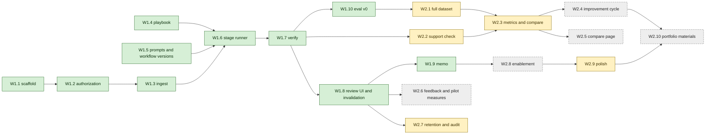

# 7. Delivery plan

**Implementation status.** The plan below was written before any code. Its ten week-one items are
Done; of its ten week-two items 5 are Partly done (W2.1, W2.2, W2.3, W2.7, W2.9) and 5 are Not
started (W2.4, W2.5, W2.6, W2.8, W2.10). Each item's status, with its evidence, follows the table
it belongs to. The hours are the plan's estimates; actual hours were not tracked, so this document
reports no actual effort. **Never run live:** no model has been called, so there is no baseline and
no improvement cycle, and no score, latency or cost of any model exists. The only numbers from a run
anywhere in this folder come from a selftest oracle or a scripted simulated reader and are labelled
so. Departures from the plan are collected under [Implementation deviations](#implementation-deviations),
and the design claims that the code does not satisfy, with a severity each, under
[Known gaps](#known-gaps).

**Last verified, 8 November 2026.** `pnpm lint`, `pnpm typecheck`, `pnpm fixtures:parol --check`,
`pnpm eval --selftest` and `pnpm eval:parol --selftest` each exited 0, and `pnpm exec vitest run`
reported 285 test files and 8,765 tests (8,764 passed and 1 skipped, in the CLI package): 72 files
and 2,741 tests under `packages`, 162 files and 4,961 tests under `apps/parol`, 35 files and 647
tests under `evals`, and 16 files and 416 tests under `apps/cli`. The dataset has 6 of the 26
planned cases (48 rule slots, nine files), the demonstration playbook has 8 rules, and the gates are 14. These counts move with every test added, so run the commands instead of trusting this line.

Two weeks for one engineer. Estimates are focused hours: about 35 planned hours in each 40-hour
week, leaving 5 to 6 hours of buffer. Every item ends with the repository's own checks passing (`pnpm lint && pnpm typecheck &&
pnpm test`), with tests that use scripted models only, as `CONTRIBUTING.md` requires. Live model
calls happen only in the evaluation runner, behind the existing spend guard.

**Deviation.** The last sentence is not true of the code. The application's own runner calls a live
model whenever it is started without `PAROL_SCRIPTED` and with a provider key, and it has no spend
guard: a review is bounded only by its own call count (one extract call and one analyze call for
each rule, plus repairs and client retries), not by a cost limit. Only `pnpm eval:parol` has
`--max-cost`. The reason is that the guard belongs to the Clausewise harness, which the evaluation
runner reuses and the application does not. It is a control the plan promised and the code lacks.

**Week one** delivers the MVP: one matter end to end (intake, run, evidence, decisions,
invalidation, memo) and a first baseline on part of the dev set. **Week two** delivers the
distinctive part: the full dataset, the full metrics, the controlled improvement cycle with a
held-out comparison, and the pilot and portfolio materials.

## Dependencies

Green is Done, yellow is Partly done and dashed grey is Not started, as in the status tables below.
The edges are the plan's; they were not enforced during the build. The modules were built in
parallel against the shared contracts (`apps/parol/src/contracts.ts`, `module-contracts.ts`) and
integrated afterwards, so two edges changed in practice. The evaluation runner and scorer (part of
W2.3) were built before the dataset (W2.1) was complete, which is why the gates have been evaluated
on six development cases only. The default support checker (part of W2.2) was written with the
services that run a review (W1.6), because the runner needs a checker as soon as a workflow version
pins the support prompt.

## Week one: MVP

| Item  | Work                                                                                                                                                                                                              | Depends on       |  Hours | Acceptance criteria                                                                                                                                                                                                                              |
| ----- | ----------------------------------------------------------------------------------------------------------------------------------------------------------------------------------------------------------------- | ---------------- | -----: | ------------------------------------------------------------------------------------------------------------------------------------------------------------------------------------------------------------------------------------------------ |
| W1.1  | Scaffold `apps/parol`: Hono server, `node:sqlite` repository, numbered SQL migrations, demo identity, CSRF tokens, strict CSP, the demo banner                                                                    | none             |      3 | `pnpm parol` serves on 127.0.0.1; refuses another address with demo identity on; migrations create the schema from empty; root checks pass                                                                                                       |
| W1.2  | Authorization middleware, `AuthorizedMatter` branded type, the route-coverage test, the first probe matrix                                                                                                        | W1.1             |      3 | Every probe returns its expected status; removing the middleware from any one route makes the coverage test fail (checked by doing it once)                                                                                                      |
| W1.3  | Matters, documents and versions; upload of DOCX (`parseDocx`) and TXT (new reader producing the same paragraph shape); file and text hashes; duplicate warnings; spans; annotations                               | W1.2             |      5 | Spans of a DOCX and an equivalent TXT segment identically; identical re-upload gives `duplicate_document` and stores nothing; "Section 6.1 of the Agreement is deleted" yields a `cross_reference` (6.1, deletes); a corrupt file stores nothing |
| W1.4  | Optional `version`, `category`, `fallbackLanguage`, `escalateWhen` in `@clausewise/playbook`; `playbooks/parol-nda-recipient.yaml`; import and approve; immutability trigger                                      | none             |    2.5 | The shipped playbooks still pass `shipped.test`; the demo playbook validates; updating an approved version's YAML fails at the database                                                                                                          |
| W1.5  | Prompt registry with hashes; workflow version v1 manifest (prompts P1, retrieval R1, checks C1); export the pure helpers Parol reuses from `@clausewise/review`                                                   | none             |      2 | Changing one character of a prompt changes the workflow version hash; the review package's tests still pass                                                                                                                                      |
| W1.6  | Stage runner; ingest, extract, retrieve (R1) and analyze stages; per-unit persistence by input hash; resume; bounded semantic repair                                                                              | W1.3, W1.4, W1.5 |      5 | A scripted run produces eight findings; a run interrupted after three rules resumes and makes calls only for the other five; an unknown span label triggers one repair, then `output_invalid`                                                    |
| W1.7  | Verify, deterministic checks: `quote_exists`, `span_in_bundle`, `citation_shape`, numeric and jurisdiction consistency, client name, missing confirmation, precedence labels, `escalateWhen` ids, fallback basis  | W1.6             |    3.5 | One unit test per check, passing and failing; a test reproduces the `PAROL-D05` v1 trail and shows every check passing, recording the known gap; an unfound quote is struck through and raises `quote_not_verified`                              |
| W1.8  | Issue table, evidence inspector, decision form; invalidation on any input change; export gate                                                                                                                     | W1.6, W1.7       |    4.5 | All eight findings can be decided; a new amendment version marks every finding and decision stale and blocks export; a decision with an old content hash gets 409                                                                                |
| W1.9  | Memo export with the `docx` library: summary table, sections, open items, rejected appendix, provenance; quotes re-verified at export                                                                             | W1.8             |      3 | The memo contains every decided finding with locations; export with one undecided finding is refused; the file opens in LibreOffice where available (as the Clausewise tests do)                                                                 |
| W1.10 | Evaluation v0: case format and builder with anchor checks; six dev cases (D01, D03, D05, D06, D08, D12); status, flag and citation metrics; a scripted oracle selftest; first live baseline if a key is available | W1.7             |    3.5 | `pnpm eval:parol --selftest` shows a perfect score and fails if one answer key is altered; the live plan prints a cost bound before any call                                                                                                     |
|       | **Week one total**                                                                                                                                                                                                |                  | **35** |                                                                                                                                                                                                                                                  |

**End of week one:** a reviewer can take the worked-example matter from upload to memo, and the
first baseline numbers on six cases exist (or, without a key, the selftest proves the plumbing and
the write-up says no live run happened).

**What the end of week one is today.** The first half holds with a scripted reader: the worked
example goes from upload to an exported memo against the demo's simulated reader
(`apps/parol/test/e2e/worked-example.test.ts`, `apps/parol/test/demo/walkthrough.test.ts`), which is
a table written in advance and not a language model. The second half is the no-key branch: no live
baseline exists, `pnpm eval:parol --selftest` proves the plumbing, and no live run has happened.

### Status of the week-one items

Done means the acceptance criterion above is met by code and a test. Partly done means part of the
item exists. Not started means nothing but a schema or a name exists. The evidence is a file, a test
or a command; commands marked "run by hand" were run while this status was written.

| Item  | Status | Evidence                                                                                                                                                                                                                                                                                                                                                                                                             |
| ----- | ------ | -------------------------------------------------------------------------------------------------------------------------------------------------------------------------------------------------------------------------------------------------------------------------------------------------------------------------------------------------------------------------------------------------------------------- |
| W1.1  | Done   | `PAROL_DEMO_IDENTITY=1 PAROL_SCRIPTED=1 pnpm parol` answers `/healthz` on 127.0.0.1 and a request with a foreign `Host` header with 403; `PAROL_HOST=0.0.0.0` with the demo identity exits 1 before opening the database (run by hand). Tests: `apps/parol/test/server/shell-main.test.ts`, `shell-host.test.ts`, `apps/parol/test/store/db.test.ts` (migrations from empty). `pnpm lint` and `pnpm typecheck` pass. |
| W1.2  | Done   | `apps/parol/src/auth/authorize.ts` is the only file that makes an `AuthorizedMatter`; `test/auth/brand.test.ts` and `brand-typed.test.ts` scan for forgeries; `test/server/shell-routes.test.ts` fails for a matter route registered without the guard (shown on synthetic routes inside the test, not by editing a real route); `test/routes/authorization.test.ts` is the probe matrix over every route.           |
| W1.3  | Done   | `apps/parol/src/ingest/`, `src/services/uploads.ts`. Tests: `test/ingest/parity.test.ts` (DOCX and TXT segment alike), `test/services/uploads.test.ts` (an identical file is stored once), `test/ingest/references.test.ts` ("Section 6.1 of the Agreement is deleted"), `test/ingest/hostile.test.ts` and `test/services/uploads.test.ts` (a file that cannot be read stores nothing).                              |
| W1.4  | Done   | `packages/playbook/test/parol-fields.test.ts`; `apps/parol/test/playbooks/` (shipped and demo playbooks validate); `apps/parol/test/store/playbooks.test.ts` and `triggers.test.ts` (an approved version cannot be updated at the database). The playbook is `apps/parol/playbooks/parol-nda-recipient.yaml`, version 1.0.1.                                                                                         |
| W1.5  | Done   | `apps/parol/src/prompts/registry.ts` and `workflows.ts`; `test/prompts/registry.test.ts` (one changed character of a prompt changes its hash) and `workflows.test.ts`. `@clausewise/review` exports `locateQuote`, `normalizeForAnchor` and `settledStatus`; `pnpm exec vitest run packages` passes (72 files, 2741 tests, run by hand).                                                                             |
| W1.6  | Done   | `apps/parol/src/services/runner.ts` and `src/stages/{extract,retrieve,analyze}.ts`. Tests: `test/services/runs-failures.test.ts` (a failed run resumes and does not ask again for what it has), `test/stages/analyze-repair.test.ts` (one repair, then `output_invalid`), `test/integration/layers.test.ts` (eight findings for the worked example).                                                                 |
| W1.7  | Done   | `apps/parol/src/stages/verify.ts` and `stages/checks/`. Tests: `test/stages/verify*.test.ts`, and `verify-worked-example.test.ts`, whose first case is the `PAROL-D05` v1 trail passing every check while the finding is wrong, labelled "the known gap". Sixteen check ids exist; the list is in [document 3](03-data-model-and-contracts.md).                                                                      |
| W1.8  | Done   | `apps/parol/src/server/pages/run.tsx`, `finding.tsx`; `src/store/repo-matters.ts` (`applyInputChange`). Tests: `test/routes/decision.test.ts`, `test/routes/forged-ids.test.ts` (409 for an old content hash), `test/integration/layers.test.ts` (a changed document makes findings and decisions stale and blocks export).                                                                                          |
| W1.9  | Done   | `apps/parol/src/export/`. Tests: `test/export/gates.test.ts` (export with an undecided finding is refused), `memo.test.ts`, `determinism.test.ts`, `libreoffice.test.ts` (converts the memo where `soffice` is installed, as it is here; Word itself was never available).                                                                                                                                           |
| W1.10 | Done   | `pnpm eval:parol --selftest` (run by hand: status accuracy 48 of 48 for a scripted oracle); `evals/test/parol-run-dataset.test.ts` and `parol-cli-exit.test.ts` alter an answer key, a case file or a hash and expect exit 2; `pnpm eval:parol` without `--yes` prints the plan and a cost upper bound and exits 3 (run by hand). The optional live baseline was not run: no key was available.                      |

## Week two: the evaluation cycle and polish

| Item  | Work                                                                                                                                                                                                                 | Depends on |  Hours | Acceptance criteria                                                                                                                                                |
| ----- | -------------------------------------------------------------------------------------------------------------------------------------------------------------------------------------------------------------------- | ---------- | -----: | ------------------------------------------------------------------------------------------------------------------------------------------------------------------ |
| W2.1  | Remaining 8 dev and 12 held-out cases; canary matters; injection twins; builder prints totals and split hashes; held-out hash committed                                                                              | W1.10      |      6 | The builder's totals match [document 5](05-evaluation.md#totals); every anchor resolves once; the held-out hash is in a commit dated before the first baseline     |
| W2.2  | Support check call with its own prompt and isolated context; the 40-pair calibration set; checker metrics                                                                                                            | W1.7       |    3.5 | The checker sees only the cited spans (asserted on the prompt in a test); calibration metrics are computed and reported, whatever they are                         |
| W2.3  | Full metrics and report: extraction, strict and lenient, SWF, abstention, injection effect, stability, latency, cost (existing usage and price modules), Wilson intervals; pin-checking `compare`; record and replay | W2.1, W2.2 |      5 | Metrics match hand-computed values on a three-case fixture; `compare` refuses runs that differ in an undeclared pin; a replay re-scores without network access     |
| W2.4  | The improvement cycle: dev baseline (k = 3), failure analysis, R2 (or the observed top failure's fix), dev re-run, held-out runs, promotion record                                                                   | W2.3       |      5 | `EXP-001.md` holds the pre-registration, measured tables, the failure record and a recommendation that follows the decision rule, including if H1 is not confirmed |
| W2.5  | Evaluation comparison page (S4)                                                                                                                                                                                      | W2.3       |    2.5 | Shows both versions, every gate, the paired changed slots, and links each to its evidence trail                                                                    |
| W2.6  | Feedback on findings (reason codes, missed issue), post-matter rating, pilot measures page and CSV export                                                                                                            | W1.8       |      3 | Every measure in [document 8](08-pilot-and-enablement.md#measures) is computed from stored events, with its denominator shown                                      |
| W2.7  | Retention job, matter deletion, audit hash-chain verification command                                                                                                                                                | W1.8       |      2 | After deletion no row or file of the matter remains (test scans tables and the folder); altering one audit row makes verification fail                             |
| W2.8  | Seeded training matter, quickstart page, in-app help                                                                                                                                                                 | W1.9       |      2 | A new user can complete the training exercise from the quickstart alone (checked by walking through it)                                                            |
| W2.9  | Polish: keyboard navigation in the table and inspector, contrast, error and empty states, README section, demo seed script                                                                                           | W2.8       |      3 | Every action is reachable by keyboard; every error state has a message that says what to do; `pnpm parol:seed` builds the demo matters                             |
| W2.10 | Portfolio materials: two-minute recording, one-pager, postmortem draft with the measured numbers                                                                                                                     | W2.4, W2.9 |      2 | Every number in the one-pager traces to a results file; claims say whether they rest on the answer keys or on qualified review                                     |
|       | **Week two total**                                                                                                                                                                                                   |            | **34** |                                                                                                                                                                    |

### Status of the week-two items

| Item  | Status      | Evidence                                                                                                                                                                                                                                                                                                                                                                                                                                                                                                                                     |
| ----- | ----------- | -------------------------------------------------------------------------------------------------------------------------------------------------------------------------------------------------------------------------------------------------------------------------------------------------------------------------------------------------------------------------------------------------------------------------------------------------------------------------------------------------------------------------------------------- |
| W2.1  | Partly done | `pnpm fixtures:parol --check` (run by hand) prints the totals table and the split hash: 6 development cases, 48 rule slots, 9 files (the injection twin is one of them), and no held-out column. Written: D01, D03, D05, D06, D08 with its twin, and D12. Not written: 8 development cases, 12 held-out cases, the canary matters and the duplicate-upload cases, so no held-out hash exists to commit. Builder tests: `evals/test/parol-builder.test.ts`, `parol-anchors.test.ts`.                                                          |
| W2.2  | Partly done | Wired, and off. `apps/parol/src/prompts/support-p1.ts` and `src/services/support-checker.ts`; `test/stages/verify-support.test.ts` asserts the checker is shown only the cited spans. Workflow versions v1 and v2 pin `support: null`, so no review runs it. `scoreCalibration` in `evals/src/parol/suites.ts` computes the checker metrics, but the 40-pair calibration set was not written, so G11 is not evaluated.                                                                                                                       |
| W2.3  | Partly done | Built: `evals/src/parol/{score,stats,gates,timing,report,compare}.ts` (the metrics of document 5, Wilson intervals, gates G1 to G14, latency and cost summaries, a pin-checking comparison). Tests: `evals/test/parol-score.test.ts` (a three-case key), `parol-run-compare.test.ts` (a difference in an undeclared pin is refused). Not built: record and replay of model responses, so a run cannot be re-scored offline. Latency and cost have only been exercised by scripted runs, which record no timing and no cost.                  |
| W2.4  | Not started | No live run was made, so there is no baseline, failure record or promotion record. `experiments/EXP-001.md` is a pre-registration draft without a measured table. `pnpm eval:parol --simulate` compares v1 with v2 on the simulated reader (see [document 5](05-evaluation.md#a-dry-run-with-the-simulated-reader)); that demonstrates the machinery and is not the cycle.                                                                                                                                                                   |
| W2.5  | Not started | There is no evaluation page or route. The comparison exists only as the Markdown report of `pnpm eval:parol --compare` (`evals/src/parol/compare.ts`, `report.ts`). Scope cut 1 below applies.                                                                                                                                                                                                                                                                                                                                               |
| W2.6  | Not started | Only the `feedback` table in `apps/parol/migrations/001_init.sql` and the `feedback.add` action in `src/auth/actions.ts` exist. No route, service, page, reason code, rating or measure uses them; a decision's reason is free text.                                                                                                                                                                                                                                                                                                         |
| W2.7  | Partly done | Built as store functions: `deleteMatter`, `listExpiredMatters`, `compact` and `verifyAuditChain` in `apps/parol/src/store/`, and deletion by the matter's creator or an admin in `src/services/matters.ts`. Tests: `test/store/retention.test.ts` (no row of the deleted matter remains), `test/store/audit.test.ts` (an altered row fails verification). Not built: the job that deletes expired matters and any command or page that runs the audit verification. Outside tests, nothing calls `listExpiredMatters` or `verifyAuditChain`. |
| W2.8  | Not started | No seeded training matter T01, no quickstart page, and no in-app help beyond a list of keyboard shortcuts on the review page. `apps/parol/README.md` has the run steps, and `pnpm parol:seed` creates two demonstration matters, neither of which is T01 (see [document 8](08-pilot-and-enablement.md)).                                                                                                                                                                                                                                     |
| W2.9  | Partly done | `pnpm parol:seed` builds the two demo matters (run by hand) and `apps/parol/README.md` is the README section. In the issue table `j`, `k`, Enter and `?` work (`public/parol.js`, `test/pages/script.test.ts`). Contrast is checked numerically in `test/pages/styles.test.ts`, and both themes were rendered in headless Chromium during the build. Not shown: that every action is reachable by keyboard; no test walks the pages by keyboard alone and no accessibility conformance test was run.                                         |
| W2.10 | Not started | No recording, one-pager or postmortem exists, and there are no measured numbers for them to carry. [Document 9](09-portfolio-materials.md) holds the script and the templates only.                                                                                                                                                                                                                                                                                                                                                          |

## What remains for week two

In the order that unblocks the most. None of it has been done, and nothing in it is an estimate of
effort.

1. **The first live run.** It needs a provider key and `--yes`. Run one case first and read its usage
   table; only then run the development split. Until it happens there is no baseline, no cost and
   latency figure, and nothing for the improvement cycle (W2.4) to compare.
2. **The rest of the dataset (W2.1).** Eight more development cases and all 12 held-out cases, the
   canary matters, and the duplicate-upload cases, which need builder extensions. The held-out hash
   must be committed before the first baseline run. Until held-out cases exist `--split heldout`
   stops with "no cases", and G3 on that split needs an injection case in it. G1 and G11 are not
   evaluated in any run today, so no run can reach "promote".
3. **The support check on (W2.2).** A new workflow version that pins `support.p1`, the 40-pair
   calibration set, and G11. Likewise `C2` (the supersession check) is built and is on in no
   registered version; a candidate version has to pin it.
4. **Record and replay (W2.3)**, so a run can be re-scored without the network.
5. **Authorization probes and exposure suites inside the evaluation.** The probe matrix runs in the
   unit suite (`apps/parol/test/routes/authorization.test.ts`); the evaluation has the scoring code
   for G1 but no suite that feeds it.
6. **The comparison page (W2.5)**, feedback on findings and the pilot measures (W2.6), the
   retention job and an audit verification command (W2.7), the training matter, a quickstart page
   and in-app help (W2.8), and the keyboard walk-through (W2.9).
7. **Recording usage in the application.** The application's runner does not record token counts,
   cost or the model the provider says answered: the fields exist and nothing fills them. The
   evaluation runner reads usage and the reported model itself.
8. **The improvement cycle (W2.4), the portfolio materials (W2.10) and a qualified review**, which
   cannot start before item 1.

## Spend

Live evaluation runs use the Clausewise spend guard: the plan is printed first, nothing is sent
without `--yes`, and a per-request cap holds the run to `--max-cost`. For scale, the bound in
`evals/README.md` for each of Clausewise's two NDA fixtures is 46,181 and 48,581 input tokens for 10
calls. That is an upper bound for a different tool and playbook, not a Parol figure. The
plan assumed roughly 15 Parol calls per case (one extract, eight analyze, up to eight support
checks, fewer when a rule needs none). With the support check off in v1 and v2, the runner's own
plan counts 9 calls per case (one extract and eight analyze), 63 calls for the six development cases
and the injection twin at one repeat, and 119 if every rule needed its repair call (`pnpm eval:parol`
without `--yes`, run by hand). Those are counts of calls and not a cost. The plan also prints a cost
upper bound from the prices in `evals/prices.json`, which have not been checked against a live price
list, and for the whole development split that bound is above the default `--max-cost`, so the plan
exits 3 and asks for a higher limit. Nothing about cost has been measured: run one case first and
read its usage table before running a split. The application has no spend guard (see the deviation
at the top).

## Scope cuts, in order

If the plan slips, cut from the top. Each cut says what is lost so the write-up can say it too.

| #   | Cut                                                                   | What is lost                                                            |
| --- | --------------------------------------------------------------------- | ----------------------------------------------------------------------- |
| 1   | Comparison page (W2.5); keep the Markdown report                      | A visual; the numbers remain                                            |
| 2   | Rule-level carry-forward of findings on playbook change               | Convenience only; full invalidation stays                               |
| 3   | Pilot measures page (W2.6); keep feedback capture and a CSV script    | A dashboard; the measures remain computable                             |
| 4   | Model support check (W2.2); keep the deterministic consistency checks | The independent substantive check; G5 and G11 reported as not evaluated |
| 5   | Held-out set from 12 to 8 cases                                       | Statistical power; the report states the smaller denominators           |
| 6   | Held-out repeats from 3 to 2                                          | Stability evidence; never below 2                                       |

**Never cut:** authorization and its probe tests, quote verification, the export gate,
invalidation, the separation of dev and held-out sets, pinning, and honest reporting of whatever the
runs show.

**Where the plan stands against the cuts.** Cut 1 has been taken: there is no comparison page, only
the Markdown report. Cut 3 has been taken further than the plan allowed, because feedback capture
is not built either, so the pilot measures cannot be computed from stored events yet. Cut 4 is half
taken: the support check is built and isolated but off in both workflow versions. **Deviation.** The
cut says G5 would then be reported as not evaluated. G5 is scored from the answer keys and not from
the support checker, so it is still evaluated with the check off; only G11 is not evaluated. Cuts 5
and 6 do not apply yet, because no held-out case exists. None of the "never cut" items was cut:
authorization with its probe tests, quote verification, the export gate, invalidation, pinning and
the held-out seal are built and tested; the held-out set itself is empty.

## Risks

| Risk                                                            | Effect                                    | Response                                                                                                     |
| --------------------------------------------------------------- | ----------------------------------------- | ------------------------------------------------------------------------------------------------------------ |
| No API key or budget                                            | The improvement cycle has no real numbers | Ship the selftest and the protocol; say plainly that no live run happened                                    |
| H1 does not reproduce                                           | The planned story changes                 | The protocol picks the top observed failure; report H1 as not confirmed                                      |
| Writing 26 good synthetic cases takes longer                    | W2.1 overruns                             | Case templates per phenomenon; cut 5 if needed                                                               |
| `node:sqlite` changes behaviour (it is experimental)            | Store breaks on a Node update             | The repository module isolates it; `better-sqlite3` is the fallback; pin the Node minor in CI                |
| A model returns valid quotes that the anchor normaliser rejects | Many false `quote_not_verified`           | The metric separates model citation validity from displayed validity; inspect before changing the normaliser |
| Word unavailable to check the memo                              | Formatting surprises                      | LibreOffice check, as Clausewise does; state the limit                                                       |

**What happened to the risks.** No API key: this happened, and the plan's response was followed, so
the selftest exists and the write-up says no live run happened. H1 (that the baseline fails on the
amendment) has not been tested on a model; the simulated reader shows the retrieval gap by
construction and says nothing about whether a real model fails the same way. Writing 26 cases: 6 of
them were written. `node:sqlite` is in use and prints its experimental warning at every start; the
store sits behind `apps/parol/src/store/`, as planned. The repository's CI
(`.github/workflows/ci.yml`) runs lint, typecheck and every test, Parol's included, on Node 22, but
pins only the major version, so the plan's "pin the Node minor" response was not carried out. The
anchor normaliser and a live model have never met.
Word was never available; the memo is converted by LibreOffice in `test/export/libreoffice.test.ts`
where `soffice` is installed.

## Definition of done

Status against each line, today:

- The worked example runs end to end in the app, and the memo exports. **Met with a scripted
  reader.** The simulated reader (a table, not a language model) reads the worked example, and the
  whole path from upload to the memo runs in `apps/parol/test/e2e/worked-example.test.ts` and on a
  real socket in `apps/parol/test/demo/walkthrough.test.ts`. Nothing a language model wrote has been
  through it.
- `EXP-001.md` contains pre-registered hypotheses, measured tables for both versions on dev and
  held-out, the failure record, and a recommendation that follows the decision rule. **Not met.**
  There are no measured tables, because there is no live run and no held-out cases.
- All gates are reported with counts, intervals and pass or fail, including failures. **Built, not
  met.** The runner reports every gate with its counts and Wilson interval, and marks the gates it
  cannot evaluate as such. The only reports so far are of a selftest oracle and of the simulated
  reader.
- The README says what was measured, on what, and what was not. **Met** by `apps/parol/README.md`,
  which says that no score was measured, and by this folder's status paragraphs.

## Known gaps

The design claims that the built system does not satisfy, in one place, each with a severity. They
were found by the documentation writers and verified here against the code, or by the three attack
reviews of the build. The severity is this document's own judgement and not a measurement. **High**:
a control the design relied on is absent or can be bypassed, or a claim the project exists to make
cannot be made. **Medium**: a control or a measure is weaker than the design said, and a reader of a
result must know. **Low**: an edge, a demonstration limit or a cosmetic mismatch. None of these gaps
is hidden elsewhere: each is also stated where it matters, in the document named in the last column.
Nothing below was small and safe enough to fix without changing what a number means, which is why
they are listed and not fixed; the ones that were small have been fixed (see the end of this section).

| #   | Gap                                                                                                                                                                                                                                                                                              | Severity | Described in                                                                                     |
| --- | ------------------------------------------------------------------------------------------------------------------------------------------------------------------------------------------------------------------------------------------------------------------------------------------------ | -------- | ------------------------------------------------------------------------------------------------ |
| 1   | No live model has ever been called, so there is no baseline, no improvement cycle and no score, latency or cost for any model. Every result in this folder comes from a selftest oracle or a scripted simulated reader                                                                           | High     | [5](05-evaluation.md#the-runner), [EXP-001](experiments/EXP-001.md)                              |
| 2   | The held-out set (12 cases) and 8 of the 14 development cases are not written, so `EXP-001` cannot be frozen, no held-out hash exists and `--split heldout` stops with "no cases"                                                                                                                | High     | [5](05-evaluation.md#dataset)                                                                    |
| 3   | The model support check is wired but pinned by neither registered workflow, and its 40-pair calibration set is not written: every finding reads "Support not checked", and G11 is never evaluated                                                                                                | High     | [3](03-data-model-and-contracts.md#quotation-validity-versus-substantive-support)                |
| 4   | Gate G1 (unauthorized-data exposure) has no input: the authorization matrix is an application test and the canary matters do not exist. G1 and G11 are never evaluated, and the decision rule needs every gate evaluated, so it cannot reach "promote"                                           | High     | [5](05-evaluation.md#supplementary-suites)                                                       |
| 5   | The application's own model calls have no spend guard; only `pnpm eval:parol` has `--max-cost`. A review through the server is bounded by its call count, not by a cost                                                                                                                          | High     | [7](#spend), [6](06-access-and-governance.md#run-provenance)                                     |
| 6   | Statuses are not settled in code against required and absence rules: `settledStatus` is called by no stage. Only `not_applicable` on a required rule, or from a selection, is escalated; `missing` for the optional rule `ret-1` is not corrected                                                | Medium   | [3](03-data-model-and-contracts.md#deterministic-checks-and-model-judgment)                      |
| 7   | The `parties` check passes when the client's name is in any span of the bundle, and for a whole-document bundle that is any occurrence (a signature block, say); its page label says "in the parties passage"                                                                                    | Medium   | [3](03-data-model-and-contracts.md#deterministic-checks-and-model-judgment)                      |
| 8   | `defined_term` finds a term no span defines, and not a term defined twice in different ways; its label "Defined terms are defined once" says more than it checks                                                                                                                                 | Low      | [3](03-data-model-and-contracts.md#deterministic-checks-and-model-judgment)                      |
| 9   | Precedence rules 3 (an amendment that disagrees without an express reference) and 4 (inconsistent passages in one document) are only in the analysis prompt. A model that fails to report such a conflict is not corrected                                                                       | Medium   | [3](03-data-model-and-contracts.md#retrieval-boundaries-and-provenance)                          |
| 10  | The supersession check (check set C2) is built and enabled by no registered workflow, so the worked example's v1 gap passes verification. The candidate that would pin it (v3) is not registered                                                                                                 | Medium   | [4](04-worked-example.md)                                                                        |
| 11  | A run does not record the model the provider reported, nor token counts or cost (the columns exist and stay empty), because the generator returns only the parsed answer; the memo says "not reported". Provenance does not show which model snapshot answered                                   | Medium   | [6](06-access-and-governance.md#run-provenance)                                                  |
| 12  | The evaluation runner composes the stage functions itself and does not call the application's run engine; a later change to `services/runner.ts` does not reach the evaluation unless two tests (rule concurrency, a layers test) notice. It writes a results file and never the `eval_*` tables | Medium   | [2](02-experience-and-architecture.md#architecture)                                              |
| 13  | A quote that occurs more than once in its paragraph is valid for the application and shown with a note, but the scorer counts it as displayed and not verified, so it can fail G2 and G5 and lower strict recall for a valid quote                                                               | Medium   | [5](05-evaluation.md#metrics)                                                                    |
| 14  | The held-out seal is a warning and a contamination note, not a lock, and the ledger records only live runs. Record and replay of model responses is not built, so a scoring change means running the cases again                                                                                 | Medium   | [5](05-evaluation.md#the-runner)                                                                 |
| 15  | The `AuthorizedMatter` brand guards the service layer and not the store, the run engine or the memo builder, so a module that imported them directly would compile without authorization. Matter-id-first store methods and database triggers contain it                                         | Medium   | [6](06-access-and-governance.md#authorization)                                                   |
| 16  | Approval of a playbook and promotion of a workflow have no route or page, and the store accepts any existing user as the actor; the demo admin approves the playbook at start-up                                                                                                                 | Medium   | [6](06-access-and-governance.md#authorization)                                                   |
| 17  | Nothing deletes an expired matter (`listExpiredMatters` is called by no application code), and nothing verifies the audit hash chain (`verifyAuditChain` is called only by tests)                                                                                                                | Medium   | [6](06-access-and-governance.md#retention-and-deletion)                                          |
| 18  | How a real model treats hostile document text is unobserved. The `instruction_like_text` check flags a finding that cites a flagged paragraph; a model that follows such a paragraph and cites a genuine clause is flagged only in the warnings                                                  | Medium   | [6](06-access-and-governance.md#documents-are-data)                                              |
| 19  | Removing a document deletes the evidence rows that earlier, stale findings cited from it (19 evidence rows became 17 on a copy of the seeded database), so a superseded finding no longer shows every passage it cited                                                                           | Medium   | [3](03-data-model-and-contracts.md#invalidation)                                                 |
| 20  | Pilot tooling is not built: feedback capture, the pilot measures, the training matter T01 and the quickstart page; the comparison page S4 is a command-line report only                                                                                                                          | Medium   | [8](08-pilot-and-enablement.md), [2](02-experience-and-architecture.md)                          |
| 21  | Keyboard reachability of every action and accessibility conformance were not tested; the memo was converted by LibreOffice and never opened in Word                                                                                                                                              | Low      | [7](#status-of-the-week-two-items)                                                               |
| 22  | An ambiguous quote has no offsets, so the inspector cannot highlight it; the design highlighted each place                                                                                                                                                                                       | Low      | [3](03-data-model-and-contracts.md#quotation-validity-versus-substantive-support)                |
| 23  | Evaluation latency is timed from the start of extract to the end of verify and not from queued to succeeded; cost per run exists only for the Anthropic provider; G13's absolute budget has no command-line option                                                                               | Low      | [5](05-evaluation.md#metrics)                                                                    |
| 24  | The homoglyph table covers only the letters of `contract` and the `c` of a header, and the hidden-text rule reads direct run formatting only (a colour set by a style, near-white greys and sizes between 2 and 5 points are not caught)                                                         | Low      | [6](06-access-and-governance.md#documents-are-data)                                              |
| 25  | A Word file of about 97 KB with 15,000 one-line paragraphs held the single-threaded server for a few seconds in an attack review (not re-measured here); there is no rate limit and no paragraph cap beyond the parser's limits                                                                  | Low      | [6](06-access-and-governance.md#deferred-until-production)                                       |
| 26  | Sign-out revocation is kept in memory, so a copied cookie works again after a restart with a fixed `PAROL_COOKIE_SECRET`; the demo identity is not authentication                                                                                                                                | Low      | [6](06-access-and-governance.md#demo-identity)                                                   |
| 27  | A refusal that the parser reports after the application has sent response headers is not logged, and the memo marked "Earlier review" on the pages keeps its JSON status `current`                                                                                                               | Low      | [6](06-access-and-governance.md#demo-identity), [3](03-data-model-and-contracts.md#invalidation) |
| 28  | The retry that settles a run whose end cannot be written has no upper bound, and a second reviewer cannot override the first reviewer's decision (they must wait for a change or a re-run)                                                                                                       | Low      | [6](06-access-and-governance.md#recovery-from-partial-failures)                                  |
| 29  | CI pins Node 22 and not a minor version, and the "removing the guard from a real route fails the coverage test" criterion of W1.2 was shown on synthetic routes only                                                                                                                             | Low      | [7](#risks)                                                                                      |

**Fixed in this round, because they were small, safe and covered by a test:** the demonstration
playbook test now compares the hint-topics column of the rules table in document 3 as well as the
other five columns (it compared five and failed when the sixth was added); the stale comment in
`evals/src/parol/timing.ts` that said no run produces latency records; and the comment in
`apps/parol/src/store/repo-runs.ts` that said an interrupted run returns its matter to `ready`.

## Implementation deviations

Where the build departs from the plan on purpose, with the reason in one sentence. The departures
are discussed in context in documents [2](02-experience-and-architecture.md),
[3](03-data-model-and-contracts.md), [5](05-evaluation.md) and [6](06-access-and-governance.md);
this is the consolidated list, grouped by area. A departure that makes a control weaker than the
design said is called out as such, and is also reported in document 6.

### Names, paths and commands

- **Paths.** The playbook is `apps/parol/playbooks/parol-nda-recipient.yaml`, not
  `playbooks/parol-nda-recipient.yaml`: it is Parol's own, and the server finds it from the app's
  folder whatever the working directory. The dataset is in `fixtures/parol/`, the evaluation code in
  `evals/src/parol/`, and the builder is `tools/make-parol-fixtures.ts` (`pnpm fixtures:parol`).
- **Commands.** `pnpm parol`, `pnpm parol:seed`, `pnpm eval:parol` and `pnpm fixtures:parol` are
  root scripts. The first two pass `--tsconfig apps/parol/tsconfig.json`, because `tsx` run from the
  root has no JSX settings and the first page render fails without them.
- **Labels.** The labels the model sees are `c1`, `c2` and so on, numbered across D1, D2 and D3 in
  order. They are not stored (`source_spans` has no such column) and are rebuilt from the stored
  spans whenever a run starts or resumes (`apps/parol/src/store/model-labels.ts`). Check details
  name a passage by a label such as `D1-p19` and a position in the finding, never by span id or by
  text. Case keys are `PAROL-D05`, and the injection twin of a case is `PAROL-D08-twin`.
- **Versions.** The prompts are `extract.p1`, `analyze.p1` and `support.p1`. The workflow versions
  are `v1` (retrieval R1) and `v2` (R2); both use check set C1 and pin no support prompt.
- **Demo users.** The names are the store's: `Alex Ruiz (associate)`, `Dana Whitfield (reviewing
attorney)`, `Lee Okafor (legal engineer)` and `Sam Patel (admin)`. There is one demo associate, so
  the second seeded matter belongs to the legal engineer.

### Dependencies and packages

- **Dependencies of `apps/parol`:** `hono`, `@hono/node-server`, `docx`, `jszip`, `tsx` and `zod`
  (reasons in the stack table of document 2). `jszip` began as a dev dependency and is now a
  dependency, because the memo module imports it at run time to make the file reproducible. The
  forgery scan in `test/auth/brand-scan.ts` imports `typescript`, a root dev dependency that the app
  does not declare. No dependency was added to the other packages.
- **`@clausewise/playbook`** gained the four optional fields the plan names and a fifth,
  `hintTopics`, because two rules share a category (see the playbook entry below).
- **`@clausewise/review`** exports `locateQuote`, `normalizeForAnchor` and `settledStatus`. Clause
  reference resolution was not exported, so Parol has its own (`src/ingest/references.ts`,
  `src/stages/clause-refs.ts`). `settledStatus` is exported and no Parol stage calls it, so a status
  is not settled in code against `required` and absence rules; see
  [document 3](03-data-model-and-contracts.md#deterministic-checks-and-model-judgment). This is a
  weaker control than the plan said.
- **TXT reading** is in `apps/parol/src/ingest/txt.ts`, not in a package. It copies the typed-number
  rules of `segment`, which the package keeps private, and `test/ingest/parity.test.ts` cuts the same
  text both ways to catch drift.

### Store

- **Three migrations, not one.** `001_init.sql` is the schema of document 3. `002_integrity.sql`
  adds what the design left out: the inputs digest (`matters.current_inputs_sha256`,
  `runs.inputs_sha256`), `findings.conflict` and `abstain_reason`, the orderings a finding's content
  hash depends on, unique indexes, and triggers that make evidence, findings, decisions, memos,
  prompts, workflow manifests and approved playbooks immutable and keep every row inside its own
  matter. `003_ingest_warnings.sql` adds the 25th table, `ingest_warnings`, because upload warnings
  had no table. `002` was edited in place after review, which changed its checksum, so a database
  made by the first build would refuse to open; none was ever released. `matters.current_manifest_sha256`
  from 001 is never written.
- **Deletion order.** A matter's rows go in one transaction, then its files, then the database is
  compacted (`secure_delete` is on, then `VACUUM`). Document 6 had the files first. The reason is
  that a stop between the two steps then leaves a folder that no row names, which the sweep at start
  removes (`FileStore.sweepOrphans`), and not rows that name a missing file.
- **State machines** have edges the diagrams did not draw: matter `running` to `stale`, `ready` to
  `draft`, `review_complete` back to `in_review`, and `in_review` or `review_complete` to `deleted`;
  run `failed` to `queued` (resume) and cancel from any active state (`src/store/states.ts`). A
  review that ends without results returns the matter to `ready` only when it has no findings from
  an earlier review; otherwise it stays `stale`, so that the decisions that no longer count are not
  hidden behind a `ready` matter.
- **Audit** has actions beyond the plan's list: `matter.update`, `matter.status`, `document.remove`,
  `version.stated_date`, `prompt.register` and `workflow.register`.
- **Errors carry no ids or caller text** (`NotFoundError` takes an entity kind only; the active run's
  id is a field, not part of the message), so a log line or an error page cannot repeat them.
- **Evaluation tables** (`eval_datasets`, `eval_runs`, `eval_slot_results`) exist and have a store
  API, but the runner writes JSON results files and uses none of them.
- **Near-duplicate re-saves** use an added `keepOperative` option, so a file with the same text and
  a different hash is stored unused and does not make the review stale, as document 3 says. The
  store used to clear the old operative flag whatever the caller said.

### Playbook and hint topics

- **Version 1.0.1, not 1.0.0.** The seeded playbook text changed after the design: the wording of
  several rules (`def-1`, `pds-1`, `dur-1` and `ret-1`) and `hintTopics` on `pds-1` and `pds-2`.
  An approved version is immutable, so changed text is a new version. The answer keys pin the
  playbook hash, and the runner refuses a playbook with another hash. The copy of the playbook in
  [document 4](04-worked-example.md) is the one that follows the code, not the 1.0.0 text.
- **Hint topics.** `pds-1` and `pds-2` share the category `permitted-disclosures`, which the design
  assumed one rule to a category would avoid. Keyword hints therefore carry a `topic`, and a rule
  names the topics that count for it (`hintTopics`, optional, so existing playbooks still load). A
  rule whose category holds more than one rule reads the whole document in retrieval, so that
  `missing` can be confirmed. `hintTopics` is optional in the type, so the compiler cannot catch a
  mapper that drops it; `test/integration/hint-topics-runner.test.ts` is the guard.

### Ingest, retrieval and the stages

- **Ingest runs at upload, not in the run.** Spans, annotations and warnings are stored when a file
  is uploaded, for every version including an unused one, and the run's ingest stage reads them
  back. A resumed run therefore never parses a file.
- **Amendment targets** are matched by the clause number or the number in its heading
  (`src/stages/clause-refs.ts`), shared by retrieval and verification, because an NDA that writes
  "2. TERM" over an unnumbered body paragraph otherwise hides the deleting amendment.
- **A coverage line** in the analysis prompt says whether the model sees the whole document or a
  selection, so that "not shown" is not read as "not present".
- **Repairs and budget.** One repair call at most, then `output_invalid`; a bundle over budget makes
  no call and becomes `undetermined` with `context_over_budget`.
- **Support check.** A default implementation is in `src/services/support-checker.ts`, written with
  the services because none existed; it runs only when a workflow pins `support.p1`.

### Verification

- **Sixteen check ids**, not the shorter list of the plan: `evidence_set`, `defined_term`,
  `instruction_like_text`, `model_abstained`, `status_forced` and `superseded_evidence` are additions
  (document 3 lists them). `instruction_like_text` was added after an attack review: a quote from a
  paragraph that reads like an instruction to software verifies like any other quote, so a cited
  passage in such a paragraph now escalates the finding. A `not_applicable` answer on a required
  rule, or from a selection, is also escalated by `citation_shape`, and a missing or unreadable stated
  date on either side of a superseded label is now a conflict and no longer accepted as later.
- **Known gaps** that the plan did not have: the `parties` check passes when the client's name
  appears anywhere in the bundle, not only in the parties passage; `defined_term` does not find a
  term defined twice; precedence rules 3 and 4 of document 3 are only in the prompt; a figure that
  only the rule's own text states is accepted. Document 3 records each of them. These are weaker
  than the plan said.
- **Evidence handling.** Evidence that cites a span the run does not have is removed from the
  finding and raises `quote_not_verified`; a quote that occurs more than once is valid but has no
  offsets, so the inspector does not highlight it.

### Services and runs

- **Order of authorization.** A person who is not a member, a missing matter and a deleted matter
  all get the same 404; only a member whose role may not act gets 403.
- **Removal and order.** Documents are removed last first, and an amendment is not accepted before
  the NDA, because the store labels documents D1 to D3 by position.
- **Resume** is refused (409) when the configured provider or model is not the one the run began
  with, because the run's provenance and the disclosure of where its text went would otherwise be
  untrue. Cancel uses the `run.start` permission, since the action table has no cancel action.
- **Workflow choice.** A run takes an optional `workflow` label; without one it uses the latest
  version promoted to pilot, else `v1`. The matter page shows a picker when more than one version is
  registered.
- **Segregation** is decided from the run's own row: whoever started a review may not decide it
  unless `PAROL_RELAXED_SEGREGATION` is on, and the memo says so only when it happened.
- **Boot.** Registration of prompts, workflows and the demo playbook is idempotent at every start;
  a run left in flight becomes `failed` with `interrupted`; the demo users are seeded whether or not
  the demo identity is on, because they import and approve the demo playbook.

### Routes and pages

- **The issue table row** is a summary (`IssueRow`) and the evidence, discrepancy, explanation and
  fallback are on the finding resource, so a table of eight rows does not carry every passage.
- **Extra routes:** `GET /api/session` (a script has no other way to learn its CSRF token), the list
  of a matter's runs, `POST .../runs/:runId/cancel`, `DELETE .../documents/:documentId`, and a run
  status route the page polls. `POST /api/demo/session` became `POST /session` and
  `POST /session/end`.
- **Not built:** routes for spans, feedback, playbook import and approval, workflow promotion and
  evaluations. `PATCH /api/matters/:id` takes one kind of change per request.
- **Upload status.** An identical file answers 200, not 201, with the `duplicate_document` warning,
  and stores nothing. If it arrives with a stated date different from the stored one, it is refused
  with 409 `duplicate_stated_date` and the date is not applied, because the version may not be the
  governing one.
- **Notices** that a page shows after a redirect carry a signed `nt` parameter, so a link cannot
  forge one. A refused form (a decision or an upload) is answered with its own page, the status and
  an error notice, and a refused decision keeps what the reviewer typed unless the finding has
  changed under them.
- **Pages** are server-rendered JSX with one script of under 250 lines; no front-end framework.
  Control characters and direction marks in document text are shown as visible markers.

### Controls added that the plan did not list

- **A host guard.** With the demo identity on, a request whose address or `Host` header is not
  `localhost`, `127.0.0.1` or `[::1]` gets 403, which closes DNS rebinding that would otherwise hand
  the passwordless demo to any web page. `PAROL_HOST` is also checked at start.
- **Sign-out revocation** is kept in memory, so a copied session cookie stops working at sign-out
  but works again after a restart with a fixed `PAROL_COOKIE_SECRET`.
- **A CSP that grants only what is used** (no images, no fonts), `Permissions-Policy`,
  `X-Frame-Options`, `Cache-Control: no-store`, and a body cap of 64 KiB on public writes and 128 KiB
  on JSON.
- **Mass assignment** is refused: an extra key in a JSON body is a 400, and a decision is always the
  signed-in reviewer's whatever reviewer a request names.
- **Stand-in banners.** Pages and the memo's provenance appendix say when the reader was a scripted
  stand-in (`apps/parol/src/stand-in.ts`).
- **Refusals below the application.** A request Node's parser rejects, one with no `Host`, one with
  a `Transfer-Encoding` that does not end in `chunked`, and one whose address has a user part get a
  short page with the security headers and one access line (`src/server/middleware/rejected.ts`).
- **One server per data folder.** An exclusive lock on `parol.lock` (`src/boot/instance-lock.ts`)
  stops a second `pnpm parol` from marking the first one's runs interrupted.
- **Settling a run.** When the database cannot be written at the end of a run, the runner tries again
  until it can, so the run is not left `analyzing` with nothing executing.
- **Decisions.** A second reviewer cannot overwrite the first reviewer's decision (409
  `decision_conflict`); exporting the same decisions again returns the memo on record and does not
  supersede it with an identical copy.
- **Stale and earlier memos.** A memo whose review a newer run replaced is labelled "Earlier review"
  on the pages, and downloads under a name that marks it superseded once it is.

### Memo

- **Open items** also lists an accepted or edited finding whose conclusion is `undetermined`, which
  the plan did not say, because the memo would otherwise state no conclusion for that rule and not
  say so. A reviewer's change of an evidence role reaches the memo.
- **Document warnings.** When an upload raised warnings (unread content, tracked changes read as
  accepted, a paragraph that reads like an instruction to software, no text), the memo prints a
  section for them before the open items, with counts and locations and no document text, and the
  open items point to it.
- **Rejected findings** show a decision line and a pointer to the appendix, which gives the
  reviewer's reason and the status the workflow proposed, and nothing of the finding's text.
- **Reproducible file.** The memo's timestamps are rewritten to the export date, so two exports of
  one memo have the same hash. Quotations are cut at 1,500 characters.

### Evaluation

- **The runner composes the stage functions itself** and does not use the store or the queue; a
  layers test compares it with the application's runner on the development cases, but nothing makes
  a later change to `services/runner.ts` reach the evaluation.
- **Every run checks integrity first** (not only the selftest) and exits 2 on a mismatch; a playbook
  with a different hash is refused, because a playbook change is a new dataset version.
- **Gates have three outcomes**, pass, fail and not evaluated; a gate with no input is not a pass,
  and "promote" needs all 14 to pass, so the runner cannot reach it today (G1 and G11 have no
  input). The decision rule is applied only to two live runs of the whole held-out split.
- **The spend check** counts a repair call for every rule, so the whole development split no longer
  starts under the default `--max-cost`.
- **The model as reported** is read by the runner from the provider's responses and pinned, but that
  path has only met scripted generators and a loopback server, never a real provider.
- **Held-out seal.** `--allow-heldout` and a ledger of held-out runs exist; the seal is a note, not a
  lock, and the split is empty.

### The simulated reader and the seed

- **`PAROL_SCRIPTED=1` runs a simulated reader** (`apps/parol/src/demo`), a table written in
  advance that answers only the worked example and declines every other document, and any edited
  paragraph of that one. It is labelled as a stand-in everywhere it appears. Under workflow v1 it
  gets `ret-1` wrong as well as `dur-1`, which is the other face of the same retrieval gap.
- **The seed** creates two matters through the services, not by inserting rows, and runs reviews
  only with `--run`.
